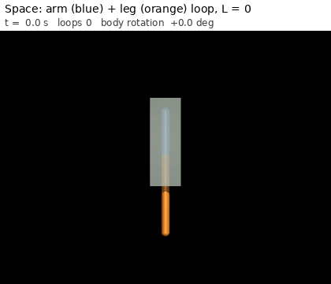
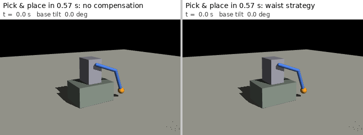
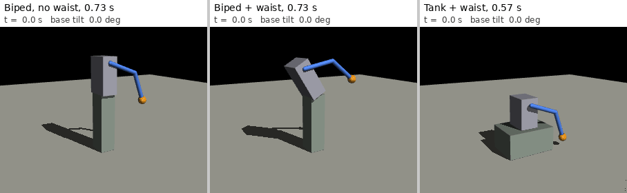
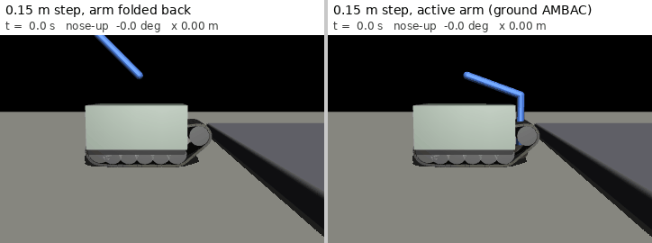
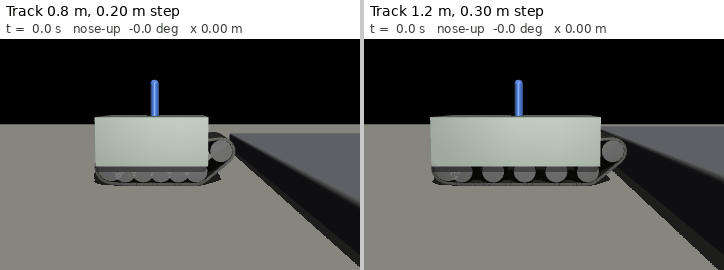
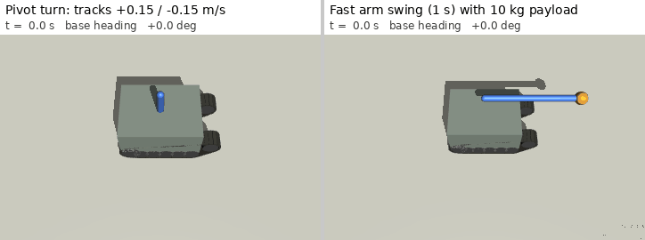

# simulation_AMBAC

AMBAC やロボット系のアニメ・ゲームを出発点に、
**「二足歩行は本当にバランスが良いのか？　なぜ人は二本脚なのか？」** を、
剛体力学・幾何力学・制御理論・機械学習で真面目に検討するリポジトリ。

AMBAC（Active Mass Balance Auto Control）は『機動戦士ガンダム』で提唱された、
手足の質量移動の反作用で姿勢を制御する考え方である。

> 新しい環境で再開するときは、まず [RESUME.md](RESUME.md)（再開用メモ）を読む。

## 目的

> **高価なフィジカル AI のハードウェアに対して、安価なコンピュータシミュレーションモデルとして、
> ガンダムから生まれた空想科学（AMBAC）が、どこまで真実に迫れるのか。**

- **第 1 段階**（完了）: 形状（機体の構成）と、それが姿勢制御・安定性・移動能力に与える意味を議論する。
- **第 2 段階**（これから）: 組み合わせた形状について、最適な動作の校正値を定義し、要求した動きや性能を実現できるかを検証する。

**技術報告書（PDF）**: [87 ページ版](report/AMBAC_technical_report.pdf) ／ [詳細版 159 ページ](report/AMBAC_technical_report_detailed.pdf)（LaTeX ソースは `report/`）

ストーリーの詳細、スコープ、前提は [00. 目的・ストーリー・スコープ](docs/00_purpose.md) を参照。
各章で参照した資料は、各章の末尾と [参考文献一覧](docs/references.md) にまとめている。

## ストーリーと章立て

### 導入：二足歩行は本当にバランスが良いのか？

答えを先に書くと、**静的には二足歩行のバランスは悪い**。
それでも人が二本脚で立てるのは、**動かせる重い上体による能動的なバランス**（腰の戦略＝地上版 AMBAC）と、
**人間の大きさでの段差への強さ** があるからである。
条件次第で形状の優位は入れ替わるので、**用途や目的に応じて形状を合わせる必要がある**（AC シリーズのアセンブルのように）。

### 第 1 段階：形状と、それが与える意味

#### 1. AMBAC の物理（宇宙）

| 章 | 内容 |
|---|---|
| [01. 理論的準備：角運動量保存と AMBAC](docs/01_theory_angular_momentum.md) | 基本式 θ̇ = −Γ(q)·q̇、幾何学的位相 |
| [02. 平面モデルの結果](docs/02_sim_results_planar.md) | 腕 1 本の往復（Sim01）、腕＋脚のループ（Sim02） |
| [03. リアクションホイールとの統一的理解](docs/03_rw_vs_ambac.md) | RW は AMBAC の特殊な場合、運動量飽和（Sim03） |
| [04. 順動力学・トルク・スケーリング則](docs/04_dynamics_scaling.md) | 必要トルク、二乗三乗則、スラスタとの比較（Sim04） |
| [05. 学習による発見と統合制御](docs/05_physical_ai.md) | 学習は AMBAC を発見できるか、最適制御との分担（Sim05） |

#### 2. 下半身の形状（地上）：二本脚・戦車・脚の価値

| 章 | 内容 |
|---|---|
| [06. 地上を動く機体：戦車型台車＋腕](docs/06_ground_tank.md) | 腕の反作用による転倒・滑り、フルード則（Sim06） |
| [09. 「足なんて飾り」は本当か](docs/09_legs.md) | 宇宙での脚の AMBAC 効果、二本脚と戦車型の安定性、腰の戦略（Sim09） |
| [10. 段差の乗り越え：戦車型 vs 二本脚](docs/10_steps.md) | 人間大では脚が有利、大型化で逆転（Sim10） |

#### 3. 上半身、特に肩と肩甲骨：フィジカル AI に必要なスペックとトレードオフ

| 章 | 内容 |
|---|---|
| [07. 3 次元化：球面座標の肩と SO(3)](docs/07_spatial_3d.md) | 肩の円錐運動、回転の非可換性、ジンバルロック、定格荷重マップ（Sim07） |
| [08. 肩の 3 次元運動：AMBAC から人体工学へ](docs/08_shoulder_human.md) | コッドマンのパラドックス、腕組みに必要な機構（Sim08） |

### 第 2 段階：校正値を使った実現性の検証（これから）

組み合わせた形状（アセンブル）ごとに最適な動作の校正値を定義し、要求した動きや性能を実現できるかを検証する。
構想は [00. 目的・ストーリー・スコープ](docs/00_purpose.md#第-2-段階校正値を使った実現性の検証) を参照。

第 1 段階の振り返りの中で、PC 上に「試験場」と「ステージ」を用意して機体を試すシミュレーション場の構想が生まれ、実現方法の検討を始めた（途中経過）：
[11. シミュレーション場の構想と実現方法の検討](docs/11_simulation_field_plan.md)

### シミュレーション場の動画（GIF）

主な場面を MuJoCo で描画した動画（`sims/field_gifs.py` で作成。数値は各段階の結果と同じ条件）。

| 宇宙：腕と脚のループで向きを変える（段階 1） | 荷物運び：補正なし vs 腰の補正（段階 6） |
|---|---|
|  |  |

二本脚（腰なし / 腰あり）と戦車型＋腰（段階 9）



| 履帯で 0.15 m の段差：腕を後ろ vs 能動の腕（段階 10） | 短い履帯で 0.20 m vs 長い履帯で 0.30 m（段階 10） |
|---|---|
|  |  |

その場旋回と、腕を速く振ると車体が回る様子（段階 11）



## 主な知見（第 1 段階）

### 導入の問いへの答え
- **二足歩行は静的にはバランスが悪い。** 足裏の支持範囲が狭く重心が高いので、10 kg の荷物を腕の先で持つだけで、静止していても転倒する（Sim09）。
- **それでも立てるのは、上体を動かす能動的なバランスがあるから。** 上体を前後に傾ける腰の戦略（地上版 AMBAC）で、同じ荷物を運べるようになる（Sim09）。
- **人間大では段差に強い。** 二本脚は戦車型の 2 倍以上の段差（0.60 m 対 0.25 m）を越える。ただし大型化すると二乗三乗則で逆転し、18 m 級の脚は 5 cm の段差しか越えられない（Sim10）。**脚の利点は人間大で最も大きい。**

### 1. AMBAC の物理
- AMBAC の基本式は θ̇ = −Γ(q)·q̇（L=0）。回転角は **関節の経路だけ** で決まり、速度にもスケールにも依存しない（Sim01）。
- 関節 1 つでは姿勢は可逆的にしか動かせない。**関節 2 つ以上の周期運動で任意角度の回転が可能**（幾何学的位相）。1 周あたりの回転量 ＝ ループが囲む曲率の面積分（Sim02）。
- リアクションホイールは「曲率ゼロ・連続回転できる関節」で、AMBAC の特殊な場合。AMBAC が回転を止められないことと RW の運動量飽和は同一の現象（Sim03）。
- 二乗三乗則：必要トルクは s⁵、使えるトルクは s³ で増えるため、AMBAC の速さは 1/s で落ちる。18 m 級で 90° 旋回に約 2 分（Sim04）。
- 学習は AMBAC を発見できる。ただし「振動子でループを描く」構造が必要で、構造なしでは失敗する（ループの効果は振幅の 2 次で、勾配が消える）。計画は最適制御、実行時の誤差・外乱への対処は学習が得意（Sim05）。

### 2. 下半身の形状
- 地上では、腕の反作用による転倒が速さを制限し、安全な最短動作時間は √(大きさ/重力) に比例する（フルード則）。荷物を体に引き寄せる軌道で 36% 短縮できた（Sim06）。
- 摩擦があると、関節 1 つの往復でも台車が回る（スティックスリップ）。月面では腕の作業が機体の向きを大きく乱す（Sim06）。
- 「足なんて飾り」は用途で答えが変わる。宇宙では脚は AMBAC で最も効く重い肢（外すと姿勢変更能力がほぼ半減）。ただし推進剤を惜しまなければ脚は飾りになる。地上の平地作業では戦車型＋腰が最も速く安定。段差では人間大の脚が有利（Sim09, 10）。

### 3. 上半身（肩と肩甲骨）
- 2 自由度の肩 1 つで、腕を円錐状に回すだけで任意の姿勢に回れる。ただし 3 次元の回転は非可換で、動作の順序を入れ替えると最終姿勢が 29° 変わる。球面座標の肩は極の近くで関節速度が発散する（ジンバルロック）（Sim07）。
- 地上では接地面の狭い横方向が最も弱い（最大荷重は前後の約 6 割）。腕を下げる旋回で 52% 短縮（Sim07）。
- 人の肩のコッドマンのパラドックスは、AMBAC と同じ幾何学的位相（上腕のひねり＝腕の向きが囲んだ立体角）（Sim08）。
- 腕組みには、ひねりを含む 3 自由度の肩と、肩甲骨（上肢帯）による肩の付け根の移動が必要。2 軸の肩では不可能で、胸が厚い機体ほど肩甲骨の動きが必須になる（Sim08）。

## 構成

```
docs/      理論・考察ノート（00: 目的とストーリー, 01〜10: 各章, references: 参考文献一覧）
src/ambac/ モデル（ライブラリ）
sims/      シミュレーションスクリプト（実行すると data/ と figures/ を生成）
data/      シミュレーション出力（CSV / NPZ / 数値まとめ）
figures/   図
notebooks/ （予定）対話的に試すノートブック
tools/     補助スクリプト（references.py: 参考文献、report_tables.py: 報告書の表と数値出力の記録）
report/    技術報告書（LaTeX ソースと PDF）
```

## 実行方法

デスクトップ（ローカル）で準備する場合は [docs/LOCAL_SETUP.md](docs/LOCAL_SETUP.md)（必要なソフト・ライブラリの一覧と手順）を参照。

```bash
pip install -r requirements.txt
```

```bash
cd sims
```

```bash
python sim01_single_arm.py
python sim02_cyclic_gait.py
python sim03_rw_vs_ambac.py        # 約30秒（Sim04, 05 が使う最適ループを保存）
python sim04_dynamics_scaling.py
python sim05a_learn_ambac.py       # 学習あり, 約5分
python sim05b_allocation.py        # 学習済み方策を再利用（再学習は RETRAIN=1, 約12分）
python sim06_ground_tank.py
python sim07_spatial.py
python sim08_shoulder.py
python sim09_legs.py
python sim10_steps.py              # 約3分
python detail_figures.py           # 詳細版の追加図（約2分）
# シミュレーション場（pip install -r requirements-field.txt、画面なしなら MUJOCO_GL=osmesa）
python field01_space.py            # field02〜11 も同様（05: 性能表・校正データ・Excel、06: 腰の戦略 約30分、07: モーターの定格、08: 段差・坂の走行、09: 二本脚 約15分、10: 正確な履帯 4 並列で約20分、11: 旋回 約8分）
```

## ロードマップ

### 第 1 段階：形状と意味（完了）
- [x] AMBAC の物理：幾何学的位相、リアクションホイール、スケーリング、学習と最適制御（Sim01〜05）
- [x] 下半身の形状：戦車型の転倒・滑り、「足は飾り」、段差（Sim06, 09, 10）
- [x] 上半身：3 次元の肩、ジンバルロック、コッドマンのパラドックス、腕組み（Sim07, 08）

### 第 2 段階：校正値を使った実現性の検証
- [x] シミュレーション場（MuJoCo の試験場・ステージ・試験メニュー）の構築と、第 1 段階との照合（[docs/11](docs/11_simulation_field_plan.md)）
- [x] 機体を組み立てて評価をまとめて実行し、性能表を出す仕組み（アセンブル）
- [ ] 校正値の定義（慣性パラメータ、摩擦、可動域、アクチュエータ特性、人の動きのデータ）
- [x] AMBAC ループを使った慣性パラメータの自己同定（仮想の実機で誤差 2% 前後）
- [x] 腰の戦略・肘の補正の動作計画を、組み立てた機体で最適化（荷物運びを最大 65% 短縮）
- [x] 二本脚の機体と戦車型を、同じ試験で比較（二本脚は腰なしでは運べない。腰ありでも戦車型より約 3 割遅い）
- [x] 板をつないだ履帯の正確なモデルで段差・坂を検証（長い履帯で 2 倍の 0.30 m。荷物は前方の低い位置に）
- [x] 左右 2 本の履帯の旋回（スキッドステア）を基準モデルと照合（差 0〜11%）。長い履帯は旋回に約 1.6 倍の力が要る
- [ ] 要求した動き・性能（例：腕組み、段差、旋回時間）を満たすかの検証とチューニング（段差・坂の走行は試作）
- [x] アクチュエータの簡易モデル（トルク・速度の上限）と、必要なモーターの定格
- [ ] アクチュエータ動特性（油圧・電動の遅れなど）
- [ ] 人体運動データ（モーションキャプチャー）を手本とした動作生成と、物理的な実現可能性の両立

### 残っている個別の課題
- [ ] 周回内の揺れを抑える AMBAC ループの最適化、弾性要素による回生
- [ ] 最適制御の計画＋学習した残差方策のハイブリッド制御
- [ ] 走行中の腕の作業、学習方策への転倒制約の導入
- [ ] 3 次元での目標姿勢への最短到達（動作系列の計画・学習）、肘を加えた冗長な腕
- [ ] 踏み出し（ステップ戦略）、動的な乗り越え、不整地、股関節を含む全身モデル
- [ ] 宇宙ロボット（反動零空間制御など）・実機事例との比較
