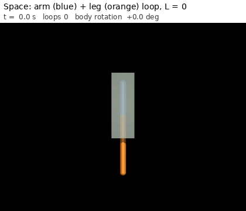
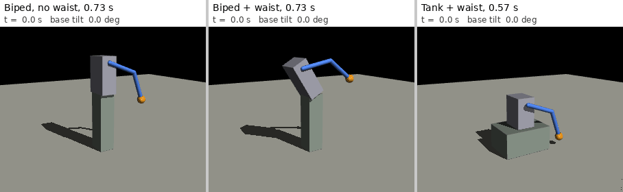
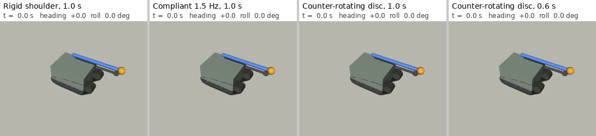

:::message
この記事は全体の入口（Overview）です。やってみたことの中身は[次の記事](https://zenn.dev/)（TODO: 公開後にリンク）に、数式・誤差評価・失敗の記録は[本](https://zenn.dev/)（TODO: 公開後にリンク）にまとめています。コードと数値はすべて [GitHub](https://github.com/okamasaya/simulation_AMBAC) で公開しています。
:::

## 概要

フィジカル AI（身体を持って実世界で動く AI）の開発には、高価な実機、シミュレーションと実機のずれ（sim-to-real ギャップ）、物理を知らない学習の探索の難しさ、実機の校正、という壁があります。
この記事のシリーズでは、**実機も、GPU を前提とする高精細なシミュレーターも持たない**条件で、**普通の PC の CPU だけで動く安価なシミュレーション**がこれらの壁のどこまでに答えられるかを、『機動戦士ガンダム』の **AMBAC**（Active Mass Balance Auto Control：手足を振った反動で姿勢を変える）を試験台にして確かめました。

分かったことは 3 つです。

1. **AMBAC は物理的に成立します。** 角運動量が保存される宇宙でも、手足を「輪を描くように」動かせば胴体を好きな角度まで回せます（幾何学的位相）。ただし二乗三乗則のため、18 m 級の機体では 90° 回るのに約 2 分かかります。
2. **学習は AMBAC を発見できますが、構造が必要です。** 報酬だけを与えた方策は手足を端まで振って止まる局所解に落ちました。「輪を描く振動子」という形を与えると、理論上界の 98% に達し、人手で設計した制御を上回りました。
3. **答えを隠した「仮想の実機」で、校正の手順を実機の前に設計できます。** 胴体の揺れの波形だけから、隠した手足の質量と慣性を 1 回あたり約 1.2% のばらつきで当てられました。そして途中で見えた「約 2% の誤差」の正体は、推定法ではなく**仮想の実機自身の積分法（1 次）**でした。積分法を RK4 にすると、雑音のない条件での誤差は 0.08% 未満になりました。

安いシミュレーションは実機の代わりにはなりません。しかし、**実機に何を持ち込むべきか（学習に与える構造、学習と制御の分担、測るべき校正値）を先に決める道具**にはなる、というのがこのシリーズの主張です。
そして次は、本物の剛体（1 m のアルミ棒）と iPhone 2 台の IMU で、自作シミュレーターが現実に合うかを確かめに行きます（番外編）。

*宇宙の試験場：腕と脚で輪を描くと、外から何も押していないのに胴体が少しずつ回っていく（MuJoCo で描画）*

---

## 導入

### AMBAC とは何か

AMBAC は、『機動戦士ガンダム』（1979 年）の作品世界を支える SF 考証として、1981 年のムック『ガンダムセンチュリー』で示されたとされる概念です。
モビルスーツが人型をしている理由の一つとして、「宇宙空間では、推進剤を使わずに、手足を振った反動で機体の向きを変えられる」という説明が与えられました。

これは作り話ではありません。外から力を受けない物体は角運動量が保存されるので、腕を右に振れば胴体は左に回ります。
宇宙飛行士が手足の動きで体の向きを変えられることは 1970 年に Kane と Scher が研究しており、同じ二人は「落下する猫が空中で身をひねって足から着地する」仕組みも説明しています。
2025 年には、宇宙飛行士の大西卓哉さんが国際宇宙ステーションで脚を使った姿勢制御に AMBAC の名を挙げ、ガンダムファンの間で話題になりました。

ただ、ここで素朴な疑問が湧きます。

- 腕を振れば胴体は逆に回る。でも**腕を戻したら、胴体も元に戻ってしまう**のでは？
- 人間なら回れるとして、**18 m の巨大ロボ**でも同じように回れるのか？
- 地上で同じことをしたら、**転ぶのでは**？
- 劇中の台詞「足なんて飾りです」は、本当なのか？

### この検証の出発点の問い

このリポジトリは、AMBAC やロボット系のアニメ・ゲームを出発点に、もう一つの問いを立てました。

> **二足歩行は本当にバランスが良いのか？ なぜ人は二本脚なのか？**

アニメでは人型の機体が当たり前のように二本脚で立って戦います。しかし、足裏という狭い支持範囲の上に高い重心を載せる二本脚は、静的に考えると明らかに不安定です。
それでも人は二本脚で立ち、荷物を運び、段差を上ります。その理由を、剛体力学・幾何力学・制御理論・機械学習の言葉で、真面目に確かめてみることにしました。

先に答えを書いておくと、**静的には、二足歩行のバランスは悪い**です。10 kg の荷物を腕の先で持つだけで、静止していても転倒します。
それでも立てるのは、**動かせる重い上体による能動的なバランス**（腰を反らせたり前に傾けたりする「腰の戦略」、いわば地上版の AMBAC）と、**人間の大きさでの段差への強さ**があるからです。
そして、宇宙・平地・段差、人間大・巨大機と条件を変えると、どの形が有利かは入れ替わります。**用途に応じて形を選ぶ**（『アーマード・コア』のアセンブルのように）必要がある、というのが第 1 段階の結論でした。

### なぜ「AMBAC」を試験台にするのか

もう一つの動機は、もっと現実的なものです。

フィジカル AI、つまりロボットのように身体を持って実世界で動く AI の開発には、よく知られた壁があります。

| 壁 | 中身 |
|---|---|
| 実機が高価 | 試行錯誤のたびに壊すリスクと時間がかかる |
| sim-to-real ギャップ | シミュレーションで学習した方策が、実機で動かない |
| 探索と構造 | 報酬だけを与えた学習は、物理の構造を知らないので局所解に落ちやすい |
| 校正（システム同定） | 質量・慣性・摩擦・モーターの特性など、シミュレーションと実機の差を埋める値を、どの試験で、どの精度で測るか |

大規模な GPU シミュレーションは、このうち sim-to-real ギャップを力業で解く有力な道です。しかし、計算資源を持たない個人には手が届きません。
筆者も**実物のロボットを 1 台も持っておらず、最新世代の GPU もありません**。すべての計算は普通の PC（とクラウドの CPU）で行いました。

そこで、問いを逆にしました。

> **CPU だけで動く安価なシミュレーションは、フィジカル AI の課題のうち何に答えられ、何に答えられないか。**

この問いの試験台として、AMBAC はとても都合が良いのです。

- **基本式が 1 本**です。外から力を受けない機体では、胴体の向き θ と関節角 q の間に、θ̇ = −Γ(q)·q̇ という関係だけが成り立ちます。
- **答えが別に計算できます。** 最適なループの形や、可動域の中での理論上の上限を、学習とは独立に求められます。学習や校正の結果を「答え合わせ」できます。
- **学習にとって本質的に難しい**性質を含みます。正味の回転は動きの「順序と組み合わせ」からしか生まれない（非ホロノミック系）ので、素直な学習ではうまくいきません。

つまり AMBAC は、**ガンダムファンにとってのロマン**であると同時に、**フィジカル AI の手法を答え合わせできる、小さくて正直な試験台**でもあります。
このシリーズでは、技術の話を背骨にして、AMBAC とガンダムは「なぜそれを確かめたいのか」を語る場面で登場してもらいます。

### 筆者の立場と、このシリーズの姿勢

本業の研究としてではなく、個人の検証です。だからこそ、次の 2 つを大事にしました。

- **誤差を評価する。** 結果の数値には、統計誤差（試行ごとのばらつき）・計算誤差（数値計算の精度）・系統誤差（仮定や装置の癖による偏り）を分けて付けます。素粒子実験の流儀です。後発が存在感を出すには、科学的に正しく、他の人がやっていないことをするしかない、と考えています。
- **失敗を記録する。** うまくいった結果だけでなく、うまくいかなかった試みとその理由を残します。先行研究と同じ形で失敗していれば、それは自分の仮説やロジックが同じ道筋をたどっている証拠になり、追いつくための足場になるからです。

---

## やってみたこと（要約）

詳しくは[次の記事](https://zenn.dev/)（TODO）と本にまとめています。ここでは全体の流れだけ書きます。

### 第 1 段階：形と、それが持つ意味（Python、Sim01〜10）

剛体のリンクでできた簡単なモデルを Python で書き、宇宙と地上で、機体の形が姿勢制御・安定性・移動能力に与える意味を調べました。

- **AMBAC の物理**：腕 1 本の往復では、胴体は −16.04° 回ったあと元に戻ります（可逆）。腕と脚の 2 つの関節でループを描くと、1 周ごとに +2.98° ずつ回り、これはループが囲む「曲率」の面積分（ストークスの定理）と一致しました。リアクションホイールは AMBAC の特殊な場合で、AMBAC が回転を止められないことと、ホイールの運動量飽和は同じ現象でした。
- **巨大ロボの壁**：必要なトルクは大きさの 5 乗、相似に大きくしたモーターが出せるトルクは 3 乗で増えるので、AMBAC の速さは大きさに反比例して落ちます。
- **学習**：「輪を描く振動子」の構造を与えた方策だけが成功しました。
- **地上**：腕を速く動かすと反作用で台車が転び、安全な最短時間は √(大きさ/重力) に比例しました（フルード則）。人間大の二本脚は戦車型の 2 倍以上の段差を越えますが、18 m 級では逆転します。
- **3 次元の肩**：人の肩の「コッドマンのパラドックス」は、AMBAC と同じ幾何学的位相でした。腕組みには、ひねりを含む 3 自由度の肩と肩甲骨が必要でした。

### 第 2 段階：シミュレーション場で、組み合わせた形を確かめる（MuJoCo、段階 1〜17）

PC の中に「試験場」と「ステージ」を作り（格闘ゲームの練習モードのようなもの）、物理エンジン MuJoCo で、部品表（JSON）から機体を組み立てて動かしました。

*二本脚は腰がないと荷物を運べない。腰があっても、同じ腰を持つ戦車型の方が約 3 割速い*

- **シミュレーター自体の照合**：まず第 1 段階の Python の式と MuJoCo を突き合わせ、腕の往復で −16.0356° 対 −16.0356°、ループ 1 周で +2.963° 対 +2.970° と一致することを確かめてから先へ進みました。
- **車体を乱すのは、腕を「止めるとき」**：地上では、足元の摩擦が車体を回し始めるトルクまでは腕の反作用を吸収します。境目を超えさせていたのは、位置サーボの遅れが生む急ブレーキでした。
- **地上版 AMBAC**：摩擦の非対称性を使えば、腕を「速く振ってゆっくり戻す」だけで車体の向きを変えられました。
- **機能を分ける**：動かすのはモーター、止める・保持するのは MR 流体のブレーキ、と分けると、速さ・精度・省エネ・電源なしの保持が同時に良くなりました。作品世界の「マグネットコーティング」や「ムーバブルフレーム」と同じ順番をたどっているように見えるのが、個人的には一番グッときたところです（これは示唆にとどめます）。

*硬い肩 / しなり / 逆回転するおもり：止めるときの反作用が、足元の摩擦の境目を超えると車体が回る*

### 校正：答えを隠した仮想の実機と、誤差の評価

実機がないので、**質量や慣性をこっそりずらした「仮想の実機」**を作り、正解を推定する側に隠しました。ジャイロとエンコーダを雑音込みで模擬して、胴体の揺れの波形から隠した値を当てる、という練習です。

最初は「誤差約 2%」という結果でした。ところが 5 回の試行がすべてプラス側にそろっていたことに気づき、統計・計算・系統に分けて評価し直すと、

- 雑音をすべて除いても +1.2〜1.8% の偏りが残り、
- その偏りは MuJoCo の時間刻みに比例し、
- 原因は、部品表から組み立てた仮想の実機が使っていた **1 次の積分法（implicitfast）が、角運動量 L = 0 をわずかに破っていた**こと

だと分かりました。積分法を RK4 にすると、雑音のない条件での誤差は 0.08% 未満、50 回の試行で偏りは有意でなくなりました（1 回あたりのばらつき 1.2〜1.4%）。
一方、絶対値は総質量の仮定に 1:1 で引きずられる（±2% の仮定なら ±2% の系統誤差）ことも分かりました。

さらに、素粒子実験の **kinematic fit**（物理の拘束条件のもとで、測定値そのものを当てはめ直す方法）を校正に持ち込みました。推定ごとの誤差 σ が正しく見積もられ（pull が平均 0、標準偏差 1）、ループを 1 本ずつ加える逐次更新で σ が 1.8% → 1.0% と縮みました。
ただし、積分法の系統誤差は χ² には現れませんでした。**当てはまりの良さは、系統誤差がないことを保証しない**、というのも収穫です。

---

## 現在地

- **第 1 段階（形と意味）は完了**し、87 ページと 159 ページの技術報告書にまとめました。
- **第 2 段階（シミュレーション場）は段階 1〜17 まで進み**、校正の誤差評価と kinematic fit による校正を試作しました。
- AI 研究者向けのレター論文（日本語、2 段組、約 5 ページ）と、SF 考証のムック風の記事も書きました。
- **まだ現実とは一度も照合していません。** 数値の多くは、仮定した部品の値に基づきます。

## 今後

- **番外編：本物の剛体と IMU で、自作シミュレーターを確かめる。** 1 m のアルミアングル（20×20×2.0 t、約 204 g）に iPhone SE（第 3 世代）を 2 台取り付け、phyphox で加速度とジャイロを記録します。振り子の周期から慣性モーメントを求め、回したときに「2 台の角速度が等しく、向心加速度が回転軸からの距離に比例する」ことを、シミュレーターの予測と比べます。
- **校正を地上の機体へ広げる**：kinematic fit に、サーボの遅れ・摩擦の校正値を加えます。総質量の計量や関節トルクなど、推定しにくい方向を外から決める情報を拘束として入れます。
- **学習と最適制御の分担を実装する**：計画は最適制御、実行時の補正は学習方策、というハイブリッドな制御です。
- **誰でも使えるシミュレーターにする**：いずれは、部品表から機体を組み立てて試験できるこのシミュレーターを、PyPI のパッケージとして公開してみたいと考えています。

---

## このシリーズの読み方

| 読みたいこと | 行き先 |
|---|---|
| 何をやって、何が分かったのか（結果と図） | 記事「やってみたこと・現在地・今後」（TODO: リンク） |
| 数式、誤差評価、失敗の記録まで全部 | 本「AMBAC を CPU で確かめる」（TODO: リンク） |
| 本物の剛体と iPhone で確かめる | 番外編（TODO: リンク） |
| コード、数値、技術報告書 | [GitHub: okamasaya/simulation_AMBAC](https://github.com/okamasaya/simulation_AMBAC) |

ファンが真剣に考察してきた SF の設定は、検証できる仮説の宝庫です。計算はすべて公開しているので、間違いを見つけたら、ぜひ教えてください。

## 参考文献

- 『機動戦士ガンダム』（テレビアニメ, 1979 年, 日本サンライズ）
- 『ガンダムセンチュリー』（みのり書房, 1981 年）。AMBAC の概念が SF 考証として示されたとされる資料
- T. R. Kane and M. P. Scher, "Human self-rotation by means of limb movements," *J. Biomechanics*, 3(1), 39–49, 1970.
- T. R. Kane and M. P. Scher, "A dynamical explanation of the falling cat phenomenon," *Int. J. Solids and Structures*, 5(7), 663–670, 1969.
- E. Todorov, T. Erez, Y. Tassa, "MuJoCo: A physics engine for model-based control," *IROS*, 2012.
- 大西卓哉さんの AMBAC への言及を紹介した記事：https://www.oricon.co.jp/news/2385521/full/
