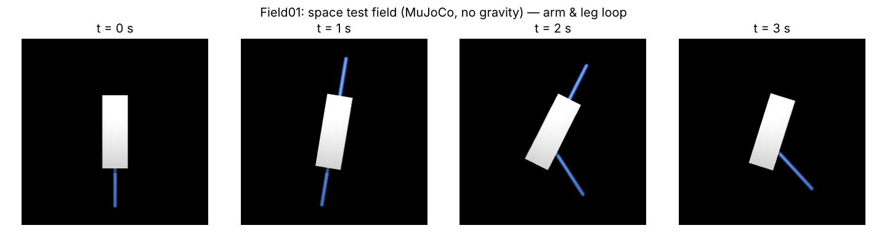
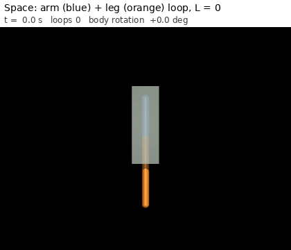
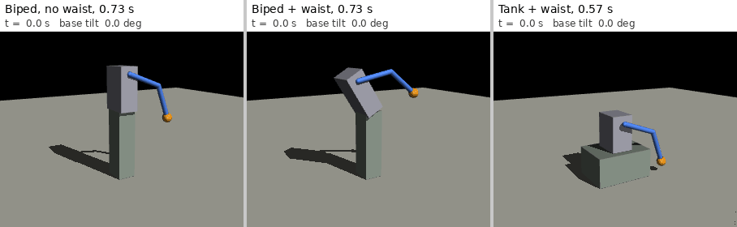
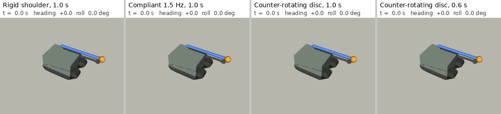
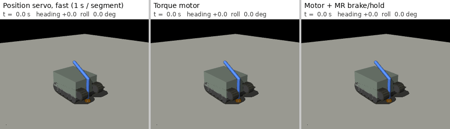

:::message
有志のファンによる非公式の SF 考証です。作品の公式な設定や見解とは関係ありません。技術的な詳細は、[入口の記事](https://zenn.dev/)（TODO: 公開後にリンク）と[本](https://zenn.dev/)（TODO）にまとめています。計算はすべて [GitHub](https://github.com/okamasaya/simulation_AMBAC) で公開しています。
:::

手足を振って宇宙で向きを変える。重い足を持って地上に立つ。関節にマグネットコーティングを施し、内部の骨格に動きを任せる。

『機動戦士ガンダム』（1979 年）とその続編を支えてきた SF 設定は、放映から半世紀近く、多くのファンに真剣に考察されてきました。その末席に連なる一ファンとして、中心にある **AMBAC**（Active Mass Balance Auto Control）を、物理の式と物理エンジンを使って、手元のパソコンだけで本気で試してみました。

結論を先に書くと、**AMBAC は物理的に成立します**。そして、機体を速くしようとすると、次に問題になるのは**「止め方」**でした。それは、作品世界の技術が歩んだ順番とよく似ていました。

## AMBAC とは何か

AMBAC は、劇中の台詞ではなく、1981 年のムック『ガンダムセンチュリー』で SF 考証として示されたとされる概念です。宇宙には、押し返してくれる地面も空気もありません。それでもモビルスーツが手足を振って向きを変えられるのはなぜか。その答えが、「手足を動かした反作用で胴体を回す」という AMBAC でした。

荒唐無稽に聞こえるかもしれませんが、これは実際に起きます。背中から落とされた猫が空中で体をひねって足から着地するのも、宇宙飛行士が何もつかまずに体の向きを変えられるのも、同じ原理です。近年では、国際宇宙ステーションに滞在した宇宙飛行士の大西卓哉さんが、脚を使った姿勢の制御を AMBAC になぞらえて紹介し、ファンの間で話題になりました。

ただし、「成立する」ことと「劇中のように使える」ことは別の話です。ファンとしては、ここで止まるわけにはいきません。この記事では、次の 4 つの問いを順に確かめます。

1. AMBAC で、本当に好きな向きに回れるのか。
2. 18 メートルの巨体でも使えるのか。
3. 「足なんて飾り」は本当か。
4. 機体を速く動かすと、次に何が問題になるのか。

## 手足を振れば、本当に回れるのか

**腕を振っても、戻せば元どおり。** 宇宙に浮かんだ人型のモデルで、腕を 1 本だけ前に振ると、胴体は反対向きに回ります。ところが、腕を元に戻すと胴体も元の向きに戻ってしまいます。外から力が働かない限り、体全体の「回る勢い」（角運動量）は 0 のままだからです。これでは、首を振っているのと変わりません。

**2 本を「ずらして」回すと、少しずつ回る。** そこで、腕と脚の 2 つの関節を、少しずらして動かします。腕を上げる、脚を上げる、腕を下ろす、脚を下ろす、というように、2 つの関節の角度が「輪（ループ）」を描くように動かすのです。すると、元の姿勢に戻ったときに、胴体の向きだけが少しずれて残ります。人間大のモデルでは、1 周あたり約 3° でした。これを繰り返せば、どんな向きにでも回れます。

**回る角度は「速さ」ではなく「形」で決まる。** 面白いのは、1 周でどれだけ回るかが、手足を動かす速さに関係なく、輪の形と大きさだけで決まることです。ゆっくり回しても、速く回しても、1 周で回る角度は同じです。物理学では「幾何学的位相」と呼ばれ、落下する猫の問題として研究されてきました。ずれの大きさは、輪が囲んだ「面積」（正確には、場所ごとの効きやすさを掛けて足し合わせたもの）で決まります。

**物理エンジンでも同じ答え。** この計算を、ロボット研究で使われる物理エンジン MuJoCo でも確かめました。腕 1 本の往復では −16.04°、腕と脚の輪 1 周では約 +2.97° で、手で書いた計算と小数点以下まで一致しました。

*物理エンジンの中の「宇宙の試験場」。胴体に腕と脚が付いた人型のモデルが、輪を描きながら向きを変えていく（0〜3 秒）*

:::message
**判定：AMBAC は物理的に成立する。** 手足で輪を描けば、推進剤なしで好きな向きに回れる。
:::

:::details コラム：人工衛星の「はずみ車」も AMBAC の仲間
人工衛星は、内部の円盤（リアクションホイール）を回して、その反作用で向きを変えます。これは「どこまでも回し続けられる関節」を持った AMBAC だと考えると、同じ式で説明できます。手足は可動域で止まってしまうので輪を描く必要がありますが、円盤はぐるぐる回し続けられるので輪が要りません。その代わり、円盤の回転には上限があり、上限に達すると推進剤で「勢いを捨てる」必要があります。AMBAC は、宇宙機の技術の延長線上にあります。
:::

## 18 メートルの壁

では、全高 18 メートル級の機体で AMBAC は使えるのか。人間大のモデルをそのまま 10 倍に拡大（同じ密度で、重さは 1000 倍の約 76 トン）して計算しました。

**回る角度は変わらない、でも遅くなる。** 輪 1 周で回る角度は、大きさによらず同じです。問題は速さです。長さが 10 倍になると、手足を同じ速さで振るのに必要な力（トルク）は 10 万倍（大きさの 5 乗）になります。一方、同じ技術のモーターを相似に大きくしても、出せるトルクは 1000 倍（3 乗）にしかなりません。いわゆる「二乗三乗則」です。

| 機体の大きさ（全高） | 0.9 m | 1.8 m | 18 m | 36 m |
|---|---|---|---|---|
| AMBAC だけで 90° 向きを変える時間 | 6.6 秒 | 13 秒 | **132 秒** | 263 秒 |

*モーターを相似に大きくした場合。時間は機体の大きさに比例して延びる*

人間大なら十数秒で済む 90° の旋回が、18 メートル級では 2 分以上かかります。劇中のように数秒で機敏に向きを変えるには、相似に大きくしたモーターの約 170 倍、つまり**今のモーターより 2 桁以上強い「筋肉」**が必要です。逆に言えば、小さいほど AMBAC は速い。猫が一瞬で体をひねれるのは、この法則の「小さい側」にいるからです。

**スラスターとの役割分担。** 化学燃料のスラスターなら、90° を 10 秒で回るのに推進剤は約 44 kg で済みます。AMBAC は推進剤を使わない代わりに遅い。素早い旋回はスラスターに任せ、ゆっくりした向きの調整や、推進剤を節約したい場面では AMBAC を使う。これが物理的に筋の通った使い方です。推進剤が尽きた、あるいは排気で位置を知られたくない、といった状況では、AMBAC の「推進剤ゼロ」は決定的な利点になります。

:::message
**判定：巨大機でも AMBAC は使えるが、遅い。** 劇中の機敏さには、2 桁上の性能の関節が要る。
:::

## 「足なんて飾り」は本当か

ファンなら一度は口にしたことのある台詞があります。脚のない機体について、整備兵が「あんなの飾りです」と言う場面です。これが広まる過程で「足なんて飾りです」の形で知られるようになりました。では物理的に、脚は飾りなのか。答えは「場面による」でした。

**宇宙では、脚は飾りではない。** 脚は腕より重く長いので、AMBAC では最も効く「重い手足」になります。同じ総重量で比べると、脚を外した機体は、1 周で稼げる回転が約 4 割減りました（9.6° → 5.7°）。逆に、推進剤タンクや装甲を脚に集めると、AMBAC はさらに強くなります（12.9°）。皮肉なことに、台詞が語られた宇宙こそ、脚が最も役に立つ場面でした。ただし、推進剤を惜しまずに使い切ってよい短時間の戦闘なら、スラスターだけで済むので、「飾り」という判定にも理があります。

**地上の平地では、ほぼ飾り。** 二本脚で立つ機体は、足裏の支える範囲が狭く、重心が高い。計算では、10 kg の荷物を腕の先で持つだけで、止まっていても前に倒れました。それでも人間が二本脚で荷物を持てるのは、**重い上体を後ろに反らせて釣り合いを取る**からです。上体を動かして腕の反作用を打ち消すこの動きは、いわば「地上版の AMBAC」です。最適化の計算に任せると、人が重い物を持つときと同じ「反ってから前に傾く」動きを、自力で見つけ出しました。ただし、同じ上体を戦車型の台車に載せると、さらに速く、安定して運べました。

*二本脚（腰なし / 腰あり）と戦車型＋腰。腰なしの二本脚は荷物を上げたところで倒れる*

**段差では、人間大なら脚が強い。** 人間大の二本脚は、戦車型の 2 倍以上の段差を越えられます。ところが、ここでも二乗三乗則が効きます。18 メートル級に拡大すると逆転し、相似に大きくしたモーターの脚では、わずか 5 cm の段差しか越えられませんでした。

| 場面 | 判定 | 理由 |
|---|---|---|
| 宇宙 | **飾りではない** | 脚は AMBAC で最も効く重い手足 |
| 宇宙・短時間の戦闘 | 飾り | 推進剤を使い切ってよいならスラスターで足りる |
| 地上・平地 | ほぼ飾り | 戦車型＋動く上体の方が速く安定 |
| 地上・段差（人間大） | **飾りではない** | 戦車型の 2 倍以上の段差を越える |
| 地上・段差（18 m 級） | 飾り | 二乗三乗則で 5 cm しか越えられない |

:::message
**判定：「足は飾りか」は用途で決まる。** だから、用途に合わせて下半身の形を選ぶ設計に意味がある。
:::

## 速くすると、次は「止め方」

ここからは、現在進めている「第 2 段階」の話です。パソコンの中に「試験場」と「ステージ」を作り、部品表から機体を組み立てて動かします。対戦ゲームの練習モードで、組み替えた機体を試すようなイメージです。

試験の機体は、左右 2 本の履帯の台車に、10 kg の荷物を持った腕を付けたもの。腕を 1 秒で 180° 振ると、台車ごと約 16° 回ってしまいました。地上では、腕の反作用を足元の摩擦が受け止めてくれます。ところが、反作用がある「境目」を超えると、その分だけ車体が回ったり滑ったりします。

**車体が回るのは、腕を「止めるとき」だった。** 詳しく調べると、腕を振り出すときの反作用は境目の内側に収まっていました。境目を超えたのは、腕を**止めるとき**です。腕を目標の位置に合わせる制御（位置サーボ）が遅れて腕が置いていかれ、最後に追いつこうとして急ブレーキになる。その衝撃で、足元が滑っていました。「何も考えずに速く動かすと、動きが雑に見える」原因の多くは、この「止め方」にありました。

対策を一つずつ試した結果は、直観に反するものもありました。

| 対策 | 振る時間 | 車体の回転 |
|---|---|---|
| なし（位置サーボ） | 1.0 秒 | +15.7° |
| 関節にしなり（ばね） | 1.0 秒 | +24.1°（悪化） |
| 逆回転するおもり | 1.0 秒 | −1.4° |
| 逆回転するおもり | 0.6 秒 | 横倒し |
| **止め方を変える** | **1.35 秒** | **0.00°** |

*腕を振ったときに車体が回る角度（荷物 10 kg、180°）*

関節にばねを入れて「しなり」を持たせると、かえって車体は大きく回りました。逆向きに回るおもりで反作用を打ち消すと向きは保てましたが、速く振ると今度は横に倒れました。最も安くて効いたのは、**止めるときの力を境目より下に抑えて、一定の力で止める**ことでした。追加の部品なしで、車体をほとんど回さずに、むしろ速く振れました。

## マグネットコーティングとムーバブルフレームを考え直す

**「止める・保持する」専用の部品。** 止め方が鍵だと分かったので、次は「止める」ことを専門の部品に任せてみました。使ったのは、MR 流体（磁気粘性流体）のブレーキです。MR 流体は、細かい鉄の粒を油に混ぜた液体で、磁石の力をかけると一瞬で固くなり、磁力を弱めると元の液体に戻ります。つまり、**磁気で関節の「抵抗」を自在に変えられる**。実際に、車のサスペンションや義足の膝などで使われている材料です。

モーターだけで「動かす・止める・保持する」をすべてこなす場合と、「動かす＝モーター、止める・保持する＝MR 流体」に分けた場合を比べました。

| | 動かす | 止める・保持する |
|---|---|---|
| モーターだけ | モーター（電力を使い続ける） | ← 同じモーター |
| 機能を分ける | モーター | MR 流体（磁気で制御） |
| 人の体 | 筋肉 | 靭帯・関節の摩擦 |

| | モーターだけ | **モーター＋MR** |
|---|---|---|
| 腕を 180° 振る時間 | 1.35 秒 | **1.18 秒** |
| 目標からの行き過ぎ | 3.9° | **0.2°** |
| 続けて動かせる頻度 | 毎分 9.5 回 | **毎分 20.4 回** |
| 電源が落ちたとき | 腕が落ちて転倒 | **2 mm 下がるだけ** |

*役割を分けた効果（荷物 10 kg の腕。段階 15〜17 の結果から）*

結果は、速さ・正確さ・省エネ・安全が**同時に**良くなりました。止める仕事を MR 流体に任せたことで、モーターは逆向きの力を出さずに済み、発熱がほぼ半分になりました。腕を上げたまま止まっているだけで、モーターは 330 W の熱を出し続けますが、MR 流体の保持なら電力は要りません。そして、電源が落ちたとき、モーターだけの機体は腕が落ち、その勢いで車体まで倒れましたが、MR 流体は電源が切れた位置で腕をつかんだまま、2 mm しか下がりませんでした。

**作品世界の技術の順番。** ここで、計算をしていた我々自身が思わず声を上げました。作品世界の技術を思い出してください。初代では、主人公の機体の反応が、パイロットの操縦の速さについていけなくなり、関節にマグネットコーティングが施されました。設定では、磁気の力で関節の動きの遅れや抵抗を解消する技術とされます。続編『機動戦士Ζガンダム』（1985 年）では、内部の骨格（フレーム）が動きを受け持ち、装甲と役割を分ける「ムーバブルフレーム」が登場します。

このシミュレーションがたどった順番は、これとよく似ています。

| | 1 | 2 | 3 | 4 |
|---|---|---|---|---|
| 作品世界 | AMBAC（1981 年の考証） | 反応が操縦に追いつかない | マグネットコーティング | ムーバブルフレーム（1985 年） |
| このシミュレーション | Sim01〜05：輪で回る | 段階 13：止めるときに車体が回る | 段階 14：MR 流体で止める | 段階 15〜17：モーターと MR を分ける |

1. まず、手足を振って姿勢を変えられることを確かめた（AMBAC）。
2. 速く動かそうとすると、**関節の応答の遅れ**が急ブレーキを生み、機体を乱した。
3. その解決は、**磁気で関節の抵抗を制御する**部品（MR 流体）だった。
4. さらに、**動かす部品と止める・保持する部品を分ける**と、すべての性能が同時に良くなった。

2 と 3 はマグネットコーティングに、4 はムーバブルフレームの「役割を分ける」考え方に対応します。

もちろん違いもあります。設定のマグネットコーティングは、関節の抵抗を**減らして**速くする技術であり、MR 流体は、抵抗を**増やして**止める・保持する技術です。向きは逆ですが、共通しているのは、**関節の抵抗を、場面ごとに磁気で制御する**という発想です。速く動かしたいときは抵抗を消し、止めたいときは抵抗を足す。今回の結果は、その両方が要ることを示しています。

1979 年から 1985 年当時に知られていた基礎、つまり角運動量の保存、関節の応答、材料の性質の上に立って、「機体を速くすると、次は関節の性質と止め方が問題になり、その次は役割を分けた構造が要る」と考えたのだとすれば、それは、私たちのシミュレーションが示した最適解に近い方向を、先に指していたことになります。設定がどこまで意図したものかは分かりません。ただ、**当時の基礎理論から考え抜かれた SF 考証は、検証できる仮説として今も通用する**、とは言えそうです。

:::message
**考察：** マグネットコーティングとムーバブルフレームは、「関節の抵抗を磁気で制御する」「動く部分と止める部分を分ける」という、物理的に筋の通った解決策と読める。
:::

:::details コラム：AI は AMBAC を自力で発見できるか
「胴体を目標の向きまで回せ」とだけ教えて、AI に手足の動かし方を学ばせてみました。物理の知識を何も与えないと、AI は手足を可動域の端まで振り切って止まる、という間違った答えにはまり込みました。輪の効果は振る幅の 2 乗でしか効かないため、小さな動きから学び始めると「輪を大きくすればよい」という手がかりがほとんど得られないのです。

ところが、「輪を描く」という**形**だけを与えると、AI は人間が設計した円い輪より効率の良い輪を見つけ、理論上の上限の 98% に達しました。物理の「形」は人間が与え、細かい調整は AI に任せる。これは、今のロボット開発でも重要な考え方です。
:::

## 舞台裏：実機も GPU もない

ここで、正直に書いておかなければならないことがあります。これは研究機関の仕事ではなく、有志の趣味の検証です。この検証には、**実物のロボットが 1 台もありません**。そして、映像のように精細なシミュレーションや、大規模な AI の学習には最新世代の GPU が必要とされますが、それも手元にはありません。すべての計算は、普通のパソコンの CPU だけで行いました。

そのため、数値には限界があります。

- モーターや MR 流体の数値は、仮定した部品の値です。実在の製品に当てはめるには、カタログの値に置き換える必要があります。
- 部品のたわみ、接触の細かい様子、流体の温度むらなど、モデルに入れていない現象は再現されません。
- シミュレーションと現実のずれ（いわゆる sim-to-real の問題）そのものは、パソコンの上だけでは確かめられません。

それでも、安いシミュレーションにできることはありました。まず、**答えの分かっている問題で、シミュレーター自体を試験する**こと。手で書いた式と物理エンジンを照合し、小数点以下まで一致することを確かめてから先に進みました。次に、**答えを隠した「仮想の実機」**を作りました。重さや慣性をこっそりずらした機体を用意し、手足の輪の動きと胴体の揺れだけから、隠した値を 1 回あたり約 1.2% のばらつきで当てられることを確かめました（途中で見えた「約 2% の偏り」の正体は、仮想の実機自身の計算方法でした。この話は[本](https://zenn.dev/)（TODO）の第 11 章にあります）。そして、動画で目で確かめることで、床を突き抜けた腕や、電源を切った後にゆっくり落ちる腕など、数値だけでは見落とす不具合をいくつも見つけました。

安いシミュレーションは、実機の代わりにはなりません。しかし、**実機に何を持ち込むべきかを決める道具**にはなります。次の目標は、アルミの棒と iPhone の IMU で、自作のシミュレーターが現実の剛体に合うかを確かめることです（番外編、TODO）。

## おわりに

AMBAC は物理的に成立します。ただし巨大機では遅く、脚が飾りかどうかは用途で決まります。そして、機体を速くしようとすると、問題は「止め方」に移り、その答えは「関節の抵抗を磁気で制御し、動く部分と止める部分を分ける」ことでした。

半世紀近く前の SF 設定と、2026 年のパソコンの計算が、同じ順番をたどったのは偶然かもしれません。それでも、ファンが真剣に考察してきた SF 設定は、検証できる仮説の宝庫です。計算はすべて公開しているので、ぜひ自分の手で、あの機体を動かしてみてください。

:::details あとがき
「AMBAC って、結局どれくらい効くの？」という雑談から始まった検証が、気がつけば物理エンジンの中に試験場を作り、MR 流体の寿命を計算するところまで来てしまいました。劇中の設定を「本当にできるのか」と真剣に問い続けたファンの先輩たちの考察がなければ、この問いも生まれませんでした。間違いを見つけたら、ぜひ教えてください。それもまた、SF 考証の楽しみ方の一つだと思います。
:::

## 参考文献

- 『機動戦士ガンダム』（テレビアニメ, 1979 年, 日本サンライズ）
- 『機動戦士Ζガンダム』（テレビアニメ, 1985 年, 日本サンライズ）
- 『ガンダムセンチュリー』（みのり書房, 1981 年）。AMBAC の概念が SF 考証として示されたとされる資料
- T. R. Kane and M. P. Scher, "A dynamical explanation of the falling cat phenomenon," *Int. J. Solids and Structures*, 5(7), 663–670, 1969.
- T. R. Kane and M. P. Scher, "Human self-rotation by means of limb movements," *J. Biomechanics*, 3(1), 39–49, 1970.
- R. Montgomery, "Gauge theory of the falling cat," in *Dynamics and Control of Mechanical Systems*, Fields Inst. Commun. 1, AMS, 1993.
- E. Todorov, T. Erez, Y. Tassa, "MuJoCo: A physics engine for model-based control," *IROS*, 2012.
