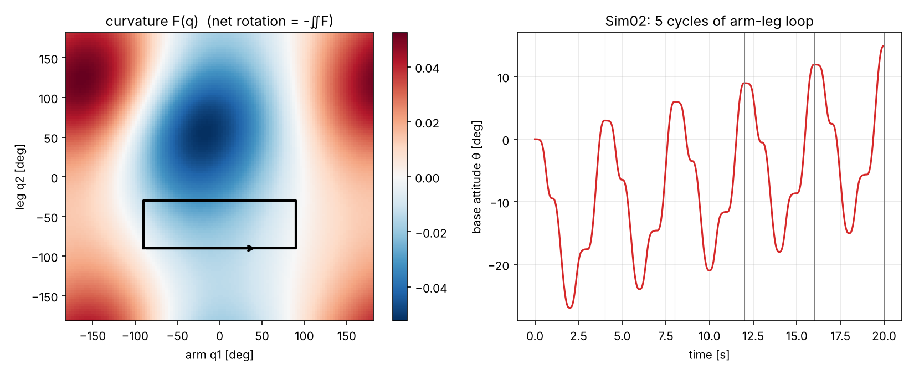
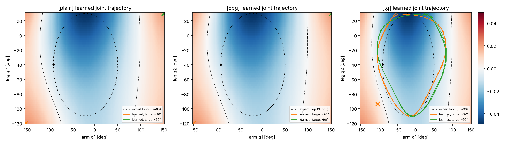
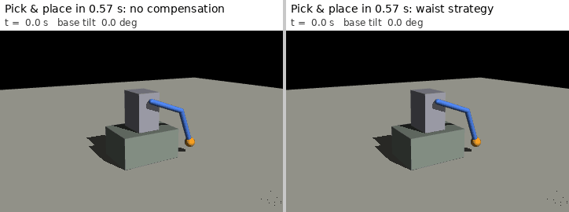
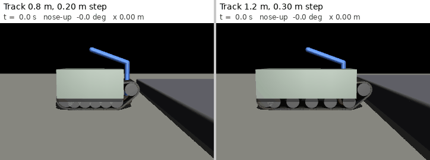
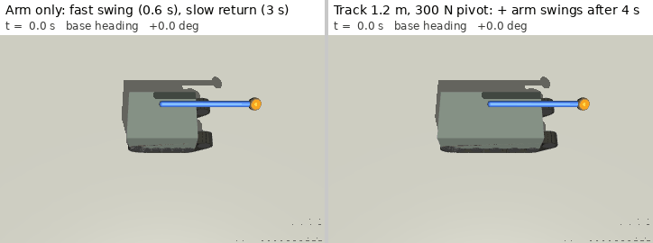
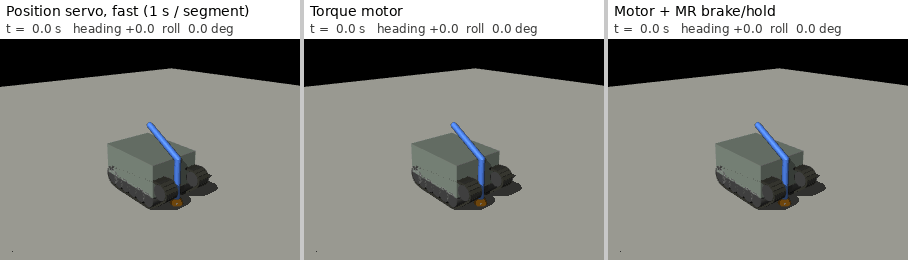
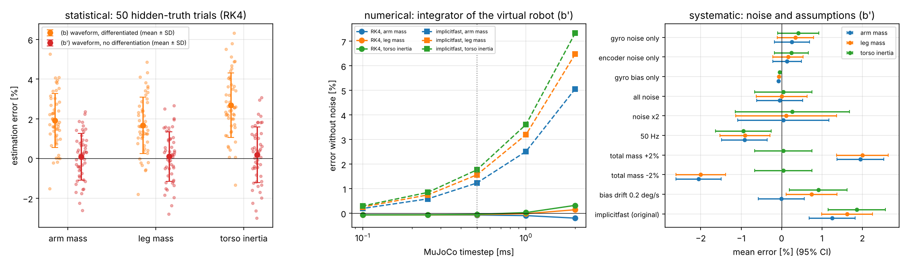
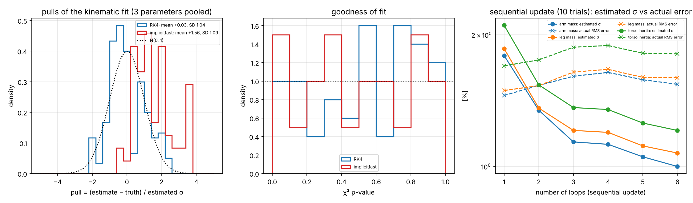

:::message
シリーズの 2 本目です。動機と全体像は[入口の記事](https://zenn.dev/)（TODO: 公開後にリンク）に、数式の導出・誤差評価の詳細・失敗の記録は[本](https://zenn.dev/)（TODO）にあります。コードと数値は [GitHub](https://github.com/okamasaya/simulation_AMBAC) で公開しています。
:::

この記事では、AMBAC（手足を振った反動で姿勢を変える）を試験台にして、**CPU だけで動く安価なシミュレーションが、フィジカル AI の 3 つの課題、(1) 探索と構造、(2) モデル誤差、(3) 校正、にどこまで答えられたか**を、結果を中心に書きます。最後に、現在地と今後の計画をまとめます。

| フィジカル AI の課題 | 安価なシミュレーションの役割 | AMBAC での結果 |
|---|---|---|
| 探索が物理の構造を知らない | 物理の構造から失敗の原因を予測し、方策に与える構造を選ぶ | 構造なし：誤差 50〜120°。振動子の構造：理論上界の 98% |
| モデル誤差・外乱 | 同じ条件で学習と最適制御を比べ、役割の分担を決める | 学習：誤差 0.09°（開ループ最適制御 30.5°）。推進剤の計画は最適制御が有利 |
| 実機の校正 | 答えを隠した仮想の実機で、推定の手順と測るべき量を決める | 1 回のばらつき約 1.2%、偏りは有意でない。約 2% の偏りの正体は仮想の実機の積分法 |

---

## 1. 試験台：AMBAC の基本式

外から力を受けない平面の多体系で、胴体の姿勢角を θ、関節角を $\bm q$ とすると、全角運動量は

$$
L = A(\bm q)\,\dot\theta + \bm B(\bm q)\cdot\dot{\bm q}
$$

と書けます。静止から始めれば $L = 0$ なので、

$$
\dot\theta = -\bm\Gamma(\bm q)\cdot\dot{\bm q},\qquad \bm\Gamma = \bm B / A
$$

が AMBAC の基本式です。$\bm\Gamma$ は幾何力学で「機械的接続」と呼ばれる量で、次の性質を持ちます。

- **時間を含まない**：回転角は関節の**経路だけ**で決まり、速さによりません。ゆっくり振っても速く振っても、同じだけ回ります。
- **関節 1 つでは可逆**：腕を戻すと、姿勢も戻ります。腕 1 本を 180° 往復させると、胴体は最大 −16.04° 回り、最後は 0° に戻りました。
- **関節 2 つ以上のループで正味の回転**：関節空間で閉曲線 $C$ を 1 周すると、ストークスの定理から

$$
\Delta\theta = -\oint_C \bm\Gamma\cdot d\bm q = -\iint_S F\,dq_1\,dq_2
$$

だけ回ります（$F$ は接続の曲率）。これが**幾何学的位相**で、繰り返せば好きな角度まで回れます。人間大の腕と脚のモデルでは、1 周あたり +2.98° で、ストークスの定理による値と一致しました。

ガンダムの言葉に戻すと、「腕を振ったら戻ってしまうのでは？」という疑問の答えは、**1 本の腕なら戻る、2 本以上で輪を描けば戻らない**、です。落下する猫も、宇宙飛行士も、これをやっています。

*腕と脚のループ 1 周ごとに、胴体が一定の角度ずつ回る（Sim02）*

### 巨大ロボの壁：二乗三乗則

回転角はスケールによりませんが、**速さ**はよります。相似に s 倍した機体では、腕を同じ角加速度で振るのに必要なトルクは $s^5$、相似に大きくしたモーターが出せるトルクは $s^3$ で増えます。足りない分だけ遅く振るしかないので、AMBAC の速さは $1/s$ で落ちます。**18 m 級で 90° 回るのに約 2 分**かかり、機敏に動くには相似則の約 170 倍のトルクが必要でした。

### AI の言葉に言い直すと

AMBAC は「行動（関節の速度）の効果が、行動の**順序と組み合わせ**でしか現れない」課題です。正味の回転は入力ベクトル場のリー括弧から生じ、滑らかな時不変フィードバックでは安定化できません（Brockett の定理）。これが、次の節の学習の失敗につながります。

---

## 2. 課題 1：探索と帰納バイアス

**設定**：人間大の腕と脚のモデル（$L = 0$）で、「胴体を目標角まで回せ」とだけ報酬を与えます。物理の知識（接続・曲率・ループ）は与えません。進化戦略（ES）で次の 3 種類の方策を学習しました。

- **plain**：観測（姿勢の誤差、関節角）→ MLP → 関節の角速度
- **cpg**：plain の観測に周期信号を足したもの
- **tg**：振動子が目標関節角のループ（中心・振幅・形）を作り、その形と位相の速さを学習する（PMTG と同じ系統）

比較として、最適な円のループを回すモデルベースの制御（expert）を用意しました。

| 目標 | plain | cpg | **tg** | expert |
|---|---|---|---|---|
| +90° | 61.8° | 61.8° | **0.2°** | 8.7° |
| −90° | 49.7° | 49.7° | **0.1°** | 7.9° |
| +150° | 121.8° | 121.8° | **0.4°** | 21.3° |

*25 秒後の姿勢の誤差*

*学習した関節の軌道（色は接続の曲率 F）。plain と cpg は手足を可動域の端まで振って止まる局所解（×）に落ちる。tg は曲率が負の領域をほぼ埋めるループを見つけた。点線は人手で設計した最適な円*

**結果**：plain と cpg は、手足を可動域の端まで振って止まる局所解に収束しました。tg は数十回の反復で解を見つけ、1 周 +9.34° のループを学習しました。これは人手で設計した最適な円（+6.70°）を上回り、可動域の中での理論上界（+9.57°）の **98%** に達します。最後に「揺れの少ない位相で止まる」ことまで覚え、終端の誤差は expert より 1 桁以上小さくなりました。

**なぜ構造なしでは失敗するのか**：1 回の動きの効果（戻ってしまう首振り $-\bm\Gamma\cdot\Delta\bm q$）は振幅の 1 次ですが、ループの正味の回転（曲率 × 囲んだ面積）は振幅の **2 次**（$\propto A_1A_2$）です。静止に近い方策から探索を始めると、ループを大きくする方向の勾配はほぼ 0 になり、1 次の効果である「端まで振る」が先に最適化されてしまいます。

これはハイパーパラメータの問題ではなく、**課題の物理の構造**に由来します。周期信号を観測に足すだけ（cpg）では足りず、「輪を描く」という**形**を方策の構造として与えることが成否を分けました。

同じことは地上でも起きました。MuJoCo を評価関数として直接使い、荷物運びの腰と肘の動きを Nelder–Mead 法で最適化したところ、最初から短い動作時間で探すと、どの係数でも転倒して評価が平らになり、探索が進みませんでした。時間を少しずつ短くする継続法で、荷物運びの時間は 65% 短縮し、「反ってから前に傾く」という、人が重い物を持つときの動き（腰の戦略）が再発見されました。

*荷物運び：補正なし vs 腰の補正。最適化が「反ってから前に傾く」動きを見つけた*

**評価が平らになる領域を物理の構造から予測し、避ける設計**は、安価なシミュレーションで実機の前に検討できます。

---

## 3. 課題 2：モデル誤差と、学習・最適制御の分担

**設定**：18 m 級の機体で、スラスターと AMBAC を併用して 90° の旋回を 60 秒で行います。制御器は周回平均の「平均化モデル」しか知らず、評価には周回内の揺れを含む「位相モデル」を使います（これがモデル誤差）。さらに、ループの効き（×0.7〜1.3）、慣性（×0.9〜1.1）、一定の外乱トルクをランダムに変えた 100 例で比べました。学習方策は、観測（平均姿勢の誤差、角運動量、残り時間、ループの位相）からスラスターのトルクとループの周波数を出す MLP で、同じランダムな条件で学習しました（ドメインランダム化）。

| 制御器 | 終端誤差 平均（95%） | 残留角速度 [°/s] | 推進剤 [kg] |
|---|---|---|---|
| 開ループ最適制御 | 30.5°（68.8°） | 0.90 | **1.97** |
| MPC | 14.6°（23.3°） | 0.030 | 5.41 |
| MPC ＋ 揺れの補償 | 0.19°（0.69°） | 0.031 | 5.56 |
| 学習方策 | **0.09°（0.10°）** | **0.002** | 4.92 |

*参考：公称モデルでのスラスターだけの最適値は 3.62 kg*

**結果**：線形計画で解いた開ループの最適制御は、推進剤は最小ですが、終端の誤差が 30° に達しました。平均化モデルの予測そのものは正確（平均姿勢 89.6° 対 予測 90.0°）で、誤差の原因は「止まった位相での揺れ」でした。人手で揺れの補償を加えた MPC は 0.19° まで改善しましたが、学習方策は**観測に位相を入れただけで**同じことを自力で獲得し、誤差 0.09°、残留回転は MPC の 1/10 でした。実行時の計算も行列の積だけで済みます（100 例で 0.1 秒、LP の再計画は 15〜40 秒）。

一方、学習方策の推進剤は、スラスターだけの最適値より多くなりました。スラスターで角運動量を一度入れると、止めるときに同じ量の逆噴射が必ず要るので、**AMBAC が推進剤を節約できるのは「最初にどれだけ噴くか」を決める段階だけ**です。報酬が最後にしか与えられない学習では、この最初の判断の価値を割り当てにくく（信用割り当ての問題）、学習方策は AMBAC で得をする余地を自分で消していました。

**示唆**：保存量（角運動量）の収支のように、最適性が明示的な構造で決まる部分は最適制御で計画し、モデル誤差・外乱・速い揺れの補正は学習が担う（残差学習）、という分担が自然です。2 節と合わせると、

> **「形」（ループ）は方策の構造として与え、「保存量」は計画で扱う**

という、物理の知識と学習の分担の指針が得られます。

---

## 4. シミュレーション場：PC の中の試験場とステージ

ここからが、現在進めている第 2 段階です。PC の中に「試験場」と「ステージ」を用意し、MuJoCo（CPU のみ）で、部品表（JSON）から機体を組み立てて動かしました。台車・腰・肩（1〜3 軸）・肘・履帯・ばね・円盤などを部品として組み合わせます（アセンブル）。

### シミュレーター自体を照合する

まず、第 1 段階の Python の基準モデルと MuJoCo を、同じ関節の動きで比べました。腕 1 本の往復で −16.0356° 対 −16.0356°、腕と脚のループ 1 周で +2.963° 対 +2.970° と一致し、角運動量の保存は $10^{-6}$ 程度でした。

ゲーム用の物理エンジンは、安定させるための減衰などで角運動量が厳密には保存されないことがあり、1 周数度の幾何学的位相は埋もれてしまいます。**答えの分かっている試験に合格させること自体が、シミュレーターの校正**です。将来の実機を 3 層目にして、基準モデル・シミュレーション場・実機の 3 層で照合する計画です（番外編がその第一歩です）。

### 組み合わせた形の結果

| 段階 | 内容 | 主な結果 |
|---|---|---|
| 6 | 腰の戦略の最適化 | 荷物運びを最大 65% 短縮。トルクは 3 倍に |
| 9 | 二本脚と戦車型 | 二本脚は腰なしでは荷物を運べない。腰ありでも戦車型より約 3 割遅い |
| 8・10 | 段差・坂（板をつないだ履帯） | 長い履帯で段差 2 倍（0.15 → 0.30 m）。短い機体は「シーソー」で後ろに転倒 |
| 11 | 左右 2 本の履帯の旋回 | 基準モデルと 0〜11% で一致。長い履帯は旋回に 1.6 倍の力 |
| 12 | 腕の振りと向きの制御 | 腕の非対称な往復で車体を回せる（地上版 AMBAC） |
| 13 | 腕の反作用への対策 | 車体が回るのは腕を「止めるとき」。しなりは逆効果、逆回転するおもりは有効 |
| 14 | 滑らかな止め方・流体ブレーキ | トルク制御で車体を回さずに 1.2〜1.35 秒で振れる |
| 15 | 機能を分けた組み合わせ | 動かす＝モーター、止める・保持する＝MR で 1.18 秒、行き過ぎ 0.2°、電源なしでも保持 |
| 16 | 繰り返しの発熱と劣化 | 先に限界に達するのはモーター。MR で止めると続けられる頻度が 2 倍 |
| 17 | 3 軸の肩 ＋ 肘の腕全体 | モーター＋MR が、車体を乱さない方式で最速。電源を切っても腕が落ちない |

*短い履帯で 0.20 m vs 長い履帯で 0.30 m。形を選べば、二本脚の利点（段差）を履帯でも補える。ただし長い履帯は曲がりにくい*

*地上版 AMBAC：腕を「速く振ってゆっくり戻す」と、摩擦の非対称性で車体の向きが変わる*

分かったことを 3 つにまとめます。

1. **地上では、足元の摩擦の境目までは、腕の反作用を摩擦が吸収します。** 車体を乱すのは主に腕を**止めるとき**で、位置サーボの遅れ（最大 17°）が急ブレーキを生み、この境目（この機体で約 260 N·m）を超えさせていました。「何も考えずに動かすと動きが雑に見える」主な原因はこれでした。
2. **止め方を変えるだけで、追加の部品なしに、車体を乱さず速く動けます。** トルクを境目より下に抑えて一定に止めればよいのです。
3. **機能を分けると、速さ・精度・省エネ・安全が同時に良くなります。** 動かすのはモーター、止める・保持するのは MR 流体のブレーキです。人の体の筋肉（動かす）・腱（しなる）・靭帯や関節の摩擦（保持する）と同じ考え方です。

*3 軸の肩＋肘の腕全体：位置サーボ / トルク制御のモーター / モーター＋MR。最後に電源を切っても、MR で保持した腕は落ちない*

### ガンダムの技術史と、同じ順番をたどった

ここは示唆として書きます。作品世界では、機体を速くした次に問題になったのは関節の応答で、それを磁気で解決する「マグネットコーティング」が登場し、続編『機動戦士Ζガンダム』では内部の骨格が動きを受け持つ「ムーバブルフレーム」で装甲と機能が分けられました。

このシミュレーションでも、**機体を速くすると、次に問題になるのは「止め方」と「関節の性質」**で、答えは「関節の抵抗を磁気（MR 流体）で制御し、動く部分と止める部分を分ける」ことでした。放映当時の基礎理論の上に立った SF 考証が、最適解に近い方向を指していた可能性があります。**フィクションの設定は、安価なシミュレーションで確かめられる仮説の源になる**、というのもこのシリーズの副次的な主張です。

---

## 5. 課題 3：校正値を実機の前に設計する

### 答えを隠した仮想の実機

実機の代わりに、腕・脚の質量（±15%）と胴体の慣性（±10%）を乱数でずらした機体を作り、正解を推定する側に隠しました。曲率マップの異なる場所に置いた 6 種類のループを 1 周ずつ回し、ジャイロ（雑音 0.2°/s、バイアス最大 ±0.2°/s）とエンコーダを 100 Hz で模擬記録して、推定結果を正解と比べます。

| 推定の方法 | 結果 |
|---|---|
| (a) ループ 1 周ごとの正味の回転だけ | 脚の質量を推定できない（50 回で誤差 +103 ± 145%） |
| (b) 波形（関節角を微分して回帰） | +1.7〜2.7% の有意な偏り（errors-in-variables） |
| (b′) 波形（区間ごとの回転量で比べ、微分しない） | 1 回のばらつき 1.2〜1.4%、偏りは有意でない |
| kinematic fit（測定値そのものを拘束付きで当てはめ直す） | 1 回のばらつき 1.1〜1.3%（(b′) より約 3 割小さい）、σ も正しく見積もれる |

*いずれも仮想の実機の積分法を RK4 にした、50 回の試行の結果*

*誤差の内訳：統計・計算・系統に分けて評価した*

### 「約 2%」の正体

最初の 5 回の試行では、(b′) の誤差が 5 回ともプラス側にそろっていました（平均 +1.6〜2.3%、ばらつき 0.5%）。つまり「誤差約 2%」の大部分は、偶然のばらつきではなく**系統的な偏り**でした。

原因を 1 つずつ切り分けると、

- 雑音をすべて除いても +1.3〜1.8% の偏りが残る
- 偏りは MuJoCo の時間刻みに比例する（2 ms で +5〜7%、0.5 ms で +1.2〜1.8%、0.1 ms で +0.2〜0.3%）
- 部品表から組み立てた機体の積分法は `implicitfast`（1 次）で、角運動量 $L = 0$ がわずかに保たれない（基本式からのずれは角速度の 0.02% 程度）
- 推定は、このずれを**推定しにくい方向**（質量・慣性の全体の大きさ。腕・脚・慣性の相関が 0.99 以上）に沿って吸収し、パラメータでは 2 桁大きい偏りになる

ということが分かりました。**積分法を RK4 にすると、0.5 ms でも雑音なしの誤差は 0.08% 以下**です。仮想の実機（シミュレーター自身）が、系統誤差の源になっていたわけです。

| 誤差の種類 | (b′) 微分なし |
|---|---|
| 統計（50 回、1 試行の標準偏差） | 1.2 / 1.3 / 1.4% |
| 偏り（50 回の平均） | +0.09 / +0.10 / +0.18%（有意でない） |
| 計算（RK4、時間刻み 0.5 → 0.1 ms） | 0.02% 以下 |
| 積分法 implicitfast（0.5 ms、雑音なし） | +1.2 / +1.6 / +1.8% |
| 総質量の仮定 ±2% | ±2.0 / ±2.0 / 0.0%（1:1 で移る） |
| ジャイロのバイアスのドリフト 0.2°/s | 0.0 / +0.7 / +0.9% |

*値は腕の質量 / 脚の質量 / 胴体の慣性の順*

### 推定しにくい方向と、測るべき量

基本式 $\dot\theta = -\bm\Gamma\cdot\dot{\bm q}$ は質量・慣性の**比**しか含まないので、姿勢の波形だけでは全体の大きさが決まりません。これはマニピュレーターの同定で知られる「推定できるパラメータの組み合わせ」（Gautier・Khalil の base parameters）と同じ構造です。**絶対値には、総質量の計量か、力の情報が要る**。これは、実機で何を測るべきかに直結する指針です。

### kinematic fit で、誤差ごと推定する

素粒子実験の kinematic fit にならい、エンコーダの関節角とジャイロの角速度を測定値とし、真の関節角の列（約 5200 個）・パラメータ・ジャイロのバイアスを、拘束条件 $L = 0$ のもとで同時に当てはめました。

$$
\chi^2 = \sum \frac{\|\bm Q - \bm q_m\|^2}{\sigma_q^2} + \sum \frac{\left(\omega_m - b + \bm\Gamma(\bm Q;\bm p)\cdot\dot{\bm Q}\right)^2}{\sigma_\omega^2}
$$

*kinematic fit：pull の分布と、逐次更新で σ が縮んでいく様子*

- **推定ごとの誤差 σ が正しく見積もられる**（pull の平均 +0.01〜0.05、標準偏差 1.04〜1.05）。実機で正解が分からなくても、1 回の校正でその値をどこまで信じてよいかを示せます。
- **逐次更新**（ループを 1 本ずつ加え、前の推定値と共分散を事前情報にする。カルマンフィルタと同じ形）で、σ が 1.8% → 1.0% と縮み、最終値は一括の当てはめと 0.23% 以内で一致しました。
- **限界**：積分法の系統誤差は pull を +1.5σ ずらしますが、χ² の p 値は一様のままで、当てはまりの良さからは検出できませんでした。ずれが推定しにくい方向に吸収されるためです。

**当てはまりの良さは、系統誤差がないことを保証しない。** だから、答えの分かっている照合（RK4 と implicitfast の比較など）と組み合わせて、誤差を評価し続ける必要があります。

### どの校正値が効くか

組み立てた機体の試験から、次の量が性能を大きく左右することが分かりました。実機で何を先に測るべきかの優先順位になります。

| 校正値 | 何を決めるか |
|---|---|
| 質量・慣性（腕・脚・胴体） | AMBAC の効き、姿勢の動き |
| 足元の摩擦の境目と、荷重の移動による変化 | 腕の作業で車体が乱れるか |
| 接地の荷重分布 | 旋回の速さ（一様と仮定すると 3 割ずれる） |
| サーボの遅れ（ゲイン） | 軌道の形が崩れ、急ブレーキになる |
| モーターの銅損・熱抵抗、MR の温度係数・寿命 | 続けて動かせる頻度、メンテナンスの周期 |
| 摩擦（重力とは別） | 重力だけが違うステージではフルード則が 1% で成り立つが、氷では外れる（予測 1.35 秒 対 2.22 秒） |

---

## 6. うまくいかなかったこと（抜粋）

成功だけでなく、失敗とその理由も残しています。全部の記録は本の「失敗の記録」の章にあります。

| 試みたこと | うまくいかなかったこと | 原因 |
|---|---|---|
| 正味の回転だけで校正 | 脚の質量が決まらない | 情報が足りない（十分に励起していない） |
| 関節角を微分して回帰 | 有意な偏り。サンプリングを上げると悪化 | 雑音の入った説明変数の微分（errors-in-variables） |
| 5 回の試行でばらつきを見積もる | 0.5% と過小評価（50 回では 1.2〜1.4%） | 少数の試行。偏りがばらつきを隠していた |
| 「偏りの原因は前処理」と結論 | **誤り**。主因は仮想の実機の積分法 | 原因を 1 つずつ変える切り分けをせず、もっともらしい説明で止めた |
| χ² で系統誤差を検出 | χ² に現れない | ずれが推定しにくい方向に吸収される |
| 構造のない方策で学習 | 端まで振って止まる局所解 | 効果が振幅の 2 次で、勾配が消える |
| しなり（ばね）で反作用を和らげる | 逆効果 | 山を下げても境目より下まで下げられず、境目を超える力積が残る |

---

## 7. 現在地

**安価なシミュレーションに答えられたこと**：3 つの課題で、シミュレーションは「実機の挙動の予測」ではなく、

1. 学習に与えるべき構造
2. 学習と制御の分担
3. 校正の試験動作と、測るべき量（と、その誤差）

を決めるために使われました。いずれも、答えの分かっている試験台があったから判断できました。大規模な GPU シミュレーションとドメインランダム化が「誤差の範囲を広く覆う」方向だとすれば、ここでの方向は「どこに誤差があり、何を測ればよいか」を絞る方向で、両者は補い合います。

**答えられないこと**：PC の上だけでは、sim-to-real ギャップそのものは確かめられません。仮想の実機で分かるのは、校正の手順が働くかと、どのパラメータが推定しやすいかまでです。モデルに入れていない現象（接触の細部、モーターの非線形、部品のたわみ）は再現されません。モーターや MR 流体の数値は仮定した部品の値で、学習手法も ES に限っています。

## 8. 今後

1. **番外編：本物の剛体と iPhone の IMU で、3 層目の照合を始める。** 1 m のアルミアングルと iPhone SE（第 3 世代）2 台、phyphox で、振り子の周期から慣性モーメントを求め、回転させたときの角速度と向心加速度をシミュレーターの予測と比べます。
2. **kinematic fit を地上の機体へ広げる**：サーボの遅れ・摩擦の校正値と、総質量の計量・関節トルクのような「推定しにくい方向を外から決める」拘束を加え、χ² で系統誤差を検出できるかを試します。投球のような「速度差のある運動の連鎖」を、段ごとの拘束の連鎖として当てはめる（粒子の崩壊の連鎖の当てはめと同じ形）のも試したいところです。
3. **学習と最適制御のハイブリッド**：計画は最適制御、実行時の補正は学習方策。PPO・SAC との比較や、ほかの非ホロノミック系での検証も行います。
4. **誰でも使えるシミュレーターへ**：部品表から機体を組み立て、性能表と校正データを CSV・JSON で書き出すところまでをまとめ、いずれは PyPI で公開したいと考えています。

## 参考文献

- J. Tobin et al., "Domain randomization for transferring deep neural networks from simulation to the real world," *IROS*, 2017.
- X. B. Peng, M. Andrychowicz, W. Zaremba, P. Abbeel, "Sim-to-real transfer of robotic control with dynamics randomization," *ICRA*, 2018.
- A. Iscen et al., "Policies modulating trajectory generators," *CoRL*, 2018.
- C. G. Atkeson, C. H. An, J. M. Hollerbach, "Estimation of inertial parameters of manipulator loads and links," *IJRR*, 5(3), 1986.
- M. Gautier, W. Khalil, "Direct calculation of minimum set of inertial parameters of serial robots," *IEEE Trans. Robotics and Automation*, 6(3), 1990.
- J. E. Marsden, *Lectures on Mechanics*, Cambridge University Press, 1992.
- R. W. Brockett, "Asymptotic stability and feedback stabilization," in *Differential Geometric Control Theory*, Birkhäuser, 1983.
- T. Salimans et al., "Evolution strategies as a scalable alternative to reinforcement learning," arXiv:1703.03864, 2017.
- T. Johannink et al., "Residual reinforcement learning for robot control," *ICRA*, 2019.
- E. Todorov, T. Erez, Y. Tassa, "MuJoCo: A physics engine for model-based control," *IROS*, 2012.
- 『機動戦士ガンダム』（1979 年）、『機動戦士Ζガンダム』（1985 年）、『ガンダムセンチュリー』（1981 年）
