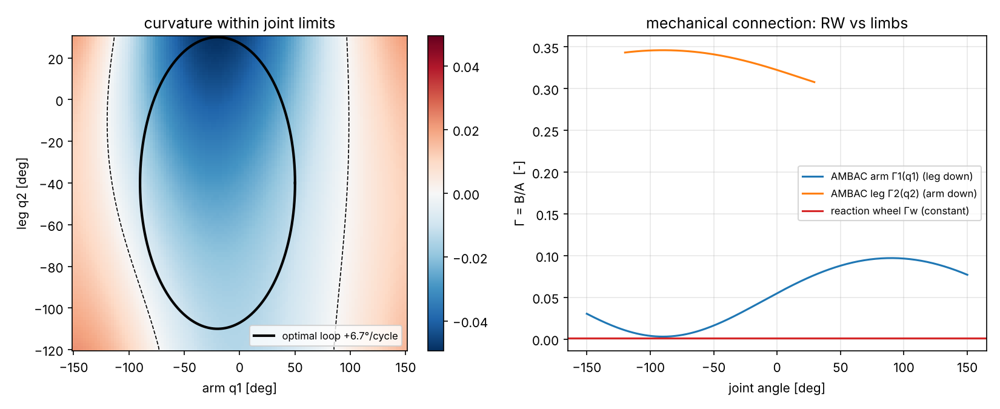
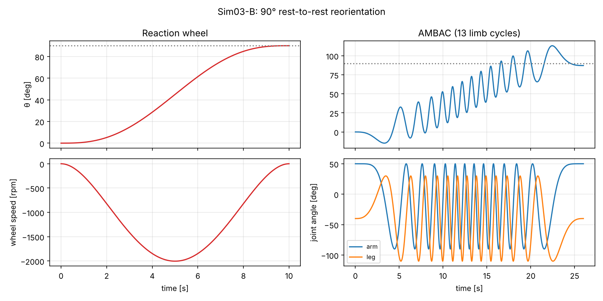
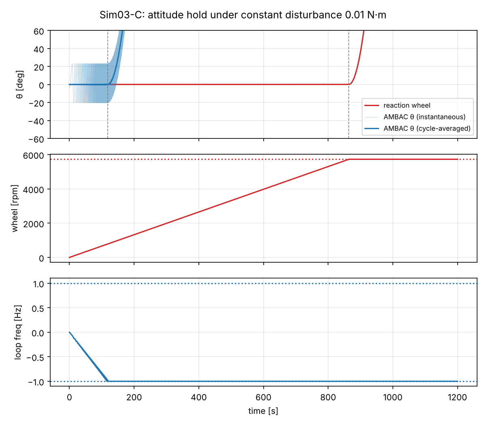

:::message
この章の元になったノート：[docs/03_rw_vs_ambac.md](https://github.com/okamasaya/simulation_AMBAC/blob/main/docs/03_rw_vs_ambac.md)。数値はリポジトリの `data/` にある出力と同じです。
:::

スクリプト: `sims/sim03_rw_vs_ambac.py` / 数値まとめ: `data/sim03_summary.txt`

## 同じ式、違う関節

人工衛星のリアクションホイール（RW）と AMBAC は、どちらも **運動量交換** による姿勢制御で、同じ式で書ける。

$$
\dot\theta = \frac{L - B(q)\cdot\dot q}{A(q)} = \frac{L}{A(q)} - \Gamma(q)\cdot\dot q
$$

| | リアクションホイール | AMBAC（四肢） |
|---|---|---|
| 関節 | 連続回転できる | 可動域がある |
| 回したときの質量配置 | 変わらない（重心が回転軸上） | 変わる |
| 接続 Γ | **一定**（I_w / A） | **形状 q に依存** |
| 曲率 F | 0 | ≠ 0 |
| 任意角の回転 | 回し続ければ可能（ホロノミック） | ループ運動で可能（非ホロノミック・幾何学的位相） |
| たとえ | 低ギア・無限ストローク | 高ギア・短ストローク |

**RW は「AMBAC の特殊な場合」**、すなわち曲率ゼロ・可動域無限の関節とみなせる。
逆に AMBAC は「可動域を補うために、形状空間のループで回転を稼ぐ RW」と言える。

## Part A: 接続とループ最適化

モデル: 人間型（胴体 60 kg、腕 4 kg、脚 12 kg）。RW は胴体内の 2 kg・半径 0.12 m の円盤。
関節可動域は腕 −150°〜150°、脚 −120°〜30°。

| 項目 | 値 |
|---|---|
| RW の Γ_w | 0.0014（ホイール 1 回転で胴体 0.51°） |
| 脚の Γ₂ | 約 0.33（脚を 1° 振ると胴体 0.33°） |
| Sim02 の長方形ループ | +2.98°/周 |
| **最適円ループ**（中心 腕 −20°, 脚 −40°、半径 70°） | **+6.70°/周** |
| 可動域内の理論上界（同符号曲率の全領域を囲む） | +9.57°/周 |

- 四肢の Γ は RW の 200 倍以上ある。四肢は「1 回の動きで大きく向きを変える」装置。
- ループ最適化で 1 周あたりの回転は 2.25 倍になった。理論上界の 70% に達している。
  曲率マップの破線（F=0）が「囲むべき領域」の境界になっている。
- 上界は関節可動域で決まる。**AMBAC 性能は可動域設計の問題**でもある。

## Part B: 90° の姿勢変更（静止→静止）

| | RW | AMBAC |
|---|---|---|
| 所要時間 | 10 s（設定値） | 26 s（13 周 × 0.5 Hz） |
| 実行量 | ホイール 178 回転、最大 2003 rpm | 四肢ループ 13 周 |
| 最終姿勢 | 90.00° | 87.16°（整数周回の端数） |
| 途中の姿勢 | 単調・滑らか | **最大 113°（周回ごとに ±20〜25° 揺れる）** |

**考察**
- AMBAC では、正味の回転の上に、形状変化による大きな **可逆的な揺れ** が重なる。
  観測・照準・作業を伴う姿勢制御では、この揺れは実用上の大問題になる。
  対策としては、ループ形状を「揺れが小さく曲率が大きい」ものに最適化すること、
  他の肢で揺れを打ち消すこと（冗長肢の利用）が考えられる。
- 端数（87° vs 90°）は、最後の部分ループや単関節の可逆運動で微調整できる
  （可逆 AMBAC＝微調整、非ホロノミック AMBAC＝大角度、という役割分担）。

## Part C: 外乱トルク下の姿勢保持と「飽和」

一定の外乱トルク τ_d = 0.01 N·m を胴体に加える。全角運動量は L(t) = τ_d t で増え続け、
**内部運動では L を消せない**。姿勢を保つには、増えた L をどこかに「溜める」しかない。

- **RW**: ホイールの回転に溜める。ホイール回転数が時間に比例して増え、ω_max に達すると飽和する。
- **AMBAC**: **四肢の周期運動に溜める**。ループ周回周波数 f が時間に比例して増え、f_max に達すると飽和する。

AMBAC の平均化モデル（1 周平均で dθ̄/dt ≈ f·Δθ_c + L·⟨1/A⟩）から、角運動量容量は次のとおり。

$$
h_{\rm RW} = I_w\,\omega_{\max}, \qquad
h_{\rm AMBAC} = \frac{f_{\max}\,|\Delta\theta_c|}{\langle 1/A\rangle}
$$

| | 角運動量容量 | 0.01 N·m での保持限界 |
|---|---|---|
| RW（2 kg、5700 rpm） | 8.64 kg·m²/s | 864 s |
| AMBAC（腕 4 kg + 脚 12 kg、1 Hz） | 1.18 kg·m²/s | 118 s |

保持中の AMBAC は、周回平均姿勢 |θ̄| ≤ 0.30° に保てたが、瞬時姿勢は ±23° 揺れる。

**考察**
- 「AMBAC で回転を止められない」ことと「RW の運動量飽和」は **同一の物理現象** である。
  RW が角運動量をホイールの回転に溜めるのと同じく、AMBAC は四肢の周期運動に溜める
  （連続的なループ運動は、実効的に「回り続けるホイール」になっている）。
- この人間大モデルでは、2 kg の RW の方が 16 kg の四肢より 7 倍以上の容量を持つ。
  AMBAC の強みは容量ではなく、**推進剤も専用機器も使わず、既存の四肢で姿勢を変えられる**ことにある。
- どちらも飽和したら、外部トルク（スラスタ、磁気トルカ、接触）による **アンローディング** が必要になる。
  劇中で AMBAC とスラスタが併用されていることは、物理的に自然な設計と言える。
- 周回内の揺れの補償には、ループ形状から計算した周期成分 θ_osc(φ) を使った。
  **幾何構造（接続・曲率）を知っていると、制御設計が格段に簡単になる**。
  これはフィジカル AI（学習で方策を得る場合）が「何を内部表現として獲得すべきか」という問いに直結する。

## 次への論点

1. **トルクとエネルギー（Sim04）**: f_max は本来アクチュエータのトルク・出力で決まる。
   順動力学で、関節トルク・消費エネルギー・f_max を見積もる。
2. **スケーリング（18 m 級）**: Δθ_c はスケール不変だが、A ∝ M ℓ² であり、f_max もスケールに依存する。
   巨大ロボで h_AMBAC がどう伸びるかは、アクチュエータのスケーリング則次第（Sim04 で検証予定）。
3. **揺れの小さいループ**: 「正味回転は大きく、周回内の揺れは小さい」ループ形状の多目的最適化。
4. **フィジカル AI**: RW＋AMBAC＋スラスタの統合制御（運動量の配分）を、最適制御と学習でそれぞれ解いて比較する。

## 参考文献

- [R5] J. E. Marsden, *Lectures on Mechanics*, London Mathematical Society Lecture Note Series 174, Cambridge University Press, 1992.
- [R15] D. N. Nenchev, K. Yoshida, P. Vichitkulsawat, M. Uchiyama, "Reaction null-space control of flexible structure mounted manipulator systems," *IEEE Transactions on Robotics and Automation*, 15(6), 1011–1023, 1999.
- [R16] B. Wie, *Space Vehicle Dynamics and Control*, 2nd ed., AIAA, 2008.（リアクションホイール・CMG・スラスタによる姿勢制御）
- [R17] M. J. Sidi, *Spacecraft Dynamics and Control: A Practical Engineering Approach*, Cambridge University Press, 1997.

（全文献の一覧と照合状況は [references.md](https://github.com/okamasaya/simulation_AMBAC/blob/main/docs/references.md) を参照）
