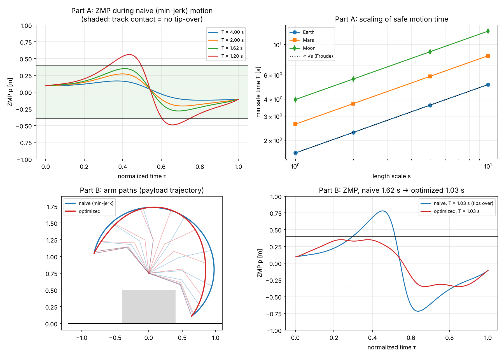
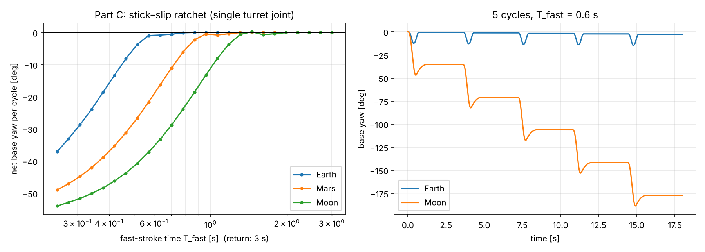
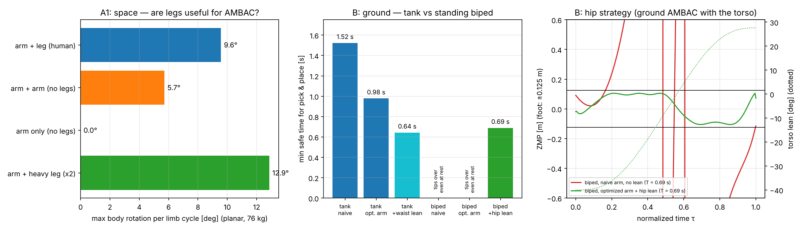
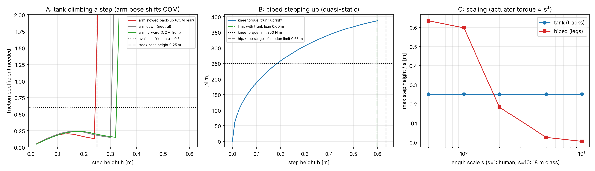

:::message
この章の元になったノート：[docs/06_ground_tank.md](https://github.com/okamasaya/simulation_AMBAC/blob/main/docs/06_ground_tank.md)、[docs/09_legs.md](https://github.com/okamasaya/simulation_AMBAC/blob/main/docs/09_legs.md)、[docs/10_steps.md](https://github.com/okamasaya/simulation_AMBAC/blob/main/docs/10_steps.md)。数値はリポジトリの `data/` にある出力と同じです。
:::

## 地上を動く機体：戦車型台車＋腕（Sim06）

スクリプト: `sims/sim06_ground_tank.py` / モデル: `src/ambac/ground.py` / 数値まとめ: `data/sim06_summary.txt`

### 宇宙から地上へ：何が変わるか

宇宙では外力がないので、角運動量が保存された（dL/dt = 0）。
地上では地面からの反力が働くので、角運動量の変化は接触反力のモーメントに等しい（dL/dt = 接触モーメント）。
ただし、接触反力には次の限界がある。

| 限界 | 条件 | 超えると |
|---|---|---|
| ZMP（反力の合力の作用点）は接地範囲の中にしか来られない | −a ≤ p ≤ a | **転倒** |
| 水平反力は摩擦の範囲までしか出せない | \|Fx\| ≤ μN | **滑り** |
| 旋回（ヨー）の反力も摩擦の範囲まで | \|τ\| ≤ μ N r̄ | **その場で回る** |

$$
p = \frac{\sum m_i\left(x_i(\ddot z_i+g) - z_i\ddot x_i\right) + \sum I_i\ddot\phi_i}{\sum m_i(\ddot z_i+g)}
$$

腕を動かしたときの反力のうち、動的な部分は「角運動量の時間変化」そのものである。
**地上版 AMBAC とは、腕の運動量の変化が接触の限界を超えるかどうかの問題** と言える。

**モデル**: 戦車型台車（台車＋胴体 80 kg、履帯接地長 0.8 m）に 2 関節の腕（上腕 4 kg・前腕 3 kg、各 0.5 m）、
先端に荷物 10 kg（総重量 97 kg）。脚の問題を切り離すため、脚は戦車型の台車として単純化した。剛体を仮定する。

### Part A: 腕の反作用で転倒するか（矢状面）

**動作**: 前方の地面にある荷物を拾い、頭上を通して後部デッキに置く（最小躍度の単純な関節軌道）。

| 動作時間 T | ZMP の範囲（接地範囲 ±0.4 m） | 必要な摩擦係数 |
|---|---|---|
| 4.0 s | −0.12 〜 +0.17 m | 0.04 |
| 2.0 s | −0.21 〜 +0.27 m | 0.15 |
| **1.62 s** | −0.28 〜 +0.35 m（安全余裕 5 cm の限界） | 0.23 |
| 1.2 s | −0.49 〜 **+0.56 m（転倒）** | 0.46 |

- 腕を持ち上げて加速する前半は、ZMP が前方に出る（前のめり）。後方で減速する後半は、後方に出る（のけぞり）。
- 摩擦係数 0.6 の路面では、**滑るより先に転倒する**（滑らない限界 1.09 s ＜ 転倒しない限界 1.62 s）。

#### スケーリング：フルード則 [R29]

| 長さ倍率 s | 地球 | 火星 | 月 |
|---|---|---|---|
| 1（人間程度） | 1.62 s | 2.62 s | 3.97 s |
| 2 | 2.29 s | 3.71 s | 5.61 s |
| 10（18 m 級） | 5.11 s | 8.30 s | 12.55 s |

安全に動ける最短時間は **T ∝ √(s/g)**（フルード則）に **厳密に** 従った（T/√(s·g_地球/g) = 1.616 で一定）。
これは時間スケーリングの性質から導ける。動的な反力は 1/T² に比例し、重力は一定なので、
限界は「加速度/重力」の比（フルード数）だけで決まる。

**考察**
- **大型化**: Sim04（宇宙）では、アクチュエータの制約で速さが 1/s で落ちた。地上では、アクチュエータが十分強くても、
  **転倒の制約だけで速さが 1/√s で落ちる**。18 m 級の機体は、人間程度の機体の約 3 倍ゆっくり腕を動かさないと転倒する。
- **低重力**: 月面では重力が 1/6 なので、同じ動作に地球の約 2.5 倍の時間がかかる。
  **低重力天体では、腕の動きの反作用が相対的に大きく効く**。月面ローバーにマニピュレータを載せる場合に直接関係する。

### Part B: 腕の動かし方で転倒を防ぐ（地上版の能動的質量バランス）

関節軌道を最小躍度＋補正（関節あたり 4 つの基底関数）で表し、
転倒・滑り・関節速度（6 rad/s）・関節加速度（60 rad/s²）の制約の下で、動作時間を最小化した（SLSQP）。

| | 単純軌道（最小躍度） | 最適化軌道 |
|---|---|---|
| 地球 | 1.62 s | **1.03 s（36% 短縮）** |
| 月 | 3.97 s | **2.01 s（49% 短縮）** |
| 1.03 s で実行したときの ZMP | −0.72 〜 +0.78 m（転倒） | −0.35 〜 +0.35 m（安全余裕ぎりぎりを使い切る） |

**最適化で見つかった戦略**（左下図）
- **荷物を体に引き寄せて、低く小さな弧で運ぶ。** 回転半径を小さくして、腕と荷物の慣性（＝角運動量の変化）を減らしている。
- ZMP が許容範囲の上限・下限に **張り付く** 形になる（右下図）。最短時間制御で典型的な「制約をぎりぎりまで使う」解である。
- これは、人間が重い物を素早く運ぶときに体に引き寄せるのと同じ戦略である。
  物理モデルの最適化が、人間らしい動きを **再発見** した例と言える（00 章の「人体運動を基準値にするか」の論点への一つの答え：
  人間の動きの合理性は、物理と制約から説明できる場合がある）。

### Part C: 腕を振ると台車がその場で回るか（上から見たヨー）

**設定**: 台車中心の旋回関節（ターレット）で、腕（7 kg・1 m）＋荷物（10 kg）を水平に 90° 振る。
台車の並進は止まっているとし、ヨー回転だけを考える。履帯の摩擦は、クーロン摩擦（静止・動摩擦）でモデル化した。

| 重力 | 摩擦トルクの上限 μNr̄ | 台車が滑り始める振りの速さ |
|---|---|---|
| 地球 | 155 N·m | 0.85 s より速い |
| 火星 | 59 N·m | 1.38 s より速い |
| 月 | 26 N·m | 2.09 s より速い |

**「速く振って、ゆっくり（3 s）戻す」往復を繰り返すと、関節が 1 つでも台車が回る。**

| 振りの時間 | 地球 | 火星 | 月 |
|---|---|---|---|
| 0.25 s | −37°/往復 | −49° | −54° |
| 0.47 s | −8° | −31° | −44° |
| 0.87 s | 0° | −2° | −19° |
| 摩擦ゼロ（宇宙と同じ） | 0°（1.9×10⁻⁴°） | | |

0.6 s で振る往復を 5 回繰り返すと、地球では −2.8°、**月では −177°** 回った。

> **注釈（シミュレーション場での検証、docs/11 の 11.10）**：この Part C は「台車は接地したまま、ヨーだけ回る」と仮定している。
> MuJoCo の地上の試験場と 3 次元の ZMP モデルで確かめると、この機体（腕 1 m・荷物 10 kg）では、横滑りで回るより先に、遠心力で台車が浮き上がり・傾く。
> 月面では、ここで回ると予測した速さのほぼ全域で、先に浮き上がりが起きる。スティックスリップの仕組み自体は正しいが、この機体の数値は転倒側の制約を受ける。

**考察: 宇宙と地上で「回る仕組み」が違う**

| | 宇宙（Sim01〜05） | 地上（Sim06） |
|---|---|---|
| 関節 1 つの往復 | 回らない（可逆） | **回る**（速い振りで滑り、遅い戻りで止まる） |
| 正味回転の源 | 形状ループの曲率（幾何学的位相） | 摩擦による **時間対称性の破れ**（スティックスリップ） |
| 速さの影響 | 関係ない（経路だけで決まる） | **決定的**（速さが摩擦の限界を超えるかどうか） |

- 宇宙では「速さは関係ない」が鉄則だった（01 章）。地上では摩擦が速さに対して非対称なので、**速さそのものが制御入力** になる。
- **低重力天体では、腕の作業がそのまま機体の姿勢を乱す。** 月面で荷物を素早く振れば、ローバーが意図せず回る。
  逆に、これを利用して車輪や履帯を使わずに向きを変えることもできる（地上版 AMBAC）。
- 地球の通常の作業速度（1 s 以上）では、ほぼ問題にならない。

### フィジカル AI への示唆

1. **安価なシミュレーションで、高価な実機の「危ない領域」を事前に地図にできる。**
   転倒・滑りの限界は ZMP と摩擦の式から求まり、時間・大きさ・重力についてのスケーリング則（フルード則）まで厳密に得られた。
   実機での試行錯誤（＝転倒させて壊すリスク）を大きく減らせる。
2. **学習・最適化に入れるべき制約が明確になる。** ZMP と摩擦の限界は、強化学習の報酬や安全制約として、
   そのまま方策に組み込める形をしている。
3. **重力や摩擦が違う環境（月・火星・氷上）への移行は、パラメータの変更だけで評価できる。**
   これはシミュレーションの大きな強みで、本章の結果は「地球で学習した方策を月にそのまま持っていくと危ない」ことを定量的に示している。

### 限界と次の課題

- 台車は静止しているとして、転倒・滑りの **開始条件** だけを調べた。転倒が始まった後の運動（台車が傾く）は扱っていない。
- 台車の並進（前後に滑る）と旋回の連成、走行中の加減速は扱っていない。
- 地面は剛体と仮定した（不整地・軟弱地盤・レゴリスの沈み込みは扱っていない）。
- アクチュエータは理想的（油圧・電動の動特性は今後の課題、00 章参照）。

**次の候補**
- 3 次元化（腕の空間的な動きで、前後の転倒・左右の転倒・旋回が同時に起きる）
- 走行中の腕の作業（台車の加減速と腕の反作用の連成）
- 学習方策に ZMP 制約を入れ、Part B の最適化結果と比較する

> **修正履歴**: 当初 Part B の最適化で、肘の関節の速度・加速度の制約が課されていなかった（制約を間引くときの配列の取り方の誤り）。
> 修正後、地球での最短時間は 1.00 s（38% 短縮）から 1.03 s（36% 短縮）に変わった。月面の結果（2.01 s）は変わらない。

### 参考文献

- [R26] D. Kraft, "A software package for sequential quadratic programming," Technical Report DFVLR-FB 88-28, DLR, 1988.（SLSQP: scipy の minimize で使用）
- [R27] T. Flash and N. Hogan, "The coordination of arm movements: an experimentally confirmed mathematical model," *Journal of Neuroscience*, 5(7), 1688–1703, 1985.（最小躍度軌道）
- [R28] M. Vukobratović and B. Borovac, "Zero-moment point — thirty five years of its life," *International Journal of Humanoid Robotics*, 1(1), 157–173, 2004.
- [R29] R. McN. Alexander and A. S. Jayes, "A dynamic similarity hypothesis for the gaits of quadrupedal mammals," *Journal of Zoology*, 201(1), 135–152, 1983.（フルード数による相似則）
- [R30] D. Karnopp, "Computer simulation of stick-slip friction in mechanical dynamic systems," *Journal of Dynamic Systems, Measurement, and Control*, 107(1), 100–103, 1985.
- [R33] G. Galilei, *Discorsi e dimostrazioni matematiche intorno a due nuove scienze*（新科学対話）, 1638.（二乗三乗則）

（全文献の一覧と照合状況は [references.md](https://github.com/okamasaya/simulation_AMBAC/blob/main/docs/references.md) を参照）

## 「足なんて飾り」は本当か（Sim09）

スクリプト: `sims/sim09_legs.py` / 数値まとめ: `data/sim09_summary.txt`

### 問い

「足なんて飾りです」という有名なセリフがある。元は『機動戦士ガンダム』第 42 話で、整備兵がシャアに脚のない機体ジオングについて言う「あんなの飾りです。偉い人にはそれがわからんのですよ」で、それが広まる過程でこの形になった [R2]。
コスト面だけを見れば、脚の代わりに戦車型の台車にした方が安い。では物理的に、脚は本当に飾りなのか。
宇宙（AMBAC）と地上（安定性）の 2 つの場面で検証した。

### Part A: 宇宙 — 脚は AMBAC の道具になるか

#### A1: 平面モデル、総質量 76 kg を揃えて比較

1 周あたりに稼げる回転の上限（関節の可動域の中で、同じ符号の曲率の領域をすべて囲んだ場合）を比べた。

| 構成 | 1 周あたりの上限 | 90° に必要な周回 |
|---|---|---|
| 腕＋脚（人間型） | 9.57° | 10 周 |
| 腕＋腕（脚を外し、脚の質量は胴体へ） | 5.71° | 16 周 |
| 腕だけ（脚を外す） | **0°**（関節 1 つでは往復で元に戻る） | 不可能 |
| 腕＋重い脚（脚 2 倍：推進剤タンクや装甲を脚に置く） | **12.87°** | 7 周 |

#### A2: 3 次元、股関節（球関節）で脚に円錐を描かせる

| 動作 | 1 周あたりの胴体の回転 |
|---|---|
| 腕（肩）: 前下方 30° の軸、半頂角 30° | 24.8° |
| **脚（股関節）: 同じ軸、同じ半頂角** | **48.2°（腕の 1.9 倍）** |
| 脚（股関節）: 同じ軸、半頂角 45° | 96.8° |

股関節の可動域は肩より狭いが、脚は腕の 3 倍重く長いので、同じ動きでもはるかに大きく胴体を回せる。

**結論 A: 宇宙では、脚は飾りではない。** 脚は AMBAC で最も効く「重い肢」であり、
脚を外すと姿勢変更の能力は半分近くまで落ちる（腕が 1 本なら平面では不可能になる）。
脚に質量（推進剤タンク、装甲）を集めるほど、AMBAC は強くなる。
皮肉なことに、セリフが語られた「宇宙」こそ、脚が最も役に立つ場面だった。
実際に、宇宙飛行士の大西卓哉さんが国際宇宙ステーションで脚を使って姿勢を制御し、AMBAC に言及している [R43, R44]。

### Part B: 地上 — 二本脚で立つ機体 vs 戦車型台車

Sim06 と同じ荷物運び（10 kg を前方の低い位置から後方の高い位置へ）を、同じ腕・同じ総質量（97 kg）で比べた。
すべての方策に、腕の関節速度 6 rad/s・加速度 60 rad/s²、上体の傾きの速度 3 rad/s・加速度 15 rad/s²、傾き ±40° 以内、
床から浮かないこと（垂直反力 ≥ 自重の 30%）の制約を課した。

| 機体 | 支持範囲 | 腕だけ最適化 | 腕＋上体の前後傾 |
|---|---|---|---|
| 戦車型（接地長 0.8 m、重心が低い） | ±0.40 m | 0.98 s | **0.64 s** |
| 二本脚（足裏 0.25 m、重心が高い） | ±0.125 m | **不可能（静止しても転倒）** | 0.69 s |

**考察**
- **二本脚で立つ機体は、10 kg の荷物を腕の先で持つだけで、静止していても転倒する。**
  足裏の支持範囲（±0.125 m）が狭いため、荷物を前に持つと ZMP が足のつま先を越える。
- **上体を前後に傾ければ（腰の戦略）、二本脚でも運べる。** 荷物を前に持つときは後ろに反り（−40°）、
  後ろに置くときは前に傾く（+28°）。重い上体（56 kg）を動かして腕の反作用を打ち消す、**地上版の AMBAC** である（人の姿勢制御でいう腰の戦略 [R31]）。
  人が重い物を持つときに自然に体を反らせるのと同じ動きを、最適化が再発見した。
- **ただし、上体を傾けられるなら戦車型の方がさらに速い**（0.64 s 対 0.69 s）。
  どちらも最終的には関節の速度・加速度の上限で決まっており、広い支持範囲は余裕として効いている。
- **地上で安定性を決めているのは「脚」ではなく、「動かせる重い上体（腰）」と「広い支持範囲」である。**
  平地での作業に限れば、脚は安定性を損なうだけで、戦車型＋腰の関節が最も合理的になる。

### コスト面

| | 戦車型＋腰 | 二本脚（人間型） |
|---|---|---|
| 移動・姿勢に使う関節・モータ | 履帯 2 ＋ 腰 1〜2 | 片脚 6 自由度 × 2 ＝ 12 ＋ 腰 |
| 立っているだけで必要な制御 | 不要（静的に安定） | 常にバランス制御が必要 |
| 荷物を持つ作業（平地） | 腰を使わなくても可能 | 腰の戦略が必須 |
| 段差・階段・不整地 | 苦手（本章では評価していない） | 得意（本章では評価していない） |

### 判定

| 場面 | 「足は飾り」か | 理由 |
|---|---|---|
| **宇宙** | **飾りではない** | 脚は AMBAC で最も効く重い肢。脚を外すと姿勢変更能力が半減する |
| **地上・平地の作業** | **ほぼ飾り（むしろ不利）** | 支持範囲が狭く、静止して荷物を持つことすら難しい。戦車型＋腰の方が速く、安く、安定 |
| **地上・不整地や段差** | 未検証 | 脚の本来の強みはここにある（次の課題） |

人体ベースのフィジカル AI として見ると、**人の脚は「歩くため」と「重い肢として姿勢を操るため」の 2 つの役割を持つ**。
平地での作業だけなら戦車型で十分だが、人間らしい動き（腰の戦略、宇宙での姿勢変更）には、
重い下半身を能動的に動かせることが本質的に効いている。

### 注釈：判定には「用途」と「前提」が付く

#### 注釈 1: 推進剤を惜しまなければ、宇宙でも脚は飾りになる

Sim04・Sim05 の 18 m 級の数値で比べると、次のようになる。

| 90° 旋回 | 時間 | 推進剤 |
|---|---|---|
| スラスタ | 5 s | 88 kg |
| スラスタ | 10 s | 44 kg |
| AMBAC（脚と腕） | 約 130 s | 0 kg |

採算を度外視して推進剤を使えば、機動力はスラスタが圧倒的に上である。
宇宙で脚が「飾りではない」のは、**推進剤に限りがある・長期間運用する・推進剤が尽きた・排気を出せない** といった前提の下での話である。
短時間の高機動戦闘のように推進剤を使い切ってよい用途では、脚は飾りという判定にも理がある。

#### 注釈 2: 平地の戦車型には、方向転換の課題が残る

履帯（キャタピラ）の機体は、左右の履帯の速度差で向きを変える（スキッドステア）。
このとき履帯は地面の上を横に滑る必要があり、Sim06 Part C で求めた旋回の摩擦抵抗（97 kg の機体で約 155 N·m）に打ち勝たなければならない。
そのため、旋回には大きなエネルギーが必要で、路面も傷める。旋回の多い用途では、車輪（全方向移動）や脚の方が有利になりうる。

#### 注釈 3: 段差・不整地では、汎用性に勝る脚が有利

段差・階段・瓦礫では、接地点を選べる脚が有利になることは容易に想像できる（本章では未評価）。

#### 用途別の整理

| 用途 | 有利な下半身 | 根拠 |
|---|---|---|
| 宇宙・長期運用・推進剤に制約あり | **重い脚**（AMBAC 用） | Sim03〜05, 09 |
| 宇宙・短時間の高機動（推進剤を使い切ってよい） | **推進剤**（脚は飾り） | Sim04, 05 |
| 地上・平地での作業 | **戦車型＋腰** | Sim06, 09 |
| 地上・平地で旋回が多い | 車輪（全方向移動）など | 注釈 2 |
| 地上・段差・不整地 | **脚** | 注釈 3（未評価） |

**「足は飾りか」の答えは用途で決まる。** 用途に応じて下半身（脚部）の形式を選ぶという設計思想は、
ロボットを題材にしたゲームなどで脚部の種類を選べる仕組みとも通じる。
人体ベースのフィジカル AI でも、すべてを人の形にするのではなく、用途に応じて「人の形をどこまで残すか」を決めることになる。

### 限界と次の課題

- 二本脚は足をそろえた静止立位のみ。足を前後に開く・踏み出す（ステップ戦略）は扱っていない。人は踏み出すことで支持範囲を広げる。
- 上体の傾きは関節の速度・加速度の制限で代用し、股関節のトルクは直接制限していない。
- 段差・階段・不整地での移動能力（脚の本来の強み）は評価していない。
- 宇宙での脚の重さの増加は、関節トルクの増加（Sim04）とのトレードオフを含めていない。

### 参考文献

- [R1] 『機動戦士ガンダム』（テレビアニメ, 1979 年, 日本サンライズ）。AMBAC を備えた人型機動兵器（モビルスーツ）の作品世界。※ AMBAC という用語・概念は劇中ではなく、設定考証 [R42] で示されたものとされる。
- [R2] 『機動戦士ガンダム』第 42 話「宇宙要塞ア・バオア・クー」。整備兵がシャアに、脚のない機体ジオングについて言う台詞「あんなの飾りです。偉い人にはそれがわからんのですよ」。これが広まる過程で「足（脚）なんて飾りです」の形で知られるようになった。
- [R3] 『アーマード・コア』シリーズ（フロム・ソフトウェア, 1997 年〜）。パーツを組み合わせて機体を構成する「アセンブル」の例として参照。
- [R8] T. R. Kane and M. P. Scher, "Human self-rotation by means of limb movements," *Journal of Biomechanics*, 3(1), 39–49, 1970. doi:10.1016/0021-9290(70)90049-7 ✓
- [R43] オリコンニュースの記事. https://www.oricon.co.jp/news/2385521/full/ 大西卓哉さんの X への投稿 [R44] を紹介し、宇宙での姿勢制御を「ガンダムの AMBAC」と表現したことがガンダムファンの間で話題になったことを伝える記事（角運動量保存則などの物理の解説記事ではない）。※ 記事名は未照合。
- [R44] 大西卓哉（@Astro_Onishi）の X への投稿, 2025 年 5 月 18 日. https://x.com/Astro_Onishi/status/1924053663238046048 （国際宇宙ステーションで脚を使って姿勢を制御し、AMBAC に言及したもの）※ 本リポジトリの作業環境からは閲覧できず、本文は未照合。
- [R16] B. Wie, *Space Vehicle Dynamics and Control*, 2nd ed., AIAA, 2008.（リアクションホイール・CMG・スラスタによる姿勢制御）
- [R28] M. Vukobratović and B. Borovac, "Zero-moment point — thirty five years of its life," *International Journal of Humanoid Robotics*, 1(1), 157–173, 2004.
- [R31] F. B. Horak and L. M. Nashner, "Central programming of postural movements: adaptation to altered support-surface configurations," *Journal of Neurophysiology*, 55(6), 1369–1381, 1986.（足首の戦略・腰の戦略）✓

（全文献の一覧と照合状況は [references.md](https://github.com/okamasaya/simulation_AMBAC/blob/main/docs/references.md) を参照）

## 段差の乗り越え：戦車型 vs 二本脚（Sim10）

スクリプト: `sims/sim10_steps.py` / 数値まとめ: `data/sim10_summary.txt`

### 問い

Sim09 で「段差や不整地では脚が有利だろう」という注釈を付けた。これを確かめる。
ゆっくり動く（準静的な）モデルで、越えられる段差の高さの上限を求めた。走り込みや蹴り出しの勢いは使わない。

### Part A: 戦車型（Sim06 の機体、履帯の接地長 0.8 m）

越えられる段差は、次の 2 つの限界のうち小さい方で決まる。

1. **形の限界**: 履帯の前端（持ち上がった部分）の高さ（0.25 m とした）より高い段差には、前端が引っかかる。
2. **力の限界**: 前端を段の角に乗せて車体が傾いた状態で、後ろの接地点と段の角の 2 点で支えながら、
   履帯の摩擦（μ = 0.6）の範囲内で這い上がれるか。重心が後ろの接地点より後ろに来ると、後ろに転倒する。

| 腕の姿勢（重心の位置） | 力の限界 | 越えられる段差 | 20 cm の段差に必要な摩擦係数 |
|---|---|---|---|
| 腕を後ろ上方にたたむ（重心が後ろ） | 0.26 m | 0.25 m | 0.16 |
| 腕を下ろす（中立） | 0.30 m | 0.25 m | 0.23 |
| 腕を前に伸ばす（重心が前） | **0.33 m** | 0.25 m | 0.24 |

- 今回の形（前端の高さ 0.25 m）では、**形の限界が先に効く**。どの腕の姿勢でも越えられる段差は 0.25 m である。
- **腕を前に伸ばして重心を前に移すと、力の限界は 0.26 m → 0.33 m に上がる**（後ろへの転倒が起きにくくなる）。
  前端を高くする（フリッパー付きの履帯など）と、腕による重心移動がそのまま乗り越え能力の差になる。地上版の能動的質量バランスである。
- 重心を後ろに置くと、必要な摩擦は減るが、後ろに転倒しやすくなる。トレードオフがある。

### Part B: 二本脚（Sim09 の機体、股関節の高さ 0.9 m、大腿・下腿 各 0.45 m）

1. **可動域の限界**: 振り出す脚の足を段の上（高さ h ＋ すき間 5 cm、前方 0.30 m）に置けるか
   （股関節の屈曲 ≤ 120°、膝の屈曲 ≤ 140°）。
2. **トルクの限界**: 段の上の脚で体を持ち上げ始める瞬間に、膝トルクと股関節トルクがともに上限（各 250 N·m）以下か。

| 項目 | 越えられる段差 |
|---|---|
| 可動域の限界 | 0.63 m |
| トルクの限界（上体を立てたまま） | 0.18 m |
| **トルクの限界（上体を前に傾けて重心を前へ移す）** | **0.60 m** |

- 上体を立てたままだと、膝だけで体を持ち上げることになり、18 cm 程度が限界になる。
- **上体を前に傾けて重心を膝の上に寄せると、膝の負担を股関節に分けられ、60 cm まで上れる。**
  人が階段や高い段差を上るときに前かがみになるのと同じで、ここでも重い上体を動かすこと（腰の戦略）が効いている。
- 人間大では、**二本脚（0.60 m）は戦車型（0.25 m）の 2 倍以上の段差を越えられる。** Sim09 の注釈どおり、段差では脚が有利。

### Part C: 大きさを変えると逆転する

長さ s 倍・質量 s³ 倍に相似拡大し、アクチュエータのトルク上限は s³ 倍（Sim04 の相似則）とした。

| s（全高） | 戦車型 | 二本脚 | 有利な方 |
|---|---|---|---|
| 0.5（約 0.9 m） | 0.12 m（大きさ比 0.25） | 0.32 m（0.63） | 脚 |
| **1（約 1.8 m、人間大）** | 0.25 m（0.25） | **0.60 m（0.60）** | **脚** |
| 2（約 3.6 m） | **0.50 m（0.25）** | 0.37 m（0.18） | 戦車 |
| 5（約 9 m） | **1.25 m（0.25）** | 0.12 m（0.02） | 戦車 |
| **10（約 18 m 級）** | **2.50 m（0.25）** | **0.05 m（0.003）** | **戦車** |

- **戦車型は大きさによらず、機体の大きさの 1/4 の段差を越えられる**（形と摩擦で決まり、どちらもスケール不変）。
- **二本脚は大型化すると急速に段差を越えられなくなる。** 体を持ち上げるのに必要なトルクは s⁴ で増えるが、
  使えるトルクは s³ でしか増えないため（二乗三乗則）。人間の 2 倍（約 3.6 m）で戦車型に逆転される。
- 18 m 級の二本脚は、相似則のアクチュエータでは 5 cm の段差しか越えられない。
  巨大ロボットが脚で段差を越えるには、Sim04 の旋回と同じく、**相似則をはるかに超えるトルク密度のアクチュエータ** が必要になる。

### 「足は飾り」の判定の更新

| 場面 | 人間大 | 18 m 級 |
|---|---|---|
| 宇宙（AMBAC） | 脚は有用 | 脚は有用（ただし遅い：Sim04） |
| 地上・平地の作業 | 戦車型＋腰が有利 | 戦車型＋腰が有利 |
| **地上・段差** | **脚が有利（2 倍以上）** | **戦車型が圧倒的に有利** |

**脚の利点は「人間大」で最も大きく、大型化すると段差でも失われる。**
人間の体が脚を持っているのは、人間の大きさだからこそ、と言える。

### 限界

- 準静的なモデル。勢いを使った乗り越え（走り込み、蹴り出し、ジャンプ）は扱っていない。動的には、どちらもより高い段差を越えられる。
- 戦車型の前端の高さ（0.25 m）は仮定。フリッパー付きの履帯なら形の限界は上がる。
- 二本脚の股関節トルクのモデルは単純化している（重心を前へ移す分の上体の前傾だけを考えた）。手すりや手をつくことは扱っていない。
- 段の角での履帯の変形、足の滑り、膝の摩擦は扱っていない。

### 参考文献

- [R29] R. McN. Alexander and A. S. Jayes, "A dynamic similarity hypothesis for the gaits of quadrupedal mammals," *Journal of Zoology*, 201(1), 135–152, 1983.（フルード数による相似則）
- [R31] F. B. Horak and L. M. Nashner, "Central programming of postural movements: adaptation to altered support-surface configurations," *Journal of Neurophysiology*, 55(6), 1369–1381, 1986.（足首の戦略・腰の戦略）✓
- [R32] J. Y. Wong, *Theory of Ground Vehicles*, 4th ed., Wiley, 2008.（履帯車両の走行・段差乗り越え）
- [R33] G. Galilei, *Discorsi e dimostrazioni matematiche intorno a due nuove scienze*（新科学対話）, 1638.（二乗三乗則）

（全文献の一覧と照合状況は [references.md](https://github.com/okamasaya/simulation_AMBAC/blob/main/docs/references.md) を参照）
