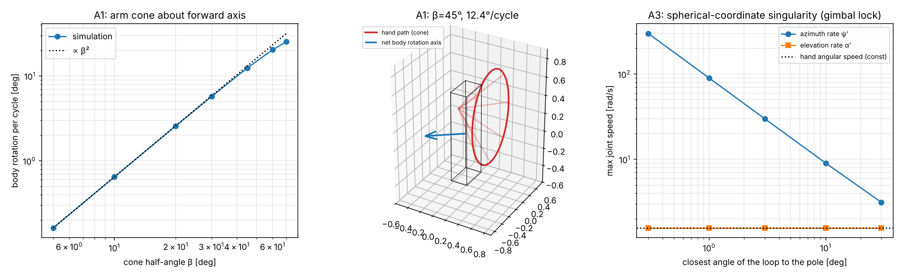
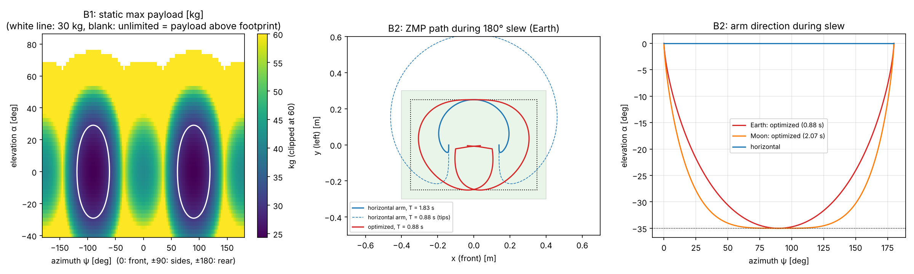
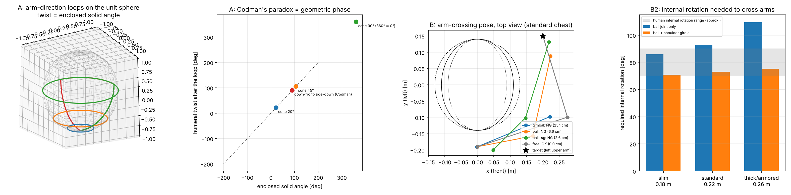

:::message
この章の元になったノート：[docs/07_spatial_3d.md](https://github.com/okamasaya/simulation_AMBAC/blob/main/docs/07_spatial_3d.md)、[docs/08_shoulder_human.md](https://github.com/okamasaya/simulation_AMBAC/blob/main/docs/08_shoulder_human.md)。数値はリポジトリの `data/` にある出力と同じです。
:::

## 3 次元化：球面座標の肩と SO(3)（Sim07）

スクリプト: `sims/sim07_spatial.py` / モデル: `src/ambac/spatial.py` / 数値まとめ: `data/sim07_summary.txt`

### 座標の選び方

| 対象 | 座標 | 理由 |
|---|---|---|
| 腕の向き | **肩を原点とする球面座標** (ψ: 方位角, α: 仰角)、u = (cos α cos ψ, cos α sin ψ, sin α) | 2 自由度の肩（旋回＋俯仰）の関節角そのもの。旋回動作を自然に書ける |
| 胴体の姿勢 | **回転行列（SO(3)）** | 3 次元の回転は順序で結果が変わる（非可換）。オイラー角は特異点を持つため、積分には使わない |

- **球面座標の弱点**: α = ±90°（真上・真下）で ψ が定まらない（座標の特異点）。
  これは座標の都合だけでなく、2 軸の肩（ジンバル）が実際に持つ **ジンバルロック** と同じ現象である（Part A3）。
- **モデルの検証**: 腕を x-z 平面内（ψ = 0）だけで動かすと、平面モデル（Sim01）と 5 桁一致した。
- **腕のモデル化**: 腕（一様な棒）は 40 個の点質量で表し、角運動量と反力を点質量の和として計算した。

3 次元での AMBAC の基本式は、平面の式（01 章）がベクトル・行列になったものである。

$$
\mathbf L = A(q)\,\boldsymbol\omega + B(q)\,\dot q = 0 \quad\Rightarrow\quad
\boldsymbol\omega = -A(q)^{-1}B(q)\,\dot q,\qquad \dot R = R\,[\boldsymbol\omega]_\times
$$

- A(q): 3×3 の慣性テンソル（形状 q で固まった系全体）
- B(q): 3×2 の結合行列
- ω: 胴体座標で表した胴体の角速度

### Part A: 宇宙での 3 次元 AMBAC（人間大）

モデル: 胴体 60 kg（奥行 0.25 × 幅 0.4 × 高さ 1.0 m）、右肩、腕 4 kg・0.7 m。

#### A1: 腕で円錐を描く（宇宙飛行士の「腕回し」）

| 半頂角 β | 1 周あたりの胴体回転 | 回転軸 |
|---|---|---|
| 10° | 0.65° | ほぼ −x（円錐の軸と逆向き） |
| 30° | 5.7° | 〃 |
| 45° | 12.4° | 〃 |
| 70° | 25.4° | 〃 |

- **2 自由度の肩 1 つ（腕 1 本）だけで、任意の角度まで回れる。** 平面では関節 2 つ（腕＋脚）が必要だったが、
  3 次元の肩はそれだけで 2 自由度の形状空間を持つ。
- 小さい円錐では、回転角 ∝ β^2.00（理論どおりの 2 次効果）。Sim05 で議論した「幾何学的位相は振幅の 2 次効果」が、3 次元でも厳密に成り立つ。
- 円錐を逆回りにすると、回転は正確に符号反転する。

#### A2: 円錐の軸の向き（β = 45°）

| 円錐の軸 | 1 周あたり | 胴体の回転軸と円錐の軸のずれ |
|---|---|---|
| 前方 | 12.4° | 17° |
| 右横 | 11.1° | 20° |
| 真上（方位角を 1 周させる旋回） | 58.0° | 8° |
| 前上方 45° | 39.7° | 31° |

- 胴体はおおむね円錐の軸の逆向きに回るが、**ぴったり逆向きではない**（8〜31° ずれる）。
  肩が胴体の中心からずれていること、胴体の慣性テンソルが非等方であることによる。
- 「真上」軸の円錐は、方位角 ψ を 360° 回し続ける動作で、腕が胴体のまわりを 1 周する。
  胴体の主軸（縦軸）まわりの慣性が最も小さいので、回転量が最も大きい。

#### A3: 球面座標の特異点（ジンバルロック）

円錐が極（真上）の近くを通ると、腕の先端は一定の速さで動いているのに、方位角の関節速度 ψ' が発散する。

| ループと極との最小角距離 | 最大 ψ' | 最大 α' |
|---|---|---|
| 30° | 3.1 rad/s | 1.57 rad/s |
| 3° | 30 rad/s | 1.57 rad/s |
| 0.3° | 300 rad/s | 1.57 rad/s |

ψ' は極からの距離に反比例する。**球面座標は旋回動作には便利だが、極の近くでは使えない。** 対策は次のとおり。
- 計画は腕の向きのベクトル u（または四元数）で行い、関節角への変換は極から離れた領域だけで行う。
- 肩の軸の取り付け方向を工夫し、極が作業領域の外に来るようにする（実機のジンバル設計と同じ考え方）。
- 冗長な関節（3 自由度の肩など）を持たせる。

#### A4: 回転の非可換性

ヨー用の円錐 1 周（約 58°）とピッチ用の円錐 3 周（約 33°）を、順序を入れ替えて実行した。

| 順序 | 最終姿勢（回転ベクトル） |
|---|---|
| ヨー → ピッチ | (8.2°, 41.4°, −64.1°) |
| ピッチ → ヨー | (−22.4°, 33.7°, −65.3°) |
| **2 つの最終姿勢の差** | **29.4°** |

平面ではループの順序を入れ替えても結果は同じだった（回転が 1 軸だけで可換）。
**3 次元では動作の順序そのものが結果を変えるので、姿勢変更の計画は「どの動作をどの順で行うか」という系列の問題になる。**
これは学習・計画（フィジカル AI）にとって、平面より本質的に難しい点である。

### Part B: 地上での 3 次元（戦車型台車＋球面座標の腕）

モデル: 台車 80 kg（接地面 前後 0.8 × 左右 0.6 m）、肩の高さ 0.75 m、腕 7 kg・1.0 m、荷物 10 kg。

#### B1: 静的な定格荷重マップ

腕の向き（ψ, α）ごとに、静止状態で転倒しない最大荷重を求めた（安全余裕 5 cm）。
クレーンや油圧ショベルの **定格荷重表** に相当する。

| 腕の向き（水平） | 最大荷重 |
|---|---|
| 前（ψ = 0°） | 41.5 kg |
| 斜め前（45°） | 42.2 kg |
| **横（90°）** | **24.3 kg** |
| 後（180°） | 41.5 kg |

- 接地面が前後に長く左右に狭いので、**横向きが最も弱い**（前後の約 6 割）。
- 腕を高く上げる（α ≳ 70°）と荷物が接地面の真上に来て、静的には転倒しなくなる（図上部の空白）。

#### B2: 腕を水平に 180° 旋回（前 → 左 → 後、荷物 10 kg）

すべての方策に同じ制約（転倒・滑り・関節速度 6 rad/s・加速度 40 rad/s²・仰角 ≥ −35°）を課し、最短時間を比べた。

| 方策 | 地球 | 月 |
|---|---|---|
| 水平のまま旋回 | 1.83 s | 4.48 s |
| 途中で 60° 持ち上げる | 1.24 s | 3.04 s |
| 途中で 35° 下げる | 1.01 s | 2.48 s |
| **最適化（仰角の時間変化と旋回のタイミング）** | **0.88 s（52% 短縮）** | **2.07 s（54% 短縮）** |

**考察**
- 水平のまま速く旋回すると、遠心力で ZMP が外側に大きく振られ、横方向（最も狭い方向）で転倒する（中央図の破線）。
- 腕を上げても下げても旋回半径（cos α）が小さくなり、慣性と遠心力が減る。ただし **下げる方が有利** である。
  転倒させるモーメントは「高さ × 水平方向の加速度」なので、荷物を低くするとその分だけ効きが弱まる。
- 最適化は、仰角の下限（−35°、地面とのすき間）まで腕を下げ、旋回の中盤（横向き＝最も弱い方向）で最も低くする解を選んだ。
  Sim06 の「荷物を体に引き寄せる」と同じく、**慣性と転倒モーメントを減らす動き** であり、人間やクレーン操作員が経験的に行う動作と一致する。

### フィジカル AI への示唆

1. **座標の選択はモデル化の一部である。** 球面座標は人間にとって直感的で、旋回動作の指令に向く。
   一方で特異点を持ち、学習方策の出力をそのまま関節角にすると、極の近くで関節速度が発散する。
   **方策が何を出力するか（関節角か、手先の向きか）は、学習の安定性と実機の安全性に直結する設計判断** である。
2. **3 次元の姿勢は非可換なので、計画は順序の問題になる。** 平面の結果（Sim01〜05）をそのまま 3 次元に拡張するだけでは不十分で、
   系列としての計画・学習が必要になる。
3. **定格荷重マップのような「安全な作業範囲の地図」は、シミュレーションで安価に作れる。**
   方向ごとに異なる限界（前後と左右）を学習方策の制約として与えれば、実機で転倒させずに学習を進められる。

### 限界と次の課題

- 腕は 1 リンク（肘なし）。肘を加えると手先位置と腕の向きを独立に選べ、冗長性を姿勢制御に使える。
- 地上モデルは台車が静止している前提（転倒・滑りの開始条件のみ）。
- 宇宙での 3 次元の最適ループ（与えた目標姿勢に最短で到達する腕の動作系列）は、まだ求めていない。
  非可換性があるため、これは学習・計画の良い課題になる。

### 参考文献

- [R8] T. R. Kane and M. P. Scher, "Human self-rotation by means of limb movements," *Journal of Biomechanics*, 3(1), 39–49, 1970. doi:10.1016/0021-9290(70)90049-7 ✓
- [R18] M. D. Shuster, "A survey of attitude representations," *Journal of the Astronautical Sciences*, 41(4), 439–517, 1993.（回転の表現と特異点）
- [R26] D. Kraft, "A software package for sequential quadratic programming," Technical Report DFVLR-FB 88-28, DLR, 1988.（SLSQP: scipy の minimize で使用）
- [R28] M. Vukobratović and B. Borovac, "Zero-moment point — thirty five years of its life," *International Journal of Humanoid Robotics*, 1(1), 157–173, 2004.

（全文献の一覧と照合状況は [references.md](https://github.com/okamasaya/simulation_AMBAC/blob/main/docs/references.md) を参照）

## 肩の 3 次元運動：AMBAC から人体工学へ（Sim08）

スクリプト: `sims/sim08_shoulder.py` / モデル: `src/ambac/shoulder.py` / 数値まとめ: `data/sim08_summary.txt`

### なぜ肩なのか

Sim07 で、球面座標の肩（2 軸ジンバル）を使って 3 次元の AMBAC を扱った。
ところが、人の肩は 2 軸ではない。少なくとも次の 3 つを持つ。

- 腕の向き（2 自由度）
- 腕の長軸まわりのひねり（内旋・外旋）
- 肩甲骨・鎖骨（上肢帯）の動きによる、肩関節の中心そのものの移動

本章では、AMBAC で使った幾何学的位相の考え方を人の肩に当てはめる。
そのうえで、**人間らしい動きを実演するために機械に何が必要か** を、腕組みを例に定量化する。

### Part A: コッドマンのパラドックス ＝ 肩の幾何学的位相

**コッドマンのパラドックス** [R34, R35]: 腕を「下 → 前 → 横 → 下」と動かして元の向きに戻すと、
一度もひねっていないのに、上腕が長軸まわりに 90° ひねられている。

「ひねらずに動かす」とは、各瞬間の回転軸が常に腕に垂直であること（ひねり方向の角速度がゼロ）を指す。
このとき、ループ 1 周後のひねりは次のようになる（ガウス・ボンネの定理 [R11]）。

$$
\text{ひねり角} = \text{腕の向きが単位球面上で囲んだ立体角}
$$

| 腕の動き | 上腕のひねり | 囲んだ立体角 |
|---|---|---|
| 下 → 前 → 横 → 下（古典的なコッドマンの動作） | +90.00° | +90.00° |
| 半頂角 20° の円錐を描いて下ろす | +21.71° | +21.71° |
| 半頂角 45° の円錐を描いて下ろす | +105.44° | +105.44° |
| 半頂角 90° の円錐を描いて下ろす | +360.00° | +360.00° |

**AMBAC との対応**

| | AMBAC（01 章） | 肩（本章） |
|---|---|---|
| 形状空間 | 関節角 (q₁, q₂) | 腕の向き（単位球面） |
| ループ 1 周の正味の変化 | 胴体の回転 Δθ | 上腕のひねり |
| 決まり方 | 曲率 F の面積分 | 球面の曲率（=1）の面積分 ＝ 立体角 |

**どちらも「形を元に戻しても、向きだけが進む」幾何学的位相** である。
AMBAC の数学は、宇宙の巨大ロボットと人の肩に共通している。

**2 軸ジンバル（Sim07 の肩）の場合**: 上腕の姿勢が関節角 (ψ, α) だけで決まるので、関節角が戻れば姿勢も戻り、
パラドックスは起きない。代わりに、ひねりを独立に選ぶことができない。

**示唆**
- 人の肩の「ひねり」は、どの順序・どの基準で測るかによって値が変わる。
  バイオメカニクスで肩の角度の測り方の標準（回転の順序の取り決め）が必要とされるのは、このためである。
- 人の動きをモーションキャプチャーでロボットに移すとき、ひねりの扱いを誤ると、同じ腕の向きでも手のひらの向きが変わる。
  **3 自由度目（ひねり）を持ち、それを明示的に計画すること** が、人間らしい動きを再現する機械の要件になる。

### Part B: 腕組みは可能か

**姿勢**: 右手を左上腕（肘の少し上）に置き、前腕を胸の前で交差させる（目標点 (0.20, 0.15, 0.00) m、許容誤差 1.5 cm）。
**制約**: 腕（上腕・前腕を太さのある円柱とする）が胸郭（楕円柱）に食い込まないこと、関節の可動域。

| 肩の機構 | 中身 |
|---|---|
| 2 軸ジンバル | Sim07 の肩。ひねりを独立に選べない |
| 球関節（人の可動域） | 3 自由度。水平内転 ≤ 45°、内旋 ≤ 70°、外旋 ≤ 90°、肘 ≤ 145° |
| 球関節＋上肢帯 | 上記に加えて、鎖骨の回転による肩の前方突出（≤ 25°） |
| 球関節（可動域制限なし） | 幾何学的に可能かどうかだけを見る |

#### B1: 合否（標準的な胸板、奥行 0.22 m）

| 肩の機構 | 結果 | 手の誤差 |
|---|---|---|
| 2 軸ジンバル | **不可** | 25 cm |
| 球関節（人の可動域） | 不可 | 6.6 cm |
| 球関節＋上肢帯 | 不可（惜しい） | 2.6 cm |
| 可動域制限なし | 可能 | 0 cm（ただしひねりが不自然） |

- **2 軸ジンバルでは、胸板の厚さによらず届かない**（誤差 24〜26 cm）。
  腕を前に出すと、前腕の曲がる面（肘の屈曲面）が上腕と同じ鉛直面に固定され、前腕を胸の前で横に渡せない。
- 人の可動域を与えた球関節では、内旋 70° の上限に張り付いて届かなかった。
  ただし、内旋 70° は腕を横に 90° 上げた姿勢での標準値で、腕を前に下ろした姿勢でどこまでひねれるかは別である。
  さらに Part A のとおり、ひねりの数値は測り方で変わる。そこで B2 では、合否ではなく「最低限必要な内旋量」を求めた。

#### B2: 腕組みに最低限必要な内旋量

水平内転 ≤ 45°、前方突出 ≤ 25° の下で、手を目標に届かせるのに必要なひねりの最小値を求めた。

| 胸板の奥行 | 球関節のみ | 球関節＋上肢帯（必要な前方突出） |
|---|---|---|
| 0.18 m（細身） | 86° | 71°（12°） |
| 0.22 m（標準） | 93° | 73°（16°） |
| 0.26 m（厚い胸板・装甲） | **110°（人の範囲を超える）** | 75°（20°） |

参考: 人の内旋の可動域はおよそ 70〜90°（姿勢と測り方に依存）。

**考察**
- **肩関節だけでは、腕組みに人の限界ぎりぎりか、それ以上の内旋が必要になる。**
  上肢帯（肩甲骨・鎖骨）が肩関節を前に出すことで、必要な内旋が 15〜35° 減り、人の範囲に収まる。
  **人が腕を組めるのは、肩甲骨が動くから** と言える。
- **胸板が厚いほど難しい。** 厚い胸板・装甲では、肩関節だけでは人の範囲を超える内旋が必要になり、上肢帯の動き（20°）が必須になる。
  アクションフィギュアで、肩の付け根を前に動かせる関節を胸に設けると腕組みができるようになるのと同じ理屈である。
  装甲で胸の厚いガンダム型の機体が腕を組むには、肩の付け根ごと前に出す機構が要る。

### 人間らしい動きのために機械が必要とするもの（ここまでの要件）

| 要件 | 根拠 |
|---|---|
| 肩は 3 自由度（ひねりを含む）にする | 2 軸ジンバルでは腕組みが不可能（B1）。ひねりを独立に選べない（A） |
| ひねりを明示的に計画・計測する | コッドマンのパラドックス：腕の向きの経路によってひねりが勝手に変わる（A） |
| 上肢帯（肩の付け根の移動）を持たせる | 腕組みに必要な内旋が人の範囲に収まる。胸板が厚い機体では必須（B2） |
| 座標の特異点を作業範囲の外に置く | 球面座標の極で関節速度が発散する（Sim07 A3） |
| 胸・装甲の厚さと腕の可動域を同時に設計する | 胸が厚いほど必要な可動域が増える（B2） |

### 限界と次の課題

- 胸郭は楕円柱、腕は円柱で近似した。筋肉の盛り上がり・衣服・装甲の形状は扱っていない。
- 可動域は「水平内転」「スイング・ツイスト分解によるひねり」で単純化した。実際の可動域は姿勢に依存して連続的に変わる。
- 左右の前腕の重なり（どちらが上か）と、左右の腕どうしの干渉は扱っていない。
- 股関節（同じく球関節だが、骨盤のくぼみが深く安定な代わりに可動域が狭い）への展開は今後の課題。

### 参考文献

- [R11] M. P. do Carmo, *Differential Geometry of Curves and Surfaces*, Prentice-Hall, 1976.（ガウス・ボンネの定理）
- [R24] X. B. Peng, P. Abbeel, S. Levine, M. van de Panne, "DeepMimic: Example-guided deep reinforcement learning of physics-based character skills," *ACM Transactions on Graphics*, 37(4), 2018.（モーションキャプチャーを手本とする物理ベースの強化学習）
- [R34] E. A. Codman, *The Shoulder*, Thomas Todd, Boston, 1934.（コッドマンのパラドックス）
- [R35] J. C. Politti, G. Goroso, M. E. Valentinuzzi, O. Bravo, "Codman's paradox of the arm rotations is not a paradox: mathematical validation," *Medical Engineering & Physics*, 20(4), 257–260, 1998. ✓（その後も解釈をめぐる議論がある）
- [R36] G. Wu et al., "ISB recommendation on definitions of joint coordinate systems of various joints for the reporting of human joint motion — Part II: shoulder, elbow, wrist and hand," *Journal of Biomechanics*, 38(5), 981–992, 2005.（肩の角度の測り方の標準）
- [R37] V. T. Inman, J. B. Saunders, L. C. Abbott, "Observations on the function of the shoulder joint," *Journal of Bone and Joint Surgery*, 26(1), 1–30, 1944.（肩甲上腕リズム）
- [R38] American Academy of Orthopaedic Surgeons, *Joint Motion: Method of Measuring and Recording*, AAOS, 1965.（関節可動域の標準値）

（全文献の一覧と照合状況は [references.md](https://github.com/okamasaya/simulation_AMBAC/blob/main/docs/references.md) を参照）
