:::message
この章の元になったノート：[docs/11_simulation_field_plan.md](https://github.com/okamasaya/simulation_AMBAC/blob/main/docs/11_simulation_field_plan.md)。数値はリポジトリの `data/` にある出力と同じです。
:::

## 実装の途中経過

検討の後、クラウドの環境（画面なし）で MuJoCo 4.0.1 を使って実装を始めた。画像は OSMesa（CPU での描画）で作成した。
コードは `src/ambac/field/`、実行スクリプトは `sims/field01_space.py`, `sims/field02_ground.py`、数値は `data/field01_summary.txt`, `data/field02_summary.txt`。

**照合の方法**：MuJoCo が実際にたどった関節の動きを、第 1 段階の Python モデルにそのまま入れて計算し直し、MuJoCo の結果と比べる。
こうすると、モーター（位置サーボ）の追従誤差に左右されずに、物理演算そのものの正しさを確かめられる。

### 段階 1：宇宙の試験場（重力なし）— 合格

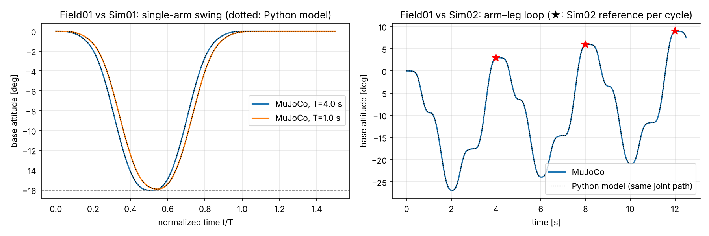
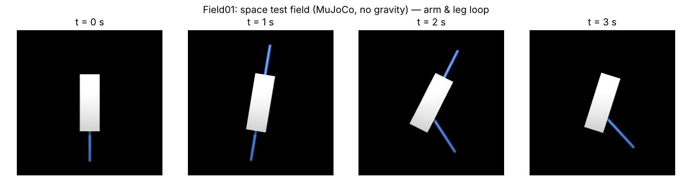

| 試験 | MuJoCo | Python（同じ関節の動き） | 第 1 段階の基準値 |
|---|---|---|---|
| 腕 1 本の往復、4 s（Sim01） | −16.0356° | −16.0356° | −16.04° |
| 腕 1 本の往復、1 s（Sim01） | −15.6924° | −15.6925° | −16.04° |
| 往復後の残り | 10⁻⁵° 程度 | — | 0° |
| 腕＋脚のループ 1 周（Sim02） | +2.963° | +2.970° | +2.9778° |
| 同じ関節の動きでの差（最大） | 2×10⁻⁴° 以下 | | |
| 角運動量の保存 | 10⁻⁶ 程度 | | |

- **MuJoCo の物理演算は、AMBAC の小さな効果（幾何学的位相）まで正しく再現した。**
- 基準値とのわずかなずれは、物理演算ではなく**位置サーボの追従遅れ**による。1 s で速く振ると腕が目標（90°）に届かず 87.5° で止まり、ループの形も最大 12.6° 崩れた。
  **アクチュエータの特性が、そのまま姿勢変化の誤差になる**ので、第 2 段階の校正値（アクチュエータ特性）として重要である。

### 段階 2：地上の試験場（重力・床・摩擦あり）

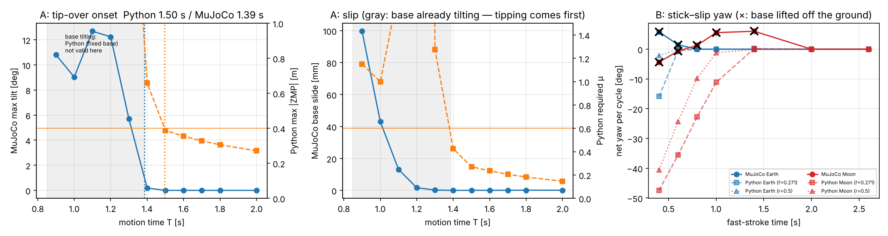

**Test A：荷物運び（Sim06 Part A）— おおむね一致**

| | Python（ZMP が接地範囲の端に達する） | MuJoCo（台車が 1° 以上傾く） |
|---|---|---|
| 転倒の始まり | 1.50 s | 1.39 s |

- 差は約 7%。Python の ZMP 判定は「傾き始める瞬間」を捉えるので、目に見えて傾くのが少し速くなってからなのは自然である。
- どちらでも、滑るより先に転倒が起きた（Sim06 の結論と一致）。
- 台車が傾き始めた後は、Python のモデル（台車は固定）の前提が崩れるので、それ以降の値は比較に使えない。

**Test B：腕の水平の振りによる旋回（Sim06 Part C）— 第 1 稿の前提が崩れる現象を発見**

| 重力 | 速い振りの時間 | MuJoCo | 3 次元の ZMP モデル（Sim07 と同じ） | Python の旋回モデル（Sim06） |
|---|---|---|---|---|
| 地球 | 0.4 s, 0.6 s | 台車が浮き上がる | ZMP が接地範囲の外 | 回る（−16°, −0.6°） |
| 地球 | 0.8 s 以上 | 接地したまま、回らない | 範囲内 | ほぼ回らない |
| 月 | 0.4〜1.4 s | 台車が浮き上がる（最大 1.2 s） | ZMP が接地範囲の外 | 大きく回る（最大 −47°） |
| 月 | 2.0 s 以上 | 接地したまま、回らない | 範囲内 | 回らない |

- **月面で荷物（10 kg）を 1 m の腕で速く振ると、遠心力（最大約 550 N）が台車の重さ（約 160 N）を上回り、台車が浮き上がって傾く。**
  浮いている間は宇宙と同じ AMBAC の状態になり、腕をゆっくり戻すときに接地して、回転の大部分が戻った。
- MuJoCo の浮き上がりと、独立に作った 3 次元の ZMP モデルの判定は、すべての条件で一致した。物理的に正しい現象である。
- 第 1 稿の Sim06 Part C は「台車は接地したまま、ヨーだけ回る」と仮定していた。この機体では、**横滑りで回るより先に、遠心力による浮き上がり・転倒が起きる**。
  とくに月面では、Python の旋回モデルが回ると予測した速さの範囲（振りが 2.09 s より速い）のほぼ全域で、先に浮き上がりが起きる。
- 接地が保たれる条件（地球で 0.8 s 以上、月で 2.0 s 以上）では、MuJoCo と Python のどちらも「回らない」で一致した。

**示唆**
- **簡単なモデルが見落とした連成（旋回と転倒）を、シミュレーション場が見つけた。** これはシミュレーション場を作る意味そのものである。
- 低重力での腕の作業では、旋回のスティックスリップより、転倒・浮き上がりの方が先に問題になる。月面ローバーのアームの運用制限は、まず転倒側から決めるべきである。
- スティックスリップを正しく検証するには、遠心力の小さい（腕が短い・荷物が軽い・接地面が広い）機体で試す必要がある。

### 次の作業

- 段階 3：部品表（JSON）から機体を組み立てる仕組みと、ステージ（段差・坂・月面など）の定義
- 段階 4：「答えを隠した仮想の実機」でのキャリブレーション
- 段階 5：性能表と校正データの書き出し

### 段階 3：アセンブル（部品表から機体を組み立てる）— 実装

コードは `src/ambac/field/assembly.py`（組み立て）、`src/ambac/field/menu.py`（試験メニューと画像）、実行は `sims/field03_assembly.py`、
数値は `data/field03_summary.txt`。部品表とステージの定義は `configs/field/` の JSON。

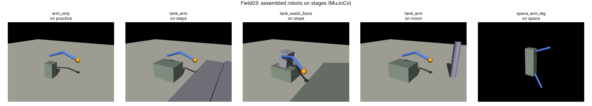

**部品表の項目**

| 項目 | 選択肢・パラメータ |
|---|---|
| 土台（base） | `fixed`（地面に固定、アームだけの試験）／`tank`（床に置いた箱形の台車）／`floating`（宇宙に浮かぶ胴体）、質量・寸法・重心 |
| 腰（waist、省略可） | 前後に傾く上体（高さ、上体の質量・寸法、可動域） |
| 腕（arms、複数可） | 取り付け位置、肩の種類（`pitch`＝1 軸、`yaw_pitch`＝2 軸ジンバル、`ball3`＝3 軸）、リンクの長さ・質量（2 本以上なら肘）、荷物 |
| モーター（actuator） | 位置サーボのゲイン |

**用意した機体とステージ**

- 機体：`arm_only`（アームだけ）、`tank_arm`（Sim06 と同じ）、`tank_waist_3axis`（腰＋3 軸の肩：Sim08・09 の要件を満たす構成）、`space_arm_leg`（Sim02 と同じ）
- ステージ：`practice`（練習場）、`steps`（0.15 m と 0.25 m の段）、`slope`（10° の坂）、`ice`（摩擦 0.1）、`moon`（柱あり）、`mars`（壁あり）、`space`（重力なし）

**組み立ての検証**

| 比較 | 組み立て | 手作り（段階 1・2） |
|---|---|---|
| 戦車型＋腕の総質量・重心 | 97.000 kg、(0.1366, 0, 0.4206) m | 同じ |
| 荷物運び 1.5 s の最大の傾き | 0.001° | 0.002° |
| 荷物運び 1.3 s の最大の傾き（転倒） | 5.46° | 5.70° |
| 宇宙の人型のループ 1 周 | +2.969° | +2.963° |

転倒が起きた後（1.3 s）の値に 4% ほどの差があるのは、転倒が始まった後の運動が初期条件の小さな違いに敏感なためと考えられる。それ以外は一致した。

**試験メニューの例：同じ荷物運び（2.0 s）を機体 × ステージで実行**

| 機体 | 練習場 | 氷 | 火星 | 月 |
|---|---|---|---|---|
| tank_arm | 傾かない | 2 cm 滑る | 11° 傾く | 14° 傾き、0.7 s 浮く |
| tank_waist_3axis（腰は固定のまま） | 傾かない | 4 cm 滑る | 10° 傾く | 14° 傾き、転倒したまま（8°） |

火星・月で傾いたのは、第 1 稿のフルード則（安全な最短時間：火星 2.62 s、月 3.97 s）より速く動かしたためで、整合している。
腰を使った動き（上体の前後傾で反作用を打ち消す）は、試験メニューにまだ入れていない。

**今回の対象外**：二本脚（立っているだけでバランス制御が必要で、規模が大きくなる）。今後の課題とする。

### 段階 4：「答えを隠した仮想の実機」によるキャリブレーション — 実装

実行は `sims/field04_calibration.py`、数値は `data/field04_summary.txt`, `data/field04_calibration.json`。

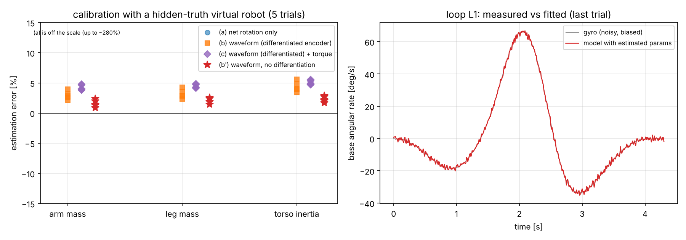

**手順**
1. 宇宙の人型の腕の質量・脚の質量（±15%）、胴体の慣性の倍率（±10%）を乱数でずらした「仮想の実機」を MuJoCo で作る。正解は推定側に隠す（総質量 76 kg は既知）。
2. 曲率マップの異なる場所に置いた 6 種類の円ループ（詳細版 D14 と同じ）を 1 周ずつ回す。
3. センサーを模擬する：ジャイロ（雑音 0.2°/s、一定のバイアス最大 ±0.2°/s）、エンコーダ（雑音 0.05°）、関節トルク（雑音 0.2 N·m）、100 Hz。
4. 次の方法で推定し、隠した正解と比べる。乱数を変えて 5 回繰り返す。

| 推定の方法 | 誤差（5 回の二乗平均）：腕 / 脚 / 胴体の慣性 |
|---|---|
| (a) ループ 1 周ごとの正味の回転だけ | 31% / **210%** / 54%（脚は推定できない） |
| (b) 周回中の角速度の波形（関節角を微分して速度を求める） | 3.0% / 3.2% / 4.4% |
| **(b′) 周回中の波形（微分を使わない：区間ごとの回転量で比べる）** | **1.7% / 2.1% / 2.4%** |
| (c) (b) に関節トルクを加える（関節角を 2 回微分して加速度を求める） | 4.3% / 4.4% / 5.0% |
| 参考：MuJoCo の正確な速度・加速度を使った場合（ノイズなし） | 0.04% 以下（トルクを加えると 0.02% 以下） |

ジャイロのバイアスも同時に推定でき、正解との差は 0.01°/s 程度だった。

**分かったこと**
- **詳細版 D14 の見積もり（正味の回転だけでは脚の質量を推定できない、波形を使えば推定できる）を、実際の手順で確かめられた。**
- **推定しにくい方向がある**：腕・脚の質量と胴体の慣性がそろって同じ割合で増減する方向（特異値がほかの方向の約 60 分の 1）。
  AMBAC の姿勢の動き（θ' = −Γ·q'）は質量・慣性の「比」で決まるため、姿勢の波形だけでは全体の大きさを決めにくい。推定の誤差もこの方向にそろって現れた。
- **偏りの原因は手法ではなく前処理**だった：MuJoCo の正確な速度・加速度を使うと誤差は 0.05% 以下になる。
  関節角を微分して速度・加速度を求めると、位置サーボの速い動きやノイズの影響で偏りが生じる。
- **校正の設計の指針**
  1. 姿勢の時間変化（IMU の波形）を記録して使う。ループ 1 周の正味の回転だけでは足りない。
  2. 関節角の微分を避ける推定式を使う（AMBAC の基本式は時間を含まないので、区間ごとの回転量で比べられる）。
  3. 質量・慣性の絶対値を決めるには力の情報（関節トルク）が有効だが、速度・加速度を直接測るセンサー（モータードライバの速度出力など）と組み合わせる必要がある。
  4. 曲率マップの異なる場所に複数のループを置き、推定しにくい方向を減らす。

**誤差評価（追記、`sims/field04b_error_budget.py`）**：上の (b′) の誤差（約 2%）の大部分は、推定法ではなく**仮想の実機の計算誤差**だった。
部品表から組み立てた機体は積分法 implicitfast（1 次）で計算しており、角運動量 L = 0 がわずかに保たれないため、雑音がなくても +1.2〜1.8% 偏る（時間刻みに比例。2 ms で +5〜7%）。
推定しにくい方向（全体の大きさ）に沿って拡大されるためで、積分法を RK4 にすると雑音なしの誤差は 0.08% 以下になる。
RK4 での 50 回の試行では、(b′) の偏りは統計的に有意でなく（平均 +0.1〜0.2%、95% 信頼区間 ±0.3〜0.4%）、1 試行のばらつきは 1.2〜1.4%。
(b) の偏り（+1.7〜2.7%）は、エンコーダの雑音を微分することによる errors-in-variables で、200 Hz では +3〜7% に増える。
総質量の仮定の誤差は腕・脚の質量に 1:1 で移る。数値は `data/field04b_summary.txt`、図は `figures/field/field04b_error_budget.png`。
上の「偏りの原因は前処理」「真の速度で 0.05% 以下」の記述は、この評価で修正される（(b) には当てはまるが、(b′) の偏りの主因は積分法）。

### 段階 5：性能表と校正データの書き出し — 実装

評価の窓口 `src/ambac/field/evaluate.py` と、書き出しのスクリプト `sims/field05_export.py` を作った。
機体（部品表の JSON）とステージ（JSON）を渡すと、荷物運び（前方の地面 → 頭上 → 後部）を
**傾き 1° 未満・ずれ 5 mm 未満で実行できる最短時間** を二分法で求め、性能表の 1 行を返す。

```bash
PYTHONPATH=src MUJOCO_GL=osmesa python -m ambac.field.evaluate configs/field/robots/tank_arm.json configs/field/stages/practice.json
```

**性能表（荷物運びの安全な最短時間 [s]）**

| 機体 | 練習場（地球, μ0.6） | 氷（地球, μ0.1） | 火星（g 3.72） | 月（g 1.62） |
|---|---|---|---|---|
| 戦車型＋腕（tank_arm） | 1.35 | 2.22（フルード則 1.35） | 2.21（フルード則 2.19） | 3.34（フルード則 3.32） |
| 戦車型＋腰＋3 軸の肩（tank_waist_3axis） | 1.41 | 2.43（フルード則 1.41） | 2.28（フルード則 2.29） | 3.44（フルード則 3.46） |

括弧内は、練習場の値 × √(g_地球 / g) によるフルード則の予測。値は段階 7 で評価の窓口を更新した後のもの（二分法を 10 回に細かくした。最初の版との差は 2% 以内）。

**分かったこと**
- **重力だけが違うステージでは、フルード則（第 1 段階の Sim06）が 1% 程度の精度で成り立つ。** 練習場で 1 回測れば、火星・月の値を予測できる。
- **氷のステージではフルード則が外れる**（予測 1.35 s に対して 2.22 s）。制限が「傾き（転倒）」から「ずれ（滑り）」に変わるため。
  滑りやすい床では、重力のスケーリングとは別に、摩擦の校正値が必要になる。
- 腰と 3 軸の肩を持つ機体は、この試験ではわずかに遅い（質量が増え、腕の付け根が高いため）。腰の戦略を使う動作計画はまだ入れていないので、これは「同じ動作をさせた場合」の比較である。

**書き出したデータ（DIY_AutoML などとの疎結合用）**

| ファイル | 内容 |
|---|---|
| `data/field_performance.csv` | 性能表（機体 × ステージ、安全な最短時間、フルード則の予測、その時の傾き・ずれ） |
| `data/field_calibration_dataset.csv` | 答えを隠した仮想の実機のセンサーデータ（6 ループ、100 Hz、2586 行：時刻、ジャイロ、腕・脚の関節角、関節トルク） |
| `data/field_calibration_truth.json` | 隠した正解（腕の質量、脚の質量、胴体の慣性の倍率、ジャイロのバイアス）、ノイズの条件、ループの定義 |
| `data/field_summary.xlsx` | Excel のサマリー（シート：説明、性能表、照合結果、キャリブレーション、計測データ） |

計測データの CSV を入力にし、正解の JSON を使わずに質量・慣性を推定できるかを試すことで、
機械学習側（DIY_AutoML）の手法を、段階 4 の物理モデルによる推定（(b′) で誤差 2% 前後）と比べられる。

### 段階 6：腰の戦略（地上版 AMBAC）を、組み立てた機体に適用する

機体 `tank_waist_3axis`（戦車型台車＋前後に傾く腰＋3 軸の肩、総質量 97 kg）で、段階 5 の荷物運びに「補正」を重ね、最短時間を比べた。
補正は時間 t/T の正弦波の和で表し（肘 2 個、腰 4 個の係数。腰は最後に一定の傾きを残してよい）、
**MuJoCo を評価関数として直接使い**、Nelder–Mead 法で係数を最適化した（物理の式を使わない探索）。
時間を少しずつ短くしながら、前の係数を初期値にして最適化し直す方法（継続法）を使った。
最初から短い時間で探すと、どの係数でも転倒して評価が平らになり、探索が進まなかったためである。

スクリプト: `sims/field06_waist.py`（約 30 分） / 数値まとめ: `data/field06_summary.txt`

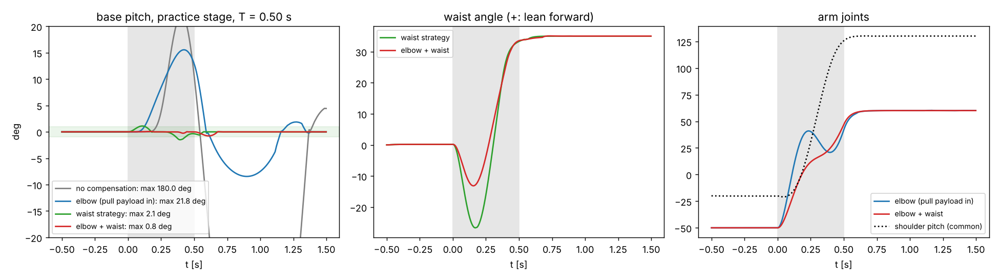

**荷物運びの安全な最短時間（傾き 1° 未満・ずれ 5 mm 未満）**

| 補正 | 練習場 | 短縮 | 月 | 短縮 | 練習場での関節の最大トルク |
|---|---|---|---|---|---|
| なし | 1.41 s | — | 3.47 s | — | 318 N·m |
| 肘（荷物を体に引き寄せる） | 0.83 s | 42% | 2.02 s | 42% | 739 N·m |
| 腰（上体を前後に傾ける） | 0.57 s | 60% | 1.51 s | 56% | 839 N·m |
| **肘＋腰** | **0.50 s** | **65%** | **1.31 s** | **62%** | 1102 N·m |

**分かったこと**
- **腰の補正は、肘の補正より効く**（練習場で 60% 対 42%）。両方を使うと 65% 短くなる。
- 最適化が見つけた腰の動きは、**最初に後ろへ反り（約 −25°）、荷物を後ろに回すにつれて前へ傾く（+35°、可動域の上限）**。
  第 1 段階の Sim09 の最適解（−40° → +28°）と同じ型で、物理の式を使わない探索でも、人が重い物を持つときの動き（腰の戦略）が再発見された。
- 肘の補正は、動作の途中で肘を曲げて荷物を体に引き寄せる動き。第 1 段階の Sim06 の「引き寄せる軌道で 36% 短縮」と同じ方向の結果。
- 月でも短縮の割合はほぼ同じ（重力が変わっても、補正の効き方の比は変わらない）。
- **速くなる代わりに、必要なトルクが増える**（補正なし 318 N·m → 肘＋腰 1102 N·m）。段階 7 のモーターの定格と合わせて、
  「どこまで速くするか」は、モーターの大きさとのトレードオフになる。


### 段階 7：アクチュエータの簡易モデル — 必要なモーターの定格

部品表の `actuator` に、関節ごとの **トルクの上限**（`torque_limit`、N·m）と **速度の上限**（`speed_limit_deg_s`、目標角の変化の速さ）を書けるようにした（`src/ambac/field/assembly.py`）。
速度の上限があると指令どおりの時間では動けないため、評価には「腕が目標の 1° 以内に入ってとどまる実際の時刻（完了時間）」と「その間の最大トルク」を加えた。
合格の条件にも「腕が目標に 1° 以内で届く」を加えた（段階 5 の性能表の値は変わらない）。

スクリプト: `sims/field07_actuator.py` / 数値まとめ: `data/field07_summary.txt`

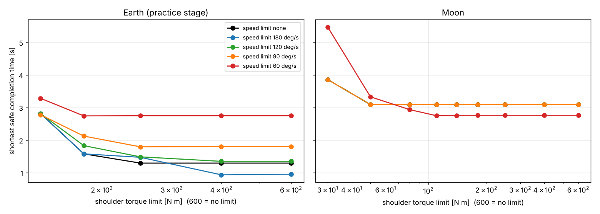

**荷物運びの完了時間の最短値 [s]（tank_arm、肘のトルクの上限は肩の 0.6 倍）**

| 肩のトルクの上限 | 地球：速度の上限なし | 地球：90°/s | 地球：60°/s | 月：速度の上限なし | 月：60°/s |
|---|---|---|---|---|---|
| 上限なし | 1.29 | 1.80 | 2.75 | 3.09 | 2.76 |
| 250 N·m | 1.29 | 1.79 | 2.75 | 3.09 | 2.76 |
| 180 N·m | 1.58 | 2.12 | 2.74 | 3.09 | 2.76 |
| 140 N·m | 2.81 | 2.78 | 3.28 | 3.09 | 2.76 |
| 110 N·m 以下 | **不可** | 不可 | 不可 | 3.09（50 N·m まで） | 2.75〜3.33 |
| 30 N·m | 不可 | 不可 | 不可 | 3.86 | 5.47 |
| 20 N·m | 不可 | 不可 | 不可 | **不可** | 不可 |

参考：腕を水平に伸ばして荷物を支える肩のトルクは、地球で 130 N·m、月で 22 N·m。

**分かったこと**
- **荷物を支えるトルク（静的な保持トルク）が、実現できるかどうかの境界になる。** 地球では 130 N·m を下回ると、どんなに遅く動かしても不可。月では 22 N·m が境界で、比は重力の比（約 6 分の 1）に一致する。
- 保持トルクを少し上回るだけ（地球で 140 N·m）だと、動作は約 2 倍遅くなる（2.8 s）。**保持トルクの約 2 倍（250 N·m）あれば、速さはトルクで制限されない。**
  転倒の制限（フルード則）とモーターの制限のどちらが効くかで、必要な定格が決まる。
- 速度の上限は、そのまま完了時間の下限になる（150° を 60°/s なら 2.5 s 以上）。
- 速度を一定に抑える動かし方（台形の速度）は、最小ジャークより速く終わる場合がある（地球で 180°/s のとき 0.95 s、月で 60°/s のとき 2.76 s）。
  最小ジャークは速度の最大値が平均の 1.9 倍になるため。**軌道の形も校正・最適化の対象になる。**
- 月では、トルクが小さくても（50 N·m まで）完了時間は変わらない。制限は転倒（フルード則）で決まる。**月面の機体は、地球の機体より小さなモーターで同じ作業ができる**が、速さは重力で決まる。

### 段階 8：履帯の台車で段差・坂を走る（試作）

台車の種類に、走行できる履帯（`base.type = "tracked"`）を加えた（`src/ambac/field/assembly.py`、走行の試験メニューは `src/ambac/field/drive.py`）。
履帯は、駆動する転輪を密に並べ（間隔は半径の 0.4 倍）、すべての転輪の回転を拘束でそろえて 1 本のベルトとして近似した。
前端は進入角 40° で高さ 0.25 m まで持ち上げた。車体（箱）は接触しない（スカート扱い）。
機体 `tracked_arm`：Sim06・10 の戦車型と同じ大きさ（接地長 0.8 m）、腕＋荷物 10 kg、転輪 3 kg × 30 個、総質量 187 kg、駆動力の上限 2000 N（重量の約 1.1 倍）、周速 0.15 m/s、μ = 0.6。

スクリプト: `sims/field08_steps.py` / 数値まとめ: `data/field08_summary.txt`

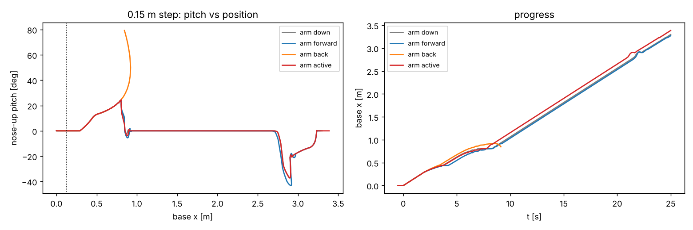

**段差（25 秒で段の上を走り抜けられたか）**

| 腕の姿勢 | 越えられた最大の段差 | 失敗のしかた |
|---|---|---|
| 下ろす（荷物を前方の床のすぐ上に） | 0.150 m | 0.175〜0.225 m で止まる（シーソー状態）、0.25 m で後ろに転倒 |
| 前に伸ばす | 0.150 m（0.125 m は止まる） | 0.175 m 以上で止まる |
| 後ろ上方にたたむ | 0.100 m | 0.125 m で止まり、0.15 m 以上で後ろに転倒 |
| 能動（機首が上がるほど腕を前へ伸ばす） | 0.150 m | 0.175〜0.225 m で止まる、0.25 m で転倒 |

**上り坂（1.5 m 上れたか）**：腕の姿勢によらず、28° まで上れ、31° で滑り落ちる（摩擦の限界 atan 0.6 = 31.0°）。

**分かったこと**
- **段の角に乗り上げた台車は「シーソー」になる。** 機首が上がると重心が段の角より後ろに移り、前に倒れ込めない。同時に、角に当たるベルトの傾きが摩擦角に近づき、這い上がれない。
  第 1 段階の Sim10（準静的な見積もり）は、この状態を考えていなかった。
- **重心の位置で失敗のしかたが変わる。** 腕を後ろにたたむと後ろに転倒し、前に伸ばすと転倒はしないが、段に当たった直後に止まりやすい。
  荷物を前方の低い位置に置く姿勢（下ろす）と能動の腕は、どちらも 0.15 m 以下をすべて越えた。重心を前に置くことが効く（Sim10 の「腕による重心移動が乗り越え能力の差になる」と同じ方向）。
  （最初の版では、「腕を下ろす」を肩 −90° としており、腕と荷物が床の下に入り込んでいた。目視の確認で見つけて直した。下の「動画による目視の確認」を参照）
- **坂は摩擦で決まり、腕の姿勢は効かない**（第 1 段階の想定どおり）。
- 越えられた段差（0.15 m）は、Sim10 の見積もり（0.25 m）より低い。

**モデルの限界（重要）**
- 転輪の列でベルトを近似しているため、段の角が転輪の間に挟まると、駆動力を 4 倍にしても動かない場合があった（転輪の間隔を変えると結果が変わる）。止まった結果の一部は、この近似による可能性がある。
- 転輪を軽くしすぎると（0.5 kg）、駆動が振動して接地が途切れ、結果が大きく変わった（3 kg で安定）。
- 段差の結果は「傾向」として扱い、数値は履帯のより正確なモデル（連結した板のベルトなど）で確かめ直す必要がある。坂の結果（摩擦の限界）は、理論と一致しており信頼できる。


### 段階 9：二本脚で立つ機体と戦車型を、同じ試験で比べる

導入の問い「二足歩行は本当にバランスが良いのか？」を、シミュレーション場で確かめた。
機体 `biped_waist` は第 1 段階の Sim09 Part B と同じ寸法（脚 24 kg・足裏 0.25 m、股関節 0.95 m で前後に傾く上体 56 kg、肩 1.45 m、総質量 97 kg）。
脚は固定とした（足首は十分に強いと仮定し、支持範囲は足裏の大きさで決まる）。比較の戦車型 `tank_waist_3axis` も総質量 97 kg。
荷物運び（段階 5・6 と同じ動作）を、傾き 1° 未満・ずれ 5 mm 未満で実行できる最短時間を求めた。

スクリプト: `sims/field09_biped.py`（約 15 分） / 数値まとめ: `data/field09_summary.txt`

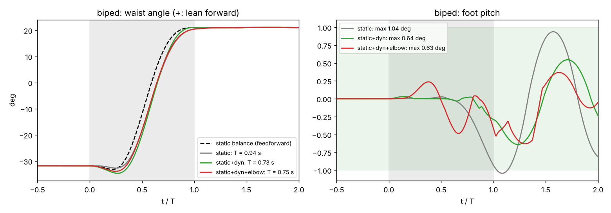

**腰の動きの作り方**：二本脚は、腰の角度を 0° から始めると、どの補正でも転倒した（最初の版の試験で確認）。
そこで、**腕の各姿勢で全体の重心が足裏の中央に来る腰の角度（静的なつり合い）** を前もって計算し、それを出発点にした（フィードフォワード）。
得られた腰の動きは **最初に後ろへ 32° 反り、最後に前へ 21° 傾く** 形で、Sim09 の最適解（−40° → +28°）とほぼ同じ。
これに正弦波の補正を重ね、段階 6 と同じく MuJoCo を評価関数として最適化した。

**荷物運びの安全な最短時間**

| 腰・肘の使い方 | 二本脚：練習場 | 戦車型：練習場 | 二本脚：月 | 戦車型：月 |
|---|---|---|---|---|
| 腰を使わない | **不可（12 s でも転倒）** | 1.41 s | **不可** | 3.47 s |
| 腰：静的なつり合いのみ | 0.94 s | — | 2.16 s | — |
| 腰：最適化（二本脚は静的なつり合い＋補正） | **0.74 s** | **0.57 s** | 1.98 s | 1.51 s |
| 腰＋肘：最適化 | 0.75 s | 0.50 s | 2.04 s | 1.31 s |

二本脚の関節の最大トルク（練習場）：静的なつり合い 351 N·m、最適化 472 N·m（戦車型の腰の最適化は 839 N·m）。

**分かったこと**
- **二本脚は、腕だけでは荷物運びができない。** 最初と最後の姿勢では静止できるが（重心は足裏の端から約 2 cm 内側）、荷物を頭上から後ろへ回す途中で重心が足裏の外に出る。
  第 1 段階の Sim09 は「静止しても転倒」としていたが、これは安全余裕 2 cm を差し引いた判定で、物理的には「ぎりぎり立てる」状態だった。
- **腰（股関節）で上体を動かせば、二本脚でも運べる。** 静的なつり合いだけで 0.94 s、動的な補正を加えて 0.74 s。
  **二本脚が立っていられるのは、脚ではなく、動かせる重い上体のおかげ**（Sim09 の結論を MuJoCo で確認）。
- **それでも、同じ腰を持つ戦車型の方が速い**（練習場 0.74 s 対 0.57 s、月 1.98 s 対 1.51 s。二本脚は約 3 割遅い）。
  Sim09（関節の速度の上限あり）では差は 8%（0.69 s 対 0.64 s）だったが、速度の上限のないこの試験では、支持範囲の広さがそのまま速さの差になった。
- 二本脚は、静止の姿勢をつくるだけで上体を大きく傾ける必要があるため、腰の可動域（±45°）の多くを「立つこと」に使ってしまう。
  戦車型は、腰の動きをすべて「腕の反作用を打ち消すこと」に使える。
- 二本脚では肘の補正を加えても速くならなかった（0.75 s）。最適化が局所解に止まった可能性がある。月の二本脚は、傾きに余裕（0.02〜0.05°）を残したまま探索が止まっており、さらに短くできる可能性がある。
- 合格の境界付近では、結果が時間の丸め（0.001 s）に敏感だった（図の再計算で、静的なつり合いの最大の傾きは 0.91° ではなく 1.04°）。

**導入の問いへの答え（シミュレーション場での確認）**：二足歩行は、静的にはバランスが悪い（腕だけでは荷物を運べない）。
立って作業できるのは、股関節で動かせる重い上体があるからで、その上体を戦車型に載せれば、さらに速く安定する。
平地での作業に限れば、第 1 段階の結論（「足は飾り」は用途で答えが変わる。平地では戦車型＋腰が最も合理的）は MuJoCo でも変わらなかった。
二本脚の利点（段差）は、段階 8 の履帯の試験と、今後の二本脚の歩行・段差の試験で比べる。

### 段階 10：板をつないだ履帯（正確なモデル）で、段差・坂をやり直す

段階 8 の「転輪の列」の近似には、段の角が転輪の間に挟まる不具合の疑いがあった。そこで、履帯を実物と同じ構造で作り直した（`src/ambac/field/track.py`、`base.type = "linked_track"`）。
- 履板（ピッチ 4 cm、厚さ 2 cm、0.3 kg）57 枚をヒンジでつないだ輪。最後と最初の履板を拘束で閉じる
- 輪を、起動輪（後ろ、半径 0.10 m、駆動、地面から 1 cm 浮かせる）・転輪 5 個（サスペンション付き）・誘導輪（前、高さ 0.25 m、進入角 40°、張り装置付き）に巻き付ける
- 地面・段に触れるのは履板だけ。駆動は起動輪と履板の摩擦で伝える（歯はない）
機体 `linked_track_arm`：総質量 128 kg、接地長 0.8 m、腕＋荷物 10 kg、駆動力の上限 2000 N、周速 0.15 m/s、μ = 0.6。
1 回の試行は実時間の約 2.6 倍かかるため、4 並列で計算した（60 試行で約 20 分）。

**モデルを作る途中で直したこと（記録）**
1. **履板の食い込み**：まっすぐな履板を車輪の円弧に沿って並べると、板の中央が円弧の内側に約 2 mm 入り込む。そのまま輪を閉じると、ベルトが車輪を締め付けて機体の重さの約 20 倍の張力が生じ、荷重が前後の端だけにかかった。頂点を外側にずらして直した。
2. **起動輪の上での空回り**：歯がないため、逆回転させた側でベルトが滑った。誘導輪をばねで前に押す張り装置（実物にもある）を加えた。
3. **荷重の偏り**：硬い履帯と硬い地面の多点接触では、荷重の分かれ方が 1 mm 以下の高さの差で決まり、前後の端に集中した。
   地面を柔らかくすると均されたが、計算が発散した（MuJoCo は発散すると状態を初期化するため、「止まった」ように見える結果が混ざった）。
   実物と同じく、**転輪にサスペンションを付け、起動輪を浮かせる**ことで、硬い地面のまま荷重を転輪に分けられ、発散もなくなった。
   走行の試験では、計算の発散を検出して「発散」と記録するようにした（今回の 60 試行では発散なし）。

スクリプト: `sims/field10_linked_track.py` / 数値まとめ: `data/field10_summary.txt`

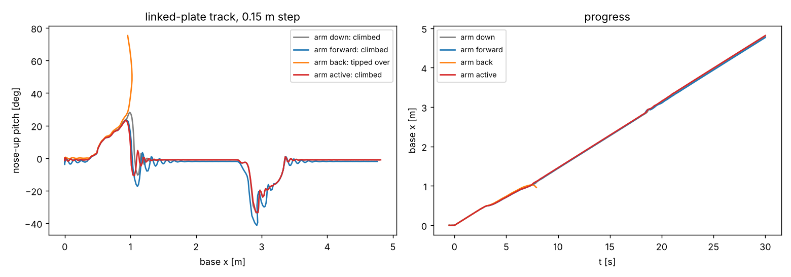

**Part A：段差（元の形）**

| 腕の姿勢 | 正確なモデル | 段階 8（転輪の列） | 高い段での失敗のしかた |
|---|---|---|---|
| 下ろす（荷物を前方の床のすぐ上に） | 0.15 m | 0.15 m | 0.20 m 以上で後ろに転倒 |
| 前に伸ばす | 0.15 m | 0.15 m | 0.20 m 以上で後ろに転倒 |
| 後ろ上方にたたむ | 0.10 m | 0.10 m | 0.15 m 以上で後ろに転倒 |
| 能動（機首が上がるほど腕を前へ） | 0.15 m | 0.15 m | 0.20 m 以上で後ろに転倒 |

**Part B：上り坂**：腕の姿勢によらず 28° まで上れ、31° で滑り落ちる（摩擦の限界 31.0°）。腕を後ろにたたむと 34° で後ろに転倒した。

**Part C：機体の形を変える**

| 機体の形 | 腕を下ろす | 腕を能動的に動かす |
|---|---|---|
| 元の形（接地長 0.8 m、車体の重心 0.30 m） | 0.15 m | 0.15 m |
| 重心を下げる（車体の重心 0.15 m） | **0.20 m**（0.25 m は止まる） | **0.20 m**（0.25 m は止まる） |
| 履帯を長くする（接地長 1.2 m） | **0.30 m** | **0.30 m** |
| 長く＋重心を下げる | **0.30 m** | **0.30 m** |

（0.30 m より高い段は試していない。前端の誘導輪の上端は 0.33 m。）

**分かったこと**
- **段階 8 の近似は、傾向としては正しかった。** 正確なモデルでも、元の形で越えられる段差は 0.10〜0.15 m で、腕を後ろにたたむと最も不利という順序も同じだった。
- **短く重心の高い機体は、段の角で「シーソー」になって後ろに転倒する。** 後ろの端が床に、腹が段の角に乗ると、進むほど支点の間隔が縮んで機首が上がる。
  重心が段の角を越える前に、重心が後ろの接地点の外に出ると転倒する。元の形では、どの腕の姿勢でも 0.20 m で転倒した。
- **履帯を長くすると、越えられる段差は 2 倍（0.15 → 0.30 m）になる。** 重心を下げるだけでは 0.20 m まで。
  第 1 段階の Sim10（0.25 m、前端の高さで決まる形の限界）は、長い履帯でなら超えられた（前端の誘導輪の上端は 0.33 m あるため）。元の短い形では、Sim10 が考えていなかったシーソーの転倒で 0.15 m に下がる。
- **荷物を前方の低い位置に置いていれば、腕を能動的に動かしても、越えられる段差は変わらなかった**（どの形でも、腕を下ろす＝能動）。
  効いているのは「重心を前に低く置くこと」で、腕を後ろにたたむ（重心を後ろ上方に置く）と最も不利になる。
  （最初の版では、能動の腕が長い履帯で 0.25 m → 0.30 m と効いたように見えたが、比べた「腕を下ろす」の荷物が床の下に入り込んでいたためだった）
- **形の選び方の指針**：段差を越える機体は、長い履帯と低い重心を選び、荷物（腕）を前方の低い位置に置く。ただし、長い履帯は旋回しにくい（段階 11）。

**モデルの限界**
- 起動輪には歯がなく、摩擦と張りで履板を送る。履板の表面には突起（グローサー）がない。
- 段階 10 は、左右の履帯を中央の 1 本で表した（まっすぐ進む試験のため）。2 本の履帯は段階 11 で扱う。

### 段階 11：左右 2 本の履帯による旋回（スキッドステア）と、旋回中の腕の作業

履帯を左右 2 本にした（各幅 0.15 m、中心の間隔 B = 0.45 m）。機体 `twin_track_arm`：総質量 160 kg、接地長 0.8 m、腕は 2 軸の肩（旋回＋俯仰）＋肘＋荷物 10 kg。
左右の履帯の速さの差で曲がる（スキッドステア）。比較のため、**スキッドステアの基準モデル**を Python で作った（`src/ambac/field/skid.py`）：
履帯の接地面を小片に分け、各小片に滑りと逆向きのクーロン摩擦が働くとして、力とモーメントのつり合いから定常旋回の角速度を求める（古典的な履帯の旋回理論と同じ考え方）。
圧力分布は、一様な場合と、MuJoCo で止まった状態の接地の荷重を測った場合の 2 通りで計算した。

スクリプト: `sims/field11_turning.py`（4 並列で約 8 分） / 数値まとめ: `data/field11_summary.txt`

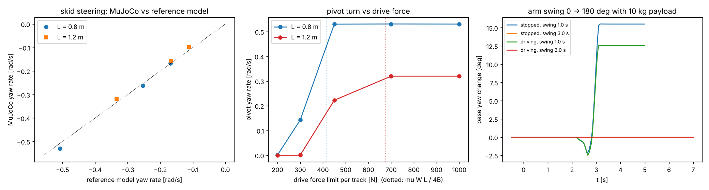

**Part A：定常旋回の角速度 [rad/s]**

| 接地長 | 左右の速さ [m/s] | MuJoCo | 基準モデル（実測の荷重分布） | 基準モデル（一様な圧力） | 滑りなし |
|---|---|---|---|---|---|
| 0.8 m | +0.15 / −0.15（その場旋回） | −0.529 | −0.506 | −0.362 | −0.667 |
| 0.8 m | +0.15 / 0（片側を止める） | −0.264 | −0.253 | −0.181 | −0.333 |
| 0.8 m | +0.20 / +0.10 | −0.168 | −0.168 | −0.120 | −0.222 |
| 1.2 m | +0.15 / −0.15 | −0.320 | −0.336 | −0.217 | −0.667 |
| 1.2 m | +0.15 / 0 | −0.157 | −0.168 | −0.108 | −0.333 |
| 1.2 m | +0.20 / +0.10 | −0.100 | −0.112 | −0.072 | −0.222 |

- **MuJoCo は、実測の荷重分布を入れた基準モデルと 0〜11% の差で一致した**（3 層の照合の第 1・2 層が、旋回でも成り立った）。
- 一様な圧力を仮定すると、旋回の速さを 3 割ほど小さく見積もる。起動輪を浮かせたため、実際に荷重を受ける長さは 0.8 m より短い（約 0.5 m）。**接地の荷重分布は、旋回の性能を決める校正値になる。**
- 滑りがない場合に比べて、旋回は 0.8 m で約 8 割、1.2 m で約 5 割の速さにとどまる（履帯の横滑りのため）。**長い履帯ほど曲がりにくい。**

**Part B：その場旋回に必要な駆動力（1 本あたり）**

| 接地長 | 200 N | 300 N | 450 N | 700 N | 1000 N | 基準モデルの必要な力 μWL/(4B) |
|---|---|---|---|---|---|---|
| 0.8 m | 回らない | 0.10 rad/s | **0.53 rad/s** | 0.53 | 0.53 | 418 N |
| 1.2 m | 回らない | 回らない | 0.23 rad/s | **0.32 rad/s** | 0.32 | 674 N |

- **その場旋回に必要な力は、基準モデルの見積もり μWL/(4B) とよく合う**（0.8 m では 300〜450 N の間、1.2 m では 450〜700 N の間で、力が足りるようになる）。
- **長い履帯（段差に強い）は、旋回に約 1.6 倍の駆動力が要る。** 段階 10 の結果と合わせると、「段差に強い長い履帯」と「曲がりやすい短い履帯」のトレードオフになる。用途に応じて形を選ぶ（アセンブル）具体例である。

**Part C：荷物を持った腕を横に振る（肩の旋回 0 → 180°、腕を水平に伸ばし荷物 10 kg）**

| 状態 | 振る時間 | 車体の向きの変化 | 最大の横の傾き | 最大の前後の傾き |
|---|---|---|---|---|
| 停止中 | 1 s | **+15.5°** | 6.0° | 7.6° |
| 停止中 | 3 s | 0.0° | 0.3° | 2.2° |
| 直進中（0.15 m/s） | 1 s | **+12.5°** | 5.5° | 7.1° |
| 直進中 | 3 s | 0.0° | 0.3° | 2.9° |

- **腕を速く振ると、その反作用で車体が回る（15°）。ゆっくり振れば回らない。** 反作用のトルクが、履帯の旋回の抵抗（摩擦）を超えたときだけ車体が滑って回る。
  第 1 段階の Sim06（摩擦がある地上では、腕の往復でも台車の向きが変わる）と、段階 2 の結果を、履帯の機体で確かめた形になる。
- 振り始めにはいったん逆向き（−2.5°）に回り、その後に大きく回る。腕の加速と減速で反作用の向きが変わり、そのうち滑りを起こした側だけが残る（スティックスリップ）。
- 直進中は、履帯がすでに前後に動いているため、向きの変化はやや小さい（12.5°）。
- 速く振ると、横に 6°、前後に 8° 傾く。**旋回中や走行中の腕の作業は、ゆっくり行うか、車体の向きの変化を見込んで履帯で打ち消す必要がある。** 腕の振りと履帯の速さの差を組み合わせて向きを制御することは、地上版の AMBAC とスキッドステアの統合制御になる。
