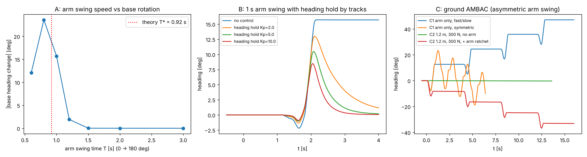
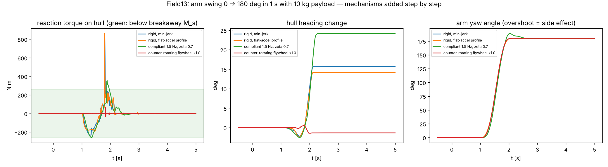
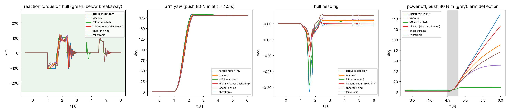
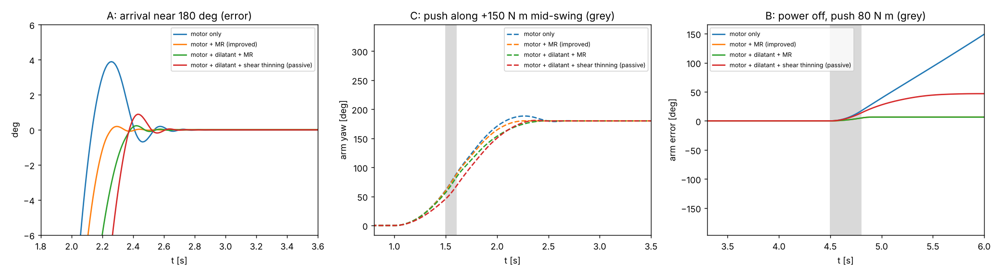
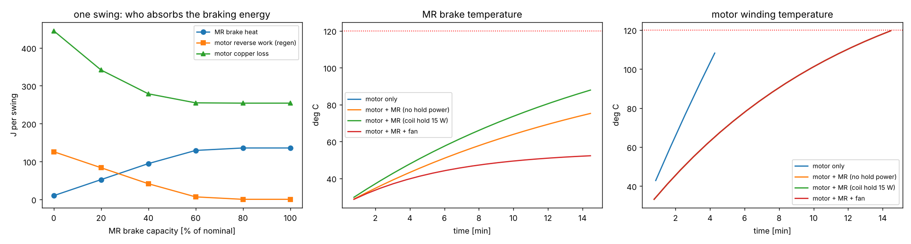
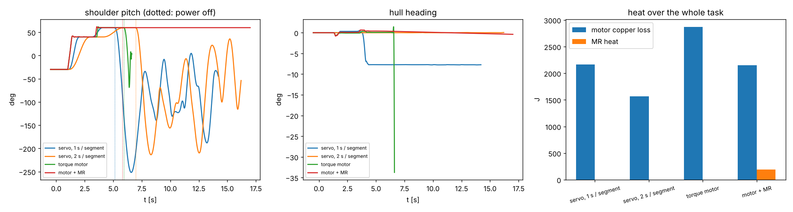

:::message
この章の元になったノート：[docs/11_simulation_field_plan.md](https://github.com/okamasaya/simulation_AMBAC/blob/main/docs/11_simulation_field_plan.md)。数値はリポジトリの `data/` にある出力と同じです。
:::

### 段階 12：腕の振りと履帯による、車体の向きの制御（地上版 AMBAC ＋ スキッドステア）

段階 11 で、荷物を持った腕を速く振ると、反作用で車体が回ることが分かった。これを「困ること（外乱）」と「使えること（地上版 AMBAC）」の両面から試した。
機体 `twin_track_arm`（段階 11 と同じ）。腕は水平に伸ばし（荷物 10 kg）、肩の旋回で横に振る。

スクリプト: `sims/field12_heading.py`（4 並列で約 5 分） / 数値まとめ: `data/field12_summary.txt` / 動画: `figures/field/gifs/07_ground_ambac_ratchet.gif`

**簡単な理論（境目の見積もり）**：腕の反作用のトルクの最大値は I·α_max（最小ジャークで θ を T 秒で振ると α_max = 5.77 θ / T²）。
履帯を止めたまま車体を回し始めるトルクは M_s = μ Σ p_i |r_i|（段階 11 の実測の荷重分布から 260 N·m）。腕の慣性 I = 12.1 kg·m²。
I·α_max > M_s で車体が回り始めるとすると、180° を振る時間の境目は T* = √(5.77 θ I / M_s) = 0.92 s。

**Part A：腕を振る時間と、車体の向きの変化（履帯は止めたまま）**

| 振る時間 | 反作用の最大（M_s との比） | 向きの変化 | 最大の横の傾き |
|---|---|---|---|
| 0.6 s | 609 N·m（2.34） | +12.1° | 12.9° |
| 0.8 s | 342 N·m（1.32） | +23.6° | 11.9° |
| 1.0 s | 219 N·m（0.84） | +15.7° | 6.0° |
| 1.2 s | 152 N·m（0.59） | +1.9° | 2.7° |
| 1.5 s 以上 | 97 N·m 以下 | 0.0° | 1.2° 以下 |

- **車体が回り始める境目は、振る時間 1.0〜1.2 s の間（反作用が M_s の 0.6〜0.8 倍）で、簡単な理論（0.92 s）より少し遅い側にあった。**
  速く振ると車体が横に傾き（1 s で 6°）、片側の履帯の荷重が減って摩擦の抵抗が下がるためと考えられる。理論は、荷重の移動を含めれば改善できる。
- **速く振るほど大きく回るわけではない**（0.8 s で 23.6°、0.6 s で 12.1°）。加速と減速の反作用が向きを変えて打ち消し合う部分があるため。
- 実用上の目安：この機体では、荷物を持った腕を 180° 振るのに **1.5 s 以上かければ、車体の向きは変わらない**。

**Part B：腕を 1 s で振りながら、履帯の速度差で向きを保つ（フィードバック）**

| 制御 | 最大のずれ | 最後のずれ |
|---|---|---|
| なし | 15.7° | +15.7° |
| 弱い（Kp = 2） | 13.0° | +1.2° |
| 中（Kp = 5） | 10.5° | +0.2° |
| 強い（Kp = 10） | 8.5° | +0.05° |
| 強い、腕を 0.6 s で振る | 20.4° | +0.1° |

- 向きの誤差から履帯の速度差を決めるフィードバックで、**最後の向きはほぼ元に戻せる**（0.05°）。ただし、**振っている間のずれ（最大 8.5°）は消しきれない**。
  履帯で車体を回すには、履帯が地面の上で滑る必要があり、反応が遅い（段階 11 の旋回の速さは最大 0.5 rad/s 程度）。
- 振っている間のずれも抑えるには、腕の動きから反作用を予測して先に履帯を動かす（フィードフォワード）か、腕の振り方そのものを遅くする（Part A）必要がある。

**Part C：地上版 AMBAC — 腕の往復で車体を回す**

| 試験 | 結果 |
|---|---|
| C1 腕だけ：速く振り（0.6 s）、ゆっくり戻す（3 s）、120° の往復 | **1 往復ごとに +11.8°（平均 2.9°/s）回る** |
| C1 腕だけ：速く振り、速く戻す（対称） | 1 往復ごとに −2.5°（向きが定まらない） |
| C2 長い履帯（1.2 m）・駆動力 300 N のその場旋回：腕なし | 回らない（−0.3°） |
| C2 同じ条件に、腕の非対称な往復を加える | **−33°（平均 2.1°/s）回る** |

- **腕だけで、車体の向きを変えられる。** 速く振ると反作用が摩擦の抵抗を超えて車体が滑り、ゆっくり戻すときは滑らないため、1 往復ごとに回った分がたまる（ラチェット）。
  宇宙の AMBAC（関節のループで向きが変わる、幾何学的位相）とは仕組みが違い、**摩擦の非対称性を使う地上版の AMBAC** である。第 1 段階の Sim06（スティックスリップ）を、狙って使った形になる。
- **駆動力が足りずにその場旋回できない長い履帯も、腕の往復を加えると回れた。** ただし、回った向きは履帯が回そうとする向き（−）で、腕だけのとき（＋）とは逆だった。
  腕の反作用で車体を押し回したのではなく、**腕の速い振りで静止摩擦が一時的に外れ、そのすきに履帯が車体を回した**と解釈できる（細かい振動で摩擦を外す「ディザ」と同じ考え方）。
- 段階 10・11 のトレードオフ（長い履帯は段差に強いが曲がりにくい）に対して、**腕の動きで旋回の弱さを補える**可能性を示した。

**分かったこと（まとめ）**
- 腕の振りは、車体の向きの「外乱」にも「操作」にもなる。境目は、反作用のトルクと、履帯の摩擦の抵抗（荷重分布と荷重の移動で決まる）の比である。
- 校正の観点では、**M_s（車体を回し始めるトルク）と、その荷重の移動による変化**が、腕の作業と旋回の両方を決める重要な校正値になる。
- 統合制御の方向性：ゆっくりした作業では腕の反作用は無視でき、速い作業では履帯のフィードバック＋腕の動きからの予測で向きを保ち、旋回が苦しいときは腕の往復で摩擦を外して助ける。

### 段階 13：腕の反作用・AMBAC・車体の摩擦の境目 — 仕組みを段階的に組み込む

段階 12 の基準（荷物 10 kg を持って水平に伸ばした腕を、肩の旋回で 0 → 180° を 1 s で振ると、車体が 15.7° 回る）に、
反作用への対策を 1 つずつ組み込み、同じ物差しで比べた（摂動のように段階的に組み込む）。

| 段 | 加えたもの | 種類 |
|---|---|---|
| 13-0 | なし（硬い肩、最小ジャークの軌道） | 基準 |
| 13-1 | 軌道の形：加速度の山を平らにした軌道（山は最小ジャークの 5.77 θ/T² に対して 4.45 θ/T²） | 制御だけ |
| 13-2 | しなり：肩の旋回にばね＋減衰（直列弾性）。腕の固有振動数 1.5 / 3 Hz、減衰比 0.3 / 0.7 | 受動の機構 |
| 13-3 | 逆回転するおもり：車体の円盤（10 kg、0.31 kg·m²）に、肩のモーターと逆向きのトルクを与える（打ち消す割合 0.5 / 1.0） | 能動の機構 |
| 13-4 | 組み合わせ：しなり＋円盤＋履帯で向きを保つ（段階 12 の Part B） | 全部 |

部品表に、肩のしなり（`arms[].sea`）と、車体の円盤（`flywheel`）を書けるようにした。

スクリプト: `sims/field13_reaction.py`（4 並列で約 2 分） / 数値まとめ: `data/field13_summary.txt` / 動画: `figures/field/gifs/08_arm_reaction_countermeasures.gif`

**結果**（反作用の最大は 0.05 s の移動平均の最大値。車体を回し始めるトルク M_s ≈ 260 N·m）

| 仕組み | 振る時間 | 車体の向きの変化 | 反作用の最大 | 横の傾き | 腕の行き過ぎ |
|---|---|---|---|---|---|
| 13-0 硬い肩 | 1.0 s | +15.7° | 411 N·m | 6.1° | 0.2° |
| 13-0 硬い肩 | 0.6 s | +12.1° | 474 N·m | 12.9° | 0.2° |
| 13-1 軌道の形 | 1.0 s | +14.1° | 406 N·m | 5.8° | 0.2° |
| 13-2 しなり 1.5 Hz・減衰比 0.7 | 1.0 s | **+24.1°（悪化）** | 330 N·m | 8.4° | 8.7° |
| 13-2 しなり 3 Hz・減衰比 0.7 | 1.0 s | +20.2°（悪化） | 397 N·m | 7.4° | 2.1° |
| 13-3 おもり（半分を打ち消す） | 1.0 s | +4.9° | 228 N·m | 5.2° | 0.0° |
| 13-3 おもり（全部を打ち消す） | 1.0 s | **−1.4°** | 13 N·m | 5.5° | 0.0° |
| 13-3 おもり（全部を打ち消す） | 0.6 s | +29.4° | 10 N·m | **79.8°（横倒し）** | 0.0° |
| 13-4 しなり＋おもり（半分）＋履帯で向きを保つ | 1.0 s | **+0.02°** | 189 N·m | 6.7° | 10.9° |
| 13-4 同上 | 0.6 s | +6.3° | 300 N·m | 29.5° | 7.9° |

（円盤の回転は最大で、半分を打ち消す場合に毎分 1300 回転、全部を打ち消す 0.6 s の場合に毎分 4400 回転）

**考察：腕の反作用・AMBAC・車体の摩擦の境目**

1. **車体が回るのは、腕を「止めるとき」。** 加速のときの反作用（約 −230 N·m）は境目 M_s の内側にとどまり、減速のときに境目を超えて滑った。
   原因は肩のサーボの遅れで、腕は計画の軌道から最大 17° 遅れ、終わり際に追いつこうとして急ブレーキになる。そこに、滑り始めの一瞬の衝撃（最大 850 N·m）が重なる。
   **「どう止めるか」が、車体を乱すかどうかを決める**。ステッピングモーターを逆向きのトルクで無理に止めるのと同じ構図で、滑らかな制動が必要という見方と一致する。
2. **反作用の山（大きさ）だけでなく、境目を超えている時間（力積）が効く。** しなりは山を 411 → 330 N·m に下げたが、境目を超える時間が長くなり、腕も行き過ぎて揺れたため、かえって大きく回った（+24°）。
   しなりが効くのは、山を境目より下まで下げられる場合に限られる。そのためには、さらに柔らかくする必要があり、腕の行き過ぎ（作業の精度）とのトレードオフになる。
3. **反作用を境目より下に抑えれば、車体はほとんど回らない。** おもりで半分を打ち消すと反作用は 228 N·m（境目のすぐ下）になり、回りは 4.9° に減った。全部打ち消すと −1.4°。
   段階 12 の「境目」の考え方が、対策の効き方も説明できた。
4. **軌道の形だけを変えても、ほとんど効かなかった。** 計画した軌道の加速度の山を 23% 下げても、サーボの遅れが軌道の形を崩してしまうため。軌道の設計は、サーボの特性と組で考える必要がある。
5. **一つの向きの問題を解くと、次の向きに問題が移る。** 0.6 s で振ると、向き（ヨー）の反作用はおもりでほぼ 0 にできたが、車体は横に倒れた（79.8°）。
   速く振った荷物の遠心力と、腕の加速の横向きの力（並進の反作用）は、向きを打ち消すおもりでは消せない。
   さらに、高速で回る円盤（毎分 4400 回転）は、車体が傾くとジャイロ効果で別の向きのトルクを生む可能性がある（今回の試験では切り分けていない）。
6. **組み合わせると、1 s なら向きをほぼ完全に保てる**（+0.02°）。ただし、腕の行き過ぎ（10.9°）と、止まるまでの時間（0.29 s）が増える。0.6 s では、向きは 6.3° に抑えられるが、横の傾きが 29.5° になり危険。
7. **AMBAC との関係**：逆回転するおもりは、宇宙の AMBAC で言えば「腕と円盤で角運動量の合計を 0 に保つ」こと（第 1 段階の Sim03 のリアクションホイール）。
   地上では、この角運動量の収支に「履帯と地面の摩擦」という出口があり、境目 M_s を超えた分だけが車体の回転として出ていく。宇宙では全部が回転に出ていく（L = 0）。
   **地上の機体は、境目 M_s までの反作用を摩擦で「ただで」吸収できる**。対策は、境目を超える分だけを、おもり・しなり・止め方の工夫で受け持てばよい。

**分かったこと（まとめ）**：腕を速く動かしたときの「雑さ」は、主に止めるときの反作用が、足元の摩擦の境目を超えることから生じる。
対策の優先順位は、①止め方（サーボと軌道を組で設計し、急ブレーキを避ける）、②境目を超える分だけを受け持つ部品（逆回転するおもり、または滑らかな制動の機構）、③履帯で残りを直す、の順がよい。
しなりは、境目より下まで下げられない場合には逆効果になる。速さを上げると、問題は横の転倒（並進の反作用）に移る。

**限界**：肩のサーボは位置制御（遅れを含む）のまま。トルクを直接制御する方式や、MR 流体のクラッチのような「ねばりを変えられる制動」は、まだ試していない。円盤のジャイロ効果は切り分けていない。

### 段階 14：滑らかな止め方 — トルク制御の肩と流体ブレーキ（MR・ダイラタント・擬塑性・チキソトロピー）

段階 13 で、車体が回るのは腕を「止めるとき」で、位置サーボの遅れが急ブレーキを生むことが分かった。そこで、止め方そのものを変えた。
- 肩の旋回を「トルクを直接制御するモーター」に変え、トルクの上限を 104 N·m（車体を回し始めるトルクの見積もり M_s = 260 N·m の 0.4 倍）にした。
  モーターは、「この位置から上限のトルクで止めれば目標で止まれる」減速の曲線に沿って腕を動かす。
  （最初に 0.8 倍の 208 N·m で試すと、トルクの山が見積もりの境目より低くても、上限のトルクが長く続いて車体が 22° 回った。段階 12 の実測でも 0.6 倍付近から滑り始めた）
- これに、流体ブレーキ（回転ダンパー）を並べて付けた。MuJoCo には流体そのものの機能はないため、**流体の性質を「速さとトルクの関係」の式で与え、毎ステップ、腕と車体の間の内力としてかけた**。ブレーキは車体に付くので、その反作用も車体に返る。

| 流体 | 式（ω：腕の角速度、トルクは動きと逆向き） | 強さ |
|---|---|---|
| 粘性（ニュートン流体） | τ = c ω | c = 10 N·m·s |
| MR 流体（ビンガム流体、制御） | τ = τ_y sign(ω) + c₀ ω。τ_y を磁場で変える（応答の遅れ 10 ms） | 止めるときは必要なだけ、止まった後は 60 N·m で保持 |
| ダイラタント（速いほど硬い） | τ = K ω\|ω\| | K = 2.0 |
| 擬塑性（速いほど柔らかい） | τ = K \|ω\|^0.5 | K = 22 |
| チキソトロピー（動くと柔らかく、休むと固まる） | τ = (η∞ + η₀ λ) ω、構造 λ：dλ/dt = (1 − λ)/2 s − 3 λ\|ω\| | η∞ = 2、η₀ = 40 |

強さは、腕の速さ 5 rad/s で約 50 N·m になるようにそろえた。MR 流体は「モーターは前に押すだけで逆回転させず、止めるのは MR に任せる」使い方にした（ステッピングモーターを逆回転で無理に止めない、という着想に対応）。

スクリプト: `sims/field14_braking.py`（4 並列で約 1.5 分） / 数値まとめ: `data/field14_summary.txt`

**Part A：荷物 10 kg を持った腕を 0 → 180° 振る（電源あり）**

| ブレーキ | 目標に着くまで | 行き過ぎ | 車体の向きの変化 | 反作用の最大 | ブレーキで熱になった | モーターが逆向きに受け持った |
|---|---|---|---|---|---|---|
| （比較）段階 13 の位置サーボ、1 s | — | 0.2° | **+15.7°** | 411 N·m | — | — |
| なし（トルク制御のモーターだけ） | 1.35 s | 3.9° | **0.00°** | 104 N·m | 0 J | 137 J |
| 粘性 | 1.23 s | 1.4° | +0.01° | 110 N·m | 94 J | 73 J |
| MR 流体（モーターは逆回転しない） | 2.66 s | 2.2° | +0.01° | 108 N·m | 139 J | **0 J** |
| ダイラタント | **1.19 s** | 1.8° | 0.00° | 115 N·m | 66 J | 95 J |
| 擬塑性 | 1.28 s | **1.0°** | +0.01° | 117 N·m | 116 J | 58 J |
| チキソトロピー | 1.26 s | 1.6° | +0.02° | 117 N·m | 58 J | 101 J |

**Part B：電源を切った保持**（到着後にモーターを止め、腕を外から 80 N·m で 0.3 s 押す）

| ブレーキ | 押し始めから 1 s の最大のずれ | 押し終わって 1.2 s 後のずれ |
|---|---|---|
| なし | 94° | 149°（流れ続ける） |
| ダイラタント | 84° | 126° |
| 粘性 | 68° | 90° |
| チキソトロピー | 57° | 76° |
| 擬塑性 | 48° | 51° |
| **MR 流体（保持の磁場だけ残す）** | **6.5°** | **6.5°** |

**分かったこと**
- **止め方を変えるだけで、車体を回さずに速く振れる。** トルクを直接制御し、上限を境目より下（実測の境目の目安：見積もり M_s の 0.6 倍）に抑えると、180° を 1.2〜1.35 s で振っても車体の向きは 0.02° 以内。
  位置サーボで車体を回さずに振れたのは 1.5 s 以上（段階 12）なので、それより速い。**「急ブレーキを避け、境目より下の一定のトルクで止める」のが、最も安くて効く対策**（追加の部品なし）。
- **流体ブレーキを並べると、行き過ぎが減り（3.9° → 1〜2°）、少し早く着く。** ブレーキが減速の一部を受け持つので、モーターは上限のトルクで長く押せる。
- **止めるエネルギーの行き先を選べる。** ブレーキなしでは、止めるエネルギー（約 140 J）はモーターが逆向きに受け持つ（回生すれば電気に戻せる）。流体ブレーキは、その一部または全部を熱にする（熱吸収）。
  MR 流体では、モーターはほぼ逆回転せず（0.3 J）、止める仕事はすべて MR が熱として受け持った。「回生で戻すか、流体で熱にするか」は、電池・放熱・モーターの負担の設計の選択になる。
- **流体の性質によって、得意な場面が逆になる。**
  - ダイラタント（速いほど硬い）：速い動きを止めるのは得意（最も早く着く）だが、ゆっくり押す力にはほとんど効かず、保持には向かない。速さの上限を自然にかける「安全ベルト」のような使い方に向く。
  - 擬塑性（速いほど柔らかい）：ゆっくりした押しに強く効くので、受け身の流体の中で保持が最もよい。行き過ぎも最小。
  - チキソトロピー（休むと固まる）：休んでいる間に固まった分だけ粘性より保持が強いが、押されて動き出すと柔らかくなり、途中から流される。「止まっている間は固く、動かすときは軽い」関節に向く。
  - **MR 流体**：制御で効き方を変えられ、保持の磁場を残せば電源を切ってもほぼ動かない（押す力 80 N·m が保持の 60 N·m を超えた分だけ、少しずれる）。
    ただし、目標を 2° 余り行き過ぎた位置でつかんで保持してしまい、修正に時間がかかった（着くまで 2.66 s）。**「つかむ」性質は、細かい位置の修正の邪魔にもなる**。ブレーキとモーターの受け持ちの制御を工夫する必要がある。
- **AMBAC・境目との関係**：車体が回るかどうかは、モーターと流体ブレーキを合わせた反作用が、足元の摩擦の境目を超えるかどうかで決まる（段階 12・13 と同じ）。
  流体ブレーキは、運動量を消す（熱にする）のではなく、**腕の運動量を車体に移す速さを決める部品**である。境目より下の速さで移せば、地上の機体はそれを摩擦で吸収できる。

**限界**：流体の性質は理想化した式で、係数は比較のためにそろえた値（実在の製品の値ではない）。温度による粘りの変化、流体の発熱による性能の低下、MR 流体の沈殿・摩耗は含めていない。
チキソトロピーの係数は仮の値で、構造が戻る時間（2 s）を変えると結果が変わる。

### 段階 15：機能を分けた組み合わせ — 「速く動かす」「止める」「保持する」を別の部品に

段階 14 で、流体ブレーキは種類によって得意な場面が逆になることが分かった。1 つの物質ですべてをこなす（速さと硬さを自在に切り替える）のではなく、
**機能ごとに部品を分け、上の制御で使い分ける**方が現実的と考え、組み合わせを比べた。人の体でも、筋肉（動かす）・腱（しなる）・靭帯や関節の摩擦（保持する）は役割が分かれ、神経がまとめて制御している。

| 組み合わせ | 速く動かす | 速さの上限・衝撃への備え | 止める | 保持する |
|---|---|---|---|---|
| ① 基準（段階 14） | モーター | — | モーター | モーター |
| ② モーター＋MR（制御を改良） | モーター | — | MR | MR（電源なしでも） |
| ③ モーター＋ダイラタント＋MR | モーター | ダイラタント（受け身） | MR | MR |
| ④ モーター＋ダイラタント＋擬塑性 | モーター | ダイラタント | 両方（受け身） | 擬塑性（受け身） |

**MR の制御の改良**（段階 14 の「行き過ぎた位置でつかんでしまう」への対策）：
① 加速はモーター → ② 減速はモーターを止め、**目標でちょうど止まるブレーキの強さ I ω² / (2 × 残りの距離) を毎ステップ計算して MR にかける** → ③ 目標の近く（ゆっくり）では MR を外してモーターで微調整 → ④ 止まったら MR でつかみ、モーターは休む。

試験：A は荷物 10 kg の腕を 0 → 180° 振り、到着後に電源を切って 80 N·m で 0.3 s 押す。C は振っている途中（開始 0.5 s 後）に 150 N·m の衝撃を 0.1 s（動きと逆向き＝ぶつかった、同じ向き＝後ろから押された）。
流体の式と強さ、モーターのトルクの上限（104 N·m）は段階 14 と同じ。

スクリプト: `sims/field15_combined.py`（4 並列で約 1 分） / 数値まとめ: `data/field15_summary.txt`

**試験 A：振る → 電源を切って押す**

| 組み合わせ | 目標に着くまで | 行き過ぎ | 車体の向き | ブレーキの熱 | モーターの逆回転の仕事 | 電源を切って押されたずれ |
|---|---|---|---|---|---|---|
| ① モーターだけ | 1.35 s | 3.9° | 0.00° | 0 J | 136 J | 149° |
| **② モーター＋MR（改良）** | **1.18 s** | **0.2°** | +0.02° | 143 J | **0 J** | **6.5°** |
| ③ モーター＋ダイラタント＋MR | 1.29 s | 0.2° | +0.02° | 166 J | 1 J | 6.5° |
| ④ モーター＋ダイラタント＋擬塑性 | 1.33 s | 0.9° | +0.01° | 182 J | 34 J | 47° |

**試験 C：振っている途中の衝撃（150 N·m、0.1 s）**（衝撃なしの腕の最大の速さは約 300 °/s）

| 組み合わせ | ぶつかった（逆向き）：行き過ぎ | 押された（同じ向き）：腕の最大の速さ | 押された：行き過ぎ |
|---|---|---|---|
| ① モーターだけ | 2.0° | 281 °/s | **8.4°** |
| ② モーター＋MR | 0.2° | 277 °/s | 0.2° |
| ③ モーター＋ダイラタント＋MR | 0.2° | 269 °/s | 0.3° |
| ④ モーター＋ダイラタント＋擬塑性 | 0.9° | **249 °/s** | 0.9° |

（どの場合も、車体の向きの変化は 0.4° 以内）

**分かったこと**
- **機能を分けると、すべての指標が同時によくなった。** モーター＋MR（②）は、段階 14 の MR（2.66 s）から **1.18 s に速くなり、行き過ぎは 0.2°**。モーターは一度も逆回転せず、電源を切っても腕はほぼ動かない（6.5°）。
  鍵は、MR を「止める」専用にして、**目標でちょうど止まる強さを毎ステップ計算する**こと。最後の微調整だけモーターに戻すことで、「つかんで動けなくなる」問題も消えた。
- **衝撃で速くなっても、MR の制御が行き過ぎを防ぐ**（押されたとき、モーターだけは 8.4° 行き過ぎ、MR ありは 0.2〜0.3°）。止める機能を独立させた効果。
- **ダイラタント（受け身）の衝撃を和らげる効果は控えめ**（押されたときの最大の速さを 3〜11% 下げた程度）。今回の強さでは、衝撃で少し速くなっても、ブレーキのトルクの増え方（約 20 N·m）が衝撃（150 N·m）に比べて小さい。
  強くすれば効くが、普段の動きも重くなる（③は②より 0.1 s 遅く、熱も多い）。**ダイラタントは「速さの上限」を受け身でかけたい場合（暴走・落下の安全）に限って使う**のがよい。
- **ぶつかった（逆向きの衝撃）ときは、ダイラタントは効かない。** 腕が遅くなると、ダイラタントの効きも弱まるため。衝撃の向きによって、効く部品が違う。
- **受け身の部品だけ（④）でも、それなりに動く**（1.33 s、行き過ぎ 0.9°）が、電源を切った保持（47°）と、止める位置の制御は、制御できる部品（MR）に及ばない。
- **設計の指針**：動かすのはモーター、止めるのと保持するのは制御できるブレーキ（MR など）、受け身の流体は「安全のための上限」として必要な場合だけ。
  止めるエネルギーはブレーキの熱になるため（約 140 J／回）、繰り返し動かす場合は放熱の設計が必要になる。回生（モーターで電気に戻す）と熱吸収（ブレーキ）のどちらを選ぶかは、電池・放熱・重さの比較で決まる。

**限界**：段階 14 と同じ（流体の式は理想化、温度や発熱による性能の変化を含めていない）。MR の応答の遅れは 10 ms と仮定した。電源を切った保持には、永久磁石と電磁石を組み合わせた MR（保持に電力が要らない方式）を想定している。

### 段階 16：繰り返し動かしたときの発熱・放熱と、MR 流体の温度による性能低下・劣化

段階 15 の「モーター＋MR（動かす＝モーター、止める・保持する＝MR）」を、何百回も繰り返したときに何が起きるかを調べた。
腕の動き（約 1 s）と温度の変化（数分〜数時間）は時間の桁が違うため、2 つを組み合わせた。
1. **MuJoCo**：MR の最大のブレーキの強さを公称値（150 N·m）の 100〜0% に下げたとき、1 回の振り（0 → 180°）がどう変わるか（足りない分はモーターが逆向きに補う）
2. **熱のモデル**（熱容量 C と周囲への熱抵抗 R の 1 次の式 C dT/dt = P − (T − T_周囲)/R）：往復を繰り返したときの MR とモーターの温度。
   MR の温度が上がると効きが下がり（温度係数 β）、その分モーターの負担と発熱が増える連鎖、モーターの巻線の抵抗が温度で増える効果（0.39 %/℃）を含める

**調べたこと（MR 流体の熱と劣化）**
- 寿命：MR 流体の寿命は「流体の体積あたり、一生のうちに熱に変えたエネルギーの総量（LDE）」で決まり、最良の流体で 10⁷ J/cm³ 程度。長く使うと濃くなり、最後はペースト状になる（in-use thickening）。
  酸化防止剤が減ると濃くなりやすい（[Carlson 2003](https://www.inderscience.com/info/inarticle.php?artid=3572)、[長期使用した流体の評価](https://www.ncbi.nlm.nih.gov/pmc/articles/PMC6265955/)、[耐久性の添加剤の特許](https://image-ppubs.uspto.gov/dirsearch-public/print/downloadPdf/7575695)、[LDE とメイソン数](https://inis.iaea.org/records/jgd8a-ryg41)）
- 温度：MR 流体の安定性・制御・寿命は温度に大きく左右される。滑らせ続けると温度はほぼ時間に比例して上がり、伝えられる力は放熱で制限される
  （[膝のアクチュエータ](https://pmc.ncbi.nlm.nih.gov/articles/PMC10358520)、[Applied Sciences 2022](https://www.mdpi.com/2076-3417/12/10/5044)、[EV の MR ブレーキ](https://www.mdpi.com/2032-6653/17/7/370)）
- **確認できなかったこと**：温度 1 ℃ あたりの効き（降伏応力）の低下率。温度に強い MR 材料の特許では −40〜150 ℃ で安定とされる（[US5599474](https://image-ppubs.uspto.gov/dirsearch-public/print/downloadPdf/5599474)）。
  そのため、β = 0.1 / 0.3 / 0.5 %/℃ の 3 通りを仮定して比べた。

**仮定した値**（実在の製品の値ではない）：MR ブレーキ（熱容量 700 J/K、熱抵抗 1.5 K/W（自然放熱）/ 0.5 K/W（ファン）、流体 20 cm³、上限 120 ℃）、
モーター（銅損 0.04 τ² W、熱容量 600 J/K、熱抵抗 0.8 K/W、巻線の上限 120 ℃、回生の効率 60%）。動作は 0 → 180° → 0 → … の往復。

スクリプト: `sims/field16_thermal.py`（約 1 分） / 数値まとめ: `data/field16_summary.txt`

**(1) 1 回の振り：MR の効きを下げたとき**

| 構成 | 動作時間 | 行き過ぎ | MR の熱 | モーターの銅損 | モーターの逆回転の仕事 |
|---|---|---|---|---|---|
| モーターだけ | 1.56 s | 3.9° | 0 J | **545 J** | 136 J |
| モーター＋MR（効き 100%） | 1.28 s | 0.2° | 136 J | **254 J** | 0 J |
| 同（効き 60%） | 1.28 s | 0.2° | 129 J | 255 J | 7 J |
| 同（効き 40%） | 1.29 s | 0.2° | 95 J | 279 J | 41 J |
| 同（効き 20%） | 1.29 s | 0.2° | 52 J | 342 J | 84 J |
| 同（効き 0%） | 1.29 s | 0.5° | 10 J | 445 J | 126 J |

**(2) 繰り返し：温度が上限（120 ℃）を超えずに続けられる頻度**

| 構成 | 1 s ごとに休む場合 | 続けられる頻度 | 1 回あたりの電池のエネルギー | そのときの MR の温度 |
|---|---|---|---|---|
| モーターだけ（回生 60%） | 5.0 分でモーターが上限 | **毎分 9.5 回** | 716 J | — |
| モーター＋MR（保持に電力不要、自然放熱） | 14.6 分でモーターが上限 | **毎分 20.4 回** | 459 J | 約 94 ℃ |
| モーター＋MR（電磁石で保持 15 W） | 同上 | 毎分 20.4 回 | 459 J | （1 s ごとの場合、停止時 88 ℃） |
| モーター＋MR（ファン） | 同上 | 毎分 20.4 回 | 459 J | （同、52 ℃） |

**(3) MR の効きの温度係数**：β = 0.1 / 0.3 / 0.5 %/℃ のどれでも、続けられる頻度は変わらなかった（毎分 20.4 回）。4 時間後の効きは 93 / 79 / 66%。

**(4) 寿命**：LDE 10⁷ J/cm³ × 流体 20 cm³ = 2 × 10⁸ J、1 回の振りで 136 J → **約 150 万回**（1 s ごとに往復し続けて約 900 時間）。

**分かったこと**
- **繰り返しで先に限界に達するのは、MR ではなくモーター。** 大きなトルクをゆっくり出す使い方では、モーターの巻線の発熱（銅損、トルクの 2 乗に比例）が、腕を動かす仕事（約 150 J）よりずっと大きい（モーターだけで 1 回 545 J）。
- **MR に止める仕事を任せると、モーターの発熱がほぼ半分になり、続けて動かせる頻度が約 2 倍（毎分 9.5 → 20.4 回）、電池の消費が約 3 分の 2 になった。**
  止める熱を、別の部品（MR）に分けて、**熱の出口を 2 つにした**ことが効いている。段階 15 の「機能を分ける」は、熱の面でも有利だった。
  （回生の効率を 60% と仮定しても、モーターで止めると銅損が増えるため、MR の方が電池の消費も少ない）
- **MR の効きが 60% 程度まで落ちても、動きはほとんど変わらない。** 最大のブレーキに余裕があるため。それより下がると、足りない分をモーターが補い、モーターの発熱が増える。
  つまり、**MR の熱による性能低下は「動きの悪化」ではなく「モーターの発熱の増加」として現れる**。温度係数が大きいほど、余裕がなくなる。
- **熱暴走に注意**：巻線の抵抗は温度で増えるため、発熱がさらに増える。モーターだけで休まずに動かし続けると、温度が上がるほど発熱が増えて止まらなくなる（今回は上限で停止させた）。
- **MR の放熱**：今回の条件では MR は上限に達しなかったが、電磁石で保持し続ける方式（コイル 15 W）は MR の温度を上げる。保持に電力が要らない方式か、ファンの方がよい。
  モーターを強く冷やして頻度を上げると、次は MR が限界になる（今回は確かめていない）。
- **寿命**：約 150 万回。1 日 8 時間、毎分 20 回で使うと約 160 日分。流体の交換か、より大きな流体の量（または熱に変えるエネルギーを減らす使い方）が必要になる。

**限界**：熱のモデルは、部品ごとに 1 つの温度で表す簡単なもの（流体の中の温度のむら、熱の伝わる経路は含めていない）。数値は仮定の値で、実在の部品に当てはめるには、データシートの値に置き換える必要がある。
MR の効きの温度係数は確認できなかったため、範囲で示した。in-use thickening による粘りの増加（効きの低下ではなく、ブレーキを外したときの引きずりの増加）は含めていない。

### 段階 17：3 軸の肩＋肘の腕全体の動作に、機能を分けた部品を当てはめる

段階 15・16 の「動かす＝モーター、止める・保持する＝MR」を、3 軸の肩（旋回・俯仰・ひねり）＋肘の 4 関節を同時に動かす動作に当てはめた。
これまでとの大きな違いは**重力**で、腕を上げて保持するには、重力に逆らうトルクを出し続ける必要がある。
機体は左右 2 本の履帯（段階 11）に、3 軸の肩＋肘の腕（荷物 10 kg）。

動作：前の低い位置（旋回 0°、俯仰 −30°、ひねり 0°、肘 −60°）→ **区間 1** 左横の高い位置（120°、40°、60°、−90°）→ 1 s 止まる
→ **区間 2** 胸の前にたたむ（−60°、60°、−30°、−120°）→ 1 s 止まる → **電源を切って 5 s**（MR は、電源が切れたら、その位置で全関節をつかむ）

| 方式 | 動かす | 止める | 保持する（重力） |
|---|---|---|---|
| ① 位置サーボ・速い（1 区間 1 s） | サーボ | サーボ | サーボ |
| ② 位置サーボ・遅い（1 区間 2 s） | サーボ | サーボ | サーボ |
| ③ トルク制御のモーター | モーター | モーター | モーター（電力を使い続ける） |
| ④ モーター＋MR（関節ごと） | モーター | MR | MR（電力なし） |

関節ごとのモーターのトルクの上限は、旋回 104（車体が滑らない範囲）・俯仰 300・ひねり 80・肘 150 N·m。MR の最大は 150 / 350 / 100 / 200 N·m。
③④ では、重力の分をモーターで打ち消し、段階 15 の減速の曲線と MR のブレーキの計算を 4 関節に広げた。
関節の慣性は姿勢で変わる（腕を伸ばすと旋回の慣性が大きくなる）ため、動作中にこまめに計算し直した（最初は計算し直しておらず、旋回が 28° 行き過ぎた）。
MR の保持は、静止摩擦に近い硬さ（ずれ 1° で 870 N·m、最大は MR の上限まで）とした。

スクリプト: `sims/field17_arm3d.py`（4 並列で約 2 分） / 数値まとめ: `data/field17_summary.txt` / 動画: `figures/field/gifs/09_arm3d_power_off.gif`

| 方式 | 2 区間の動作時間 | 車体の向きの変化 | 横の傾き | モーターの銅損 | MR の熱 | 電源を切ったとき |
|---|---|---|---|---|---|---|
| ① 位置サーボ・速い | 2.14 s | **−7.7°** | 4.8° | 2167 J | — | 荷物が 1.0 m 落ちる（振り子のように揺れ続ける） |
| ② 位置サーボ・遅い | 3.98 s | 0.0° | 0.4° | 1566 J | — | 1.0 m 落ちる |
| ③ トルク制御のモーター | 2.93 s | 0.1° | 1.6° | 2867 J | — | 0.9 m 落ち、**その勢いで車体が倒れる（横の傾き 78°）** |
| **④ モーター＋MR** | **2.81 s** | 0.4° | 1.6° | 2153 J | 191 J | **2 mm 下がるだけ** |

重力に逆らって止まっているのに必要なモーターの銅損：区間 1 の姿勢で **330 W**（1 分間で 20 kJ）、区間 2 の姿勢で 183 W。MR の保持（電力が要らない方式）なら 0 W。

**分かったこと**
- **モーター＋MR は、車体をほとんど乱さない方式の中で最速**（2.81 s）。位置サーボで車体を乱さないようにすると 3.98 s かかり、速くすると車体が 7.7° 回る。4 関節を同時に動かしても、段階 14・15 の結論（止め方を変える、止める機能を分ける）がそのまま成り立った。
- **電源が落ちたときの安全で、大きな差が出た。** モーターやサーボだけでは、電源が落ちると腕が重力で落ち（約 1 m）、その勢いで車体まで倒れることがある（③）。
  MR（保持に電力が要らない方式）は、5 s たっても 2 mm 下がっただけだった。重力のかかる腕では、**「電源なしで保持できる」ことが、安全の機能そのものになる**。
- **重力に逆らって止まっている時間が長いほど、MR の利点は大きい。** 今回は止まる時間が短く（1 s × 2）、モーターの発熱の差は 25% にとどまったが、
  腕を上げて止まっているだけでモーターは 330 W の熱を出し続ける。物を持って待つ、狙いを定める、といった作業では、発熱と電池の消費が数倍違ってくる。
- **関節の慣性は姿勢で大きく変わる**ので、止める計算（MR のブレーキの強さ、減速の曲線）は、その場の慣性で計算し直す必要がある。

**MR を「止める・保持する」制御材として見たまとめ（段階 14〜17）**
- 利点：止めるときに車体（足元）を乱さない／モーターの逆回転・発熱を減らし、続けて動かせる頻度を上げる／電源なしで保持できる（安全・省電力）
- 弱点と対策：温度で効きが下がる → 余裕を持った大きさと放熱（ファン）／熱に変えたエネルギーの総量で劣化する → 寿命を見積もって、流体の交換を定期的なメンテナンスに組み込む
  ／「つかむ」性質が細かい位置合わせの邪魔になる → 最後の微調整はモーターに戻す制御
- **熱や経年による劣化が、予測できて定期的なメンテナンスで受け止められる範囲なら、MR は「止める・保持する」制御材として有力**と言える（効きの温度係数と寿命は、使う製品のデータで確かめる必要がある）。

**目視で見つけて直したこと**：最初の版では、MR が腕をつかむのは「目標の 0.5° 以内に 0.2 s とどまったとき」だけで、目標から 0.5〜1° ずれて止まった関節は、
つかまれないまま電源が切られて重力で動いていた。数値の試験は電源を切った後 2 s しか見ていなかったため「32 mm 下がるだけ」に見えたが、
GIF（約 8 s 後まで）でゆっくり動き続けるのが見えた。**電源が切れたら、その位置で全関節を MR でつかむ**ように直し、観察を 5 s に延ばした（上の表は修正後の値）。
MR の熱は、電源を切るまでの値（保持のモデルの小さな振動を熱として数えないため）。

**限界**：腕の各関節の部品（モーター・MR）の重さと大きさは、機体の質量に含めていない。MR の保持の硬さは仮定。電源を切ったときの位置サーボは、サーボの力を 0 にした場合として扱った。

### 動画（GIF）による目視の確認

数値やグラフだけでは見落としがある（段階 10 の履板の食い込みのように）ため、主な場面を GIF にして目で確かめた（`sims/field_gifs.py`、`figures/field/gifs/`）。

| GIF | 内容 | 目で確かめたこと |
|---|---|---|
| 01_space_loop | 宇宙の人型が腕と脚でループを描く（8 周） | 周回中に体が ±17° 揺れながら、1 周ごとに少しずつ回る（7 周で 24°） |
| 02_pick_place_waist | 同じ 0.57 s の荷物運び：補正なし / 腰の補正 | 補正なしは台車が浮いて倒れる。腰の補正は、先に後ろへ反り、荷物を後ろに回すにつれて前に傾き、台車は水平のまま |
| 03_biped_vs_tank | 二本脚（腰なし・腰あり）と戦車型＋腰 | 腰なしの二本脚は荷物を頭上に上げたところで倒れる。腰ありの二本脚と戦車型は倒れない |
| 04_track_step | 履帯で 0.15 m の段差：腕を後ろ / 能動 | 腕を後ろにたたむと、機首が上がって後ろにひっくり返る。能動の腕は、床の近くの荷物を、機首が上がると前に伸ばし、段を越える |
| 05_track_length | 接地長 0.8 m で 0.20 m / 1.2 m で 0.30 m（どちらも能動の腕） | 短い履帯は段の角でシーソーになり、機首が 49° まで上がってひっくり返る。長い履帯は 28° で角を越える |
| 06_turning | その場旋回 / 荷物を持った腕を 1 s で振る | 6 s で 163° 回る（0.53 rad/s）。腕を振ると、振り始めに少し逆に回ったあと、車体が 15.7° 回る |
| 09_arm3d_power_off | 3 軸の肩＋肘：位置サーボ（速い）/ トルク制御のモーター / モーター＋MR、最後に電源を切る（段階 17） | 位置サーボは車体が 7.7° 回り、電源を切ると腕が落ちて揺れる。トルク制御のモーターは、電源を切ると腕が落ちる勢いで車体が倒れる。MR は電源を切った位置で腕が止まる |
| 08_arm_reaction_countermeasures | 腕の反作用への対策：硬い肩 / しなり / 逆回転するおもり（1 s・0.6 s）（段階 13） | 硬い肩は止めるときに車体が回る（+15.7°）。しなりはかえって大きく回る（+24°）。おもりは向きを保つ（−1.4°）が、0.6 s では横に倒れる |
| 07_ground_ambac_ratchet | 腕だけの非対称な往復 / 長い履帯（駆動力 300 N）のその場旋回＋腕の往復（段階 12） | 腕だけで 20 s に +60° 回る。長い履帯は履帯だけでは回らず、腕の往復を加えると −33° 回る |

**目視で見つけた問題と修正**：「腕を下ろす」姿勢（肩 −90°）では、腕と荷物が床の下（荷物は床の 25 cm 下）に入り込んでいた（腕には当たり判定がない）。
能動の腕も、機首が上がる前は同じ姿勢から始まっていた。段階 11 の旋回の試験も同じ姿勢だった。
荷物が床のすぐ上に来る姿勢（肩 −20°、肘 −70°：荷物は前方 0.47 m、高さ 0.08 m）に直し、能動の腕はこの姿勢から「水平に前へ伸ばす」姿勢へ移すようにして、
段階 8・10・11 と GIF 04〜06 を計算し直した（上の表は修正後の値）。
- 段階 10 の元の形（Part A）と、段階 11 の旋回は、ほとんど変わらなかった。
- 段階 8 の「腕を下ろす」は 0.125 → 0.15 m になった。
- 段階 10 の Part C では、腕を下ろしたままでも長い履帯で 0.30 m、重心を下げた形で 0.20 m を越え、能動の腕との差がなくなった。
  **「能動の腕が長い履帯で効いた」という最初の版の結論は、取り消した。**

### 次の作業（段階 12 以降の候補）
1. 起動輪の歯・履板の突起（グローサー）の効果、旋回しながらの段差・坂
2. 関節ごとの部品（モーター・MR）の重さを含めた設計、腕組み（Sim08、肩甲骨を含む）の動作、モーターの冷却を強めたときの MR の限界、荷重の移動を含めた境目の理論
3. 速く振ったときの横の転倒（並進の反作用）への対策と、円盤のジャイロ効果の切り分け
2. 腰の戦略とモーターの定格を同時に考える（腰で速くすると、必要なトルクが 3 倍以上に増える）
3. 計測データを DIY_AutoML に入れて推定を試す（ユーザーの環境）
4. 二本脚の段差の試験（足を持ち上げる関節を加え、Sim10 と比べる）
5. 二本脚の最適化のやり直し（初期値を変える、関節の速度の上限を入れて Sim09 と同じ条件で比べる）
