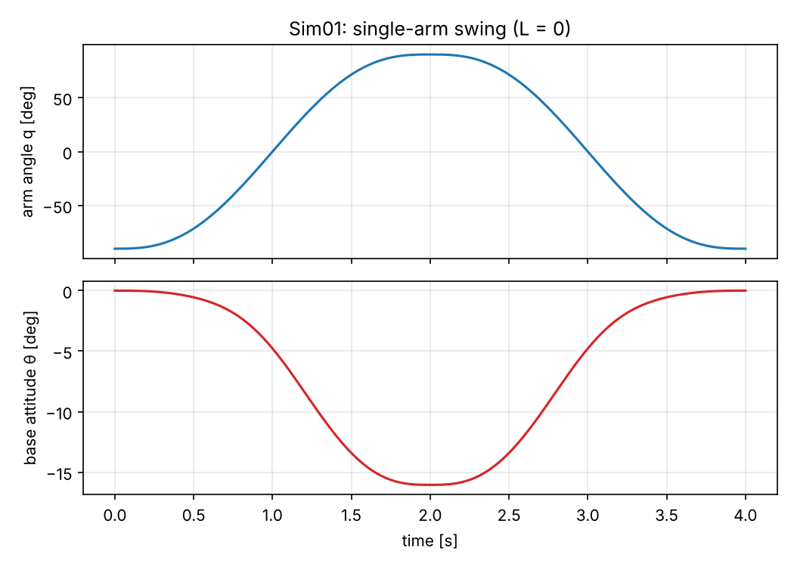
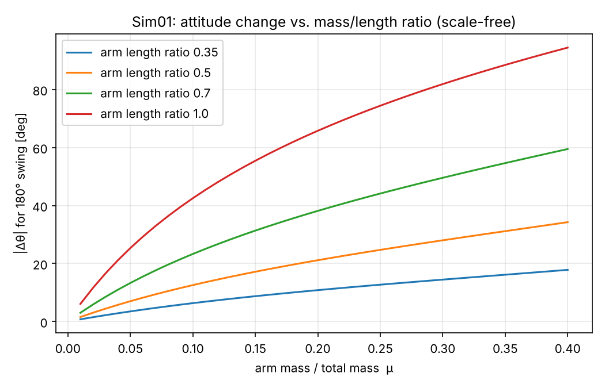
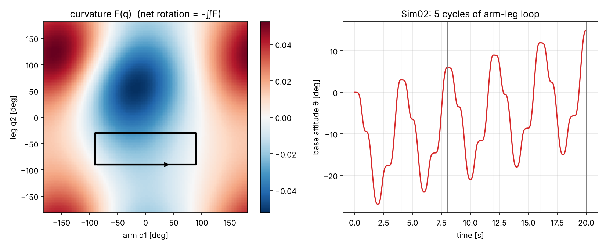

# 02. シミュレーション結果：平面モデル（Sim01, Sim02）

モデル: `src/ambac/planar.py`。人間を矢状面に投影した粗いモデル
（胴体 60 kg, 0.35×1.0 m / 腕 4 kg, 0.7 m / 脚 12 kg, 0.9 m）。

## Sim01: 腕 1 本の往復（`sims/sim01_single_arm.py`）

| 項目 | 結果 |
|---|---|
| 腕を下→上へ 180° 振ったときの胴体回転 | **−16.0°**（逆向き） |
| 腕を戻した後の残留姿勢 | 約 1e-9°（可逆的） |
| 角運動量の残差 | 約 1e-5 kg·m²/s（数値微分による誤差の範囲） |
| 18 m 級（長さ ×10、質量 ×1000）での同条件 | **−16.0432°（人間大と同一）** |

**考察**
- 腕 1 本では「一時的な首振り」しかできない。姿勢を保ったまま腕を戻す手段がない。
- 回転量は腕の質量比 μ と長さ比にほぼ比例して増える。μ≈0.06（人間の腕）で約 16°。
  AMBAC を主機能とするなら、四肢を **重く・長く** する設計圧力がかかる（推進剤タンクを四肢に置く等）。
- スケール不変性により「巨大ロボだから AMBAC が効く/効かない」ということは **回転角については無い**。

## Sim02: 腕＋脚の周期運動（`sims/sim02_cyclic_gait.py`）

| 項目 | 結果 |
|---|---|
| 1 周あたりの正味回転（数値積分） | **+2.9778°** |
| 1 周あたりの正味回転（曲率の面積分） | **+2.9778°**（一致） |
| 360° 回転に必要な周回数 | 約 121 周 |

**考察**
- 形状を周期的に戻しても姿勢が累積する ＝ 非ホロノミック AMBAC が成立。
- 今回のループは曲率の弱い領域に置かれている。曲率マップ中央の負のピーク
  （腕 ≈ −20°、脚 ≈ +50°）を囲めば 1 周あたりの回転量は増やせる → ループ最適化が次の課題。
- 1 周あたり約 3° は人間の宇宙飛行士の経験（ゆっくりとしか向きを変えられない）と定性的に整合。
