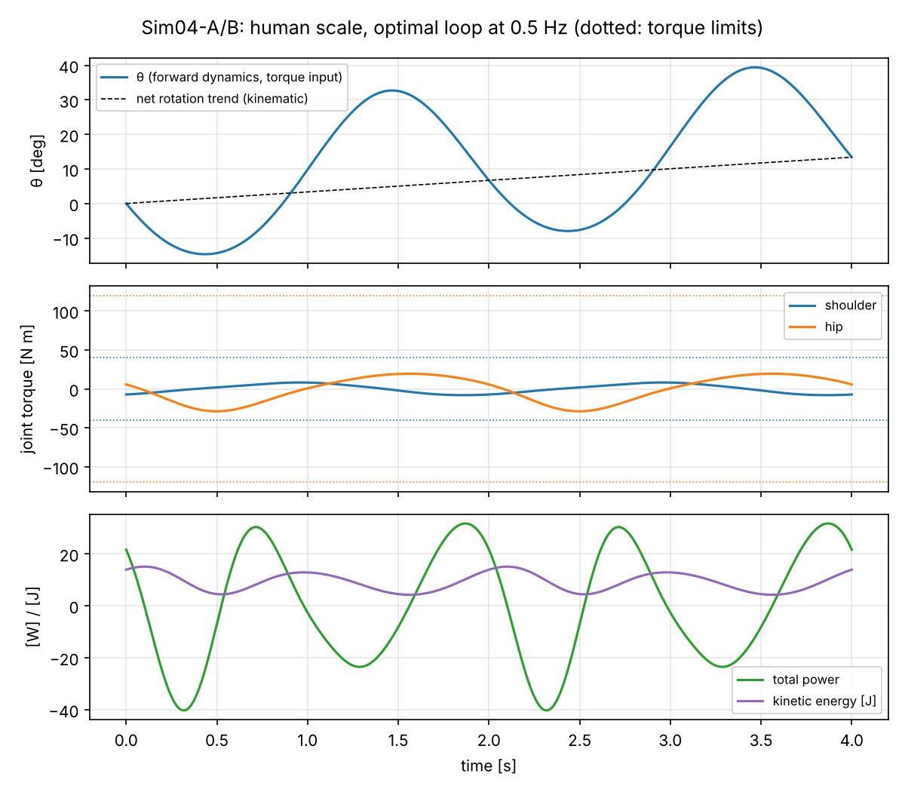
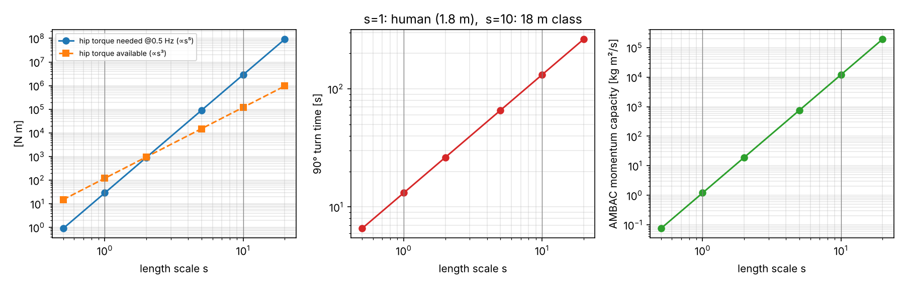

# 04. 順動力学・トルク・スケーリング則（Sim04）

スクリプト: `sims/sim04_dynamics_scaling.py` / 数値まとめ: `data/sim04_summary.txt`
モデル: `src/ambac/planar.py`（質量行列・順動力学・逆動力学を追加）

## 4.1 運動方程式

一般化速度 u = (θ̇, q̇) とする。外力なし・全運動量ゼロなら系重心は静止し、
運動エネルギーは T = ½ uᵀM(q)u（θ に依存しない）。ラグランジュ方程式は次のとおり。

$$
M(q)\dot u + \dot M(q) u - \tfrac12\left[0;\ u^\top \tfrac{\partial M}{\partial q_k} u\right] = [0;\ \tau]
$$

- M の第 1 行は (A, B) そのもので、第 1 式は dL/dt = 0 を表す。
- 関節トルク τ は胴体とリンクの間の **内力** なので、胴体には直接トルクがかからない。

**時間スケーリングの性質（厳密）**: 同じ経路を f 倍速で回すと、τ = M q̈ + (速度の 2 次項) なので
**τ ∝ f²、パワー ∝ f³**。一方、回転角は経路のみで決まり、f に依存しない（01 章）。

## 4.2 Part A: 検証

関節トルク τ(t) だけを入力し、開ループで 2 周分（0.5 Hz）を数値積分した。

| 検証項目 | 結果 |
|---|---|
| 関節軌道の追従誤差 | 2.6e-8° |
| 2 周後の正味回転 | +13.4086°（運動学モデル Sim03 と一致） |
| 角運動量 | max 2e-9 kg·m²/s（保存） |
| エネルギー収支 ΔT − ∫P dt | 9e-4 J（台形積分誤差の範囲） |

→ 運動学モデル（Sim01〜03）と動力学モデルは整合している。

## 4.3 Part B: 人間大（76 kg）

| 項目 | 0.5 Hz で最適ループを回す場合 |
|---|---|
| 必要トルク peak | 肩 8.2 N·m、股 28.8 N·m |
| パワー peak | 肩 21 W、股 47 W |
| 平均正仕事率（回生なし） | 18.5 W |
| 持続トルク目安（肩 40、股 120 N·m）での f_max | **1.02 Hz** |
| 90° 旋回時間（f_max） | **13.2 s** |

- 人間の筋力で十分実行できる負荷である。90° に十数秒という数値は、宇宙飛行士の
  「腕や脚を回して、ゆっくりなら向きを変えられる」という経験と整合する。
- パワーは周期的に正負を繰り返し、1 周あたりの正味仕事はゼロ（内力のみ・摩擦なし）。
  **回生・弾性要素（ばね）を使えば、消費エネルギーは原理的にほぼゼロにできる**。
  動物が腱の弾性を使うのと同じ発想で、フィジカル AI の「身体性の活用」の論点になる。

## 4.4 Part C: スケーリング則 — 二乗三乗則が AMBAC を直撃する

人間大モデルを長さ s 倍・同密度で相似拡大した（s=10 で約 18 m・76 t）。
アクチュエータは「同じ技術で相似拡大」と仮定し、最大トルク ∝ s³（断面積 s² × レバー s）とした。

| 量 | スケーリング（理論） | 数値で得た指数 |
|---|---|---|
| 1 周あたりの回転角 Δθ_c | s⁰（不変） | — |
| 同じ周波数で回すのに必要なトルク | s⁵ | 5.00 |
| 達成可能な周回周波数 f_max | s⁻¹ | −1.00 |
| 90° 旋回時間 | s¹ | — |
| AMBAC の角運動量容量 h | s⁴ | 4.00 |

| s | 全長 | 質量 | f_max | 90° 旋回 |
|---|---|---|---|---|
| 0.5 | 約 0.9 m | 9.5 kg | 2.0 Hz | 6.6 s |
| 1 | 約 1.8 m | 76 kg | 1.0 Hz | 13 s |
| 10 | 約 18 m | 76 t | 0.10 Hz | **132 s** |
| 20 | 約 36 m | 608 t | 0.05 Hz | 263 s |

**18 m 級について**
- 人間と同じ機敏さ（0.5 Hz）で回すには、股関節に 2.9 MN·m が必要になる（人間の 10 万倍）。
- 90° を 10 s で旋回するには 20.8 MN·m が必要で、**相似則で拡大したアクチュエータの 173 倍** にあたる。
- 相似則のままなら、90° の旋回に 2 分以上かかる。

**考察**
- 「回転角はスケール不変」（Sim01）でも、**速さは 1/s で落ちる**。巨大ロボの AMBAC は遅い。
- 逆に、小さい生物ほど AMBAC が速い。猫が空中で素早く向きを変えられるのは、この則の小さい側にいるため。
- 劇中のように機敏な AMBAC を実現するには、人間の筋肉や既存のモータに比べて
  **トルク密度が 2 桁以上高いアクチュエータ** が必要になる。これは物理的な要求として定量化できた。

## 4.5 Part D: スラスタとの比較（18 m 級）

慣性モーメント約 1.0×10⁶ kg·m²、スラスタのモーメントアーム 5 m、Isp 300 s（化学推進相当）とし、
90° 旋回（静止→静止、加速→減速）に必要な推進剤を求めた。推進剤は 1/T に比例する。

| 旋回時間 T | スラスタ推進剤 / 回 | AMBAC |
|---|---|---|
| 5 s | 88 kg | 不可能（相似則アクチュエータ） |
| 10 s | 44 kg | 不可能（173 倍のトルクが必要） |
| 30 s | 15 kg | 不可能 |
| 132 s | 3.4 kg | **推進剤 0 kg**、関節の正仕事 約 2.1 MJ（回生なしの場合） |

**考察**
- ゆっくり回るならスラスタの推進剤も少なくて済む。AMBAC の節約効果が大きくなるのは素早い旋回のときだが、
  巨大機では素早い旋回こそ AMBAC が苦手とする領域である。**トレードオフが逆向きに噛み合っている**。
- ただし、推進剤ゼロという性質は、長期間の運用・推進剤が尽きた状況・排気を出せない状況
  （汚染、被探知）では決定的な利点になる。
- 合理的な設計は **ハイブリッド** になる。素早い旋回はスラスタ（あるいは大トルクの CMG）で行い、
  低速の姿勢調整・外乱の吸収・推進剤節約は AMBAC で行う。
  「どの時間スケールの運動をどのアクチュエータに配分するか」は、そのまま最適制御・学習の問題になる。

## 4.6 次への論点

1. **統合制御（フィジカル AI 編）**: スラスタ・RW/CMG・AMBAC の配分を、推進剤・時間・揺れの多目的で
   最適制御と強化学習によって解き、比較する。
2. **弾性・回生**: 直列弾性アクチュエータ（ばね）で周回運動のエネルギーをほぼゼロにできるか。
   共振周波数とループ周波数の整合。
3. **3 次元化**: 3 次元ではロール・ピッチ・ヨーの結合（非可換性）により、平面では見えない回転が生じる。

## 参考文献

- [R16] B. Wie, *Space Vehicle Dynamics and Control*, 2nd ed., AIAA, 2008.（リアクションホイール・CMG・スラスタによる姿勢制御）
- [R33] G. Galilei, *Discorsi e dimostrazioni matematiche intorno a due nuove scienze*（新科学対話）, 1638.（二乗三乗則）

（全文献の一覧と照合状況は [references.md](references.md) を参照）
