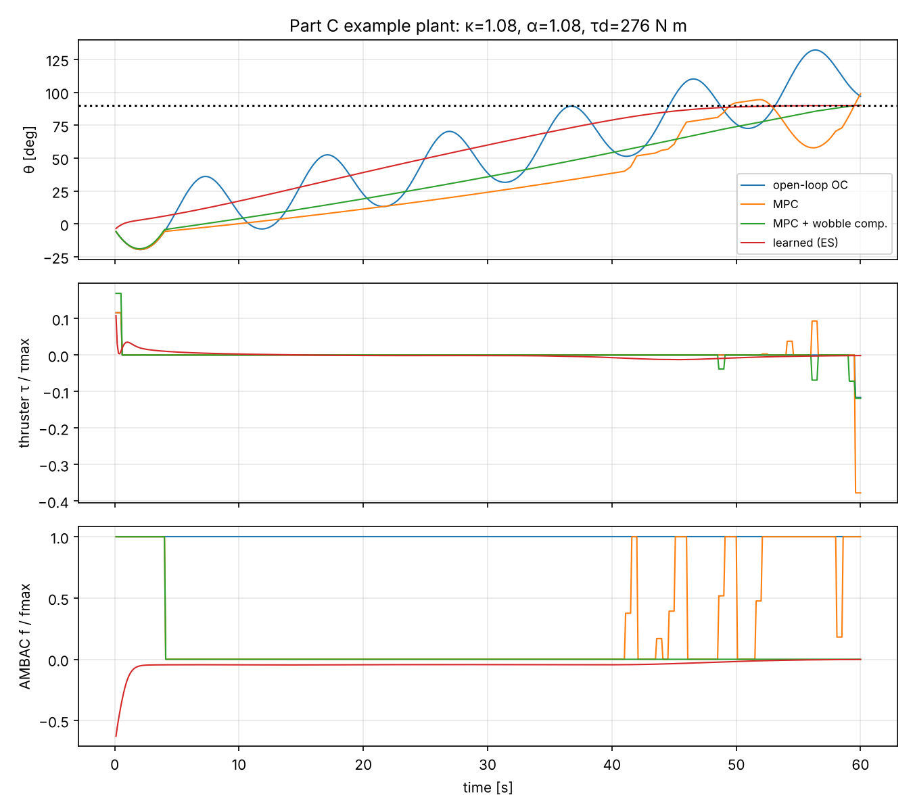

# 05. フィジカル AI 編：学習は AMBAC を発見できるか、どう配分すべきか（Sim05）

スクリプト: `sims/sim05a_learn_ambac.py`, `sims/sim05b_allocation.py`
学習器: `src/ambac/es.py`（numpy のみの MLP と進化戦略 OpenAI-ES）

## 5.0 問題設定と問い

ここまでで分かったことは次の 3 点である。

- AMBAC は **非ホロノミック**（形状ループの幾何学的位相で回る）。
- AMBAC は **周回内で大きく揺れる**。
- 巨大機では **遅い**。

この性質を持つ系を、フィジカル AI はどう扱うべきか。本章では次の 2 つの問いを立てる。

1. **発見**: 物理の知識を与えずに「胴体を目標角まで回せ」とだけ学習させたとき、エージェントは AMBAC（形状空間のループ）を自力で発見できるか。発見に必要な前提知識（帰納バイアス）は何か。
2. **配分**: スラスタ・リアクションホイール・AMBAC を併用するとき、最適制御（モデルベース）と学習（モデルフリー）はそれぞれどう配分し、モデル誤差・外乱にどう反応するか。

学習手法には進化戦略（ES）を使った。勾配を使わない方策探索で、報酬が終端でしか決まらない問題や、
長いロールアウトに強い。強化学習の一種（ブラックボックス方策最適化）として扱う。

---

## 5.1 Part A: 学習エージェントは AMBAC を発見できるか（人間大）

**設定**: L=0 の運動学モデル（腕＋脚）。行動は関節角速度（上限は Sim04 の f_max 相当）。
報酬は姿勢誤差の時間平均と終端誤差。接続・曲率・ループの知識は一切与えない。

| 方策の構造 | 中身 |
|---|---|
| **plain** | 観測（姿勢誤差, 関節角）→ MLP → 関節角速度 |
| **cpg** | plain の観測に周期信号 sin/cos(2πft) を追加 |
| **tg** | 振動子（内部位相 ψ）が目標関節角 q* = c + A⊙(cos ψ, sin(ψ+δ)) を生成する。学習するのはループの中心 c・振幅 A・形 δ と、姿勢誤差 → 位相速度のフィードバック則（MLP）。PMTG（Iscen+ 2018）と同系統の「軌道生成器を学習で調整する」構造 |
| expert（比較） | Sim03 の最適円ループを、揺れ補償付きフィードバックで回すモデルベース制御 |

**結果（25 s 後の姿勢誤差）**

| 目標 | plain | cpg | **tg** | expert |
|---|---|---|---|---|
| +90° | 61.8° | 61.8° | **0.2°** | 8.7° |
| −90° | 49.7° | 49.7° | **0.1°** | 7.9° |
| +45° | 16.8° | 16.8° | **0.1°** | 6.1° |
| +150° | 121.8° | 121.8° | **0.4°** | 21.3° |
| 報酬 | −3.00 | −3.00 | **−0.46** | −1.18 |

**tg が学習したループ**: 中心（腕 −11°, 脚 −10°）、振幅（120°, 128°）。可動域で切り取られ、
**曲率 F<0 の領域をほぼ埋め尽くす形** になった。1 周あたり **+9.34°** で、
Sim03 の最適円（+6.70°）を上回り、可動域内の理論上界（+9.57°）の **98%** に達する。
回す向きも、目標 +90° では反時計回り（掃引面積 +33.5 rad²）、−90° では時計回り（−33.3 rad²）で、
曲率の符号と整合している。

### 考察 A-1: なぜ構造なしでは失敗するのか —「幾何学的位相は 2 次の効果」

plain と cpg は、手足を可動域の端まで振って止まる（×印）という局所解に収束した。
これは単なるハイパーパラメータの問題ではなく、物理的な理由がある。

- 1 回の動きの効果（可逆的な首振り, −Γ·Δq）は振幅の **1 次**。
- ループの正味回転（曲率 × 囲んだ面積）は振幅の **2 次**（∝ A₁A₂）。

静止に近い方策から探索を始めると、ループを大きくする方向の勾配はほぼゼロになり、
1 次の効果である「端まで振る」が先に最適化されてしまう。
制御理論の言葉では、正味回転は入力ベクトル場の **リー括弧**（2 次の項）から生じる。
Brockett の定理で、滑らかな時不変フィードバックでは安定化できないのと同じ構造である。

### 考察 A-2: 正しい帰納バイアスを与えれば、学習は専門家を超える

周期信号を観測に足すだけ（cpg）では不十分だった。**「ループを描く振動子」という構造** を与え、
その位置・大きさ・回す向き・速さを学習に任せたところ（tg）、数十イテレーションで解を見つけた。

- 学習したループは、人間が設計した「最適円」より大きい（円という形の制約がないため）。
- 学習方策は最後に **揺れのない位相で止まる** ことを覚え、終端誤差が専門家より 1 桁以上小さい。
  専門家は周回平均の姿勢 θ̄ を制御するので、止まった位相の揺れがそのまま誤差に残る。

**フィジカル AI への示唆**: 身体のダイナミクスが持つ幾何構造（ここでは「周期運動 × 曲率」）を
方策の構造として埋め込むことが、学習の成否を分ける。歩行ロボットで CPG や
軌道生成器が有効なのと同じ原理を、AMBAC という別の非ホロノミック系で確認できた。

---

## 5.2 Part B: 最適制御による配分（18 m 級）

**モデル**: 平均化モデル θ̄' = (L−h)/Ā + fΔθc、L' = τ_th、h' = τ_rw。
90° 静止→静止旋回の推進剤最小化を **線形計画（LP）** として厳密に解いた。

| 機器 | 主な値 |
|---|---|
| スラスタ | τ_max 2.5×10⁵ N·m、アーム 5 m、Isp 300 s |
| AMBAC | Δθc 6.70°/周、f_max 0.102 Hz（Sim04） |
| RW | 2 kg・半径 0.12 m の RW を相似拡大（h_max 8.6×10⁴ kg·m²/s、τ_max 200 N·m） |

| 旋回時間 T | スラスタのみ | +RW | +AMBAC | +AMBAC+RW |
|---|---|---|---|---|
| 8 s | 30.1 kg | 30.0 | 28.1 | 28.1 |
| 30 s | 7.3 | 7.1 | 5.6 | 5.4 |
| 73 s | 3.0 | 2.5 | 1.3 | 0.85 |
| 113 s | 1.9 | 1.2 | 0.28 | **0** |
| 推進剤ゼロの最短時間 | — | 183 s | 137 s | **97 s** |

（推進剤ゼロの最短時間は格子上の値。AMBAC 単独の理論値は 132 s）

**考察**
- 最適な配分は「AMBAC と RW を常に最大で使い、足りない分だけスラスタで補う」になる。
  T=60 s の例（右図）では、AMBAC は全区間フル稼働、RW は前半で加速・後半で減速し、
  スラスタは最初と最後に少しだけ噴く。
- 内部機器（AMBAC・RW）は **ゆっくりした旋回ほど効く**。素早い旋回（10 s 以下）ではほぼスラスタ頼みになる。
  これは Sim04 で見た「トレードオフが逆向きに噛み合う」構造の定量版である。
- AMBAC と RW は相補的で、併用すると推進剤ゼロ領域が約 100 s まで広がる。
  四肢（AMBAC）は「大きく、遅い」、RW は「小さく、トルクが弱い」が、角運動量の受け皿として足し合わせられる。

---

## 5.3 Part C: モデル誤差・外乱がある場合 — 最適制御 vs 学習

**設定**: 18 m 級、スラスタ＋AMBAC、90° 旋回を T=60 s で行う。

- **評価用プラント**: 周回内の揺れを含む **位相モデル**（制御器は平均化モデルしか知らない）。
- **モデル誤差**: Δθc の倍率 κ ∈ [0.7, 1.3]（ループ形状の誤差）、慣性の倍率 α ∈ [0.9, 1.1]。
- **外乱**: 一定トルク τ_d ∈ [−500, 500] N·m。
- **指標**: 終端姿勢誤差（実際の θ）、旋回後に残る回転（残留角速度）、推進剤。

| 制御器 | 中身 |
|---|---|
| 開ループ最適制御 | 公称モデルで一度だけ LP を解き、そのまま実行 |
| MPC | 2 s ごとに現在の状態（θ̄, L）から LP を再計画 |
| MPC＋揺れ補償 | MPC に加えて、計画から終端位相 φ_end を予測し、目標を「90° − 揺れ(φ_end)」に置換。終盤 10 s は AMBAC を止め、スラスタで仕上げる |
| 学習方策（ES） | 観測（θ̄ 誤差, L, 残り時間, 位相 φ）→ MLP → (τ_th, f)。上記のランダムなプラントで 800 イテレーション学習（ドメインランダム化） |

参考（公称・平均化モデルでの最適値）: スラスタのみ 3.62 kg、スラスタ＋AMBAC 1.97 kg

| 条件 | 制御器 | 終端誤差 平均（95%） | 残留角速度 | 推進剤 | AMBAC 周回 |
|---|---|---|---|---|---|
| 公称 | 開ループ最適制御 | 17.4° | 0 | **1.97 kg** | 6.1 |
| 公称 | MPC | 10.5° | 0 | 3.65 kg | 5.4 |
| 公称 | MPC＋揺れ補償 | **0.02°** | 0 | 3.05 kg | 0.6 |
| 公称 | 学習方策 | 0.09° | 0.002°/s | 4.66 kg | 0.3 |
| ランダム 100 例 | 開ループ最適制御 | 30.5°（68.8°） | 0.90°/s | 1.97 kg | 6.1 |
| ランダム 100 例 | MPC | 14.6°（23.3°） | 0.030°/s | 5.41 kg | 2.9 |
| ランダム 100 例 | MPC＋揺れ補償 | 0.19°（0.69°） | 0.031°/s | 5.56 kg | 0.8 |
| ランダム 100 例 | 学習方策 | **0.09°（0.10°）** | **0.002°/s** | 4.92 kg | 0.3 |

### 考察 C-1: 平均化モデルは正確だが「揺れ」が最後に効く

開ループで実行すると、60 s 後の周回平均姿勢 θ̄ は 89.6° で、平均化モデルの予測（90.0°）とよく一致した。
それでも実際の姿勢 θ は 17° ずれる。止まった位相の揺れが誤差としてそのまま残るためである。
**AMBAC の精密な制御には、平均（ゆっくりした回転）と揺れ（速い形状変化）の 2 つの時間スケールを両方扱う必要がある**。
MPC＋揺れ補償はこれを人手で設計して解決した。学習方策は観測に位相 φ を含めただけで、同じことを自力で獲得した。

### 考察 C-2: 角運動量を一度入れると、AMBAC は推進剤を節約しなくなる

最適計画では AMBAC を 6 周使って 1.97 kg まで下げているが、MPC 系も学習方策も、実際には AMBAC をあまり使わない。
再計画の過程を追跡すると、理由は次のとおりだった。

- スラスタで角運動量 L を入れると、止めるときに |L| ぶんの逆噴射が必ず必要になる（減速の時期を変えても費用は同じ）。
- そのため、**一度回転を始めた後は、AMBAC を使っても推進剤は 1 g も減らない**。
  AMBAC が推進剤を節約できるのは、**最初にどれだけ噴くかを決める段階** だけである。
- 再計画の時点では「AMBAC を使う／使わない」の費用が同じになり、LP は使わない解を選ぶ。
  揺れ補償 MPC は、終盤で AMBAC を止める制約の分だけ初期の噴射が増えた。

学習方策の推進剤（約 4.7〜4.9 kg）は、スラスタのみの最適値（3.62 kg）より多い。
同じ構造により、学習方策は「まずスラスタで回し始め、精度を出す」解に落ち着き、AMBAC で得をする余地を自ら消している。
**AMBAC の価値は「最初の判断」に集中しており、報酬が終端でしか与えられない学習では、その判断を学ぶのが難しい**。

### 考察 C-3: 最適制御と学習の得意・不得意

| | 最適制御（LP / MPC） | 学習方策（ES） |
|---|---|---|
| 公称条件での推進剤 | ◎ 最適（1.97 kg、ただし揺れで精度が出ない） | △ スラスタのみの最適値より悪い |
| モデル誤差・外乱への強さ | △ 再計画すれば精度は出るが、外乱を知らないため回転が残る | ◎ 誤差 0.1°、残留回転は MPC の 1/10 |
| 揺れ（2 つの時間スケール）の扱い | 人手の設計が必要 | 観測に位相を入れれば自力で獲得 |
| 実行時の計算 | 再計画のたびに LP（ここでは 100 例で 15〜40 s） | 行列積だけ（100 例で 0.1 s） |
| 解釈性・保証 | 制約・最適性が明示的 | ブラックボックス |

**フィジカル AI への示唆**
- どちらか一方では足りない。**計画（いつ・どれだけ噴くか、AMBAC をどれだけ回すか）は最適制御が担い、
  実行時の誤差・外乱・揺れの補正は学習方策が担う** という役割分担（残差学習、学習済み MPC コスト）が自然な次の一手になる。
- Part A と合わせると、学習が成功するかどうかは **物理構造をどこまで方策に埋め込むか** で決まる。
  - ループという「形」は構造として与える（Part A の tg）。
  - 角運動量という「保存量」の扱いは、最適制御のように明示的に計画する。

  物理の知識と学習の分担を設計することが、フィジカル AI の中心的な課題であることを、
  AMBAC という具体例で示せた。

---

## 5.4 まとめと次への論点

1. 学習で AMBAC を **発見できる**。ただし「振動子でループを描く」構造が必要で、構造がないと 2 次効果の壁に阻まれる。
   構造を与えた学習は、可動域内の理論上界の 98% に達するループを見つけ、専門家制御を上回った。
2. 18 m 級では、AMBAC＋RW により **約 100 s 以上かける旋回なら推進剤ゼロ** にできる。素早い旋回はスラスタ頼みになる。
3. AMBAC が推進剤を節約するのは **最初の噴射量を決める計画段階だけ**。一方、揺れと外乱への対処は学習が得意である。
   → **計画は最適制御、実行は学習** というハイブリッドが有望。

**次の候補**
- 最適制御の計画に学習した残差方策を重ねるハイブリッド制御の実装と評価
- 3 次元化（ロール・ピッチ・ヨーの非可換性）で同じ問いを立て直す
- 弾性要素（ばね）による周回エネルギーの回生と、学習によるリズムの獲得
