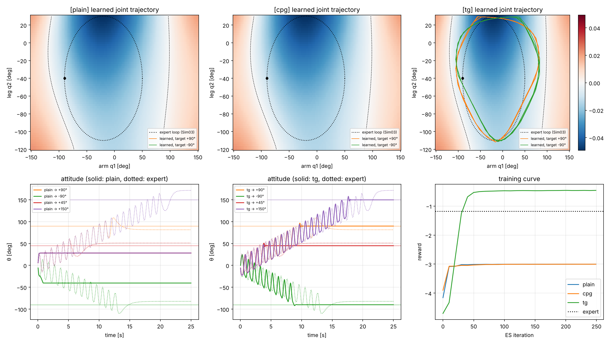
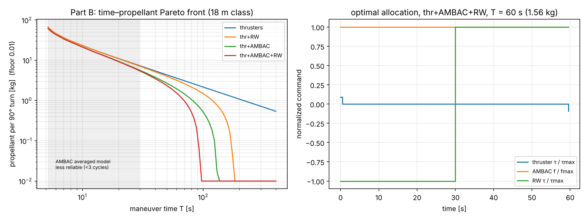

# 05. フィジカル AI 編：学習は AMBAC を発見できるか、どう配分すべきか（Sim05）

スクリプト: `sims/sim05a_learn_ambac.py`, `sims/sim05b_allocation.py`
学習器: `src/ambac/es.py`（numpy のみの MLP と進化戦略 OpenAI-ES）

## 5.0 問題設定と問い

ここまでで分かったことは次の 3 点である。

- AMBAC は **非ホロノミック**（形状ループの幾何学的位相で回る）。
- AMBAC は **周回内で大きく揺れる**。
- 巨大機では **遅い**。

この性質を持つ系を、フィジカル AI はどう扱うべきか。本章では次の 2 つの問いを立てる。

1. **発見**: 物理の知識を与えずに「胴体を目標角まで回せ」とだけ学習させたとき、エージェントは AMBAC（形状空間のループ）を自力で発見できるか。発見に必要な前提知識（帰納バイアス）は何か。
2. **配分**: スラスタ・リアクションホイール・AMBAC を併用するとき、最適制御（モデルベース）と学習（モデルフリー）はそれぞれどう配分し、モデル誤差・外乱にどう反応するか。

学習手法には進化戦略（ES）を使った。勾配を使わない方策探索で、報酬が終端でしか決まらない問題や、
長いロールアウトに強い。強化学習の一種（ブラックボックス方策最適化）として扱う。

---

## 5.1 Part A: 学習エージェントは AMBAC を発見できるか（人間大）

**設定**: L=0 の運動学モデル（腕＋脚）。行動は関節角速度（上限は Sim04 の f_max 相当）。
報酬は姿勢誤差の時間平均と終端誤差。接続・曲率・ループの知識は一切与えない。

| 方策の構造 | 中身 |
|---|---|
| **plain** | 観測（姿勢誤差, 関節角）→ MLP → 関節角速度 |
| **cpg** | plain の観測に周期信号 sin/cos(2πft) を追加 |
| **tg** | 振動子（内部位相 ψ）が目標関節角 q* = c + A⊙(cos ψ, sin(ψ+δ)) を生成する。学習するのはループの中心 c・振幅 A・形 δ と、姿勢誤差 → 位相速度のフィードバック則（MLP）。PMTG（Iscen+ 2018）と同系統の「軌道生成器を学習で調整する」構造 |
| expert（比較） | Sim03 の最適円ループを、揺れ補償付きフィードバックで回すモデルベース制御 |

**結果（25 s 後の姿勢誤差）**

| 目標 | plain | cpg | **tg** | expert |
|---|---|---|---|---|
| +90° | 61.8° | 61.8° | **0.2°** | 8.7° |
| −90° | 49.7° | 49.7° | **0.1°** | 7.9° |
| +45° | 16.8° | 16.8° | **0.1°** | 6.1° |
| +150° | 121.8° | 121.8° | **0.4°** | 21.3° |
| 報酬 | −3.00 | −3.00 | **−0.46** | −1.18 |

**tg が学習したループ**: 中心（腕 −11°, 脚 −10°）、振幅（120°, 128°）。可動域で切り取られ、
**曲率 F<0 の領域をほぼ埋め尽くす形** になった。1 周あたり **+9.34°** で、
Sim03 の最適円（+6.70°）を上回り、可動域内の理論上界（+9.57°）の **98%** に達する。
回す向きも、目標 +90° では反時計回り（掃引面積 +33.5 rad²）、−90° では時計回り（−33.3 rad²）で、
曲率の符号と整合している。

### 考察 A-1: なぜ構造なしでは失敗するのか —「幾何学的位相は 2 次の効果」

plain と cpg は、手足を可動域の端まで振って止まる（×印）という局所解に収束した。
これは単なるハイパーパラメータの問題ではなく、物理的な理由がある。

- 1 回の動きの効果（可逆的な首振り, −Γ·Δq）は振幅の **1 次**。
- ループの正味回転（曲率 × 囲んだ面積）は振幅の **2 次**（∝ A₁A₂）。

静止に近い方策から探索を始めると、ループを大きくする方向の勾配はほぼゼロになり、
1 次の効果である「端まで振る」が先に最適化されてしまう。
制御理論の言葉では、正味回転は入力ベクトル場の **リー括弧**（2 次の項）から生じる。
Brockett の定理で、滑らかな時不変フィードバックでは安定化できないのと同じ構造である。

### 考察 A-2: 正しい帰納バイアスを与えれば、学習は専門家を超える

周期信号を観測に足すだけ（cpg）では不十分だった。**「ループを描く振動子」という構造** を与え、
その位置・大きさ・回す向き・速さを学習に任せたところ（tg）、数十イテレーションで解を見つけた。

- 学習したループは、人間が設計した「最適円」より大きい（円という形の制約がないため）。
- 学習方策は最後に **揺れのない位相で止まる** ことを覚え、終端誤差が専門家より 1 桁以上小さい。
  専門家は周回平均の姿勢 θ̄ を制御するので、止まった位相の揺れがそのまま誤差に残る。

**フィジカル AI への示唆**: 身体のダイナミクスが持つ幾何構造（ここでは「周期運動 × 曲率」）を
方策の構造として埋め込むことが、学習の成否を分ける。歩行ロボットで CPG や
軌道生成器が有効なのと同じ原理を、AMBAC という別の非ホロノミック系で確認できた。

---

## 5.2 Part B: 最適制御による配分（18 m 級）

**モデル**: 平均化モデル θ̄' = (L−h)/Ā + fΔθc、L' = τ_th、h' = τ_rw。
90° 静止→静止旋回の推進剤最小化を **線形計画（LP）** として厳密に解いた。

| 機器 | 主な値 |
|---|---|
| スラスタ | τ_max 2.5×10⁵ N·m、アーム 5 m、Isp 300 s |
| AMBAC | Δθc 6.70°/周、f_max 0.102 Hz（Sim04） |
| RW | 2 kg・半径 0.12 m の RW を相似拡大（h_max 8.6×10⁴ kg·m²/s、τ_max 200 N·m） |

| 旋回時間 T | スラスタのみ | +RW | +AMBAC | +AMBAC+RW |
|---|---|---|---|---|
| 8 s | 30.1 kg | 30.0 | 28.1 | 28.1 |
| 30 s | 7.3 | 7.1 | 5.6 | 5.4 |
| 73 s | 3.0 | 2.5 | 1.3 | 0.85 |
| 113 s | 1.9 | 1.2 | 0.28 | **0** |
| 推進剤ゼロの最短時間 | — | 183 s | 137 s | **97 s** |

（推進剤ゼロの最短時間は格子上の値。AMBAC 単独の理論値は 132 s）

**考察**
- 最適な配分は「AMBAC と RW を常に最大で使い、足りない分だけスラスタで補う」になる。
  T=60 s の例（右図）では、AMBAC は全区間フル稼働、RW は前半で加速・後半で減速し、
  スラスタは最初と最後に少しだけ噴く。
- 内部機器（AMBAC・RW）は **ゆっくりした旋回ほど効く**。素早い旋回（10 s 以下）ではほぼスラスタ頼みになる。
  これは Sim04 で見た「トレードオフが逆向きに噛み合う」構造の定量版である。
- AMBAC と RW は相補的で、併用すると推進剤ゼロ領域が約 100 s まで広がる。
  四肢（AMBAC）は「大きく、遅い」、RW は「小さく、トルクが弱い」が、角運動量の受け皿として足し合わせられる。
