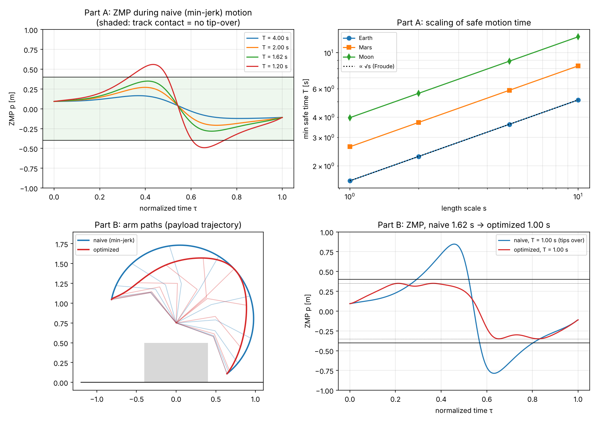
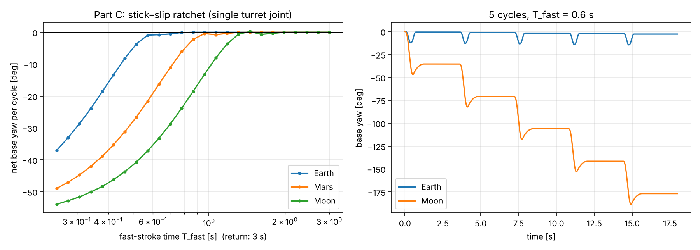

# 06. 地上を動く機体：戦車型台車＋腕（Sim06）

スクリプト: `sims/sim06_ground_tank.py` / モデル: `src/ambac/ground.py` / 数値まとめ: `data/sim06_summary.txt`

## 6.1 宇宙から地上へ：何が変わるか

宇宙では外力がないので、角運動量が保存された（dL/dt = 0）。
地上では地面からの反力が働くので、角運動量の変化は接触反力のモーメントに等しい（dL/dt = 接触モーメント）。
ただし、接触反力には次の限界がある。

| 限界 | 条件 | 超えると |
|---|---|---|
| ZMP（反力の合力の作用点）は接地範囲の中にしか来られない | −a ≤ p ≤ a | **転倒** |
| 水平反力は摩擦の範囲までしか出せない | \|Fx\| ≤ μN | **滑り** |
| 旋回（ヨー）の反力も摩擦の範囲まで | \|τ\| ≤ μ N r̄ | **その場で回る** |

$$
p = \frac{\sum m_i\left(x_i(\ddot z_i+g) - z_i\ddot x_i\right) + \sum I_i\ddot\phi_i}{\sum m_i(\ddot z_i+g)}
$$

腕を動かしたときの反力のうち、動的な部分は「角運動量の時間変化」そのものである。
**地上版 AMBAC とは、腕の運動量の変化が接触の限界を超えるかどうかの問題** と言える。

**モデル**: 戦車型台車（台車＋胴体 80 kg、履帯接地長 0.8 m）に 2 関節の腕（上腕 4 kg・前腕 3 kg、各 0.5 m）、
先端に荷物 10 kg（総重量 97 kg）。脚の問題を切り離すため、脚は戦車型の台車として単純化した。剛体を仮定する。

## 6.2 Part A: 腕の反作用で転倒するか（矢状面）

**動作**: 前方の地面にある荷物を拾い、頭上を通して後部デッキに置く（最小躍度の単純な関節軌道）。

| 動作時間 T | ZMP の範囲（接地範囲 ±0.4 m） | 必要な摩擦係数 |
|---|---|---|
| 4.0 s | −0.12 〜 +0.17 m | 0.04 |
| 2.0 s | −0.21 〜 +0.27 m | 0.15 |
| **1.62 s** | −0.28 〜 +0.35 m（安全余裕 5 cm の限界） | 0.23 |
| 1.2 s | −0.49 〜 **+0.56 m（転倒）** | 0.46 |

- 腕を持ち上げて加速する前半は、ZMP が前方に出る（前のめり）。後方で減速する後半は、後方に出る（のけぞり）。
- 摩擦係数 0.6 の路面では、**滑るより先に転倒する**（滑らない限界 1.09 s ＜ 転倒しない限界 1.62 s）。

### スケーリング：フルード則 [R29]

| 長さ倍率 s | 地球 | 火星 | 月 |
|---|---|---|---|
| 1（人間程度） | 1.62 s | 2.62 s | 3.97 s |
| 2 | 2.29 s | 3.71 s | 5.61 s |
| 10（18 m 級） | 5.11 s | 8.30 s | 12.55 s |

安全に動ける最短時間は **T ∝ √(s/g)**（フルード則）に **厳密に** 従った（T/√(s·g_地球/g) = 1.616 で一定）。
これは時間スケーリングの性質から導ける。動的な反力は 1/T² に比例し、重力は一定なので、
限界は「加速度/重力」の比（フルード数）だけで決まる。

**考察**
- **大型化**: Sim04（宇宙）では、アクチュエータの制約で速さが 1/s で落ちた。地上では、アクチュエータが十分強くても、
  **転倒の制約だけで速さが 1/√s で落ちる**。18 m 級の機体は、人間程度の機体の約 3 倍ゆっくり腕を動かさないと転倒する。
- **低重力**: 月面では重力が 1/6 なので、同じ動作に地球の約 2.5 倍の時間がかかる。
  **低重力天体では、腕の動きの反作用が相対的に大きく効く**。月面ローバーにマニピュレータを載せる場合に直接関係する。

## 6.3 Part B: 腕の動かし方で転倒を防ぐ（地上版の能動的質量バランス）

関節軌道を最小躍度＋補正（関節あたり 4 つの基底関数）で表し、
転倒・滑り・関節速度（6 rad/s）・関節加速度（60 rad/s²）の制約の下で、動作時間を最小化した（SLSQP）。

| | 単純軌道（最小躍度） | 最適化軌道 |
|---|---|---|
| 地球 | 1.62 s | **1.03 s（36% 短縮）** |
| 月 | 3.97 s | **2.01 s（49% 短縮）** |
| 1.03 s で実行したときの ZMP | −0.72 〜 +0.78 m（転倒） | −0.35 〜 +0.35 m（安全余裕ぎりぎりを使い切る） |

**最適化で見つかった戦略**（左下図）
- **荷物を体に引き寄せて、低く小さな弧で運ぶ。** 回転半径を小さくして、腕と荷物の慣性（＝角運動量の変化）を減らしている。
- ZMP が許容範囲の上限・下限に **張り付く** 形になる（右下図）。最短時間制御で典型的な「制約をぎりぎりまで使う」解である。
- これは、人間が重い物を素早く運ぶときに体に引き寄せるのと同じ戦略である。
  物理モデルの最適化が、人間らしい動きを **再発見** した例と言える（00 章の「人体運動を基準値にするか」の論点への一つの答え：
  人間の動きの合理性は、物理と制約から説明できる場合がある）。

## 6.4 Part C: 腕を振ると台車がその場で回るか（上から見たヨー）

**設定**: 台車中心の旋回関節（ターレット）で、腕（7 kg・1 m）＋荷物（10 kg）を水平に 90° 振る。
台車の並進は止まっているとし、ヨー回転だけを考える。履帯の摩擦は、クーロン摩擦（静止・動摩擦）でモデル化した。

| 重力 | 摩擦トルクの上限 μNr̄ | 台車が滑り始める振りの速さ |
|---|---|---|
| 地球 | 155 N·m | 0.85 s より速い |
| 火星 | 59 N·m | 1.38 s より速い |
| 月 | 26 N·m | 2.09 s より速い |

**「速く振って、ゆっくり（3 s）戻す」往復を繰り返すと、関節が 1 つでも台車が回る。**

| 振りの時間 | 地球 | 火星 | 月 |
|---|---|---|---|
| 0.25 s | −37°/往復 | −49° | −54° |
| 0.47 s | −8° | −31° | −44° |
| 0.87 s | 0° | −2° | −19° |
| 摩擦ゼロ（宇宙と同じ） | 0°（1.9×10⁻⁴°） | | |

0.6 s で振る往復を 5 回繰り返すと、地球では −2.8°、**月では −177°** 回った。

> **注釈（シミュレーション場での検証、docs/11 の 11.10）**：この Part C は「台車は接地したまま、ヨーだけ回る」と仮定している。
> MuJoCo の地上の試験場と 3 次元の ZMP モデルで確かめると、この機体（腕 1 m・荷物 10 kg）では、横滑りで回るより先に、遠心力で台車が浮き上がり・傾く。
> 月面では、ここで回ると予測した速さのほぼ全域で、先に浮き上がりが起きる。スティックスリップの仕組み自体は正しいが、この機体の数値は転倒側の制約を受ける。

**考察: 宇宙と地上で「回る仕組み」が違う**

| | 宇宙（Sim01〜05） | 地上（Sim06） |
|---|---|---|
| 関節 1 つの往復 | 回らない（可逆） | **回る**（速い振りで滑り、遅い戻りで止まる） |
| 正味回転の源 | 形状ループの曲率（幾何学的位相） | 摩擦による **時間対称性の破れ**（スティックスリップ） |
| 速さの影響 | 関係ない（経路だけで決まる） | **決定的**（速さが摩擦の限界を超えるかどうか） |

- 宇宙では「速さは関係ない」が鉄則だった（01 章）。地上では摩擦が速さに対して非対称なので、**速さそのものが制御入力** になる。
- **低重力天体では、腕の作業がそのまま機体の姿勢を乱す。** 月面で荷物を素早く振れば、ローバーが意図せず回る。
  逆に、これを利用して車輪や履帯を使わずに向きを変えることもできる（地上版 AMBAC）。
- 地球の通常の作業速度（1 s 以上）では、ほぼ問題にならない。

## 6.5 フィジカル AI への示唆

1. **安価なシミュレーションで、高価な実機の「危ない領域」を事前に地図にできる。**
   転倒・滑りの限界は ZMP と摩擦の式から求まり、時間・大きさ・重力についてのスケーリング則（フルード則）まで厳密に得られた。
   実機での試行錯誤（＝転倒させて壊すリスク）を大きく減らせる。
2. **学習・最適化に入れるべき制約が明確になる。** ZMP と摩擦の限界は、強化学習の報酬や安全制約として、
   そのまま方策に組み込める形をしている。
3. **重力や摩擦が違う環境（月・火星・氷上）への移行は、パラメータの変更だけで評価できる。**
   これはシミュレーションの大きな強みで、本章の結果は「地球で学習した方策を月にそのまま持っていくと危ない」ことを定量的に示している。

## 6.6 限界と次の課題

- 台車は静止しているとして、転倒・滑りの **開始条件** だけを調べた。転倒が始まった後の運動（台車が傾く）は扱っていない。
- 台車の並進（前後に滑る）と旋回の連成、走行中の加減速は扱っていない。
- 地面は剛体と仮定した（不整地・軟弱地盤・レゴリスの沈み込みは扱っていない）。
- アクチュエータは理想的（油圧・電動の動特性は今後の課題、00 章参照）。

**次の候補**
- 3 次元化（腕の空間的な動きで、前後の転倒・左右の転倒・旋回が同時に起きる）
- 走行中の腕の作業（台車の加減速と腕の反作用の連成）
- 学習方策に ZMP 制約を入れ、Part B の最適化結果と比較する

> **修正履歴**: 当初 Part B の最適化で、肘の関節の速度・加速度の制約が課されていなかった（制約を間引くときの配列の取り方の誤り）。
> 修正後、地球での最短時間は 1.00 s（38% 短縮）から 1.03 s（36% 短縮）に変わった。月面の結果（2.01 s）は変わらない。

## 参考文献

- [R26] D. Kraft, "A software package for sequential quadratic programming," Technical Report DFVLR-FB 88-28, DLR, 1988.（SLSQP: scipy の minimize で使用）
- [R27] T. Flash and N. Hogan, "The coordination of arm movements: an experimentally confirmed mathematical model," *Journal of Neuroscience*, 5(7), 1688–1703, 1985.（最小躍度軌道）
- [R28] M. Vukobratović and B. Borovac, "Zero-moment point — thirty five years of its life," *International Journal of Humanoid Robotics*, 1(1), 157–173, 2004.
- [R29] R. McN. Alexander and A. S. Jayes, "A dynamic similarity hypothesis for the gaits of quadrupedal mammals," *Journal of Zoology*, 201(1), 135–152, 1983.（フルード数による相似則）
- [R30] D. Karnopp, "Computer simulation of stick-slip friction in mechanical dynamic systems," *Journal of Dynamic Systems, Measurement, and Control*, 107(1), 100–103, 1985.
- [R33] G. Galilei, *Discorsi e dimostrazioni matematiche intorno a due nuove scienze*（新科学対話）, 1638.（二乗三乗則）

（全文献の一覧と照合状況は [references.md](references.md) を参照）
