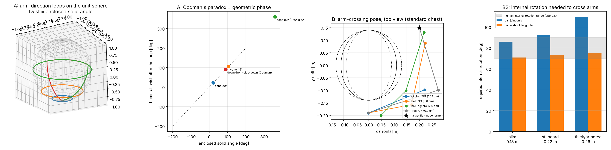

# 08. 肩の 3 次元運動：AMBAC から人体工学へ（Sim08）

スクリプト: `sims/sim08_shoulder.py` / モデル: `src/ambac/shoulder.py` / 数値まとめ: `data/sim08_summary.txt`

## 8.0 なぜ肩なのか

Sim07 で、球面座標の肩（2 軸ジンバル）を使って 3 次元の AMBAC を扱った。
ところが、人の肩は 2 軸ではない。少なくとも次の 3 つを持つ。

- 腕の向き（2 自由度）
- 腕の長軸まわりのひねり（内旋・外旋）
- 肩甲骨・鎖骨（上肢帯）の動きによる、肩関節の中心そのものの移動

本章では、AMBAC で使った幾何学的位相の考え方を人の肩に当てはめる。
そのうえで、**人間らしい動きを実演するために機械に何が必要か** を、腕組みを例に定量化する。

## 8.1 Part A: コッドマンのパラドックス ＝ 肩の幾何学的位相

**コッドマンのパラドックス** [R34, R35]: 腕を「下 → 前 → 横 → 下」と動かして元の向きに戻すと、
一度もひねっていないのに、上腕が長軸まわりに 90° ひねられている。

「ひねらずに動かす」とは、各瞬間の回転軸が常に腕に垂直であること（ひねり方向の角速度がゼロ）を指す。
このとき、ループ 1 周後のひねりは次のようになる（ガウス・ボンネの定理 [R11]）。

$$
\text{ひねり角} = \text{腕の向きが単位球面上で囲んだ立体角}
$$

| 腕の動き | 上腕のひねり | 囲んだ立体角 |
|---|---|---|
| 下 → 前 → 横 → 下（古典的なコッドマンの動作） | +90.00° | +90.00° |
| 半頂角 20° の円錐を描いて下ろす | +21.71° | +21.71° |
| 半頂角 45° の円錐を描いて下ろす | +105.44° | +105.44° |
| 半頂角 90° の円錐を描いて下ろす | +360.00° | +360.00° |

**AMBAC との対応**

| | AMBAC（01 章） | 肩（本章） |
|---|---|---|
| 形状空間 | 関節角 (q₁, q₂) | 腕の向き（単位球面） |
| ループ 1 周の正味の変化 | 胴体の回転 Δθ | 上腕のひねり |
| 決まり方 | 曲率 F の面積分 | 球面の曲率（=1）の面積分 ＝ 立体角 |

**どちらも「形を元に戻しても、向きだけが進む」幾何学的位相** である。
AMBAC の数学は、宇宙の巨大ロボットと人の肩に共通している。

**2 軸ジンバル（Sim07 の肩）の場合**: 上腕の姿勢が関節角 (ψ, α) だけで決まるので、関節角が戻れば姿勢も戻り、
パラドックスは起きない。代わりに、ひねりを独立に選ぶことができない。

**示唆**
- 人の肩の「ひねり」は、どの順序・どの基準で測るかによって値が変わる。
  バイオメカニクスで肩の角度の測り方の標準（回転の順序の取り決め）が必要とされるのは、このためである。
- 人の動きをモーションキャプチャーでロボットに移すとき、ひねりの扱いを誤ると、同じ腕の向きでも手のひらの向きが変わる。
  **3 自由度目（ひねり）を持ち、それを明示的に計画すること** が、人間らしい動きを再現する機械の要件になる。

## 8.2 Part B: 腕組みは可能か

**姿勢**: 右手を左上腕（肘の少し上）に置き、前腕を胸の前で交差させる（目標点 (0.20, 0.15, 0.00) m、許容誤差 1.5 cm）。
**制約**: 腕（上腕・前腕を太さのある円柱とする）が胸郭（楕円柱）に食い込まないこと、関節の可動域。

| 肩の機構 | 中身 |
|---|---|
| 2 軸ジンバル | Sim07 の肩。ひねりを独立に選べない |
| 球関節（人の可動域） | 3 自由度。水平内転 ≤ 45°、内旋 ≤ 70°、外旋 ≤ 90°、肘 ≤ 145° |
| 球関節＋上肢帯 | 上記に加えて、鎖骨の回転による肩の前方突出（≤ 25°） |
| 球関節（可動域制限なし） | 幾何学的に可能かどうかだけを見る |

### B1: 合否（標準的な胸板、奥行 0.22 m）

| 肩の機構 | 結果 | 手の誤差 |
|---|---|---|
| 2 軸ジンバル | **不可** | 25 cm |
| 球関節（人の可動域） | 不可 | 6.6 cm |
| 球関節＋上肢帯 | 不可（惜しい） | 2.6 cm |
| 可動域制限なし | 可能 | 0 cm（ただしひねりが不自然） |

- **2 軸ジンバルでは、胸板の厚さによらず届かない**（誤差 24〜26 cm）。
  腕を前に出すと、前腕の曲がる面（肘の屈曲面）が上腕と同じ鉛直面に固定され、前腕を胸の前で横に渡せない。
- 人の可動域を与えた球関節では、内旋 70° の上限に張り付いて届かなかった。
  ただし、内旋 70° は腕を横に 90° 上げた姿勢での標準値で、腕を前に下ろした姿勢でどこまでひねれるかは別である。
  さらに Part A のとおり、ひねりの数値は測り方で変わる。そこで B2 では、合否ではなく「最低限必要な内旋量」を求めた。

### B2: 腕組みに最低限必要な内旋量

水平内転 ≤ 45°、前方突出 ≤ 25° の下で、手を目標に届かせるのに必要なひねりの最小値を求めた。

| 胸板の奥行 | 球関節のみ | 球関節＋上肢帯（必要な前方突出） |
|---|---|---|
| 0.18 m（細身） | 86° | 71°（12°） |
| 0.22 m（標準） | 93° | 73°（16°） |
| 0.26 m（厚い胸板・装甲） | **110°（人の範囲を超える）** | 75°（20°） |

参考: 人の内旋の可動域はおよそ 70〜90°（姿勢と測り方に依存）。

**考察**
- **肩関節だけでは、腕組みに人の限界ぎりぎりか、それ以上の内旋が必要になる。**
  上肢帯（肩甲骨・鎖骨）が肩関節を前に出すことで、必要な内旋が 15〜35° 減り、人の範囲に収まる。
  **人が腕を組めるのは、肩甲骨が動くから** と言える。
- **胸板が厚いほど難しい。** 厚い胸板・装甲では、肩関節だけでは人の範囲を超える内旋が必要になり、上肢帯の動き（20°）が必須になる。
  アクションフィギュアで、肩の付け根を前に動かせる関節を胸に設けると腕組みができるようになるのと同じ理屈である。
  装甲で胸の厚いガンダム型の機体が腕を組むには、肩の付け根ごと前に出す機構が要る。

## 8.3 人間らしい動きのために機械が必要とするもの（ここまでの要件）

| 要件 | 根拠 |
|---|---|
| 肩は 3 自由度（ひねりを含む）にする | 2 軸ジンバルでは腕組みが不可能（B1）。ひねりを独立に選べない（A） |
| ひねりを明示的に計画・計測する | コッドマンのパラドックス：腕の向きの経路によってひねりが勝手に変わる（A） |
| 上肢帯（肩の付け根の移動）を持たせる | 腕組みに必要な内旋が人の範囲に収まる。胸板が厚い機体では必須（B2） |
| 座標の特異点を作業範囲の外に置く | 球面座標の極で関節速度が発散する（Sim07 A3） |
| 胸・装甲の厚さと腕の可動域を同時に設計する | 胸が厚いほど必要な可動域が増える（B2） |

## 8.4 限界と次の課題

- 胸郭は楕円柱、腕は円柱で近似した。筋肉の盛り上がり・衣服・装甲の形状は扱っていない。
- 可動域は「水平内転」「スイング・ツイスト分解によるひねり」で単純化した。実際の可動域は姿勢に依存して連続的に変わる。
- 左右の前腕の重なり（どちらが上か）と、左右の腕どうしの干渉は扱っていない。
- 股関節（同じく球関節だが、骨盤のくぼみが深く安定な代わりに可動域が狭い）への展開は今後の課題。

## 参考文献

- [R11] M. P. do Carmo, *Differential Geometry of Curves and Surfaces*, Prentice-Hall, 1976.（ガウス・ボンネの定理）
- [R24] X. B. Peng, P. Abbeel, S. Levine, M. van de Panne, "DeepMimic: Example-guided deep reinforcement learning of physics-based character skills," *ACM Transactions on Graphics*, 37(4), 2018.（モーションキャプチャーを手本とする物理ベースの強化学習）
- [R34] E. A. Codman, *The Shoulder*, Thomas Todd, Boston, 1934.（コッドマンのパラドックス）
- [R35] J. C. Politti, G. Goroso, M. E. Valentinuzzi, O. Bravo, "Codman's paradox of the arm rotations is not a paradox: mathematical validation," *Medical Engineering & Physics*, 20(4), 257–260, 1998. ✓（その後も解釈をめぐる議論がある）
- [R36] G. Wu et al., "ISB recommendation on definitions of joint coordinate systems of various joints for the reporting of human joint motion — Part II: shoulder, elbow, wrist and hand," *Journal of Biomechanics*, 38(5), 981–992, 2005.（肩の角度の測り方の標準）
- [R37] V. T. Inman, J. B. Saunders, L. C. Abbott, "Observations on the function of the shoulder joint," *Journal of Bone and Joint Surgery*, 26(1), 1–30, 1944.（肩甲上腕リズム）
- [R38] American Academy of Orthopaedic Surgeons, *Joint Motion: Method of Measuring and Recording*, AAOS, 1965.（関節可動域の標準値）

（全文献の一覧と照合状況は [references.md](references.md) を参照）
