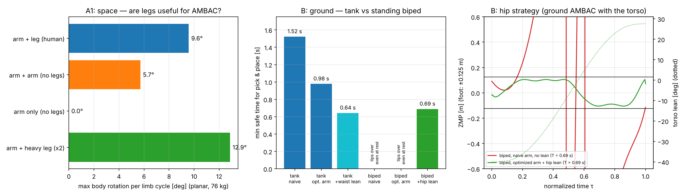

# 09. 「足なんて飾り」は本当か（Sim09）

スクリプト: `sims/sim09_legs.py` / 数値まとめ: `data/sim09_summary.txt`

## 9.0 問い

「足なんて飾りです」という有名なセリフがある（宇宙用の脚のない機体について語られたものと記憶している）。
コスト面だけを見れば、脚の代わりに戦車型の台車にした方が安い。では物理的に、脚は本当に飾りなのか。
宇宙（AMBAC）と地上（安定性）の 2 つの場面で検証した。

## 9.1 Part A: 宇宙 — 脚は AMBAC の道具になるか

### A1: 平面モデル、総質量 76 kg を揃えて比較

1 周あたりに稼げる回転の上限（関節の可動域の中で、同じ符号の曲率の領域をすべて囲んだ場合）を比べた。

| 構成 | 1 周あたりの上限 | 90° に必要な周回 |
|---|---|---|
| 腕＋脚（人間型） | 9.57° | 10 周 |
| 腕＋腕（脚を外し、脚の質量は胴体へ） | 5.71° | 16 周 |
| 腕だけ（脚を外す） | **0°**（関節 1 つでは往復で元に戻る） | 不可能 |
| 腕＋重い脚（脚 2 倍：推進剤タンクや装甲を脚に置く） | **12.87°** | 7 周 |

### A2: 3 次元、股関節（球関節）で脚に円錐を描かせる

| 動作 | 1 周あたりの胴体の回転 |
|---|---|
| 腕（肩）: 前下方 30° の軸、半頂角 30° | 24.8° |
| **脚（股関節）: 同じ軸、同じ半頂角** | **48.2°（腕の 1.9 倍）** |
| 脚（股関節）: 同じ軸、半頂角 45° | 96.8° |

股関節の可動域は肩より狭いが、脚は腕の 3 倍重く長いので、同じ動きでもはるかに大きく胴体を回せる。

**結論 A: 宇宙では、脚は飾りではない。** 脚は AMBAC で最も効く「重い肢」であり、
脚を外すと姿勢変更の能力は半分近くまで落ちる（腕が 1 本なら平面では不可能になる）。
脚に質量（推進剤タンク、装甲）を集めるほど、AMBAC は強くなる。
皮肉なことに、セリフが語られた「宇宙」こそ、脚が最も役に立つ場面だった。

## 9.2 Part B: 地上 — 二本脚で立つ機体 vs 戦車型台車

Sim06 と同じ荷物運び（10 kg を前方の低い位置から後方の高い位置へ）を、同じ腕・同じ総質量（97 kg）で比べた。
すべての方策に、腕の関節速度 6 rad/s・加速度 60 rad/s²、上体の傾きの速度 3 rad/s・加速度 15 rad/s²、傾き ±40° 以内、
床から浮かないこと（垂直反力 ≥ 自重の 30%）の制約を課した。

| 機体 | 支持範囲 | 腕だけ最適化 | 腕＋上体の前後傾 |
|---|---|---|---|
| 戦車型（接地長 0.8 m、重心が低い） | ±0.40 m | 0.98 s | **0.64 s** |
| 二本脚（足裏 0.25 m、重心が高い） | ±0.125 m | **不可能（静止しても転倒）** | 0.69 s |

**考察**
- **二本脚で立つ機体は、10 kg の荷物を腕の先で持つだけで、静止していても転倒する。**
  足裏の支持範囲（±0.125 m）が狭いため、荷物を前に持つと ZMP が足のつま先を越える。
- **上体を前後に傾ければ（腰の戦略）、二本脚でも運べる。** 荷物を前に持つときは後ろに反り（−40°）、
  後ろに置くときは前に傾く（+28°）。重い上体（56 kg）を動かして腕の反作用を打ち消す、**地上版の AMBAC** である。
  人が重い物を持つときに自然に体を反らせるのと同じ動きを、最適化が再発見した。
- **ただし、上体を傾けられるなら戦車型の方がさらに速い**（0.64 s 対 0.69 s）。
  どちらも最終的には関節の速度・加速度の上限で決まっており、広い支持範囲は余裕として効いている。
- **地上で安定性を決めているのは「脚」ではなく、「動かせる重い上体（腰）」と「広い支持範囲」である。**
  平地での作業に限れば、脚は安定性を損なうだけで、戦車型＋腰の関節が最も合理的になる。

## 9.3 コスト面

| | 戦車型＋腰 | 二本脚（人間型） |
|---|---|---|
| 移動・姿勢に使う関節・モータ | 履帯 2 ＋ 腰 1〜2 | 片脚 6 自由度 × 2 ＝ 12 ＋ 腰 |
| 立っているだけで必要な制御 | 不要（静的に安定） | 常にバランス制御が必要 |
| 荷物を持つ作業（平地） | 腰を使わなくても可能 | 腰の戦略が必須 |
| 段差・階段・不整地 | 苦手（本章では評価していない） | 得意（本章では評価していない） |

## 9.4 判定

| 場面 | 「足は飾り」か | 理由 |
|---|---|---|
| **宇宙** | **飾りではない** | 脚は AMBAC で最も効く重い肢。脚を外すと姿勢変更能力が半減する |
| **地上・平地の作業** | **ほぼ飾り（むしろ不利）** | 支持範囲が狭く、静止して荷物を持つことすら難しい。戦車型＋腰の方が速く、安く、安定 |
| **地上・不整地や段差** | 未検証 | 脚の本来の強みはここにある（次の課題） |

人体ベースのフィジカル AI として見ると、**人の脚は「歩くため」と「重い肢として姿勢を操るため」の 2 つの役割を持つ**。
平地での作業だけなら戦車型で十分だが、人間らしい動き（腰の戦略、宇宙での姿勢変更）には、
重い下半身を能動的に動かせることが本質的に効いている。

## 9.5 注釈：判定には「用途」と「前提」が付く

### 注釈 1: 推進剤を惜しまなければ、宇宙でも脚は飾りになる

Sim04・Sim05 の 18 m 級の数値で比べると、次のようになる。

| 90° 旋回 | 時間 | 推進剤 |
|---|---|---|
| スラスタ | 5 s | 88 kg |
| スラスタ | 10 s | 44 kg |
| AMBAC（脚と腕） | 約 130 s | 0 kg |

採算を度外視して推進剤を使えば、機動力はスラスタが圧倒的に上である。
宇宙で脚が「飾りではない」のは、**推進剤に限りがある・長期間運用する・推進剤が尽きた・排気を出せない** といった前提の下での話である。
短時間の高機動戦闘のように推進剤を使い切ってよい用途では、脚は飾りという判定にも理がある。

### 注釈 2: 平地の戦車型には、方向転換の課題が残る

履帯（キャタピラ）の機体は、左右の履帯の速度差で向きを変える（スキッドステア）。
このとき履帯は地面の上を横に滑る必要があり、Sim06 Part C で求めた旋回の摩擦抵抗（97 kg の機体で約 155 N·m）に打ち勝たなければならない。
そのため、旋回には大きなエネルギーが必要で、路面も傷める。旋回の多い用途では、車輪（全方向移動）や脚の方が有利になりうる。

### 注釈 3: 段差・不整地では、汎用性に勝る脚が有利

段差・階段・瓦礫では、接地点を選べる脚が有利になることは容易に想像できる（本章では未評価）。

### 用途別の整理

| 用途 | 有利な下半身 | 根拠 |
|---|---|---|
| 宇宙・長期運用・推進剤に制約あり | **重い脚**（AMBAC 用） | Sim03〜05, 09 |
| 宇宙・短時間の高機動（推進剤を使い切ってよい） | **推進剤**（脚は飾り） | Sim04, 05 |
| 地上・平地での作業 | **戦車型＋腰** | Sim06, 09 |
| 地上・平地で旋回が多い | 車輪（全方向移動）など | 注釈 2 |
| 地上・段差・不整地 | **脚** | 注釈 3（未評価） |

**「足は飾りか」の答えは用途で決まる。** 用途に応じて下半身（脚部）の形式を選ぶという設計思想は、
ロボットを題材にしたゲームなどで脚部の種類を選べる仕組みとも通じる。
人体ベースのフィジカル AI でも、すべてを人の形にするのではなく、用途に応じて「人の形をどこまで残すか」を決めることになる。

## 9.6 限界と次の課題

- 二本脚は足をそろえた静止立位のみ。足を前後に開く・踏み出す（ステップ戦略）は扱っていない。人は踏み出すことで支持範囲を広げる。
- 上体の傾きは関節の速度・加速度の制限で代用し、股関節のトルクは直接制限していない。
- 段差・階段・不整地での移動能力（脚の本来の強み）は評価していない。
- 宇宙での脚の重さの増加は、関節トルクの増加（Sim04）とのトレードオフを含めていない。
