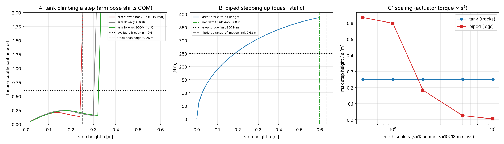

# 10. 段差の乗り越え：戦車型 vs 二本脚（Sim10）

スクリプト: `sims/sim10_steps.py` / 数値まとめ: `data/sim10_summary.txt`

## 10.0 問い

Sim09 で「段差や不整地では脚が有利だろう」という注釈を付けた。これを確かめる。
ゆっくり動く（準静的な）モデルで、越えられる段差の高さの上限を求めた。走り込みや蹴り出しの勢いは使わない。

## 10.1 Part A: 戦車型（Sim06 の機体、履帯の接地長 0.8 m）

越えられる段差は、次の 2 つの限界のうち小さい方で決まる。

1. **形の限界**: 履帯の前端（持ち上がった部分）の高さ（0.25 m とした）より高い段差には、前端が引っかかる。
2. **力の限界**: 前端を段の角に乗せて車体が傾いた状態で、後ろの接地点と段の角の 2 点で支えながら、
   履帯の摩擦（μ = 0.6）の範囲内で這い上がれるか。重心が後ろの接地点より後ろに来ると、後ろに転倒する。

| 腕の姿勢（重心の位置） | 力の限界 | 越えられる段差 | 20 cm の段差に必要な摩擦係数 |
|---|---|---|---|
| 腕を後ろ上方にたたむ（重心が後ろ） | 0.26 m | 0.25 m | 0.16 |
| 腕を下ろす（中立） | 0.30 m | 0.25 m | 0.23 |
| 腕を前に伸ばす（重心が前） | **0.33 m** | 0.25 m | 0.24 |

- 今回の形（前端の高さ 0.25 m）では、**形の限界が先に効く**。どの腕の姿勢でも越えられる段差は 0.25 m である。
- **腕を前に伸ばして重心を前に移すと、力の限界は 0.26 m → 0.33 m に上がる**（後ろへの転倒が起きにくくなる）。
  前端を高くする（フリッパー付きの履帯など）と、腕による重心移動がそのまま乗り越え能力の差になる。地上版の能動的質量バランスである。
- 重心を後ろに置くと、必要な摩擦は減るが、後ろに転倒しやすくなる。トレードオフがある。

## 10.2 Part B: 二本脚（Sim09 の機体、股関節の高さ 0.9 m、大腿・下腿 各 0.45 m）

1. **可動域の限界**: 振り出す脚の足を段の上（高さ h ＋ すき間 5 cm、前方 0.30 m）に置けるか
   （股関節の屈曲 ≤ 120°、膝の屈曲 ≤ 140°）。
2. **トルクの限界**: 段の上の脚で体を持ち上げ始める瞬間に、膝トルクと股関節トルクがともに上限（各 250 N·m）以下か。

| 項目 | 越えられる段差 |
|---|---|
| 可動域の限界 | 0.63 m |
| トルクの限界（上体を立てたまま） | 0.18 m |
| **トルクの限界（上体を前に傾けて重心を前へ移す）** | **0.60 m** |

- 上体を立てたままだと、膝だけで体を持ち上げることになり、18 cm 程度が限界になる。
- **上体を前に傾けて重心を膝の上に寄せると、膝の負担を股関節に分けられ、60 cm まで上れる。**
  人が階段や高い段差を上るときに前かがみになるのと同じで、ここでも重い上体を動かすこと（腰の戦略）が効いている。
- 人間大では、**二本脚（0.60 m）は戦車型（0.25 m）の 2 倍以上の段差を越えられる。** Sim09 の注釈どおり、段差では脚が有利。

## 10.3 Part C: 大きさを変えると逆転する

長さ s 倍・質量 s³ 倍に相似拡大し、アクチュエータのトルク上限は s³ 倍（Sim04 の相似則）とした。

| s（全高） | 戦車型 | 二本脚 | 有利な方 |
|---|---|---|---|
| 0.5（約 0.9 m） | 0.12 m（大きさ比 0.25） | 0.32 m（0.63） | 脚 |
| **1（約 1.8 m、人間大）** | 0.25 m（0.25） | **0.60 m（0.60）** | **脚** |
| 2（約 3.6 m） | **0.50 m（0.25）** | 0.37 m（0.18） | 戦車 |
| 5（約 9 m） | **1.25 m（0.25）** | 0.12 m（0.02） | 戦車 |
| **10（約 18 m 級）** | **2.50 m（0.25）** | **0.05 m（0.003）** | **戦車** |

- **戦車型は大きさによらず、機体の大きさの 1/4 の段差を越えられる**（形と摩擦で決まり、どちらもスケール不変）。
- **二本脚は大型化すると急速に段差を越えられなくなる。** 体を持ち上げるのに必要なトルクは s⁴ で増えるが、
  使えるトルクは s³ でしか増えないため（二乗三乗則）。人間の 2 倍（約 3.6 m）で戦車型に逆転される。
- 18 m 級の二本脚は、相似則のアクチュエータでは 5 cm の段差しか越えられない。
  巨大ロボットが脚で段差を越えるには、Sim04 の旋回と同じく、**相似則をはるかに超えるトルク密度のアクチュエータ** が必要になる。

## 10.4 「足は飾り」の判定の更新

| 場面 | 人間大 | 18 m 級 |
|---|---|---|
| 宇宙（AMBAC） | 脚は有用 | 脚は有用（ただし遅い：Sim04） |
| 地上・平地の作業 | 戦車型＋腰が有利 | 戦車型＋腰が有利 |
| **地上・段差** | **脚が有利（2 倍以上）** | **戦車型が圧倒的に有利** |

**脚の利点は「人間大」で最も大きく、大型化すると段差でも失われる。**
人間の体が脚を持っているのは、人間の大きさだからこそ、と言える。

## 10.5 限界

- 準静的なモデル。勢いを使った乗り越え（走り込み、蹴り出し、ジャンプ）は扱っていない。動的には、どちらもより高い段差を越えられる。
- 戦車型の前端の高さ（0.25 m）は仮定。フリッパー付きの履帯なら形の限界は上がる。
- 二本脚の股関節トルクのモデルは単純化している（重心を前へ移す分の上体の前傾だけを考えた）。手すりや手をつくことは扱っていない。
- 段の角での履帯の変形、足の滑り、膝の摩擦は扱っていない。
