# 11. シミュレーション場の構想と実現方法の検討（途中経過）

> **位置づけ**：第 1 段階（Sim01〜10、技術報告書の第 1 稿）を終えた後の振り返りの中で生まれた構想と、その実現方法を検討した記録である。
> 第 1 稿（`report/`、`docs/00`〜`10`）はそのまま残し、本書は第 2 段階に向けた**検討中の案**として扱う。実装にはまだ着手していない。

## 11.1 経緯

第 1 段階の振り返りの対話の中で、次の流れで構想がまとまった。

1. **フィギュア・作画の知見との照合**：最新のアクションフィギュアやガンプラが、肩を内側に寄せる・前に出す機構を取り入れていること（Sim08 の結論と一致）、
   アニメーターが腰ではなく股関節を意識して作画していること（Sim09・10 の上体の回転は股関節が軸）が、シミュレーションの結果と重なった。
2. **複雑な動作に必要なものの整理**：必要な場所に自由度を置く、全身で運動量を扱う、動きの「型」を制御・学習に組み込む、動作を順序として計画する、校正値で現実との差を埋める（`RESUME.md` の着想メモ）。
3. **シミュレータの選択肢の検討**：Python の自作モデルに加えて、ゲームエンジン（UE5・Unity）をフィジカル AI のシミュレータとして使い、校正値の妥当性を判断できないかという発想が出た。
   その後、ロボット用のシミュレータや、物理演算を後から加えられる 3D アニメーションのアプリも対象に広げて検討した。
4. **DIY_AutoML との接続**：ユーザーが別途開発している DIY_AutoML（誤差評価の組み込み、古典アニーリングの実装を目指す）と、このプロジェクトを相互に活用する案が出た。
5. **シミュレーション場の構想**：格闘ゲームの「練習モード」と「各ステージ」のように、何もない試験場と障害物のあるステージを用意し、アームだけのモデルや実際に作ろうとしているモデルを動かして、
   物理モデルやキャリブレーションデータを作る、という構想にまとまった。
6. **前提条件**：資金の制約から、ハードウェアも実環境も用意できない。**PC の上で再現する**ことを目標とする。開発は手元の端末で行うため、マシンパワーにも配慮する。

## 11.2 構想：シミュレーション場

| 格闘ゲームでいうと | シミュレーション場では | 中身 |
|---|---|---|
| キャラクター | 機体モデル | アームだけ、戦車型＋腕、二本脚、人型など。部品を組み合わせて作る（アセンブル） |
| 練習モード | 試験場 | 何もない平らな床、地球の重力。計測用のセンサーを仕込む |
| 各ステージ | ステージ | 段差、坂、滑りやすい床、障害物、月面の重力など |
| コンボ練習・技表 | 試験メニュー | 荷物運び、旋回、段差越え、腕組みなどの決まった動作を自動で実行する |
| リプレイ・判定 | 記録と評価 | 動作の記録、転倒・滑りの判定、性能表の出力 |

目的は次の 3 つである。

1. 組み合わせた機体（アセンブル）を、さまざまな環境で安全に・安価に試す。
2. 物理モデルの妥当性を確かめる（第 1 段階の基準値との照合）。
3. キャリブレーションデータを作り、校正の手順とその精度を確かめる。

## 11.3 シミュレータの比較（検討の途中経過）

| 種類 | 代表例 | 物理の正確さ | マシンへの負荷 | Windows | 向いている役割 |
|---|---|---|---|---|---|
| ロボット用の物理エンジン | MuJoCo | 高い（関節でつながった機体に強い） | 軽い（CPU で十分） | 可（`pip install mujoco`） | 物理の検証の本命 |
| | PyBullet | 中程度 | 軽い | 可 | 手軽な試作 |
| | Drake | 高い | 中程度 | 不向き（Linux・Mac 中心） | 厳密な解析 |
| ロボットシミュレータ | Webots | 中〜高 | 中程度 | 可 | ロボット全体の動作確認 |
| | Gazebo | 中程度 | 中程度 | 不向き | ROS との連携 |
| | NVIDIA Isaac Sim | 高い | 重い（NVIDIA の GPU が必要） | 可 | 大規模な学習 |
| 3D アニメーション | Blender（物理演算つき） | 低〜中（見た目重視） | 中程度 | 可 | 可視化、人の動きとの接続 |
| ゲームエンジン | Unity・UE5 | 低〜中 | 中〜重い | 可 | 視覚・環境・操作性 |

※ 各ツールの対応環境や性能は検討時点の一般的な理解に基づく。採用前に最新の公式情報で確認すること。

### ゲームエンジンの物理演算で気をつけること

ゲームの物理演算は、正確さより「破綻しないこと」と「速さ」を優先して作られている。

- 安定化のための減衰や角速度の上限が既定で入っていることがあり、角運動量が厳密には保存されない。AMBAC の 1 周あたりの回転（数度）のような小さな効果が埋もれるおそれがある。
- 関節の拘束を反復計算で解くため、関節がわずかに伸びたりずれたりする。
- 摩擦・接触が簡略化されており、スティックスリップや転倒の始まりの再現が近似的になる。
- 質量比や大きさが極端な設定（18 m 級など）では不安定になりやすい。

### 現時点の推奨

- **物理の検証には MuJoCo**：無料、Python から使え、CPU だけで軽く動く。減衰をゼロにして角運動量の保存を確かめやすい。DIY_AutoML と同じ Python 環境で動く。
- **見た目と人の動きには Blender**：無料、Python から操作でき、モーションキャプチャーの取り込みやリターゲットができる。物理を後から加えるより、計算した動きを再生して見せる使い方が向く。
- **Isaac Sim は後回し**：高性能だが NVIDIA の GPU が必須で、手元の端末の条件に合わない。
- ゲームエンジン（Unity・UE5）は、視覚を使う学習や操作性が必要になった段階で再検討する。

## 11.4 3 層の照合による妥当性の判断

| 層 | 役割 | 長所と短所 |
|---|---|---|
| ① Python の基準モデル（Sim01〜10） | 正解を出す物差し | 正確で検証済みだが、見た目や環境は簡素 |
| ② シミュレーション場（MuJoCo など） | 豊かな環境で動かす | 表現力は高いが、物理は近似 |
| ③ 実機（将来） | 最終確認 | 本物だが高価で、壊すリスクがある |

①と②を同じ条件で比べ、次の「答えの分かっている試験」に合格するように②の設定（時間刻み、反復回数、減衰、摩擦モデル）を調整する。これ自体が「シミュレータの校正」になる。

| 試験 | 基準値（第 1 段階） | 確かめること |
|---|---|---|
| 腕 1 本の往復（Sim01） | 胴体が −16.04° 回り、腕を戻すと 0° に戻る | 角運動量の保存、減衰の影響 |
| 腕＋脚のループ（Sim02） | 1 周 +2.98°（ストークスの定理と一致） | 小さな幾何学的位相を再現できるか |
| 速さを変えても同じ（第 1 章） | 回転角は速さによらない | 時間刻みや反復回数の影響 |
| 荷物運びの転倒（Sim06） | 最小躍度の軌道で 1.62 s より速いと転倒 | ZMP と接触の再現性 |
| フルード則（Sim06） | 大きさ・重力を変えても規格化した ZMP が一致 | 大きさを変えたときの安定性 |
| スティックスリップ（Sim06） | 月面で振りが 2.09 s より速いと滑る | 摩擦モデルの妥当性 |
| 段差（Sim10） | 戦車型 0.25 m、二本脚（上体の前傾あり）0.60 m | 接触と静力学の再現性 |

## 11.5 実機なしでキャリブレーションを試す方法：「答えを隠した仮想の実機」

1. 設計どおりの機体モデル（設計値）とは別に、質量・摩擦・関節の遊びなどを乱数で少しずらした「仮想の実機」を作る。ずらした値は推定する側には隠す。
2. 仮想の実機を試験場で動かし、IMU や関節角度のセンサーデータをノイズ付きで記録する（実験データの代わり）。
3. そのデータから、DIY_AutoML などでパラメータを推定する（キャリブレーション）。
4. 推定した値を、隠しておいた正解と比べる。

これにより、「どの試験動作をすれば、どのパラメータが、どの精度で推定できるか」を PC の上だけで確かめられる。
詳細版の追加解析 D14（AMBAC のループで慣性を推定できるか：周回中の姿勢の波形を使うと腕 3%・脚 10%・胴体の慣性 0.9% で推定可能）を、シミュレーション場の上で本格的に行う形になる。

## 11.6 DIY_AutoML との接続案

DIY_AutoML（ユーザーが手元で開発中。目標はデータサイエンティスト向けの PyPI 公開と、ビジネスパーソン向けの Windows アプリ＋Excel のサマリー出力。
既存モデルへの誤差評価の組み込みと、古典アニーリングの実装を目指す）とは、CSV と JSON でやりとりする疎結合な形でつなぐ。

| 方向 | 内容 |
|---|---|
| このプロジェクト → DIY_AutoML | 物理法則が分かっている試験用データセット（例：大きさ・重力・動作時間 → 転倒するか、手足の質量・ループの形 → 1 周あたりの回転）。AutoML が物理的に正しい関係を見つけられるかを測れる |
| DIY_AutoML → このプロジェクト | 誤差評価（校正値の妥当性）、代理モデル（重いシミュレーションの近似）、シミュレーテッドアニーリング（アセンブルの部品選び）、Excel のサマリー（性能表の出力形式） |

- **評価関数の窓口**：機体の構成を JSON で受け取り、性能表を JSON で返す。アニーリングの目的関数として呼び出せる形にする。
- **マシンパワー**：第 1 段階のシミュレーションの多くは CPU で 1 回数秒程度。大量に評価する場合は、結果のキャッシュ、代理モデル、CPU コアでの並列化を組み合わせる。
- **QUBO（イジング形式）への定式化**は先の課題とする（部品の選択を 0/1 の変数にし、制約を罰則項にする形が考えられる）。

## 11.7 限界

- **PC の上だけでは、現実との差（sim-to-real）は確かめられない。** 仮想の実機で分かるのは、キャリブレーションの手順が正しく働くかと、どのパラメータが推定しやすいかまでである。
  接触の細かい振る舞い、モーターの遅れ、部品のたわみなど、モデルに入れていない現象は再現されない。
- **将来、安く現実に近づける方法**（必須ではない）：
  - サーボモーターを使った安価なロボットアームのキット 1 台で、「アームだけ」の試験を現実でも確かめる。
  - スマートフォンで撮った人の動画から姿勢推定して、人の動きのデータにする。

## 11.8 実現方法の案（段階）

| 段階 | 内容 | 照合する基準 |
|---|---|---|
| 1 | 試験場（平らな床・地球の重力／重力なし）とアームだけのモデルを作る | Sim01・Sim02 |
| 2 | 戦車型・二本脚のモデルと、ステージ（段差・坂・滑りやすい床・月面）を加える | Sim06・Sim09・Sim10 |
| 3 | 部品表（JSON）から機体モデルを自動生成する（アセンブル） | 第 2 段階の部品表 |
| 4 | 「答えを隠した仮想の実機」でキャリブレーションデータを作り、推定の手順を確かめる | D14 |
| 5 | 性能表と校正データを、Excel のサマリーや DIY_AutoML へ渡せる形で書き出す | — |
| 6 | 必要に応じて Blender で可視化、人の動きのデータと接続する | Sim08（ひねりの扱い） |

## 11.9 未決の論点

- 使うシミュレータの最終決定（MuJoCo を本命として、段階 1 の照合結果で判断する）。
- 試験メニュー（技表）の具体的な一覧と、合格の基準（基準値との許容誤差）。
- 仮想の実機でずらすパラメータの種類と範囲（校正値の定義表と対応させる）。
- DIY_AutoML とのデータ形式（CSV の列、JSON の項目）の取り決め。
- 将来、安価な実機（アームのキットなど）を導入するかどうか。

---

## 11.10 実装の途中経過

検討の後、クラウドの環境（画面なし）で MuJoCo 4.0.1 を使って実装を始めた。画像は OSMesa（CPU での描画）で作成した。
コードは `src/ambac/field/`、実行スクリプトは `sims/field01_space.py`, `sims/field02_ground.py`、数値は `data/field01_summary.txt`, `data/field02_summary.txt`。

**照合の方法**：MuJoCo が実際にたどった関節の動きを、第 1 段階の Python モデルにそのまま入れて計算し直し、MuJoCo の結果と比べる。
こうすると、モーター（位置サーボ）の追従誤差に左右されずに、物理演算そのものの正しさを確かめられる。

### 段階 1：宇宙の試験場（重力なし）— 合格

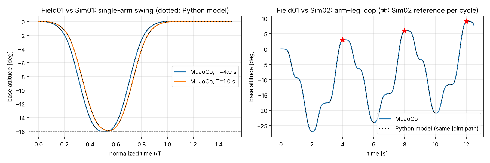
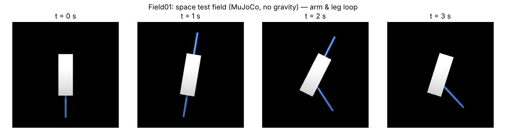

| 試験 | MuJoCo | Python（同じ関節の動き） | 第 1 段階の基準値 |
|---|---|---|---|
| 腕 1 本の往復、4 s（Sim01） | −16.0356° | −16.0356° | −16.04° |
| 腕 1 本の往復、1 s（Sim01） | −15.6924° | −15.6925° | −16.04° |
| 往復後の残り | 10⁻⁵° 程度 | — | 0° |
| 腕＋脚のループ 1 周（Sim02） | +2.963° | +2.970° | +2.9778° |
| 同じ関節の動きでの差（最大） | 2×10⁻⁴° 以下 | | |
| 角運動量の保存 | 10⁻⁶ 程度 | | |

- **MuJoCo の物理演算は、AMBAC の小さな効果（幾何学的位相）まで正しく再現した。**
- 基準値とのわずかなずれは、物理演算ではなく**位置サーボの追従遅れ**による。1 s で速く振ると腕が目標（90°）に届かず 87.5° で止まり、ループの形も最大 12.6° 崩れた。
  **アクチュエータの特性が、そのまま姿勢変化の誤差になる**ので、第 2 段階の校正値（アクチュエータ特性）として重要である。

### 段階 2：地上の試験場（重力・床・摩擦あり）

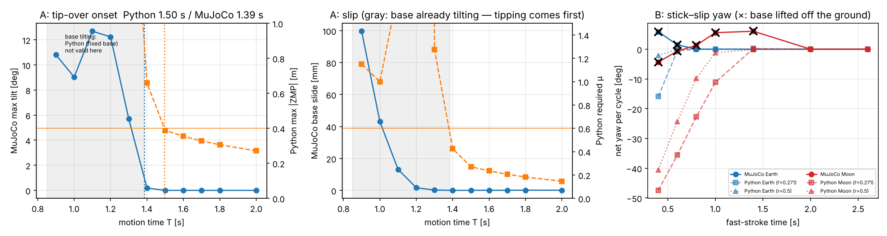

**Test A：荷物運び（Sim06 Part A）— おおむね一致**

| | Python（ZMP が接地範囲の端に達する） | MuJoCo（台車が 1° 以上傾く） |
|---|---|---|
| 転倒の始まり | 1.50 s | 1.39 s |

- 差は約 7%。Python の ZMP 判定は「傾き始める瞬間」を捉えるので、目に見えて傾くのが少し速くなってからなのは自然である。
- どちらでも、滑るより先に転倒が起きた（Sim06 の結論と一致）。
- 台車が傾き始めた後は、Python のモデル（台車は固定）の前提が崩れるので、それ以降の値は比較に使えない。

**Test B：腕の水平の振りによる旋回（Sim06 Part C）— 第 1 稿の前提が崩れる現象を発見**

| 重力 | 速い振りの時間 | MuJoCo | 3 次元の ZMP モデル（Sim07 と同じ） | Python の旋回モデル（Sim06） |
|---|---|---|---|---|
| 地球 | 0.4 s, 0.6 s | 台車が浮き上がる | ZMP が接地範囲の外 | 回る（−16°, −0.6°） |
| 地球 | 0.8 s 以上 | 接地したまま、回らない | 範囲内 | ほぼ回らない |
| 月 | 0.4〜1.4 s | 台車が浮き上がる（最大 1.2 s） | ZMP が接地範囲の外 | 大きく回る（最大 −47°） |
| 月 | 2.0 s 以上 | 接地したまま、回らない | 範囲内 | 回らない |

- **月面で荷物（10 kg）を 1 m の腕で速く振ると、遠心力（最大約 550 N）が台車の重さ（約 160 N）を上回り、台車が浮き上がって傾く。**
  浮いている間は宇宙と同じ AMBAC の状態になり、腕をゆっくり戻すときに接地して、回転の大部分が戻った。
- MuJoCo の浮き上がりと、独立に作った 3 次元の ZMP モデルの判定は、すべての条件で一致した。物理的に正しい現象である。
- 第 1 稿の Sim06 Part C は「台車は接地したまま、ヨーだけ回る」と仮定していた。この機体では、**横滑りで回るより先に、遠心力による浮き上がり・転倒が起きる**。
  とくに月面では、Python の旋回モデルが回ると予測した速さの範囲（振りが 2.09 s より速い）のほぼ全域で、先に浮き上がりが起きる。
- 接地が保たれる条件（地球で 0.8 s 以上、月で 2.0 s 以上）では、MuJoCo と Python のどちらも「回らない」で一致した。

**示唆**
- **簡単なモデルが見落とした連成（旋回と転倒）を、シミュレーション場が見つけた。** これはシミュレーション場を作る意味そのものである。
- 低重力での腕の作業では、旋回のスティックスリップより、転倒・浮き上がりの方が先に問題になる。月面ローバーのアームの運用制限は、まず転倒側から決めるべきである。
- スティックスリップを正しく検証するには、遠心力の小さい（腕が短い・荷物が軽い・接地面が広い）機体で試す必要がある。

### 次の作業

- 段階 3：部品表（JSON）から機体を組み立てる仕組みと、ステージ（段差・坂・月面など）の定義
- 段階 4：「答えを隠した仮想の実機」でのキャリブレーション
- 段階 5：性能表と校正データの書き出し

### 段階 3：アセンブル（部品表から機体を組み立てる）— 実装

コードは `src/ambac/field/assembly.py`（組み立て）、`src/ambac/field/menu.py`（試験メニューと画像）、実行は `sims/field03_assembly.py`、
数値は `data/field03_summary.txt`。部品表とステージの定義は `configs/field/` の JSON。

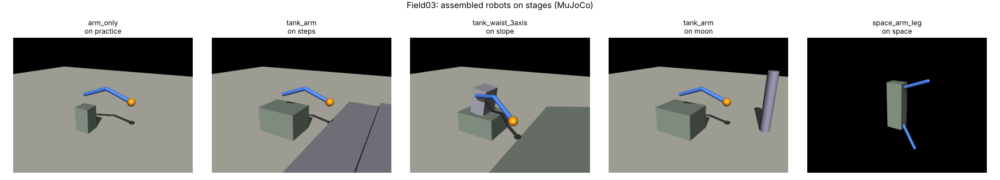

**部品表の項目**

| 項目 | 選択肢・パラメータ |
|---|---|
| 土台（base） | `fixed`（地面に固定、アームだけの試験）／`tank`（床に置いた箱形の台車）／`floating`（宇宙に浮かぶ胴体）、質量・寸法・重心 |
| 腰（waist、省略可） | 前後に傾く上体（高さ、上体の質量・寸法、可動域） |
| 腕（arms、複数可） | 取り付け位置、肩の種類（`pitch`＝1 軸、`yaw_pitch`＝2 軸ジンバル、`ball3`＝3 軸）、リンクの長さ・質量（2 本以上なら肘）、荷物 |
| モーター（actuator） | 位置サーボのゲイン |

**用意した機体とステージ**

- 機体：`arm_only`（アームだけ）、`tank_arm`（Sim06 と同じ）、`tank_waist_3axis`（腰＋3 軸の肩：Sim08・09 の要件を満たす構成）、`space_arm_leg`（Sim02 と同じ）
- ステージ：`practice`（練習場）、`steps`（0.15 m と 0.25 m の段）、`slope`（10° の坂）、`ice`（摩擦 0.1）、`moon`（柱あり）、`mars`（壁あり）、`space`（重力なし）

**組み立ての検証**

| 比較 | 組み立て | 手作り（段階 1・2） |
|---|---|---|
| 戦車型＋腕の総質量・重心 | 97.000 kg、(0.1366, 0, 0.4206) m | 同じ |
| 荷物運び 1.5 s の最大の傾き | 0.001° | 0.002° |
| 荷物運び 1.3 s の最大の傾き（転倒） | 5.46° | 5.70° |
| 宇宙の人型のループ 1 周 | +2.969° | +2.963° |

転倒が起きた後（1.3 s）の値に 4% ほどの差があるのは、転倒が始まった後の運動が初期条件の小さな違いに敏感なためと考えられる。それ以外は一致した。

**試験メニューの例：同じ荷物運び（2.0 s）を機体 × ステージで実行**

| 機体 | 練習場 | 氷 | 火星 | 月 |
|---|---|---|---|---|
| tank_arm | 傾かない | 2 cm 滑る | 11° 傾く | 14° 傾き、0.7 s 浮く |
| tank_waist_3axis（腰は固定のまま） | 傾かない | 4 cm 滑る | 10° 傾く | 14° 傾き、転倒したまま（8°） |

火星・月で傾いたのは、第 1 稿のフルード則（安全な最短時間：火星 2.62 s、月 3.97 s）より速く動かしたためで、整合している。
腰を使った動き（上体の前後傾で反作用を打ち消す）は、試験メニューにまだ入れていない。

**今回の対象外**：二本脚（立っているだけでバランス制御が必要で、規模が大きくなる）。今後の課題とする。

### 段階 4：「答えを隠した仮想の実機」によるキャリブレーション — 実装

実行は `sims/field04_calibration.py`、数値は `data/field04_summary.txt`, `data/field04_calibration.json`。

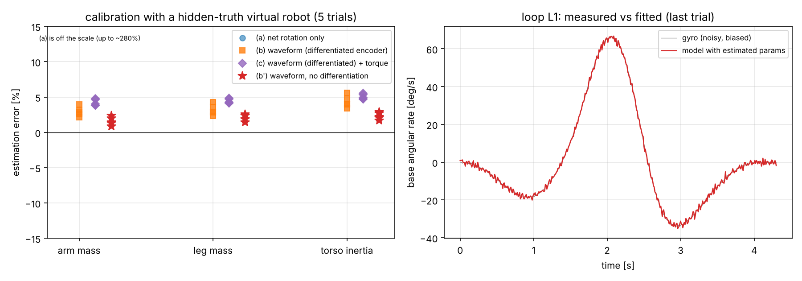

**手順**
1. 宇宙の人型の腕の質量・脚の質量（±15%）、胴体の慣性の倍率（±10%）を乱数でずらした「仮想の実機」を MuJoCo で作る。正解は推定側に隠す（総質量 76 kg は既知）。
2. 曲率マップの異なる場所に置いた 6 種類の円ループ（詳細版 D14 と同じ）を 1 周ずつ回す。
3. センサーを模擬する：ジャイロ（雑音 0.2°/s、一定のバイアス最大 ±0.2°/s）、エンコーダ（雑音 0.05°）、関節トルク（雑音 0.2 N·m）、100 Hz。
4. 次の方法で推定し、隠した正解と比べる。乱数を変えて 5 回繰り返す。

| 推定の方法 | 誤差（5 回の二乗平均）：腕 / 脚 / 胴体の慣性 |
|---|---|
| (a) ループ 1 周ごとの正味の回転だけ | 31% / **210%** / 54%（脚は推定できない） |
| (b) 周回中の角速度の波形（関節角を微分して速度を求める） | 3.0% / 3.2% / 4.4% |
| **(b′) 周回中の波形（微分を使わない：区間ごとの回転量で比べる）** | **1.7% / 2.1% / 2.4%** |
| (c) (b) に関節トルクを加える（関節角を 2 回微分して加速度を求める） | 4.3% / 4.4% / 5.0% |
| 参考：MuJoCo の正確な速度・加速度を使った場合（ノイズなし） | 0.04% 以下（トルクを加えると 0.02% 以下） |

ジャイロのバイアスも同時に推定でき、正解との差は 0.01°/s 程度だった。

**分かったこと**
- **詳細版 D14 の見積もり（正味の回転だけでは脚の質量を推定できない、波形を使えば推定できる）を、実際の手順で確かめられた。**
- **推定しにくい方向がある**：腕・脚の質量と胴体の慣性がそろって同じ割合で増減する方向（特異値がほかの方向の約 60 分の 1）。
  AMBAC の姿勢の動き（θ' = −Γ·q'）は質量・慣性の「比」で決まるため、姿勢の波形だけでは全体の大きさを決めにくい。推定の誤差もこの方向にそろって現れた。
- **偏りの原因は手法ではなく前処理**だった：MuJoCo の正確な速度・加速度を使うと誤差は 0.05% 以下になる。
  関節角を微分して速度・加速度を求めると、位置サーボの速い動きやノイズの影響で偏りが生じる。
- **校正の設計の指針**
  1. 姿勢の時間変化（IMU の波形）を記録して使う。ループ 1 周の正味の回転だけでは足りない。
  2. 関節角の微分を避ける推定式を使う（AMBAC の基本式は時間を含まないので、区間ごとの回転量で比べられる）。
  3. 質量・慣性の絶対値を決めるには力の情報（関節トルク）が有効だが、速度・加速度を直接測るセンサー（モータードライバの速度出力など）と組み合わせる必要がある。
  4. 曲率マップの異なる場所に複数のループを置き、推定しにくい方向を減らす。

### 段階 5：性能表と校正データの書き出し — 実装

評価の窓口 `src/ambac/field/evaluate.py` と、書き出しのスクリプト `sims/field05_export.py` を作った。
機体（部品表の JSON）とステージ（JSON）を渡すと、荷物運び（前方の地面 → 頭上 → 後部）を
**傾き 1° 未満・ずれ 5 mm 未満で実行できる最短時間** を二分法で求め、性能表の 1 行を返す。

```bash
PYTHONPATH=src MUJOCO_GL=osmesa python -m ambac.field.evaluate configs/field/robots/tank_arm.json configs/field/stages/practice.json
```

**性能表（荷物運びの安全な最短時間 [s]）**

| 機体 | 練習場（地球, μ0.6） | 氷（地球, μ0.1） | 火星（g 3.72） | 月（g 1.62） |
|---|---|---|---|---|
| 戦車型＋腕（tank_arm） | 1.35 | 2.22（フルード則 1.35） | 2.21（フルード則 2.19） | 3.34（フルード則 3.32） |
| 戦車型＋腰＋3 軸の肩（tank_waist_3axis） | 1.41 | 2.43（フルード則 1.41） | 2.28（フルード則 2.29） | 3.44（フルード則 3.46） |

括弧内は、練習場の値 × √(g_地球 / g) によるフルード則の予測。値は段階 7 で評価の窓口を更新した後のもの（二分法を 10 回に細かくした。最初の版との差は 2% 以内）。

**分かったこと**
- **重力だけが違うステージでは、フルード則（第 1 段階の Sim06）が 1% 程度の精度で成り立つ。** 練習場で 1 回測れば、火星・月の値を予測できる。
- **氷のステージではフルード則が外れる**（予測 1.35 s に対して 2.22 s）。制限が「傾き（転倒）」から「ずれ（滑り）」に変わるため。
  滑りやすい床では、重力のスケーリングとは別に、摩擦の校正値が必要になる。
- 腰と 3 軸の肩を持つ機体は、この試験ではわずかに遅い（質量が増え、腕の付け根が高いため）。腰の戦略を使う動作計画はまだ入れていないので、これは「同じ動作をさせた場合」の比較である。

**書き出したデータ（DIY_AutoML などとの疎結合用）**

| ファイル | 内容 |
|---|---|
| `data/field_performance.csv` | 性能表（機体 × ステージ、安全な最短時間、フルード則の予測、その時の傾き・ずれ） |
| `data/field_calibration_dataset.csv` | 答えを隠した仮想の実機のセンサーデータ（6 ループ、100 Hz、2586 行：時刻、ジャイロ、腕・脚の関節角、関節トルク） |
| `data/field_calibration_truth.json` | 隠した正解（腕の質量、脚の質量、胴体の慣性の倍率、ジャイロのバイアス）、ノイズの条件、ループの定義 |
| `data/field_summary.xlsx` | Excel のサマリー（シート：説明、性能表、照合結果、キャリブレーション、計測データ） |

計測データの CSV を入力にし、正解の JSON を使わずに質量・慣性を推定できるかを試すことで、
機械学習側（DIY_AutoML）の手法を、段階 4 の物理モデルによる推定（(b′) で誤差 2% 前後）と比べられる。

### 段階 6：腰の戦略（地上版 AMBAC）を、組み立てた機体に適用する

機体 `tank_waist_3axis`（戦車型台車＋前後に傾く腰＋3 軸の肩、総質量 97 kg）で、段階 5 の荷物運びに「補正」を重ね、最短時間を比べた。
補正は時間 t/T の正弦波の和で表し（肘 2 個、腰 4 個の係数。腰は最後に一定の傾きを残してよい）、
**MuJoCo を評価関数として直接使い**、Nelder–Mead 法で係数を最適化した（物理の式を使わない探索）。
時間を少しずつ短くしながら、前の係数を初期値にして最適化し直す方法（継続法）を使った。
最初から短い時間で探すと、どの係数でも転倒して評価が平らになり、探索が進まなかったためである。

スクリプト: `sims/field06_waist.py`（約 30 分） / 数値まとめ: `data/field06_summary.txt`

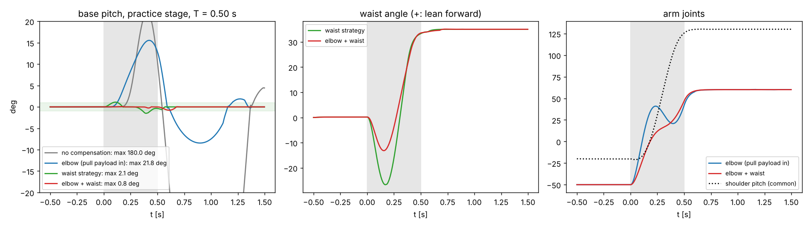

**荷物運びの安全な最短時間（傾き 1° 未満・ずれ 5 mm 未満）**

| 補正 | 練習場 | 短縮 | 月 | 短縮 | 練習場での関節の最大トルク |
|---|---|---|---|---|---|
| なし | 1.41 s | — | 3.47 s | — | 318 N·m |
| 肘（荷物を体に引き寄せる） | 0.83 s | 42% | 2.02 s | 42% | 739 N·m |
| 腰（上体を前後に傾ける） | 0.57 s | 60% | 1.51 s | 56% | 839 N·m |
| **肘＋腰** | **0.50 s** | **65%** | **1.31 s** | **62%** | 1102 N·m |

**分かったこと**
- **腰の補正は、肘の補正より効く**（練習場で 60% 対 42%）。両方を使うと 65% 短くなる。
- 最適化が見つけた腰の動きは、**最初に後ろへ反り（約 −25°）、荷物を後ろに回すにつれて前へ傾く（+35°、可動域の上限）**。
  第 1 段階の Sim09 の最適解（−40° → +28°）と同じ型で、物理の式を使わない探索でも、人が重い物を持つときの動き（腰の戦略）が再発見された。
- 肘の補正は、動作の途中で肘を曲げて荷物を体に引き寄せる動き。第 1 段階の Sim06 の「引き寄せる軌道で 36% 短縮」と同じ方向の結果。
- 月でも短縮の割合はほぼ同じ（重力が変わっても、補正の効き方の比は変わらない）。
- **速くなる代わりに、必要なトルクが増える**（補正なし 318 N·m → 肘＋腰 1102 N·m）。段階 7 のモーターの定格と合わせて、
  「どこまで速くするか」は、モーターの大きさとのトレードオフになる。


### 段階 7：アクチュエータの簡易モデル — 必要なモーターの定格

部品表の `actuator` に、関節ごとの **トルクの上限**（`torque_limit`、N·m）と **速度の上限**（`speed_limit_deg_s`、目標角の変化の速さ）を書けるようにした（`src/ambac/field/assembly.py`）。
速度の上限があると指令どおりの時間では動けないため、評価には「腕が目標の 1° 以内に入ってとどまる実際の時刻（完了時間）」と「その間の最大トルク」を加えた。
合格の条件にも「腕が目標に 1° 以内で届く」を加えた（段階 5 の性能表の値は変わらない）。

スクリプト: `sims/field07_actuator.py` / 数値まとめ: `data/field07_summary.txt`

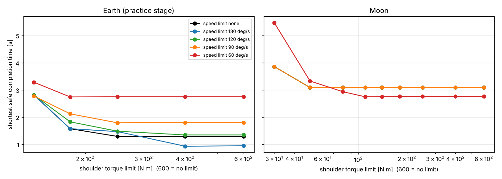

**荷物運びの完了時間の最短値 [s]（tank_arm、肘のトルクの上限は肩の 0.6 倍）**

| 肩のトルクの上限 | 地球：速度の上限なし | 地球：90°/s | 地球：60°/s | 月：速度の上限なし | 月：60°/s |
|---|---|---|---|---|---|
| 上限なし | 1.29 | 1.80 | 2.75 | 3.09 | 2.76 |
| 250 N·m | 1.29 | 1.79 | 2.75 | 3.09 | 2.76 |
| 180 N·m | 1.58 | 2.12 | 2.74 | 3.09 | 2.76 |
| 140 N·m | 2.81 | 2.78 | 3.28 | 3.09 | 2.76 |
| 110 N·m 以下 | **不可** | 不可 | 不可 | 3.09（50 N·m まで） | 2.75〜3.33 |
| 30 N·m | 不可 | 不可 | 不可 | 3.86 | 5.47 |
| 20 N·m | 不可 | 不可 | 不可 | **不可** | 不可 |

参考：腕を水平に伸ばして荷物を支える肩のトルクは、地球で 130 N·m、月で 22 N·m。

**分かったこと**
- **荷物を支えるトルク（静的な保持トルク）が、実現できるかどうかの境界になる。** 地球では 130 N·m を下回ると、どんなに遅く動かしても不可。月では 22 N·m が境界で、比は重力の比（約 6 分の 1）に一致する。
- 保持トルクを少し上回るだけ（地球で 140 N·m）だと、動作は約 2 倍遅くなる（2.8 s）。**保持トルクの約 2 倍（250 N·m）あれば、速さはトルクで制限されない。**
  転倒の制限（フルード則）とモーターの制限のどちらが効くかで、必要な定格が決まる。
- 速度の上限は、そのまま完了時間の下限になる（150° を 60°/s なら 2.5 s 以上）。
- 速度を一定に抑える動かし方（台形の速度）は、最小ジャークより速く終わる場合がある（地球で 180°/s のとき 0.95 s、月で 60°/s のとき 2.76 s）。
  最小ジャークは速度の最大値が平均の 1.9 倍になるため。**軌道の形も校正・最適化の対象になる。**
- 月では、トルクが小さくても（50 N·m まで）完了時間は変わらない。制限は転倒（フルード則）で決まる。**月面の機体は、地球の機体より小さなモーターで同じ作業ができる**が、速さは重力で決まる。

### 段階 8：履帯の台車で段差・坂を走る（試作）

台車の種類に、走行できる履帯（`base.type = "tracked"`）を加えた（`src/ambac/field/assembly.py`、走行の試験メニューは `src/ambac/field/drive.py`）。
履帯は、駆動する転輪を密に並べ（間隔は半径の 0.4 倍）、すべての転輪の回転を拘束でそろえて 1 本のベルトとして近似した。
前端は進入角 40° で高さ 0.25 m まで持ち上げた。車体（箱）は接触しない（スカート扱い）。
機体 `tracked_arm`：Sim06・10 の戦車型と同じ大きさ（接地長 0.8 m）、腕＋荷物 10 kg、転輪 3 kg × 30 個、総質量 187 kg、駆動力の上限 2000 N（重量の約 1.1 倍）、周速 0.15 m/s、μ = 0.6。

スクリプト: `sims/field08_steps.py` / 数値まとめ: `data/field08_summary.txt`

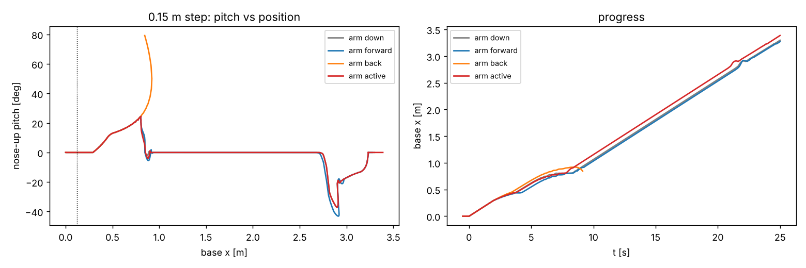

**段差（25 秒で段の上を走り抜けられたか）**

| 腕の姿勢 | 越えられた最大の段差 | 失敗のしかた |
|---|---|---|
| 下ろす（荷物を前方の床のすぐ上に） | 0.150 m | 0.175〜0.225 m で止まる（シーソー状態）、0.25 m で後ろに転倒 |
| 前に伸ばす | 0.150 m（0.125 m は止まる） | 0.175 m 以上で止まる |
| 後ろ上方にたたむ | 0.100 m | 0.125 m で止まり、0.15 m 以上で後ろに転倒 |
| 能動（機首が上がるほど腕を前へ伸ばす） | 0.150 m | 0.175〜0.225 m で止まる、0.25 m で転倒 |

**上り坂（1.5 m 上れたか）**：腕の姿勢によらず、28° まで上れ、31° で滑り落ちる（摩擦の限界 atan 0.6 = 31.0°）。

**分かったこと**
- **段の角に乗り上げた台車は「シーソー」になる。** 機首が上がると重心が段の角より後ろに移り、前に倒れ込めない。同時に、角に当たるベルトの傾きが摩擦角に近づき、這い上がれない。
  第 1 段階の Sim10（準静的な見積もり）は、この状態を考えていなかった。
- **重心の位置で失敗のしかたが変わる。** 腕を後ろにたたむと後ろに転倒し、前に伸ばすと転倒はしないが、段に当たった直後に止まりやすい。
  荷物を前方の低い位置に置く姿勢（下ろす）と能動の腕は、どちらも 0.15 m 以下をすべて越えた。重心を前に置くことが効く（Sim10 の「腕による重心移動が乗り越え能力の差になる」と同じ方向）。
  （最初の版では、「腕を下ろす」を肩 −90° としており、腕と荷物が床の下に入り込んでいた。目視の確認で見つけて直した。下の「動画による目視の確認」を参照）
- **坂は摩擦で決まり、腕の姿勢は効かない**（第 1 段階の想定どおり）。
- 越えられた段差（0.15 m）は、Sim10 の見積もり（0.25 m）より低い。

**モデルの限界（重要）**
- 転輪の列でベルトを近似しているため、段の角が転輪の間に挟まると、駆動力を 4 倍にしても動かない場合があった（転輪の間隔を変えると結果が変わる）。止まった結果の一部は、この近似による可能性がある。
- 転輪を軽くしすぎると（0.5 kg）、駆動が振動して接地が途切れ、結果が大きく変わった（3 kg で安定）。
- 段差の結果は「傾向」として扱い、数値は履帯のより正確なモデル（連結した板のベルトなど）で確かめ直す必要がある。坂の結果（摩擦の限界）は、理論と一致しており信頼できる。


### 段階 9：二本脚で立つ機体と戦車型を、同じ試験で比べる

導入の問い「二足歩行は本当にバランスが良いのか？」を、シミュレーション場で確かめた。
機体 `biped_waist` は第 1 段階の Sim09 Part B と同じ寸法（脚 24 kg・足裏 0.25 m、股関節 0.95 m で前後に傾く上体 56 kg、肩 1.45 m、総質量 97 kg）。
脚は固定とした（足首は十分に強いと仮定し、支持範囲は足裏の大きさで決まる）。比較の戦車型 `tank_waist_3axis` も総質量 97 kg。
荷物運び（段階 5・6 と同じ動作）を、傾き 1° 未満・ずれ 5 mm 未満で実行できる最短時間を求めた。

スクリプト: `sims/field09_biped.py`（約 15 分） / 数値まとめ: `data/field09_summary.txt`

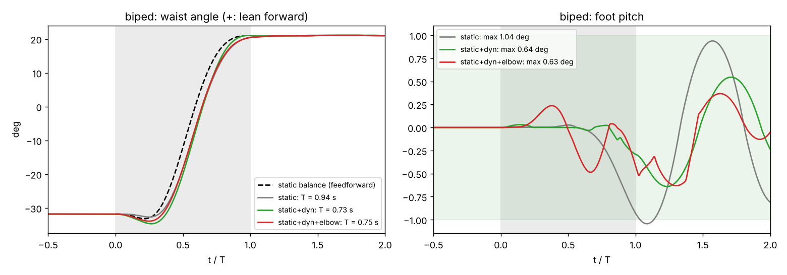

**腰の動きの作り方**：二本脚は、腰の角度を 0° から始めると、どの補正でも転倒した（最初の版の試験で確認）。
そこで、**腕の各姿勢で全体の重心が足裏の中央に来る腰の角度（静的なつり合い）** を前もって計算し、それを出発点にした（フィードフォワード）。
得られた腰の動きは **最初に後ろへ 32° 反り、最後に前へ 21° 傾く** 形で、Sim09 の最適解（−40° → +28°）とほぼ同じ。
これに正弦波の補正を重ね、段階 6 と同じく MuJoCo を評価関数として最適化した。

**荷物運びの安全な最短時間**

| 腰・肘の使い方 | 二本脚：練習場 | 戦車型：練習場 | 二本脚：月 | 戦車型：月 |
|---|---|---|---|---|
| 腰を使わない | **不可（12 s でも転倒）** | 1.41 s | **不可** | 3.47 s |
| 腰：静的なつり合いのみ | 0.94 s | — | 2.16 s | — |
| 腰：最適化（二本脚は静的なつり合い＋補正） | **0.74 s** | **0.57 s** | 1.98 s | 1.51 s |
| 腰＋肘：最適化 | 0.75 s | 0.50 s | 2.04 s | 1.31 s |

二本脚の関節の最大トルク（練習場）：静的なつり合い 351 N·m、最適化 472 N·m（戦車型の腰の最適化は 839 N·m）。

**分かったこと**
- **二本脚は、腕だけでは荷物運びができない。** 最初と最後の姿勢では静止できるが（重心は足裏の端から約 2 cm 内側）、荷物を頭上から後ろへ回す途中で重心が足裏の外に出る。
  第 1 段階の Sim09 は「静止しても転倒」としていたが、これは安全余裕 2 cm を差し引いた判定で、物理的には「ぎりぎり立てる」状態だった。
- **腰（股関節）で上体を動かせば、二本脚でも運べる。** 静的なつり合いだけで 0.94 s、動的な補正を加えて 0.74 s。
  **二本脚が立っていられるのは、脚ではなく、動かせる重い上体のおかげ**（Sim09 の結論を MuJoCo で確認）。
- **それでも、同じ腰を持つ戦車型の方が速い**（練習場 0.74 s 対 0.57 s、月 1.98 s 対 1.51 s。二本脚は約 3 割遅い）。
  Sim09（関節の速度の上限あり）では差は 8%（0.69 s 対 0.64 s）だったが、速度の上限のないこの試験では、支持範囲の広さがそのまま速さの差になった。
- 二本脚は、静止の姿勢をつくるだけで上体を大きく傾ける必要があるため、腰の可動域（±45°）の多くを「立つこと」に使ってしまう。
  戦車型は、腰の動きをすべて「腕の反作用を打ち消すこと」に使える。
- 二本脚では肘の補正を加えても速くならなかった（0.75 s）。最適化が局所解に止まった可能性がある。月の二本脚は、傾きに余裕（0.02〜0.05°）を残したまま探索が止まっており、さらに短くできる可能性がある。
- 合格の境界付近では、結果が時間の丸め（0.001 s）に敏感だった（図の再計算で、静的なつり合いの最大の傾きは 0.91° ではなく 1.04°）。

**導入の問いへの答え（シミュレーション場での確認）**：二足歩行は、静的にはバランスが悪い（腕だけでは荷物を運べない）。
立って作業できるのは、股関節で動かせる重い上体があるからで、その上体を戦車型に載せれば、さらに速く安定する。
平地での作業に限れば、第 1 段階の結論（「足は飾り」は用途で答えが変わる。平地では戦車型＋腰が最も合理的）は MuJoCo でも変わらなかった。
二本脚の利点（段差）は、段階 8 の履帯の試験と、今後の二本脚の歩行・段差の試験で比べる。

### 段階 10：板をつないだ履帯（正確なモデル）で、段差・坂をやり直す

段階 8 の「転輪の列」の近似には、段の角が転輪の間に挟まる不具合の疑いがあった。そこで、履帯を実物と同じ構造で作り直した（`src/ambac/field/track.py`、`base.type = "linked_track"`）。
- 履板（ピッチ 4 cm、厚さ 2 cm、0.3 kg）57 枚をヒンジでつないだ輪。最後と最初の履板を拘束で閉じる
- 輪を、起動輪（後ろ、半径 0.10 m、駆動、地面から 1 cm 浮かせる）・転輪 5 個（サスペンション付き）・誘導輪（前、高さ 0.25 m、進入角 40°、張り装置付き）に巻き付ける
- 地面・段に触れるのは履板だけ。駆動は起動輪と履板の摩擦で伝える（歯はない）
機体 `linked_track_arm`：総質量 128 kg、接地長 0.8 m、腕＋荷物 10 kg、駆動力の上限 2000 N、周速 0.15 m/s、μ = 0.6。
1 回の試行は実時間の約 2.6 倍かかるため、4 並列で計算した（60 試行で約 20 分）。

**モデルを作る途中で直したこと（記録）**
1. **履板の食い込み**：まっすぐな履板を車輪の円弧に沿って並べると、板の中央が円弧の内側に約 2 mm 入り込む。そのまま輪を閉じると、ベルトが車輪を締め付けて機体の重さの約 20 倍の張力が生じ、荷重が前後の端だけにかかった。頂点を外側にずらして直した。
2. **起動輪の上での空回り**：歯がないため、逆回転させた側でベルトが滑った。誘導輪をばねで前に押す張り装置（実物にもある）を加えた。
3. **荷重の偏り**：硬い履帯と硬い地面の多点接触では、荷重の分かれ方が 1 mm 以下の高さの差で決まり、前後の端に集中した。
   地面を柔らかくすると均されたが、計算が発散した（MuJoCo は発散すると状態を初期化するため、「止まった」ように見える結果が混ざった）。
   実物と同じく、**転輪にサスペンションを付け、起動輪を浮かせる**ことで、硬い地面のまま荷重を転輪に分けられ、発散もなくなった。
   走行の試験では、計算の発散を検出して「発散」と記録するようにした（今回の 60 試行では発散なし）。

スクリプト: `sims/field10_linked_track.py` / 数値まとめ: `data/field10_summary.txt`

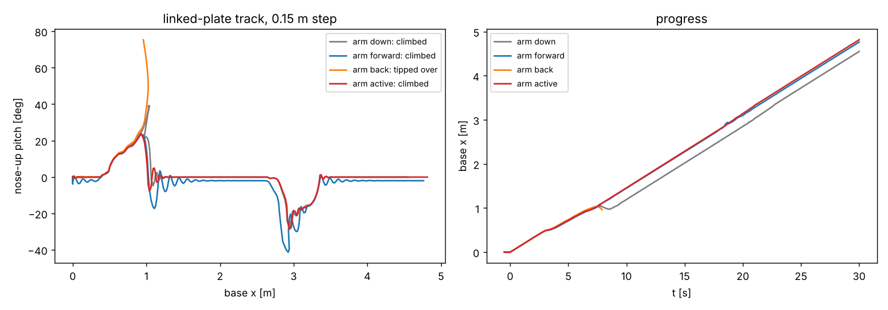

**Part A：段差（元の形）**

| 腕の姿勢 | 正確なモデル | 段階 8（転輪の列） | 高い段での失敗のしかた |
|---|---|---|---|
| 下ろす（荷物を前方の床のすぐ上に） | 0.15 m | 0.15 m | 0.20 m 以上で後ろに転倒 |
| 前に伸ばす | 0.15 m | 0.15 m | 0.20 m 以上で後ろに転倒 |
| 後ろ上方にたたむ | 0.10 m | 0.10 m | 0.15 m 以上で後ろに転倒 |
| 能動（機首が上がるほど腕を前へ） | 0.15 m | 0.15 m | 0.20 m 以上で後ろに転倒 |

**Part B：上り坂**：腕の姿勢によらず 28° まで上れ、31° で滑り落ちる（摩擦の限界 31.0°）。腕を後ろにたたむと 34° で後ろに転倒した。

**Part C：機体の形を変える**

| 機体の形 | 腕を下ろす | 腕を能動的に動かす |
|---|---|---|
| 元の形（接地長 0.8 m、車体の重心 0.30 m） | 0.15 m | 0.15 m |
| 重心を下げる（車体の重心 0.15 m） | **0.20 m**（0.25 m は止まる） | **0.20 m**（0.25 m は止まる） |
| 履帯を長くする（接地長 1.2 m） | **0.30 m** | **0.30 m** |
| 長く＋重心を下げる | **0.30 m** | **0.30 m** |

（0.30 m より高い段は試していない。前端の誘導輪の上端は 0.33 m。）

**分かったこと**
- **段階 8 の近似は、傾向としては正しかった。** 正確なモデルでも、元の形で越えられる段差は 0.10〜0.15 m で、腕を後ろにたたむと最も不利という順序も同じだった。
- **短く重心の高い機体は、段の角で「シーソー」になって後ろに転倒する。** 後ろの端が床に、腹が段の角に乗ると、進むほど支点の間隔が縮んで機首が上がる。
  重心が段の角を越える前に、重心が後ろの接地点の外に出ると転倒する。元の形では、どの腕の姿勢でも 0.20 m で転倒した。
- **履帯を長くすると、越えられる段差は 2 倍（0.15 → 0.30 m）になる。** 重心を下げるだけでは 0.20 m まで。
  第 1 段階の Sim10（0.25 m、前端の高さで決まる形の限界）は、長い履帯でなら超えられた（前端の誘導輪の上端は 0.33 m あるため）。元の短い形では、Sim10 が考えていなかったシーソーの転倒で 0.15 m に下がる。
- **荷物を前方の低い位置に置いていれば、腕を能動的に動かしても、越えられる段差は変わらなかった**（どの形でも、腕を下ろす＝能動）。
  効いているのは「重心を前に低く置くこと」で、腕を後ろにたたむ（重心を後ろ上方に置く）と最も不利になる。
  （最初の版では、能動の腕が長い履帯で 0.25 m → 0.30 m と効いたように見えたが、比べた「腕を下ろす」の荷物が床の下に入り込んでいたためだった）
- **形の選び方の指針**：段差を越える機体は、長い履帯と低い重心を選び、荷物（腕）を前方の低い位置に置く。ただし、長い履帯は旋回しにくい（段階 11）。

**モデルの限界**
- 起動輪には歯がなく、摩擦と張りで履板を送る。履板の表面には突起（グローサー）がない。
- 段階 10 は、左右の履帯を中央の 1 本で表した（まっすぐ進む試験のため）。2 本の履帯は段階 11 で扱う。

### 段階 11：左右 2 本の履帯による旋回（スキッドステア）と、旋回中の腕の作業

履帯を左右 2 本にした（各幅 0.15 m、中心の間隔 B = 0.45 m）。機体 `twin_track_arm`：総質量 160 kg、接地長 0.8 m、腕は 2 軸の肩（旋回＋俯仰）＋肘＋荷物 10 kg。
左右の履帯の速さの差で曲がる（スキッドステア）。比較のため、**スキッドステアの基準モデル**を Python で作った（`src/ambac/field/skid.py`）：
履帯の接地面を小片に分け、各小片に滑りと逆向きのクーロン摩擦が働くとして、力とモーメントのつり合いから定常旋回の角速度を求める（古典的な履帯の旋回理論と同じ考え方）。
圧力分布は、一様な場合と、MuJoCo で止まった状態の接地の荷重を測った場合の 2 通りで計算した。

スクリプト: `sims/field11_turning.py`（4 並列で約 8 分） / 数値まとめ: `data/field11_summary.txt`

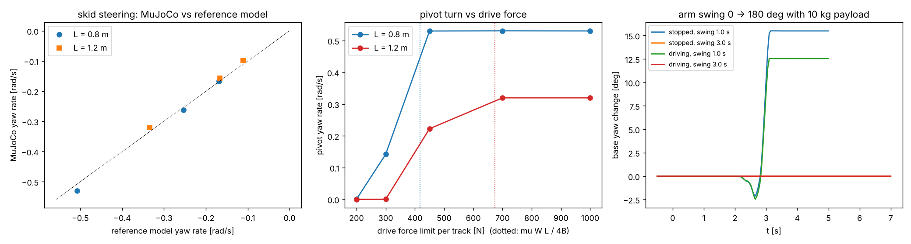

**Part A：定常旋回の角速度 [rad/s]**

| 接地長 | 左右の速さ [m/s] | MuJoCo | 基準モデル（実測の荷重分布） | 基準モデル（一様な圧力） | 滑りなし |
|---|---|---|---|---|---|
| 0.8 m | +0.15 / −0.15（その場旋回） | −0.529 | −0.506 | −0.362 | −0.667 |
| 0.8 m | +0.15 / 0（片側を止める） | −0.264 | −0.253 | −0.181 | −0.333 |
| 0.8 m | +0.20 / +0.10 | −0.168 | −0.168 | −0.120 | −0.222 |
| 1.2 m | +0.15 / −0.15 | −0.320 | −0.336 | −0.217 | −0.667 |
| 1.2 m | +0.15 / 0 | −0.157 | −0.168 | −0.108 | −0.333 |
| 1.2 m | +0.20 / +0.10 | −0.100 | −0.112 | −0.072 | −0.222 |

- **MuJoCo は、実測の荷重分布を入れた基準モデルと 0〜11% の差で一致した**（3 層の照合の第 1・2 層が、旋回でも成り立った）。
- 一様な圧力を仮定すると、旋回の速さを 3 割ほど小さく見積もる。起動輪を浮かせたため、実際に荷重を受ける長さは 0.8 m より短い（約 0.5 m）。**接地の荷重分布は、旋回の性能を決める校正値になる。**
- 滑りがない場合に比べて、旋回は 0.8 m で約 8 割、1.2 m で約 5 割の速さにとどまる（履帯の横滑りのため）。**長い履帯ほど曲がりにくい。**

**Part B：その場旋回に必要な駆動力（1 本あたり）**

| 接地長 | 200 N | 300 N | 450 N | 700 N | 1000 N | 基準モデルの必要な力 μWL/(4B) |
|---|---|---|---|---|---|---|
| 0.8 m | 回らない | 0.10 rad/s | **0.53 rad/s** | 0.53 | 0.53 | 418 N |
| 1.2 m | 回らない | 回らない | 0.23 rad/s | **0.32 rad/s** | 0.32 | 674 N |

- **その場旋回に必要な力は、基準モデルの見積もり μWL/(4B) とよく合う**（0.8 m では 300〜450 N の間、1.2 m では 450〜700 N の間で、力が足りるようになる）。
- **長い履帯（段差に強い）は、旋回に約 1.6 倍の駆動力が要る。** 段階 10 の結果と合わせると、「段差に強い長い履帯」と「曲がりやすい短い履帯」のトレードオフになる。用途に応じて形を選ぶ（アセンブル）具体例である。

**Part C：荷物を持った腕を横に振る（肩の旋回 0 → 180°、腕を水平に伸ばし荷物 10 kg）**

| 状態 | 振る時間 | 車体の向きの変化 | 最大の横の傾き | 最大の前後の傾き |
|---|---|---|---|---|
| 停止中 | 1 s | **+15.5°** | 6.0° | 7.6° |
| 停止中 | 3 s | 0.0° | 0.3° | 2.2° |
| 直進中（0.15 m/s） | 1 s | **+12.5°** | 5.5° | 7.1° |
| 直進中 | 3 s | 0.0° | 0.3° | 2.9° |

- **腕を速く振ると、その反作用で車体が回る（15°）。ゆっくり振れば回らない。** 反作用のトルクが、履帯の旋回の抵抗（摩擦）を超えたときだけ車体が滑って回る。
  第 1 段階の Sim06（摩擦がある地上では、腕の往復でも台車の向きが変わる）と、段階 2 の結果を、履帯の機体で確かめた形になる。
- 振り始めにはいったん逆向き（−2.5°）に回り、その後に大きく回る。腕の加速と減速で反作用の向きが変わり、そのうち滑りを起こした側だけが残る（スティックスリップ）。
- 直進中は、履帯がすでに前後に動いているため、向きの変化はやや小さい（12.5°）。
- 速く振ると、横に 6°、前後に 8° 傾く。**旋回中や走行中の腕の作業は、ゆっくり行うか、車体の向きの変化を見込んで履帯で打ち消す必要がある。** 腕の振りと履帯の速さの差を組み合わせて向きを制御することは、地上版の AMBAC とスキッドステアの統合制御になる。

### 段階 12：腕の振りと履帯による、車体の向きの制御（地上版 AMBAC ＋ スキッドステア）

段階 11 で、荷物を持った腕を速く振ると、反作用で車体が回ることが分かった。これを「困ること（外乱）」と「使えること（地上版 AMBAC）」の両面から試した。
機体 `twin_track_arm`（段階 11 と同じ）。腕は水平に伸ばし（荷物 10 kg）、肩の旋回で横に振る。

スクリプト: `sims/field12_heading.py`（4 並列で約 5 分） / 数値まとめ: `data/field12_summary.txt` / 動画: `figures/field/gifs/07_ground_ambac_ratchet.gif`

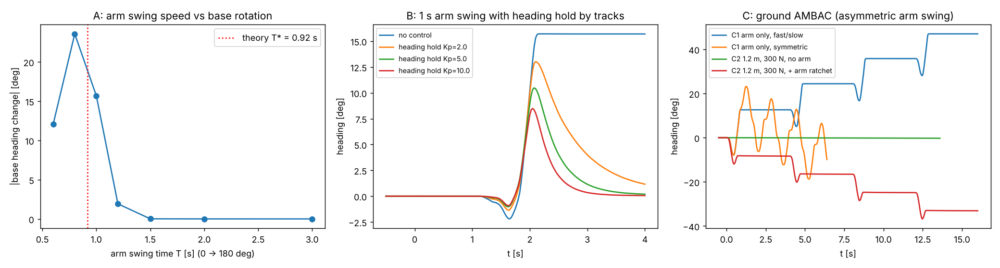

**簡単な理論（境目の見積もり）**：腕の反作用のトルクの最大値は I·α_max（最小ジャークで θ を T 秒で振ると α_max = 5.77 θ / T²）。
履帯を止めたまま車体を回し始めるトルクは M_s = μ Σ p_i |r_i|（段階 11 の実測の荷重分布から 260 N·m）。腕の慣性 I = 12.1 kg·m²。
I·α_max > M_s で車体が回り始めるとすると、180° を振る時間の境目は T* = √(5.77 θ I / M_s) = 0.92 s。

**Part A：腕を振る時間と、車体の向きの変化（履帯は止めたまま）**

| 振る時間 | 反作用の最大（M_s との比） | 向きの変化 | 最大の横の傾き |
|---|---|---|---|
| 0.6 s | 609 N·m（2.34） | +12.1° | 12.9° |
| 0.8 s | 342 N·m（1.32） | +23.6° | 11.9° |
| 1.0 s | 219 N·m（0.84） | +15.7° | 6.0° |
| 1.2 s | 152 N·m（0.59） | +1.9° | 2.7° |
| 1.5 s 以上 | 97 N·m 以下 | 0.0° | 1.2° 以下 |

- **車体が回り始める境目は、振る時間 1.0〜1.2 s の間（反作用が M_s の 0.6〜0.8 倍）で、簡単な理論（0.92 s）より少し遅い側にあった。**
  速く振ると車体が横に傾き（1 s で 6°）、片側の履帯の荷重が減って摩擦の抵抗が下がるためと考えられる。理論は、荷重の移動を含めれば改善できる。
- **速く振るほど大きく回るわけではない**（0.8 s で 23.6°、0.6 s で 12.1°）。加速と減速の反作用が向きを変えて打ち消し合う部分があるため。
- 実用上の目安：この機体では、荷物を持った腕を 180° 振るのに **1.5 s 以上かければ、車体の向きは変わらない**。

**Part B：腕を 1 s で振りながら、履帯の速度差で向きを保つ（フィードバック）**

| 制御 | 最大のずれ | 最後のずれ |
|---|---|---|
| なし | 15.7° | +15.7° |
| 弱い（Kp = 2） | 13.0° | +1.2° |
| 中（Kp = 5） | 10.5° | +0.2° |
| 強い（Kp = 10） | 8.5° | +0.05° |
| 強い、腕を 0.6 s で振る | 20.4° | +0.1° |

- 向きの誤差から履帯の速度差を決めるフィードバックで、**最後の向きはほぼ元に戻せる**（0.05°）。ただし、**振っている間のずれ（最大 8.5°）は消しきれない**。
  履帯で車体を回すには、履帯が地面の上で滑る必要があり、反応が遅い（段階 11 の旋回の速さは最大 0.5 rad/s 程度）。
- 振っている間のずれも抑えるには、腕の動きから反作用を予測して先に履帯を動かす（フィードフォワード）か、腕の振り方そのものを遅くする（Part A）必要がある。

**Part C：地上版 AMBAC — 腕の往復で車体を回す**

| 試験 | 結果 |
|---|---|
| C1 腕だけ：速く振り（0.6 s）、ゆっくり戻す（3 s）、120° の往復 | **1 往復ごとに +11.8°（平均 2.9°/s）回る** |
| C1 腕だけ：速く振り、速く戻す（対称） | 1 往復ごとに −2.5°（向きが定まらない） |
| C2 長い履帯（1.2 m）・駆動力 300 N のその場旋回：腕なし | 回らない（−0.3°） |
| C2 同じ条件に、腕の非対称な往復を加える | **−33°（平均 2.1°/s）回る** |

- **腕だけで、車体の向きを変えられる。** 速く振ると反作用が摩擦の抵抗を超えて車体が滑り、ゆっくり戻すときは滑らないため、1 往復ごとに回った分がたまる（ラチェット）。
  宇宙の AMBAC（関節のループで向きが変わる、幾何学的位相）とは仕組みが違い、**摩擦の非対称性を使う地上版の AMBAC** である。第 1 段階の Sim06（スティックスリップ）を、狙って使った形になる。
- **駆動力が足りずにその場旋回できない長い履帯も、腕の往復を加えると回れた。** ただし、回った向きは履帯が回そうとする向き（−）で、腕だけのとき（＋）とは逆だった。
  腕の反作用で車体を押し回したのではなく、**腕の速い振りで静止摩擦が一時的に外れ、そのすきに履帯が車体を回した**と解釈できる（細かい振動で摩擦を外す「ディザ」と同じ考え方）。
- 段階 10・11 のトレードオフ（長い履帯は段差に強いが曲がりにくい）に対して、**腕の動きで旋回の弱さを補える**可能性を示した。

**分かったこと（まとめ）**
- 腕の振りは、車体の向きの「外乱」にも「操作」にもなる。境目は、反作用のトルクと、履帯の摩擦の抵抗（荷重分布と荷重の移動で決まる）の比である。
- 校正の観点では、**M_s（車体を回し始めるトルク）と、その荷重の移動による変化**が、腕の作業と旋回の両方を決める重要な校正値になる。
- 統合制御の方向性：ゆっくりした作業では腕の反作用は無視でき、速い作業では履帯のフィードバック＋腕の動きからの予測で向きを保ち、旋回が苦しいときは腕の往復で摩擦を外して助ける。

### 段階 13：腕の反作用・AMBAC・車体の摩擦の境目 — 仕組みを段階的に組み込む

段階 12 の基準（荷物 10 kg を持って水平に伸ばした腕を、肩の旋回で 0 → 180° を 1 s で振ると、車体が 15.7° 回る）に、
反作用への対策を 1 つずつ組み込み、同じ物差しで比べた（摂動のように段階的に組み込む）。

| 段 | 加えたもの | 種類 |
|---|---|---|
| 13-0 | なし（硬い肩、最小ジャークの軌道） | 基準 |
| 13-1 | 軌道の形：加速度の山を平らにした軌道（山は最小ジャークの 5.77 θ/T² に対して 4.45 θ/T²） | 制御だけ |
| 13-2 | しなり：肩の旋回にばね＋減衰（直列弾性）。腕の固有振動数 1.5 / 3 Hz、減衰比 0.3 / 0.7 | 受動の機構 |
| 13-3 | 逆回転するおもり：車体の円盤（10 kg、0.31 kg·m²）に、肩のモーターと逆向きのトルクを与える（打ち消す割合 0.5 / 1.0） | 能動の機構 |
| 13-4 | 組み合わせ：しなり＋円盤＋履帯で向きを保つ（段階 12 の Part B） | 全部 |

部品表に、肩のしなり（`arms[].sea`）と、車体の円盤（`flywheel`）を書けるようにした。

スクリプト: `sims/field13_reaction.py`（4 並列で約 2 分） / 数値まとめ: `data/field13_summary.txt` / 動画: `figures/field/gifs/08_arm_reaction_countermeasures.gif`

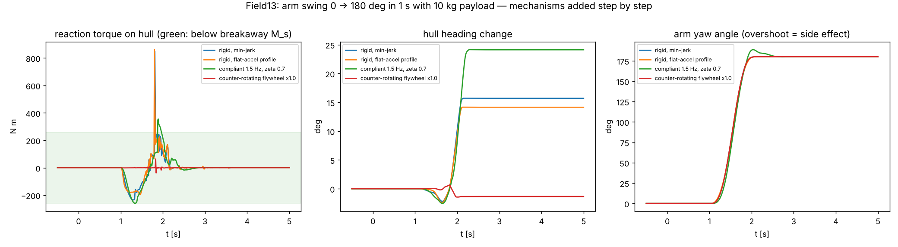

**結果**（反作用の最大は 0.05 s の移動平均の最大値。車体を回し始めるトルク M_s ≈ 260 N·m）

| 仕組み | 振る時間 | 車体の向きの変化 | 反作用の最大 | 横の傾き | 腕の行き過ぎ |
|---|---|---|---|---|---|
| 13-0 硬い肩 | 1.0 s | +15.7° | 411 N·m | 6.1° | 0.2° |
| 13-0 硬い肩 | 0.6 s | +12.1° | 474 N·m | 12.9° | 0.2° |
| 13-1 軌道の形 | 1.0 s | +14.1° | 406 N·m | 5.8° | 0.2° |
| 13-2 しなり 1.5 Hz・減衰比 0.7 | 1.0 s | **+24.1°（悪化）** | 330 N·m | 8.4° | 8.7° |
| 13-2 しなり 3 Hz・減衰比 0.7 | 1.0 s | +20.2°（悪化） | 397 N·m | 7.4° | 2.1° |
| 13-3 おもり（半分を打ち消す） | 1.0 s | +4.9° | 228 N·m | 5.2° | 0.0° |
| 13-3 おもり（全部を打ち消す） | 1.0 s | **−1.4°** | 13 N·m | 5.5° | 0.0° |
| 13-3 おもり（全部を打ち消す） | 0.6 s | +29.4° | 10 N·m | **79.8°（横倒し）** | 0.0° |
| 13-4 しなり＋おもり（半分）＋履帯で向きを保つ | 1.0 s | **+0.02°** | 189 N·m | 6.7° | 10.9° |
| 13-4 同上 | 0.6 s | +6.3° | 300 N·m | 29.5° | 7.9° |

（円盤の回転は最大で、半分を打ち消す場合に毎分 1300 回転、全部を打ち消す 0.6 s の場合に毎分 4400 回転）

**考察：腕の反作用・AMBAC・車体の摩擦の境目**

1. **車体が回るのは、腕を「止めるとき」。** 加速のときの反作用（約 −230 N·m）は境目 M_s の内側にとどまり、減速のときに境目を超えて滑った。
   原因は肩のサーボの遅れで、腕は計画の軌道から最大 17° 遅れ、終わり際に追いつこうとして急ブレーキになる。そこに、滑り始めの一瞬の衝撃（最大 850 N·m）が重なる。
   **「どう止めるか」が、車体を乱すかどうかを決める**。ステッピングモーターを逆向きのトルクで無理に止めるのと同じ構図で、滑らかな制動が必要という見方と一致する。
2. **反作用の山（大きさ）だけでなく、境目を超えている時間（力積）が効く。** しなりは山を 411 → 330 N·m に下げたが、境目を超える時間が長くなり、腕も行き過ぎて揺れたため、かえって大きく回った（+24°）。
   しなりが効くのは、山を境目より下まで下げられる場合に限られる。そのためには、さらに柔らかくする必要があり、腕の行き過ぎ（作業の精度）とのトレードオフになる。
3. **反作用を境目より下に抑えれば、車体はほとんど回らない。** おもりで半分を打ち消すと反作用は 228 N·m（境目のすぐ下）になり、回りは 4.9° に減った。全部打ち消すと −1.4°。
   段階 12 の「境目」の考え方が、対策の効き方も説明できた。
4. **軌道の形だけを変えても、ほとんど効かなかった。** 計画した軌道の加速度の山を 23% 下げても、サーボの遅れが軌道の形を崩してしまうため。軌道の設計は、サーボの特性と組で考える必要がある。
5. **一つの向きの問題を解くと、次の向きに問題が移る。** 0.6 s で振ると、向き（ヨー）の反作用はおもりでほぼ 0 にできたが、車体は横に倒れた（79.8°）。
   速く振った荷物の遠心力と、腕の加速の横向きの力（並進の反作用）は、向きを打ち消すおもりでは消せない。
   さらに、高速で回る円盤（毎分 4400 回転）は、車体が傾くとジャイロ効果で別の向きのトルクを生む可能性がある（今回の試験では切り分けていない）。
6. **組み合わせると、1 s なら向きをほぼ完全に保てる**（+0.02°）。ただし、腕の行き過ぎ（10.9°）と、止まるまでの時間（0.29 s）が増える。0.6 s では、向きは 6.3° に抑えられるが、横の傾きが 29.5° になり危険。
7. **AMBAC との関係**：逆回転するおもりは、宇宙の AMBAC で言えば「腕と円盤で角運動量の合計を 0 に保つ」こと（第 1 段階の Sim03 のリアクションホイール）。
   地上では、この角運動量の収支に「履帯と地面の摩擦」という出口があり、境目 M_s を超えた分だけが車体の回転として出ていく。宇宙では全部が回転に出ていく（L = 0）。
   **地上の機体は、境目 M_s までの反作用を摩擦で「ただで」吸収できる**。対策は、境目を超える分だけを、おもり・しなり・止め方の工夫で受け持てばよい。

**分かったこと（まとめ）**：腕を速く動かしたときの「雑さ」は、主に止めるときの反作用が、足元の摩擦の境目を超えることから生じる。
対策の優先順位は、①止め方（サーボと軌道を組で設計し、急ブレーキを避ける）、②境目を超える分だけを受け持つ部品（逆回転するおもり、または滑らかな制動の機構）、③履帯で残りを直す、の順がよい。
しなりは、境目より下まで下げられない場合には逆効果になる。速さを上げると、問題は横の転倒（並進の反作用）に移る。

**限界**：肩のサーボは位置制御（遅れを含む）のまま。トルクを直接制御する方式や、MR 流体のクラッチのような「ねばりを変えられる制動」は、まだ試していない。円盤のジャイロ効果は切り分けていない。

### 段階 14：滑らかな止め方 — トルク制御の肩と流体ブレーキ（MR・ダイラタント・擬塑性・チキソトロピー）

段階 13 で、車体が回るのは腕を「止めるとき」で、位置サーボの遅れが急ブレーキを生むことが分かった。そこで、止め方そのものを変えた。
- 肩の旋回を「トルクを直接制御するモーター」に変え、トルクの上限を 104 N·m（車体を回し始めるトルクの見積もり M_s = 260 N·m の 0.4 倍）にした。
  モーターは、「この位置から上限のトルクで止めれば目標で止まれる」減速の曲線に沿って腕を動かす。
  （最初に 0.8 倍の 208 N·m で試すと、トルクの山が見積もりの境目より低くても、上限のトルクが長く続いて車体が 22° 回った。段階 12 の実測でも 0.6 倍付近から滑り始めた）
- これに、流体ブレーキ（回転ダンパー）を並べて付けた。MuJoCo には流体そのものの機能はないため、**流体の性質を「速さとトルクの関係」の式で与え、毎ステップ、腕と車体の間の内力としてかけた**。ブレーキは車体に付くので、その反作用も車体に返る。

| 流体 | 式（ω：腕の角速度、トルクは動きと逆向き） | 強さ |
|---|---|---|
| 粘性（ニュートン流体） | τ = c ω | c = 10 N·m·s |
| MR 流体（ビンガム流体、制御） | τ = τ_y sign(ω) + c₀ ω。τ_y を磁場で変える（応答の遅れ 10 ms） | 止めるときは必要なだけ、止まった後は 60 N·m で保持 |
| ダイラタント（速いほど硬い） | τ = K ω\|ω\| | K = 2.0 |
| 擬塑性（速いほど柔らかい） | τ = K \|ω\|^0.5 | K = 22 |
| チキソトロピー（動くと柔らかく、休むと固まる） | τ = (η∞ + η₀ λ) ω、構造 λ：dλ/dt = (1 − λ)/2 s − 3 λ\|ω\| | η∞ = 2、η₀ = 40 |

強さは、腕の速さ 5 rad/s で約 50 N·m になるようにそろえた。MR 流体は「モーターは前に押すだけで逆回転させず、止めるのは MR に任せる」使い方にした（ステッピングモーターを逆回転で無理に止めない、という着想に対応）。

スクリプト: `sims/field14_braking.py`（4 並列で約 1.5 分） / 数値まとめ: `data/field14_summary.txt`

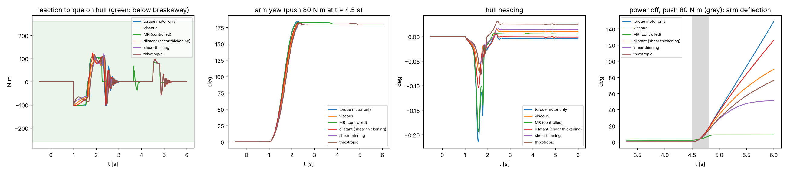

**Part A：荷物 10 kg を持った腕を 0 → 180° 振る（電源あり）**

| ブレーキ | 目標に着くまで | 行き過ぎ | 車体の向きの変化 | 反作用の最大 | ブレーキで熱になった | モーターが逆向きに受け持った |
|---|---|---|---|---|---|---|
| （比較）段階 13 の位置サーボ、1 s | — | 0.2° | **+15.7°** | 411 N·m | — | — |
| なし（トルク制御のモーターだけ） | 1.35 s | 3.9° | **0.00°** | 104 N·m | 0 J | 137 J |
| 粘性 | 1.23 s | 1.4° | +0.01° | 110 N·m | 94 J | 73 J |
| MR 流体（モーターは逆回転しない） | 2.66 s | 2.2° | +0.01° | 108 N·m | 139 J | **0 J** |
| ダイラタント | **1.19 s** | 1.8° | 0.00° | 115 N·m | 66 J | 95 J |
| 擬塑性 | 1.28 s | **1.0°** | +0.01° | 117 N·m | 116 J | 58 J |
| チキソトロピー | 1.26 s | 1.6° | +0.02° | 117 N·m | 58 J | 101 J |

**Part B：電源を切った保持**（到着後にモーターを止め、腕を外から 80 N·m で 0.3 s 押す）

| ブレーキ | 押し始めから 1 s の最大のずれ | 押し終わって 1.2 s 後のずれ |
|---|---|---|
| なし | 94° | 149°（流れ続ける） |
| ダイラタント | 84° | 126° |
| 粘性 | 68° | 90° |
| チキソトロピー | 57° | 76° |
| 擬塑性 | 48° | 51° |
| **MR 流体（保持の磁場だけ残す）** | **6.5°** | **6.5°** |

**分かったこと**
- **止め方を変えるだけで、車体を回さずに速く振れる。** トルクを直接制御し、上限を境目より下（実測の境目の目安：見積もり M_s の 0.6 倍）に抑えると、180° を 1.2〜1.35 s で振っても車体の向きは 0.02° 以内。
  位置サーボで車体を回さずに振れたのは 1.5 s 以上（段階 12）なので、それより速い。**「急ブレーキを避け、境目より下の一定のトルクで止める」のが、最も安くて効く対策**（追加の部品なし）。
- **流体ブレーキを並べると、行き過ぎが減り（3.9° → 1〜2°）、少し早く着く。** ブレーキが減速の一部を受け持つので、モーターは上限のトルクで長く押せる。
- **止めるエネルギーの行き先を選べる。** ブレーキなしでは、止めるエネルギー（約 140 J）はモーターが逆向きに受け持つ（回生すれば電気に戻せる）。流体ブレーキは、その一部または全部を熱にする（熱吸収）。
  MR 流体では、モーターはほぼ逆回転せず（0.3 J）、止める仕事はすべて MR が熱として受け持った。「回生で戻すか、流体で熱にするか」は、電池・放熱・モーターの負担の設計の選択になる。
- **流体の性質によって、得意な場面が逆になる。**
  - ダイラタント（速いほど硬い）：速い動きを止めるのは得意（最も早く着く）だが、ゆっくり押す力にはほとんど効かず、保持には向かない。速さの上限を自然にかける「安全ベルト」のような使い方に向く。
  - 擬塑性（速いほど柔らかい）：ゆっくりした押しに強く効くので、受け身の流体の中で保持が最もよい。行き過ぎも最小。
  - チキソトロピー（休むと固まる）：休んでいる間に固まった分だけ粘性より保持が強いが、押されて動き出すと柔らかくなり、途中から流される。「止まっている間は固く、動かすときは軽い」関節に向く。
  - **MR 流体**：制御で効き方を変えられ、保持の磁場を残せば電源を切ってもほぼ動かない（押す力 80 N·m が保持の 60 N·m を超えた分だけ、少しずれる）。
    ただし、目標を 2° 余り行き過ぎた位置でつかんで保持してしまい、修正に時間がかかった（着くまで 2.66 s）。**「つかむ」性質は、細かい位置の修正の邪魔にもなる**。ブレーキとモーターの受け持ちの制御を工夫する必要がある。
- **AMBAC・境目との関係**：車体が回るかどうかは、モーターと流体ブレーキを合わせた反作用が、足元の摩擦の境目を超えるかどうかで決まる（段階 12・13 と同じ）。
  流体ブレーキは、運動量を消す（熱にする）のではなく、**腕の運動量を車体に移す速さを決める部品**である。境目より下の速さで移せば、地上の機体はそれを摩擦で吸収できる。

**限界**：流体の性質は理想化した式で、係数は比較のためにそろえた値（実在の製品の値ではない）。温度による粘りの変化、流体の発熱による性能の低下、MR 流体の沈殿・摩耗は含めていない。
チキソトロピーの係数は仮の値で、構造が戻る時間（2 s）を変えると結果が変わる。

### 段階 15：機能を分けた組み合わせ — 「速く動かす」「止める」「保持する」を別の部品に

段階 14 で、流体ブレーキは種類によって得意な場面が逆になることが分かった。1 つの物質ですべてをこなす（速さと硬さを自在に切り替える）のではなく、
**機能ごとに部品を分け、上の制御で使い分ける**方が現実的と考え、組み合わせを比べた。人の体でも、筋肉（動かす）・腱（しなる）・靭帯や関節の摩擦（保持する）は役割が分かれ、神経がまとめて制御している。

| 組み合わせ | 速く動かす | 速さの上限・衝撃への備え | 止める | 保持する |
|---|---|---|---|---|
| ① 基準（段階 14） | モーター | — | モーター | モーター |
| ② モーター＋MR（制御を改良） | モーター | — | MR | MR（電源なしでも） |
| ③ モーター＋ダイラタント＋MR | モーター | ダイラタント（受け身） | MR | MR |
| ④ モーター＋ダイラタント＋擬塑性 | モーター | ダイラタント | 両方（受け身） | 擬塑性（受け身） |

**MR の制御の改良**（段階 14 の「行き過ぎた位置でつかんでしまう」への対策）：
① 加速はモーター → ② 減速はモーターを止め、**目標でちょうど止まるブレーキの強さ I ω² / (2 × 残りの距離) を毎ステップ計算して MR にかける** → ③ 目標の近く（ゆっくり）では MR を外してモーターで微調整 → ④ 止まったら MR でつかみ、モーターは休む。

試験：A は荷物 10 kg の腕を 0 → 180° 振り、到着後に電源を切って 80 N·m で 0.3 s 押す。C は振っている途中（開始 0.5 s 後）に 150 N·m の衝撃を 0.1 s（動きと逆向き＝ぶつかった、同じ向き＝後ろから押された）。
流体の式と強さ、モーターのトルクの上限（104 N·m）は段階 14 と同じ。

スクリプト: `sims/field15_combined.py`（4 並列で約 1 分） / 数値まとめ: `data/field15_summary.txt`

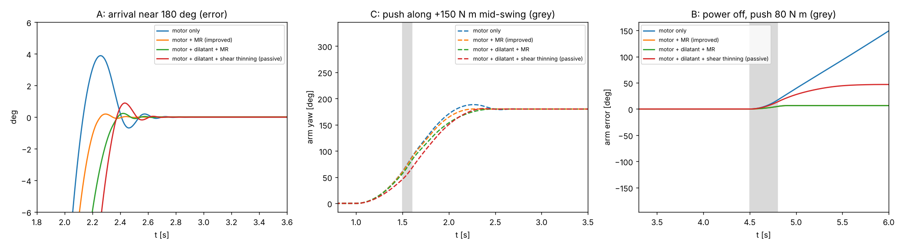

**試験 A：振る → 電源を切って押す**

| 組み合わせ | 目標に着くまで | 行き過ぎ | 車体の向き | ブレーキの熱 | モーターの逆回転の仕事 | 電源を切って押されたずれ |
|---|---|---|---|---|---|---|
| ① モーターだけ | 1.35 s | 3.9° | 0.00° | 0 J | 136 J | 149° |
| **② モーター＋MR（改良）** | **1.18 s** | **0.2°** | +0.02° | 143 J | **0 J** | **6.5°** |
| ③ モーター＋ダイラタント＋MR | 1.29 s | 0.2° | +0.02° | 166 J | 1 J | 6.5° |
| ④ モーター＋ダイラタント＋擬塑性 | 1.33 s | 0.9° | +0.01° | 182 J | 34 J | 47° |

**試験 C：振っている途中の衝撃（150 N·m、0.1 s）**（衝撃なしの腕の最大の速さは約 300 °/s）

| 組み合わせ | ぶつかった（逆向き）：行き過ぎ | 押された（同じ向き）：腕の最大の速さ | 押された：行き過ぎ |
|---|---|---|---|
| ① モーターだけ | 2.0° | 281 °/s | **8.4°** |
| ② モーター＋MR | 0.2° | 277 °/s | 0.2° |
| ③ モーター＋ダイラタント＋MR | 0.2° | 269 °/s | 0.3° |
| ④ モーター＋ダイラタント＋擬塑性 | 0.9° | **249 °/s** | 0.9° |

（どの場合も、車体の向きの変化は 0.4° 以内）

**分かったこと**
- **機能を分けると、すべての指標が同時によくなった。** モーター＋MR（②）は、段階 14 の MR（2.66 s）から **1.18 s に速くなり、行き過ぎは 0.2°**。モーターは一度も逆回転せず、電源を切っても腕はほぼ動かない（6.5°）。
  鍵は、MR を「止める」専用にして、**目標でちょうど止まる強さを毎ステップ計算する**こと。最後の微調整だけモーターに戻すことで、「つかんで動けなくなる」問題も消えた。
- **衝撃で速くなっても、MR の制御が行き過ぎを防ぐ**（押されたとき、モーターだけは 8.4° 行き過ぎ、MR ありは 0.2〜0.3°）。止める機能を独立させた効果。
- **ダイラタント（受け身）の衝撃を和らげる効果は控えめ**（押されたときの最大の速さを 3〜11% 下げた程度）。今回の強さでは、衝撃で少し速くなっても、ブレーキのトルクの増え方（約 20 N·m）が衝撃（150 N·m）に比べて小さい。
  強くすれば効くが、普段の動きも重くなる（③は②より 0.1 s 遅く、熱も多い）。**ダイラタントは「速さの上限」を受け身でかけたい場合（暴走・落下の安全）に限って使う**のがよい。
- **ぶつかった（逆向きの衝撃）ときは、ダイラタントは効かない。** 腕が遅くなると、ダイラタントの効きも弱まるため。衝撃の向きによって、効く部品が違う。
- **受け身の部品だけ（④）でも、それなりに動く**（1.33 s、行き過ぎ 0.9°）が、電源を切った保持（47°）と、止める位置の制御は、制御できる部品（MR）に及ばない。
- **設計の指針**：動かすのはモーター、止めるのと保持するのは制御できるブレーキ（MR など）、受け身の流体は「安全のための上限」として必要な場合だけ。
  止めるエネルギーはブレーキの熱になるため（約 140 J／回）、繰り返し動かす場合は放熱の設計が必要になる。回生（モーターで電気に戻す）と熱吸収（ブレーキ）のどちらを選ぶかは、電池・放熱・重さの比較で決まる。

**限界**：段階 14 と同じ（流体の式は理想化、温度や発熱による性能の変化を含めていない）。MR の応答の遅れは 10 ms と仮定した。電源を切った保持には、永久磁石と電磁石を組み合わせた MR（保持に電力が要らない方式）を想定している。

### 段階 16：繰り返し動かしたときの発熱・放熱と、MR 流体の温度による性能低下・劣化

段階 15 の「モーター＋MR（動かす＝モーター、止める・保持する＝MR）」を、何百回も繰り返したときに何が起きるかを調べた。
腕の動き（約 1 s）と温度の変化（数分〜数時間）は時間の桁が違うため、2 つを組み合わせた。
1. **MuJoCo**：MR の最大のブレーキの強さを公称値（150 N·m）の 100〜0% に下げたとき、1 回の振り（0 → 180°）がどう変わるか（足りない分はモーターが逆向きに補う）
2. **熱のモデル**（熱容量 C と周囲への熱抵抗 R の 1 次の式 C dT/dt = P − (T − T_周囲)/R）：往復を繰り返したときの MR とモーターの温度。
   MR の温度が上がると効きが下がり（温度係数 β）、その分モーターの負担と発熱が増える連鎖、モーターの巻線の抵抗が温度で増える効果（0.39 %/℃）を含める

**調べたこと（MR 流体の熱と劣化）**
- 寿命：MR 流体の寿命は「流体の体積あたり、一生のうちに熱に変えたエネルギーの総量（LDE）」で決まり、最良の流体で 10⁷ J/cm³ 程度。長く使うと濃くなり、最後はペースト状になる（in-use thickening）。
  酸化防止剤が減ると濃くなりやすい（[Carlson 2003](https://www.inderscience.com/info/inarticle.php?artid=3572)、[長期使用した流体の評価](https://www.ncbi.nlm.nih.gov/pmc/articles/PMC6265955/)、[耐久性の添加剤の特許](https://image-ppubs.uspto.gov/dirsearch-public/print/downloadPdf/7575695)、[LDE とメイソン数](https://inis.iaea.org/records/jgd8a-ryg41)）
- 温度：MR 流体の安定性・制御・寿命は温度に大きく左右される。滑らせ続けると温度はほぼ時間に比例して上がり、伝えられる力は放熱で制限される
  （[膝のアクチュエータ](https://pmc.ncbi.nlm.nih.gov/articles/PMC10358520)、[Applied Sciences 2022](https://www.mdpi.com/2076-3417/12/10/5044)、[EV の MR ブレーキ](https://www.mdpi.com/2032-6653/17/7/370)）
- **確認できなかったこと**：温度 1 ℃ あたりの効き（降伏応力）の低下率。温度に強い MR 材料の特許では −40〜150 ℃ で安定とされる（[US5599474](https://image-ppubs.uspto.gov/dirsearch-public/print/downloadPdf/5599474)）。
  そのため、β = 0.1 / 0.3 / 0.5 %/℃ の 3 通りを仮定して比べた。

**仮定した値**（実在の製品の値ではない）：MR ブレーキ（熱容量 700 J/K、熱抵抗 1.5 K/W（自然放熱）/ 0.5 K/W（ファン）、流体 20 cm³、上限 120 ℃）、
モーター（銅損 0.04 τ² W、熱容量 600 J/K、熱抵抗 0.8 K/W、巻線の上限 120 ℃、回生の効率 60%）。動作は 0 → 180° → 0 → … の往復。

スクリプト: `sims/field16_thermal.py`（約 1 分） / 数値まとめ: `data/field16_summary.txt`

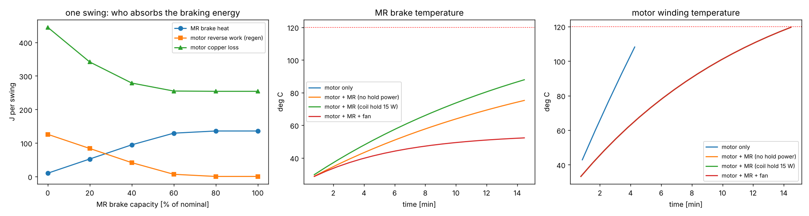

**(1) 1 回の振り：MR の効きを下げたとき**

| 構成 | 動作時間 | 行き過ぎ | MR の熱 | モーターの銅損 | モーターの逆回転の仕事 |
|---|---|---|---|---|---|
| モーターだけ | 1.56 s | 3.9° | 0 J | **545 J** | 136 J |
| モーター＋MR（効き 100%） | 1.28 s | 0.2° | 136 J | **254 J** | 0 J |
| 同（効き 60%） | 1.28 s | 0.2° | 129 J | 255 J | 7 J |
| 同（効き 40%） | 1.29 s | 0.2° | 95 J | 279 J | 41 J |
| 同（効き 20%） | 1.29 s | 0.2° | 52 J | 342 J | 84 J |
| 同（効き 0%） | 1.29 s | 0.5° | 10 J | 445 J | 126 J |

**(2) 繰り返し：温度が上限（120 ℃）を超えずに続けられる頻度**

| 構成 | 1 s ごとに休む場合 | 続けられる頻度 | 1 回あたりの電池のエネルギー | そのときの MR の温度 |
|---|---|---|---|---|
| モーターだけ（回生 60%） | 5.0 分でモーターが上限 | **毎分 9.5 回** | 716 J | — |
| モーター＋MR（保持に電力不要、自然放熱） | 14.6 分でモーターが上限 | **毎分 20.4 回** | 459 J | 約 94 ℃ |
| モーター＋MR（電磁石で保持 15 W） | 同上 | 毎分 20.4 回 | 459 J | （1 s ごとの場合、停止時 88 ℃） |
| モーター＋MR（ファン） | 同上 | 毎分 20.4 回 | 459 J | （同、52 ℃） |

**(3) MR の効きの温度係数**：β = 0.1 / 0.3 / 0.5 %/℃ のどれでも、続けられる頻度は変わらなかった（毎分 20.4 回）。4 時間後の効きは 93 / 79 / 66%。

**(4) 寿命**：LDE 10⁷ J/cm³ × 流体 20 cm³ = 2 × 10⁸ J、1 回の振りで 136 J → **約 150 万回**（1 s ごとに往復し続けて約 900 時間）。

**分かったこと**
- **繰り返しで先に限界に達するのは、MR ではなくモーター。** 大きなトルクをゆっくり出す使い方では、モーターの巻線の発熱（銅損、トルクの 2 乗に比例）が、腕を動かす仕事（約 150 J）よりずっと大きい（モーターだけで 1 回 545 J）。
- **MR に止める仕事を任せると、モーターの発熱がほぼ半分になり、続けて動かせる頻度が約 2 倍（毎分 9.5 → 20.4 回）、電池の消費が約 3 分の 2 になった。**
  止める熱を、別の部品（MR）に分けて、**熱の出口を 2 つにした**ことが効いている。段階 15 の「機能を分ける」は、熱の面でも有利だった。
  （回生の効率を 60% と仮定しても、モーターで止めると銅損が増えるため、MR の方が電池の消費も少ない）
- **MR の効きが 60% 程度まで落ちても、動きはほとんど変わらない。** 最大のブレーキに余裕があるため。それより下がると、足りない分をモーターが補い、モーターの発熱が増える。
  つまり、**MR の熱による性能低下は「動きの悪化」ではなく「モーターの発熱の増加」として現れる**。温度係数が大きいほど、余裕がなくなる。
- **熱暴走に注意**：巻線の抵抗は温度で増えるため、発熱がさらに増える。モーターだけで休まずに動かし続けると、温度が上がるほど発熱が増えて止まらなくなる（今回は上限で停止させた）。
- **MR の放熱**：今回の条件では MR は上限に達しなかったが、電磁石で保持し続ける方式（コイル 15 W）は MR の温度を上げる。保持に電力が要らない方式か、ファンの方がよい。
  モーターを強く冷やして頻度を上げると、次は MR が限界になる（今回は確かめていない）。
- **寿命**：約 150 万回。1 日 8 時間、毎分 20 回で使うと約 160 日分。流体の交換か、より大きな流体の量（または熱に変えるエネルギーを減らす使い方）が必要になる。

**限界**：熱のモデルは、部品ごとに 1 つの温度で表す簡単なもの（流体の中の温度のむら、熱の伝わる経路は含めていない）。数値は仮定の値で、実在の部品に当てはめるには、データシートの値に置き換える必要がある。
MR の効きの温度係数は確認できなかったため、範囲で示した。in-use thickening による粘りの増加（効きの低下ではなく、ブレーキを外したときの引きずりの増加）は含めていない。

### 段階 17：3 軸の肩＋肘の腕全体の動作に、機能を分けた部品を当てはめる

段階 15・16 の「動かす＝モーター、止める・保持する＝MR」を、3 軸の肩（旋回・俯仰・ひねり）＋肘の 4 関節を同時に動かす動作に当てはめた。
これまでとの大きな違いは**重力**で、腕を上げて保持するには、重力に逆らうトルクを出し続ける必要がある。
機体は左右 2 本の履帯（段階 11）に、3 軸の肩＋肘の腕（荷物 10 kg）。

動作：前の低い位置（旋回 0°、俯仰 −30°、ひねり 0°、肘 −60°）→ **区間 1** 左横の高い位置（120°、40°、60°、−90°）→ 1 s 止まる
→ **区間 2** 胸の前にたたむ（−60°、60°、−30°、−120°）→ 1 s 止まる → **電源を切って 5 s**（MR は、電源が切れたら、その位置で全関節をつかむ）

| 方式 | 動かす | 止める | 保持する（重力） |
|---|---|---|---|
| ① 位置サーボ・速い（1 区間 1 s） | サーボ | サーボ | サーボ |
| ② 位置サーボ・遅い（1 区間 2 s） | サーボ | サーボ | サーボ |
| ③ トルク制御のモーター | モーター | モーター | モーター（電力を使い続ける） |
| ④ モーター＋MR（関節ごと） | モーター | MR | MR（電力なし） |

関節ごとのモーターのトルクの上限は、旋回 104（車体が滑らない範囲）・俯仰 300・ひねり 80・肘 150 N·m。MR の最大は 150 / 350 / 100 / 200 N·m。
③④ では、重力の分をモーターで打ち消し、段階 15 の減速の曲線と MR のブレーキの計算を 4 関節に広げた。
関節の慣性は姿勢で変わる（腕を伸ばすと旋回の慣性が大きくなる）ため、動作中にこまめに計算し直した（最初は計算し直しておらず、旋回が 28° 行き過ぎた）。
MR の保持は、静止摩擦に近い硬さ（ずれ 1° で 870 N·m、最大は MR の上限まで）とした。

スクリプト: `sims/field17_arm3d.py`（4 並列で約 2 分） / 数値まとめ: `data/field17_summary.txt` / 動画: `figures/field/gifs/09_arm3d_power_off.gif`

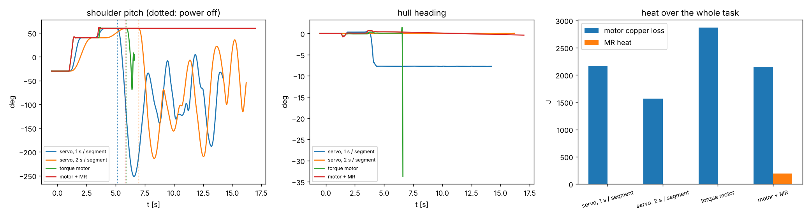

| 方式 | 2 区間の動作時間 | 車体の向きの変化 | 横の傾き | モーターの銅損 | MR の熱 | 電源を切ったとき |
|---|---|---|---|---|---|---|
| ① 位置サーボ・速い | 2.14 s | **−7.7°** | 4.8° | 2167 J | — | 荷物が 1.0 m 落ちる（振り子のように揺れ続ける） |
| ② 位置サーボ・遅い | 3.98 s | 0.0° | 0.4° | 1566 J | — | 1.0 m 落ちる |
| ③ トルク制御のモーター | 2.93 s | 0.1° | 1.6° | 2867 J | — | 0.9 m 落ち、**その勢いで車体が倒れる（横の傾き 78°）** |
| **④ モーター＋MR** | **2.81 s** | 0.4° | 1.6° | 2153 J | 191 J | **2 mm 下がるだけ** |

重力に逆らって止まっているのに必要なモーターの銅損：区間 1 の姿勢で **330 W**（1 分間で 20 kJ）、区間 2 の姿勢で 183 W。MR の保持（電力が要らない方式）なら 0 W。

**分かったこと**
- **モーター＋MR は、車体をほとんど乱さない方式の中で最速**（2.81 s）。位置サーボで車体を乱さないようにすると 3.98 s かかり、速くすると車体が 7.7° 回る。4 関節を同時に動かしても、段階 14・15 の結論（止め方を変える、止める機能を分ける）がそのまま成り立った。
- **電源が落ちたときの安全で、大きな差が出た。** モーターやサーボだけでは、電源が落ちると腕が重力で落ち（約 1 m）、その勢いで車体まで倒れることがある（③）。
  MR（保持に電力が要らない方式）は、5 s たっても 2 mm 下がっただけだった。重力のかかる腕では、**「電源なしで保持できる」ことが、安全の機能そのものになる**。
- **重力に逆らって止まっている時間が長いほど、MR の利点は大きい。** 今回は止まる時間が短く（1 s × 2）、モーターの発熱の差は 25% にとどまったが、
  腕を上げて止まっているだけでモーターは 330 W の熱を出し続ける。物を持って待つ、狙いを定める、といった作業では、発熱と電池の消費が数倍違ってくる。
- **関節の慣性は姿勢で大きく変わる**ので、止める計算（MR のブレーキの強さ、減速の曲線）は、その場の慣性で計算し直す必要がある。

**MR を「止める・保持する」制御材として見たまとめ（段階 14〜17）**
- 利点：止めるときに車体（足元）を乱さない／モーターの逆回転・発熱を減らし、続けて動かせる頻度を上げる／電源なしで保持できる（安全・省電力）
- 弱点と対策：温度で効きが下がる → 余裕を持った大きさと放熱（ファン）／熱に変えたエネルギーの総量で劣化する → 寿命を見積もって、流体の交換を定期的なメンテナンスに組み込む
  ／「つかむ」性質が細かい位置合わせの邪魔になる → 最後の微調整はモーターに戻す制御
- **熱や経年による劣化が、予測できて定期的なメンテナンスで受け止められる範囲なら、MR は「止める・保持する」制御材として有力**と言える（効きの温度係数と寿命は、使う製品のデータで確かめる必要がある）。

**目視で見つけて直したこと**：最初の版では、MR が腕をつかむのは「目標の 0.5° 以内に 0.2 s とどまったとき」だけで、目標から 0.5〜1° ずれて止まった関節は、
つかまれないまま電源が切られて重力で動いていた。数値の試験は電源を切った後 2 s しか見ていなかったため「32 mm 下がるだけ」に見えたが、
GIF（約 8 s 後まで）でゆっくり動き続けるのが見えた。**電源が切れたら、その位置で全関節を MR でつかむ**ように直し、観察を 5 s に延ばした（上の表は修正後の値）。
MR の熱は、電源を切るまでの値（保持のモデルの小さな振動を熱として数えないため）。

**限界**：腕の各関節の部品（モーター・MR）の重さと大きさは、機体の質量に含めていない。MR の保持の硬さは仮定。電源を切ったときの位置サーボは、サーボの力を 0 にした場合として扱った。

### 動画（GIF）による目視の確認

数値やグラフだけでは見落としがある（段階 10 の履板の食い込みのように）ため、主な場面を GIF にして目で確かめた（`sims/field_gifs.py`、`figures/field/gifs/`）。

| GIF | 内容 | 目で確かめたこと |
|---|---|---|
| 01_space_loop | 宇宙の人型が腕と脚でループを描く（8 周） | 周回中に体が ±17° 揺れながら、1 周ごとに少しずつ回る（7 周で 24°） |
| 02_pick_place_waist | 同じ 0.57 s の荷物運び：補正なし / 腰の補正 | 補正なしは台車が浮いて倒れる。腰の補正は、先に後ろへ反り、荷物を後ろに回すにつれて前に傾き、台車は水平のまま |
| 03_biped_vs_tank | 二本脚（腰なし・腰あり）と戦車型＋腰 | 腰なしの二本脚は荷物を頭上に上げたところで倒れる。腰ありの二本脚と戦車型は倒れない |
| 04_track_step | 履帯で 0.15 m の段差：腕を後ろ / 能動 | 腕を後ろにたたむと、機首が上がって後ろにひっくり返る。能動の腕は、床の近くの荷物を、機首が上がると前に伸ばし、段を越える |
| 05_track_length | 接地長 0.8 m で 0.20 m / 1.2 m で 0.30 m（どちらも能動の腕） | 短い履帯は段の角でシーソーになり、機首が 49° まで上がってひっくり返る。長い履帯は 28° で角を越える |
| 06_turning | その場旋回 / 荷物を持った腕を 1 s で振る | 6 s で 163° 回る（0.53 rad/s）。腕を振ると、振り始めに少し逆に回ったあと、車体が 15.7° 回る |
| 09_arm3d_power_off | 3 軸の肩＋肘：位置サーボ（速い）/ トルク制御のモーター / モーター＋MR、最後に電源を切る（段階 17） | 位置サーボは車体が 7.7° 回り、電源を切ると腕が落ちて揺れる。トルク制御のモーターは、電源を切ると腕が落ちる勢いで車体が倒れる。MR は電源を切った位置で腕が止まる |
| 08_arm_reaction_countermeasures | 腕の反作用への対策：硬い肩 / しなり / 逆回転するおもり（1 s・0.6 s）（段階 13） | 硬い肩は止めるときに車体が回る（+15.7°）。しなりはかえって大きく回る（+24°）。おもりは向きを保つ（−1.4°）が、0.6 s では横に倒れる |
| 07_ground_ambac_ratchet | 腕だけの非対称な往復 / 長い履帯（駆動力 300 N）のその場旋回＋腕の往復（段階 12） | 腕だけで 20 s に +60° 回る。長い履帯は履帯だけでは回らず、腕の往復を加えると −33° 回る |

**目視で見つけた問題と修正**：「腕を下ろす」姿勢（肩 −90°）では、腕と荷物が床の下（荷物は床の 25 cm 下）に入り込んでいた（腕には当たり判定がない）。
能動の腕も、機首が上がる前は同じ姿勢から始まっていた。段階 11 の旋回の試験も同じ姿勢だった。
荷物が床のすぐ上に来る姿勢（肩 −20°、肘 −70°：荷物は前方 0.47 m、高さ 0.08 m）に直し、能動の腕はこの姿勢から「水平に前へ伸ばす」姿勢へ移すようにして、
段階 8・10・11 と GIF 04〜06 を計算し直した（上の表は修正後の値）。
- 段階 10 の元の形（Part A）と、段階 11 の旋回は、ほとんど変わらなかった。
- 段階 8 の「腕を下ろす」は 0.125 → 0.15 m になった。
- 段階 10 の Part C では、腕を下ろしたままでも長い履帯で 0.30 m、重心を下げた形で 0.20 m を越え、能動の腕との差がなくなった。
  **「能動の腕が長い履帯で効いた」という最初の版の結論は、取り消した。**

### 次の作業（段階 12 以降の候補）
1. 起動輪の歯・履板の突起（グローサー）の効果、旋回しながらの段差・坂
2. 関節ごとの部品（モーター・MR）の重さを含めた設計、腕組み（Sim08、肩甲骨を含む）の動作、モーターの冷却を強めたときの MR の限界、荷重の移動を含めた境目の理論
3. 速く振ったときの横の転倒（並進の反作用）への対策と、円盤のジャイロ効果の切り分け
2. 腰の戦略とモーターの定格を同時に考える（腰で速くすると、必要なトルクが 3 倍以上に増える）
3. 計測データを DIY_AutoML に入れて推定を試す（ユーザーの環境）
4. 二本脚の段差の試験（足を持ち上げる関節を加え、Sim10 と比べる）
5. 二本脚の最適化のやり直し（初期値を変える、関節の速度の上限を入れて Sim09 と同じ条件で比べる）
