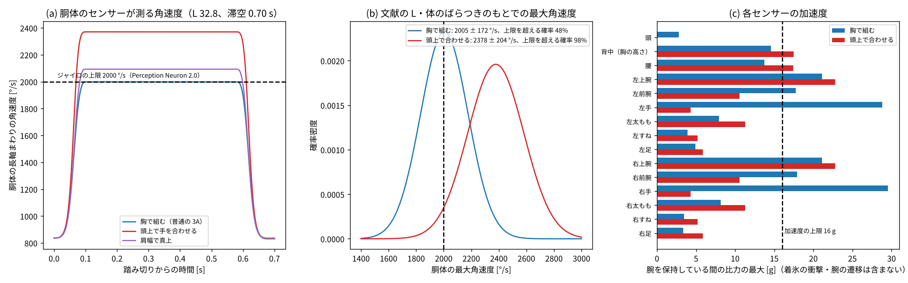

# 18. 番外編 05：羽生結弦さんの論文とシミュレーションの突き合わせ

2026-11-28。ユーザーの問い：**本人の実測は羽生結弦（2021）の論文しかない。番外編 03・04 のシミュレーションとどこまで一致するのか。**

- 論文：羽生結弦「無線・慣性センサー式モーションキャプチャシステムのフィギュアスケートでの利活用に関するフィージビリティスタディ」人間科学研究 補遺号, 1–7 (2021), 早稲田大学人間科学学術院（特別寄稿）
- スクリプト：`sims/bangai05_sensor_check.py`（`main`、`mc`、`figure`）。番外編 03 の `Skater.fly` に `return_states` を足した（体の各部の位置・速度を後で計算するため。結果は変わらない）
- 結果：`data/bangai05_sensor_check.json`、`data/bangai05_mc.json`、図：`figures/field/bangai05_sensor_check.png`

## 18.1 結論（先に）

1. **論文には数値の結果がない**（F76）。慣性モーメント、回転数、角速度、腕の角度、体格、滞空時間のどれも載っていない。だから「数値がどこまで一致するか」は今は答えられない。
2. 代わりに、論文が書いている**測定の条件（センサーの仕様）と定性的な所見**を、シミュレーションの予測と突き合わせた。**矛盾はなかった**。
   - 普通の 3A（胸で組む）の胴体の角速度は、最大で **2005 ± 172 °/s**（モンテカルロ 300 回）。Perception Neuron 2.0 のジャイロの上限 2000 °/s の**ちょうど境目**（超える確率 48%）。超えても少しだけなので、回転の数え落としは 0.0 回転。→ 論文の「3A の回転はしっかりと追えていた」と合う。
   - 腕を頭上で合わせる 3A なら最大 **2378 ± 204 °/s**（超える確率 98%）。約 0.54 s の間飽和し、ジャイロの積分だと **約 0.54 回転少なく数える**。論文は腕の形を書いていないが、「しっかり追えた」という所見は、測定した 3A が普通の締めだったことと合う（ただし、頭上の 3A だったら追えないはず、という予測は検証されていない）。
   - 着氷の膝の角度と着氷の回転角が怪しい、跳んだ高さ・距離が取れない、という所見も、60 Hz（センサー 31 個のとき）・加速度 ±16 g・慣性センサーのドリフトという測定の限界と合う（18.4）。
3. 実際に数値で突き合わせるには、**その実験の生データ（各センサーの角速度・BVH）**が必要。胴体の ω(t) があれば、L と I(t) をフィットできる（18.6）。

## 18.2 論文から抜き出せたもの

| 項目 | 論文の値 | シミュレーションで使える？ |
|---|---|---|
| 測定機器 | Perception Neuron 2.0（Noitom）、センサー 31 個（1 個 約 1 g）、Wi-Fi | ○ 仕様を使う（18.3） |
| 電池 | 約 160 g、82 × 82 × 15 mm、10000 mAh | ○ 装備の慣性モーメントに使う |
| 固定 | シリコンの防水テープ | △ 皮膚・服の揺れは定量できない |
| 跳んだジャンプ | 1Lo、1F、1A、3Lo、3F、3A を各 2 本 | △ 本数が少なく、統計はできない |
| 3A の所見 | 回転はしっかり追えていた、非常に安定 | ○ 定性的に比べる |
| 1A の所見 | 腕と右脚の振りに乱れ（データの不具合） | — |
| 高さ・距離 | 慣性センサーでは取れない | ○ 限界として合う |
| 着氷 | 膝の角度と着氷の回転角の精度に疑問 → 回転不足の自動判定はまだ難しい | ○ 限界として合う |
| エッジ | 接地点から 1F はインサイド、3F はアウトサイドに見える（エッジエラーの検出） | × 番外編 03 は空中だけ |
| 回転の角速度・回転数 | **載っていない** | — |
| 3A の腕の形・角度 | **載っていない**（3A の姿勢の図もない） | — |
| 体格（身長・体重・各部の長さ） | **載っていない** | — |
| 滞空時間 | **載っていない** | — |

センサーの仕様（販売店の公開ページ、Perception Neuron 2.0）：ジャイロ ±2000 °/s、加速度 ±16 g、32 個のとき 60 Hz（17 個なら 120 Hz）、静止時の精度 roll・pitch 1° 未満、yaw 2° 未満、センサーは 12.5 × 13.1 × 4.3 mm。

## 18.3 シミュレーションの予測（番外編 03 の体、L = 32.8、滞空 0.70 s）

| 腕の形 | 回転数 | 胴体の最大 [°/s] | 2000 を超える時間 | ジャイロの積分で数え落とす回転 | 60 Hz で失う回転 |
|---|---|---|---|---|---|
| 胸で組む（普通の 3A） | 3.430 | 1999 | 0 ms | 0.000 | 0.000 |
| 頭上で手を合わせる | 4.015 | 2371 | 541 ms | −0.543 | 0.000 |
| 肩幅で真上 | 3.571 | 2093 | 517 ms | −0.130 | 0.000 |
| 半分の締め | 2.556 | 1432 | 0 ms | 0.000 | 0.000 |

- 60 Hz で失う回転が 0 なのは、回転が滑らか（ナイキストは 30 Hz、回転は 5〜7 Hz）だから。60 Hz が効くのは着氷の衝撃のような速い変化の方。
- 腕のジャイロは、どの形でも**腕を動かす間**に 2000 °/s を超える（胸で組むとき前腕・手で 約 4300 °/s）。腕を保持している間は胴体と同じ角速度。番外編 03 の遷移時間 0.10 s は仮定なので、この値は仮定に強く依存する。
- 装備（電池 160 g を腰の後ろ、軸から 0.12 m と仮定。センサー 31 g を 0.15 m）の慣性モーメントは 0.003 kg m²（普通の 3A の I の 0.32%）。回転は −0.011 回転。**測定の装備が回転を妨げた、という効果は無視できる**。
- 加速度（腕を保持している間、着氷は含まない）：胸で組むと手で 約 29 g、上腕で 21 g、背中・腰で 14 g。回転の向心加速度 ω²r（ω ≈ 35 rad/s、r ≈ 0.2 m で 約 25 g）なので物理的な値。**手首・上腕のセンサーは空中でも 16 g を超えて飽和する**と予測する。頭上の形では背中・腰も 17.5 g。

## 18.4 一致・不一致の整理

| 論文の所見 | シミュレーションの予測 | 判定 |
|---|---|---|
| 3A の回転はしっかり追えた | 普通の 3A は胴体の ω が上限の境目、数え落とし 約 0 | 一致（定性的） |
| 3A は非常に安定 | 普通の 3A でも腕・手は ±2000 °/s・±16 g を超える | **一部不一致の可能性**。腕のデータは飽和しているはず。論文は腕の値を書いていないので、確かめられない。PN 2.0 の姿勢推定は飽和しても見た目は滑らかに出ることがある（未確認） |
| 高さ・距離が取れない | 慣性センサーは位置を積分するのでドリフトする（番外編 01 と同じ） | 一致 |
| 着氷の膝の角度・回転角が怪しい | 着氷の衝撃はモデル外。ただし 60 Hz・16 g では衝撃（文献では数十 g の報告）を取りきれない | 一致（定性的） |
| 1A の腕と右脚の乱れ | 1A は ω が小さく、上限には届かない | モデルでは説明できない（無線の欠落・テープのずれなど別の原因） |

## 18.5 誤差の整理

**統計誤差**（`mc`、300 回、seed 5）：文献の L = 32.8 ± 2.0（Knoll & Hildebrand 1998）、滞空 0.68〜0.76 s、体の慣性モーメントのばらつき（番外編 03 と同じ CV 6.2%）。

| | 平均 ± SD [°/s] | 5 / 50 / 95% | 上限を超える確率 |
|---|---|---|---|
| 胸で組む | 2005 ± 172 | 1748 / 1992 / 2293 | 48% |
| 頭上で合わせる | 2378 ± 204 | 2073 / 2363 / 2719 | 98% |

モンテカルロの有限サンプルの誤差は、確率 48% に対して ±2.9%（二項分布の SD、n = 300）。

**計算誤差**：番外編 03 と同じ RK4、dt = 1 ms、|ΔL|/L ~ 1e−15。加速度は位置の 2 階差分（dt = 1 ms）で、腕を動かす間は 100〜230 g と大きく出る（F77）。

**系統誤差**（大きい順）
1. **体格**：本人の体格は不明。de Leva の 1.70 m・62 kg の一般の男子。I が 6% 違うと最大 ω も 6% 違う（120 °/s）。上限の境目にいるので、「超える／超えない」はこれだけで変わる。
2. **L（角運動量）**：本人の L は不明。文献の平均を使った。King らの 4.9 rev/s（平均）から逆算すると、モデルの最大/平均の比 1.13 で最大 約 2000 °/s と、同じ境目に来る。
3. **センサーの位置と軸**：胴体のセンサーが長軸からずれていても、剛体の角速度は場所によらない。ただし胴体のねじれ（背中と腰の角速度の違い）はモデルにない。
4. **上限の振る舞い**：ジャイロが 2000 °/s で単純に頭打ちになると仮定した。実機の内部の融合（加速度・地磁気との融合）で一部補われる可能性がある。
5. **腕の遷移時間**：0.10 s は仮定。腕の加速度・角速度の最大は、これに強く依存する。

## 18.6 実際に数値で突き合わせるには

1. その実験の生データ（BVH や各センサーの角速度）。胴体の ω(t) が 2000 °/s で頭打ちになっているかどうかを見るだけで、18.3 の予測（普通の 3A は境目）を検定できる。
2. ω(t) から L と I(t) をフィットする（EKF。UC-AutoMaiL の `filter_diagnostics` が使える）。
3. 公開されている映像からの滞空時間・回転数（番外編 03 の次の手として残っている「映像 + EKF」）。

## 18.7 失敗の記録

| 番号 | 失敗 | なぜ | 対処 |
|---|---|---|---|
| F76 | 計画していた「論文の数値（慣性モーメント・回転数・腕の角度・角速度）との突き合わせ」ができなかった | 論文はフィージビリティスタディで、数値の結果・体格・図の 3A の姿勢を載せていない。読む前に中身を仮定して計画を立てた | 測定の条件（センサーの仕様）と定性的な所見に切り替えて比べた（18.3〜18.4）。生データが要ることを明記 |
| F77 | 腕のセンサーの加速度が 100〜230 g と出た（手・前腕） | 仮定の 0.10 s の腕の遷移（高速回転中）と、位置の 2 階差分。現実の腕の動きの速さを表していない | 腕を保持している間（0.13 s〜着氷前 0.15 s）だけで最大を取るように分けた（`acc_hold`）。保持中は 20〜30 g で、向心加速度の手計算と合う |
| F78 | 頭上の形の「頭」のセンサーの加速度が 0.0 g | 頭が回転軸のほぼ上にあり、空中は自由落下なので比力がほぼ 0 になる。バグではない | 図にそのまま残した。軸上のセンサーは姿勢推定の重力の参照を失う、という意味で、むしろ測定の弱点を示す |
