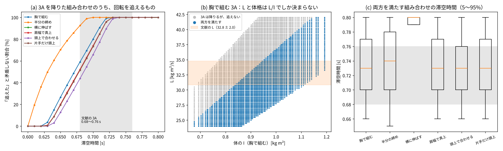

# 19. 番外編 06：論文の所見と矛盾しないパラメータの範囲（組み合わせの総当たり）

2026-11-28。番外編 05（docs/18）で、羽生結弦（2021）の論文には数値の結果がないことが分かった（F76）。
ユーザーの問い：**数字を仮定して組み合わせのパターンで振り、論文の結果と合うパラメータを推定できないか。**
途中まででもよく、生データや別の論文が手に入ったらやり直す前提。

19.1〜19.2 は**総当たりを回す前に書いて、スクリプトと一緒にコミットした**（事前登録、番外編 04 と同じ）。結果を見てから変えた点は 19.4 以降に書く。

- スクリプト：`sims/bangai06_param_scan.py`（`check`、`scan`、`summarize`、`figure`）
- 結果：`data/bangai06_*.json`、図：`figures/field/bangai06_param_scan.png`

## 19.1 振るパラメータ

| パラメータ | 範囲 | 刻み | 根拠 |
|---|---|---|---|
| 身長 | 1.60〜1.80 m | 0.02 | 男子のトップ選手の幅（本人の値は使わない） |
| 体重 | 50〜70 kg | 2 | 同上 |
| 角運動量 L | 24〜42 kg m²/s | 0.25 | 文献 32.8 ± 2.0、最大 37.5（Knoll & Hildebrand 1998）より広く |
| 滞空時間 | 0.60〜0.80 s | 0.01 | 文献の 3A 0.68〜0.76 s より広く |
| 腕の遷移時間 | 0.07, 0.10, 0.15 s | — | 番外編 03 の仮定 0.10 s の前後 |
| 腕の形 | 胸で組む、半分の締め、横に伸ばす、肩幅で真上、頭上で合わせる、片手だけ頭上 | — | 番外編 03 の姿勢 |

体は de Leva 1996 の比率を身長・体重で伸縮（靴 1.3 kg、較正の ΔI は番外編 03 のまま）。腕の形ごとに 11 × 11 × 73 × 21 × 3 = 55 万通り、全体で 330 万通り。

## 19.2 判定（論文の所見 → 数値）

| 番号 | 論文の所見 | 数値の判定 | 閾値の根拠 |
|---|---|---|---|
| C1 | 3A を 2 本跳び、非常に安定 | 空中の回転数 N = 3.43 ± 0.25 | 3.43 は番外編 03 の基準（King らの 4.9 rev/s × 0.70 s）。± 0.25 は ISU の回転不足（1/4）の幅 |
| C2 | 回転はしっかりと追えていた | ジャイロ（±2000 °/s で頭打ち）の積分で数え落とす回転 < 0.125（45°） | 45° 欠けると着氷の向きが明らかにずれる。感度として 0.05 と 0.25 も出す |
| — | 着氷の膝・回転角が怪しい、高さが取れない | 判定に使わない | 60 Hz・16 g・ドリフトの限界で、どのパラメータでも起こる（docs/18） |

計算は準静的（胴体の ω = L / I(t)）。`check` で MuJoCo の飛行と比べ、N の差 0.015 回転以内、最大 ω の差 7 °/s 以内、数え落としの差 0.007 回転以内（基準の体、L 32.8、滞空 0.70 s、4 つの腕の形）。

事前の予想（回す前に書く）：N も ω も L / I にしか依存しないので、体格と L は分けられない（縮退）。C1 で N を固定すると、最大 ω はほぼ N / 滞空時間で決まるので、腕の形はあまり区別できず、**主に滞空時間が絞られる**と予想する。これは番外編 05 の「頭上の 3A なら数え落とす」（L を固定した比較）の読み方を変える可能性がある。

## 19.3 結果

計算は 1 分 19 秒（330 万通り、準静的なのでこの環境で十分。ユーザーの PC でも回る）。

**事前の判定のまま（体・L・滞空・遷移は一様に振る）**

| 腕の形 | C1（3A を降りる）を満たす | そのうち C2（追える）も | 残った滞空（5 / 50 / 95%） | 残った L（同） | 縮退した s = L × (0.944 / I_tuck) |
|---|---|---|---|---|---|
| 胸で組む | 129566 | 61.7% | 0.66 / 0.73 / 0.80 s | 25.0 / 30.8 / 38.3 | 27.8 / 31.3 / 34.2 |
| 半分の締め | 78813 | 92.0% | 0.65 / 0.74 / 0.80 | 31.0 / 37.8 / 41.8 | 36.8 / 41.2 / 46.9 |
| 横に伸ばす | 24 | 100% | 0.79 / 0.80 / 0.80 | 41.0 / 41.6 / 42.0 | 57.2 / 58.1 / 58.6 |
| 肩幅で真上 | 124611 | 56.2% | 0.66 / 0.73 / 0.80 | 24.8 / 29.5 / 36.5 | 26.6 / 29.9 / 32.5 |
| 頭上で合わせる | 98696 | 45.6% | 0.66 / 0.73 / 0.80 | 24.3 / 27.3 / 32.8 | 23.8 / 26.7 / 28.7 |
| 片手だけ頭上 | 119676 | 54.2% | 0.66 / 0.73 / 0.80 | 24.5 / 29.0 / 35.5 | 25.9 / 29.1 / 31.5 |

C2 の閾値の感度（全組み合わせのうち両方を満たす割合、0.05 / 0.125 / 0.25 回転）：胸で組む 12.3 / 14.4 / 17.8%、頭上で合わせる 6.6 / 8.1 / 10.8%。閾値を変えても順番は同じ。

**事前の予想どおりだった点**

1. **体格と L は分けられない**（図 b）。残る組み合わせは L / I（s）の帯で、身長・体重を変えても L が一緒に動くだけ。本人の体格を論文から推定することはできない。
2. **「追えた」が一番絞るのは滞空時間**（図 a）。3A を降りた（N ≈ 3.43）なら、平均の角速度は N / 滞空時間で決まり、短い滞空ほど上限 2000 °/s を超える。胸で組む 3A では、追える割合が 50% を超えるのは滞空 0.67 s 以上、100% は 0.73 s 以上。頭上で合わせると 0.69 s と 0.74 s。**論文の所見は「滞空がおよそ 0.67 s 以上だった」ことと合う**（文献の 3A 0.68〜0.76 s と重なる）。
3. **腕の形は、ほとんど区別できない**。C1 を満たす中で C2 を満たす割合は、胸で組む 62%、頭上で合わせる 46%。どの形でも残る組み合わせがある（横に伸ばす以外）。

## 19.4 結果を見た後に加えた解析：文献の L で重みをつける

事前登録では体・L・滞空を一様に振った。結果を見て、文献の事前分布（L ~ 正規 32.8 ± 2.0、滞空 一様 0.68〜0.76 s、体は一様）で重みをつけた確率を追加した（`lit`）。**事前登録の外の解析**なので、参考として扱う。

| 腕の形 | P(3A を降りる) | P(降りて、追える) | P(追える｜降りる) |
|---|---|---|---|
| 胸で組む | 33.6% | 29.6% | 88.0% |
| 半分の締め | 14.0% | 14.0% | 99.8% |
| 横に伸ばす | 0.0% | 0.0% | — |
| 肩幅で真上 | 29.6% | 24.5% | 82.8% |
| 頭上で合わせる | 14.1% | 9.5% | 67.8% |
| 片手だけ頭上 | 26.1% | 21.1% | 80.8% |

- 胸で組む : 頭上で合わせる = 29.6 : 9.5 ≈ **3.1 倍**（ベイズ因子に相当）。ただし、その大部分（2.4 倍）は C1 から来る：文献の平均の L で頭上の形をとると回りすぎる（4.0 回転）ので、頭上の形は L が文献より低い（中央 27）ときだけ 3A に合う。**C2（「追えた」）だけの寄与は 88 / 68 = 1.3 倍で、弱い**。
- 横に伸ばす形は、文献の L では 3A に届かない（必要な L は 41 以上）。

## 19.5 誤差の整理

- **計算誤差**：準静的な式と MuJoCo の差は N で 0.015 回転、最大 ω で 7 °/s、数え落としで 0.007 回転（19.2）。格子の刻み（L 0.25、滞空 0.01 s）による判定の境目のずれは、N で 0.03 回転、滞空の閾値で ± 0.005 s 程度。
- **統計誤差**：総当たりなので乱数の誤差はない。19.4 の確率は事前分布に依存する（L の SD を 2.0 → 3.0 にすると頭上の形の重みが増える。未計算）。
- **系統誤差**（大きい順）
  1. **判定の閾値**：C1 の ± 0.25 と C2 の 0.125 は仮定。C2 は感度を出した（順番は不変）。C1 の基準 3.43 回転そのもの（King らの平均の速さ × 平均の滞空）も仮定。
  2. **ジャイロの頭打ちのモデル**：± 2000 °/s で単純に切れるとした。実機の融合アルゴリズムが補えば、C2 はもっと弱くなる（全部が「追える」に近づく）。
  3. **腕の形の候補**：番外編 03 の 6 つだけ。腕の締め具合を連続に振っていない。
  4. **L が腕の形によらない**という仮定：実際は踏み切りの技術で L も変わる。
  5. **体の比率**：de Leva の比率を伸縮しただけ。脚の長い・短いなどの比率の違いは振っていない（番外編 03 では K への影響は小さかった）。

## 19.6 まとめと、やり直すとき

- 論文の定性的な所見から言えるのは、**(1) 滞空はおよそ 0.67 s 以上、(2) 体格と L は L/I の比でしか決まらない、(3) 腕の形は弱くしか区別できない（文献の L を入れて胸で組む形が約 3 倍）**、の 3 つ。
- 生データ（胴体の ω(t)、BVH）が手に入ったら：ω が 2000 °/s で頭打ちになっている時間を見るだけで、19.3 の滞空の閾値と腕の形の判定が数値になる。`scan` の判定 C2 を「実測の頭打ちの時間との差」に置き換えて同じ総当たりを回せばよい（1 分少し）。
- 別の論文や映像で滞空時間・回転数が分かったら：C1 の基準と、滞空の範囲を差し替える。滞空が分かれば s = L/I も決まる。
- 再開の手順：`python bangai06_param_scan.py check`（検証）→ `scan`（総当たり、約 80 秒）→ `lit`（文献の重み）→ `figure`。

## 19.7 失敗の記録

| 番号 | 失敗 | なぜ | 対処 |
|---|---|---|---|
| F79 | 番外編 05 で「頭上の 3A なら約 0.54 回転数え落とすので、追えたなら普通の締めだった」と書いたが、言いすぎだった | L を固定して腕の形だけを変えて比べた。実際の選手は 3A を降りる（N ≈ 3.43）ように L を合わせるので、腕の形を変えても平均の角速度はあまり変わらない。3A を降りたという条件を入れると、「追えた」の区別の力は 1.3 倍しかない | 総当たりで N を固定した比較をした（19.3〜19.4）。docs/18 の 18.1 に注記を追加 |
| F80 | 総当たりの最初の実行で、図 (a) の「横に伸ばす」の線がほとんど出ない | 3A を降りる組み合わせが 24 通り（L 41 以上、滞空 0.79 s 以上）しかなく、他の滞空では割合が計算できない（NaN）。バグではない | そのまま残し、表に件数を書いた |
| F81 | 文献の重みづけ（19.4）は事前登録の外 | 結果を見てから、一様の振り方では腕の形の比較が L の範囲の取り方に左右されると気づいた | 事前登録の外と明記し、主な結論（19.3）と分けた |
