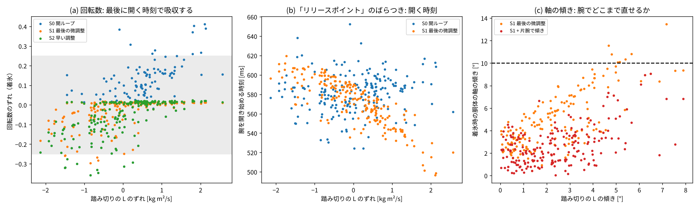

# 20. 番外編 07：踏み切りの外乱を、空中の腕の使い方でどこまで打ち消せるか

2026-11-28。ユーザーの着想：羽生さんの 3A は、桑田投手のリリースポイント（高速カメラで一番ばらついていたが、外乱を吸収して最後に微調整している可能性）や、武豊騎手のぶれないジョッキーカメラに近いのではないか。
**着目するのは制御の方法、体の止め方・固定の仕方。**

ここで確かめること：踏み切りで入ってしまったずれ（角運動量の大きさ・向き、跳んだ高さ）を、空中の腕の動かし方でどこまで打ち消して 3A を降りられるか。そして、打ち消すときに「腕を開く時刻（3A のリリースポイント）」がどうばらつくか。

20.1〜20.3 は**モンテカルロを回す前に書いて、スクリプトと一緒にコミットした**（事前登録）。`check`（計算の誤差の確認）だけは先に回した。結果を見てから変えた点は 20.5 以降に書く。

- スクリプト：`sims/bangai07_robust.py`（`check`、`run main|strong`、`summary`、`figure`）。番外編 03 の `fly` に `Lvec`（傾いた L）を足した（既定は今までと同じ）
- 結果：`data/bangai07_*.json`、図：`figures/field/bangai07_robust.png`

## 20.1 外乱と制御

**外乱**（踏み切りで決まり、空中では変えられない。体は番外編 03 の基準、L 32.8、滞空 0.70 s のまわり）

| 外乱 | 主 | 強 | 根拠 |
|---|---|---|---|
| L の大きさ δL | N(0, 1.0) | N(0, 2.0) | 2.0 は選手の間のばらつき（Knoll & Hildebrand 1998）。同じ選手の中ではその半分と仮定 |
| 滞空 δt | N(0, 0.02 s) | 同じ | 文献の 3A の幅 0.68〜0.76 s の 1/4 |
| L の向きの傾き θ0 | 半正規、σ 3° | σ 6° | 仮定（踏み切りで軸が少し傾いて入る）。方位は一様 |

**腕の制御**（空中だけ）

| 型 | 内容 | たとえ |
|---|---|---|
| S0 開ループ | いつも同じに締め（tuck）、着氷の 0.12 s 前に開く | 決めた型を毎回なぞる |
| S1 最後の微調整 | t = 0.30 s の時点で、開く時刻を選び直して回転数を 3.43 に合わせる（0.35 s〜着氷の 0.10 s 前） | 桑田型：最後に合わせる |
| S2 早い調整 | 踏み切りの直後に締めの強さ λ（0.4〜1）を選ぶ。開く時刻は S0 と同じ | 最初に合わせる |
| S3 S1 + 片腕 | S1 に加えて、片腕を頭上の方向へ a（0.25〜1）だけ、時刻 t_a（0.25, 0.35, 0.45 s）から上げて軸の傾きを直す（24 通りを試して一番よいもの） | 体の止め方 |

- S1・S2 の選び方は、選手の「体の中のモデル」として準静的な式（番外編 06）を使う。本当の結果は MuJoCo の飛行。体の中のモデルと実際の差（基準で 0.015 回転）も誤差に入る。
- 状態は**完全に分かる**と仮定（選手の感覚の誤差は入れない）。S3 の格子は MuJoCo で試すので、選手ができる上限（理想）。
- 腕で増やせる回転には上限がある（締め以上には締められない、開くのを遅らせられるのは着氷の 0.10 s 前まで）。

## 20.2 判定（事前登録）

- 回転 OK：|N − 3.43| < 0.25（ISU の 1/4 回転）
- 傾き OK：着氷時の胴体の軸の傾き < 10°（感度 5°、15°）。基準の 3A でも 2.6° ある（腕を組む姿勢の主軸のずれ）
- 成功：両方。各段階 n = 200、乱数の種 11。統計誤差は二項分布の SE。S0〜S3 は同じ外乱の組（共通の乱数）で比べる

## 20.3 仮説（回す前の予想）

- H1：最後の微調整（S1）は開ループ（S0）より成功率が高い。強い外乱で 20 ポイント以上。
- H2（桑田の型）：S1 では、開く時刻のばらつきが S0 より大きく、そのかわり回転数のずれが小さい。開く時刻と δL の相関は強い負（|r| > 0.8。L が大きいと早く開く）。
- H3：腕の非対称で直せる軸の傾きは数度まで（予想：平均 2〜4°）。強い外乱（σ 6°）では、S3 でも傾きで失敗が残る。
- H4：S2（早い調整）は L が大きいときしか効かない（締め以上には締められない）ので、S1 より劣る。

## 20.4 check（回す前に確認した計算の誤差）

- dt 2 ms と 1 ms の差：N で 3e−8 回転、傾きで 1e−7°。モンテカルロは 2 ms で回す。
- 体の中のモデル（準静的）と MuJoCo の差：N で 0.015 回転（準静的が少ない）。
- L 30.8（−2.0）では、S1 は開く時刻を上限（0.60 s）まで遅らせても 3.28 回転にしかならない。腕で回転を増やす余地は小さい。
- L の傾き 5° で、着氷の傾きは 9.0°（基準 2.6°）。

## 20.5 結果

計算は各段階 200 回で約 3.5 分（4 並列）。

**主（δL σ 1.0、傾き σ 3°）**

| 型 | 回転数のずれ（平均 ± SD） | 回転 OK | 傾き 平均 / 95% | 成功（傾き < 10°） | 開く時刻の SD | r(開く時刻, δL) |
|---|---|---|---|---|---|---|
| S0 開ループ | +0.006 ± 0.156 | 90% | 4.4° / 8.9° | 87.5 ± 2.3% | 20.1 ms | +0.11 |
| S1 最後の微調整 | −0.027 ± 0.069 | 98% | 4.6° / 9.4° | 94.0 ± 1.7% | 24.1 ms | −0.84 |
| S2 早い調整 | −0.054 ± 0.092 | 96% | 4.6° / 9.0° | 92.0 ± 1.9% | 20.1 ms | +0.11 |
| S3 S1 + 片腕 | −0.016 ± 0.036 | 100% | 2.6° / 6.2° | 100.0% | 24.1 ms | −0.84 |

**強（δL σ 2.0、傾き σ 6°）**

| 型 | 回転数のずれ | 回転 OK | 傾き 平均 / 95% | 成功（< 10°） | 開く時刻の SD | r |
|---|---|---|---|---|---|---|
| S0 | −0.005 ± 0.236 | 68% | 7.8° / 16.9° | 48.0 ± 3.5% | 20.1 ms | +0.11 |
| S1 | −0.071 ± 0.114 | 90% | 8.0° / 17.7° | 65.5 ± 3.4% | 39.9 ms | −0.89 |
| S2 | −0.098 ± 0.136 | 84% | 8.0° / 16.9° | 60.0 ± 3.5% | 20.1 ms | +0.11 |
| S3 | −0.038 ± 0.078 | 96% | 5.1° / 13.9° | 84.0 ± 2.6% | 39.9 ms | −0.89 |

傾きの閾値の感度（成功率、5° / 10° / 15°）：強で S0 28 / 48 / 62%、S1 33.5 / 65.5 / 82%、S3 60.5 / 84 / 93.5%。順番はどの閾値でも同じ。

**対応のある比較**（同じ外乱の組、McNemar 検定）

| 比較 | 主：差・p | 強：差・p |
|---|---|---|
| S1 − S0 | +6.5 pt、p = 0.004 | +17.5 pt、p = 5e−10 |
| S2 − S0 | +4.5 pt、p = 0.02 | +12.0 pt、p = 8e−7 |
| S1 − S2 | +2.0 pt、p = 0.22 | +5.5 pt、p = 0.003 |
| S3 − S1 | +6.0 pt、p = 5e−4 | +18.5 pt、p = 1e−11 |

## 20.6 仮説の判定

| 仮説 | 判定 | 根拠 |
|---|---|---|
| H1 S1 は S0 より強い外乱で 20 pt 以上よい | **部分的に支持**（向きは強く支持、量は閾値に届かず） | +17.5 pt（p = 5e−10）。届かなかった理由は 20.7（F83） |
| H2 桑田の型：開く時刻がばらつき、回転数はそろう。r < −0.8 | **支持** | 強で開く時刻の SD 20 → 40 ms（2 倍）、回転数の SD 0.236 → 0.114（半分）、r = −0.89（主 −0.84） |
| H3 腕の非対称で直せる傾きは数度まで、強では傾きの失敗が残る | **支持** | S3 で減った傾き 平均 2.0°（主）、2.9°（強）、最大 約 8°。強の S3 の失敗 32 回のうち 25 回は傾き（初期の傾き 7.8〜15.8°） |
| H4 S2 は S1 より劣る | **支持**（強のみ有意） | 強 +5.5 pt（p = 0.003）、主 +2.0 pt（p = 0.22） |

**読み取り**

1. **「最後に合わせる」は、結果をそろえるかわりに途中の動きをばらつかせる**。開く時刻（3A のリリースポイントに当たる）のばらつきが 2 倍になり、着氷の回転数のばらつきが半分になる。ユーザーの桑田投手のたとえ（リリースポイントが一番ばらついているのに結果がそろう）と同じ形が、3A のモデルで再現した。映像で開く時刻のばらつきと L（踏み切りの速さ）の相関を測れば、この型を検定できる。
2. **腕で回転を「減らす」のは簡単だが「増やす」のは難しい**。締め以上には締められないし、開くのも着氷の直前までしか遅らせられない。S1 で回転が足りずに失敗したのは、ほとんどが L が小さい（−1.1 〜 −4.3）か滞空が短いとき。足りない回転は踏み切りで作るしかない。
3. **軸の傾きを直すのが一番効く**（強で +18.5 pt）。片腕を頭上の方向に上げると、体の主軸が胴体からずれて、傾きを 平均 3° 打ち消せる。番外編 03・04 の「片腕ずつ上げる」と同じ動き。ただし 8° を超える傾きは直せない。体の止め方としては「早めに（t_a = 0.25〜0.35 s が 7 割）、大きく（量 0.84〜0.89）片腕を使う」が選ばれた。

## 20.7 誤差の整理

- **統計誤差**：成功率の SE は 1.7〜3.5 pt（二項分布、n = 200）。比較は共通の乱数で対応をとった McNemar 検定。種を変えた再実行はしていない（未）。
- **計算誤差**：dt 2 ms と 1 ms の差は無視できる（20.4）。体の中のモデル（準静的）が MuJoCo より 0.015 回転少ないので、S1 は回転を少し多めに足りなくする方向にずれる（S1 の平均のずれ −0.027 の一部）。
- **系統誤差**（大きい順）
  1. **状態が完全に分かる仮定**：選手の感覚の誤差・遅れを入れていない。S1・S3 は上限。とくに S3 は 24 通りを実際に試して一番よいものを選んでいる（理想）。
  2. **外乱の大きさ**：同じ選手の中の δL（主 1.0）と傾き（3°、6°）は仮定。文献の値がない。
  3. **腕の制御の種類**：開く時刻・締めの強さ・片腕の 3 つだけ。脚（足を組む・ほどく）、首、肩の上げ下げは入れていない。脚は質量が大きいので、実際にはもっと効く可能性が高い。
  4. **着氷の判定**：|ΔN| < 0.25 と傾き < 10° は仮定。着氷の衝撃・エッジでの吸収（着氷後の微調整）はモデル外。
  5. **体は 1 人分**（de Leva の基準）。

## 20.8 失敗の記録

| 番号 | 失敗 | なぜ | 対処 |
|---|---|---|---|
| F83 | H1 の「20 pt 以上」に届かなかった（+17.5 pt） | 予想のときに、腕で回転を増やす余地が小さいこと（L が小さいと S1 でも直せない）と、傾きの失敗は S1 では直らないことを見積もっていなかった。強の S1 の失敗 69 回のうち、回転で落ちたのは 21 回だけ | 判定は「部分的に支持」のまま。閾値は動かさない。失敗の内訳を 20.6 に書いた |
| F84 | 作業ブランチへの push が拒否された | 前の PR（#34）をスカッシュでマージしたので、リモートのブランチに古いコミットが残っていた。強制 push は使えない | リモートのブランチをマージしてから push。古いコミットに 65 MB のファイル（F82）が含まれるので、この PR もスカッシュでマージする |
| F85 | S1 の回転数のずれに負の偏り（主 −0.027、強 −0.071） | 体の中のモデルの偏り（−0.015）と、L が小さいときの上限（回転を増やせない）。0 にそろうはずという直感と違った | 偏りの内訳を 20.7 に書いた。体の中のモデルを MuJoCo に合わせて較正するのは次の課題 |

## 20.9 次にやること

- 選手の感覚の誤差と遅れを入れる（S1 の判断の時刻を遅らせるほど情報は良くなるが、使える時間が減る、という釣り合い。桑田投手の「最後の微調整」の最適な時刻）。
- 脚の制御を入れる。
- 映像：同じ選手の 3A を何本も見て、腕を開く時刻のばらつきと、踏み切りの速さ・着氷の向きの相関を測る（H2 の実測での検定）。
