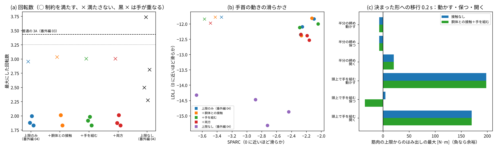

# 22. 番外編 08：体との接触と手を組む力を入れて、肩の上限のブラインド解析をやり直す

2026-11-28。番外編 04（docs/17）では、文献の肩・肘の筋力と可動域を上限にすると、最良でも 1.99 回転で普通の 3A（3.43）に届かなかった（F72）。
その読みは「**実際の 3A では、腕を胸に押し付ける・手をつかむといった接触が、腕を保つ力の大部分を担っているはず**」だった。ユーザーの順番（2 → 資料作成 → 3 → 4 → 1）の 2 番目として、これを同じ事前登録の手順で確かめる。

22.1〜22.4 は**最適化を回す前に書いて、スクリプトと一緒にコミットした**（事前登録）。`check`（計算の確認）だけは先に回した。結果を見てから変えた点は 22.5 以降に書く。

- スクリプト：`sims/bangai08_contact_blind.py`（番外編 04 の `Problem` を引き継ぎ、筋力の制約の中身だけを変える）
- 結果：`data/bangai08/*.json`、図：`figures/field/bangai08_contact_blind.png`

## 22.1 変えること・変えないこと

**変えないこと**（番外編 04 と同じ）：目的（回転数の最大化、腕の形は指定しない）、変数（肩 3 軸 + 肘 × 9 節点、左右対称で 36 変数）、初期値（可動域の中の一様乱数）、解き方（2 段：違反の最小化 L-BFGS-B 80 反復 → SLSQP 150 反復）、乱数の種 11〜14、筋力と可動域の上限（docs/17 の 17.2）、傾きの制約、滑らかさの指標（17.4）。

**変えること**：必要な関節トルク τ_req（逆動力学）のうち、接触の力が担える分を引いた残りを筋肉のトルクとし、それを上限で判定する。

τ_m = τ_req − Σ_p J_pᵀ f_p

各時刻で、接触の力 f_p を「筋肉のトルクの上限からのはみ出しの最大」が最小になるように線形計画で選ぶ（選手が接触を一番うまく使うとした上限）。接触は体の中の力なので、全体の角運動量は変えない。

| 接触 | 条件（いつ使えるか） | 力の向き・大きさ | 根拠 |
|---|---|---|---|
| 胴体 | 腕の 7 点（上腕 3・前腕 3・手 1）のうち、胴体のカプセルの表面から 1 cm 以内の点 | 外向きの法線（押すだけ）と摩擦 μ = 0.5（四角錐で近似）。上限 2000 N（数値の箱） | μ は皮膚と布の目安（仮定） |
| 手を組む | 左右の手の中心が 3 cm 以内に近づく（手の中心の y ≤ 0.055 m） | 左右対称なので左右の向き（y）だけ。引く・押すの両方、≤ 220 N | 成人男性の握力 約 45 kg の約半分（指を組んで引き離す力は握力より小さいと仮定） |

新しく加える制約：左右の手が中心線を越えて重ならない（手の中心の y ≥ 0.04 m）。左右対称のモデルでは、手が中心線を越えると左右の腕が重なる（物理的にありえない）。番外編 04 の上限ありの解はすべて満たしている（手の中心の y の最小 0.14〜0.32 m）。

**条件**：contact（胴体との接触）、clasp（手を組む）、both（両方）。それぞれ種 11〜14 の 4 本、計 12 本。対照は番外編 04 の limited（同じ種・同じコードなので再実行しない。`check` で同じ値になることを確認済み）。

## 22.2 回す前に気づいたこと（モデルの性質）

- **胴体との接触は、遠心力に逆らえない**。接触の力は胴体から外向き（押すだけ）で、遠心力も軸から外向きなので、同じ向きになる。胴体との接触が役に立つのは、筋肉が腕を内へ押し付けすぎる場面（例えば内転のトルクの上限）くらいのはず。
- **手を組むと、左右の腕が 1 つの輪になる**。輪の張力で遠心力を受けられる。ただし左右対称なので力は左右の向きだけで、手が体の前（x の向き）にあるときの前向きの遠心力は受けられない。頭上で手を組むときに一番効くはず。
- 実際の 3A の締め（腕を胸の前で交差させる）は、左右対称のモデルでは作れない（交差すると鏡像の腕が重なる）。これは系統誤差として残る（非対称の最適化は 72 変数で、計算時間が倍になる）。

## 22.3 仮説（回す前の予想）

- H1（主）：both で、最良の解が 3A に届く（実行できる解の回転数の最大 ≥ 3.25 = 3.43 − 1/4）。H0：番外編 04 と同じく 2 回転前後にとどまる。
- H2：胴体との接触だけ（contact）では、ほとんど変わらない（limited との差 < 0.3 回転）。22.2 の理由による予想。
- H3：手を組む（clasp・both）と、腕が頭上で手を組む形が現れる（17.4 の分類で「頭上」）。
- H4（番外編 04 の H1 の続き）：接触があっても、上限ありの方が上限なし（番外編 04 の free）より滑らか（17.4 の判定の決まりのまま）。

## 22.4 判定の決まり

- H1：4 本のうち実行できる解の回転数の最大が 3.25 以上で「支持」。そのうえ中央値も 3.0 以上なら「強い支持」。最大が 2.5〜3.25 なら「部分的」、2.5 未満なら「支持しない」。
- H2：contact の実行できる解の平均と、limited の平均（1.90）の差が 0.3 回転未満なら「支持」。
- H3：clasp・both の実行できる解のうち、半分以上が「頭上」なら「支持」。
- H4：docs/17 の 17.4 と同じ（SPARC・LDLJ の両方で 2σ を超えて free より滑らかなら支持、片方なら弱い支持）。比べるのは both と free。
- 回転数の比較の誤差は、番外編 04 と同じく種のばらつき（局所解）が主と予想する。計算時間は 1 本 45〜160 分と見込む（接触のある時刻だけ線形計画を解くので、番外編 04 の 2〜3 倍。F75 の教訓から先に書いておく）。

## 22.5 事前登録からの変更（結果を見る前）

1. **途中経過の保存**（F87）：最初の実行（12 本を 4 並列、環境から切り離して起動）は、1 時間後に実行環境が再起動して、結果を 1 本も残さずに消えた。
   最適化の中身は変えずに、実行できる点で回転数が最大のものを評価のたびに `data/bangai08/<条件>_<種>_partial.json` に保存するようにし、条件ごとに 4 本ずつ、環境が見張る形で回し直した（both → clasp → contact の順）。
   1 本の計算が 2 時間を超えて止められた場合は、途中経過の最良を「打ち切り」として扱い、そう明記する。
2. **打ち切り**（F88）：contact の種 12 は、2 時間の上限で止められ、実行できる点を 1 つも見つけていなかった（途中経過のファイルもなし）。「打ち切り、実行できる解なし」として数える。回し直していない。

## 22.6 結果（ブラインドを外したあと）

計算は 1 本 58〜110 分（打ち切りの 1 本を除く）、全体で約 5 時間半（4 並列 × 3 回）。数値は `data/bangai08_summary.json`、図は `figures/field/bangai08_contact_blind.png`。
判定（`metrics`）を実行してから、腕の形を見た。

| 条件 | 実行できた解 | 回転数（実行できた解） | 最大 | 腕の形（17.4 の分類） | 接触を使った時間 | 手を組んだ時間 |
|---|---|---|---|---|---|---|
| limited（番外編 04、対照） | 3 / 4 | 1.88、1.99、1.83 | 1.99 | すべてその他 | — | — |
| contact | 2 / 3（1 本打ち切り） | 2.01、1.83 | 2.01 | すべてその他 | 0% | — |
| clasp | 3 / 4 | 1.91、1.98、1.83 | 1.98 | すべてその他 | — | 0% |
| both | 3 / 4 | 1.87、2.01、1.83 | 2.01 | すべてその他 | 0% | 0% |

**22.4 の判定**

| 仮説 | 判定 | 根拠 |
|---|---|---|
| H1 both で 3A に届く | **支持しない** | 最大 2.01 回転（limited 1.99 と同じ） |
| H2 胴体との接触だけではほとんど変わらない | 支持 | contact の平均 1.92、limited 1.90、差 0.02 |
| H3 手を組むと頭上の形が現れる | **支持しない** | 実行できた解はすべて「その他」（腕を横に広げたまま） |
| H4 上限ありは上限なしより滑らか | 弱い支持（LDLJ 5.1σ、SPARC 1.4σ） | 番外編 04 と同じ。ただし比べた上限なしの解は手が重なっていた（F86） |

**なぜ伸びなかったか**

1. **最適化は接触も手を組む力も一度も使わなかった**。実行できた解はすべて、接触の時間・手を組んだ時間が 0 で、接触の力なしで評価しても筋肉の余裕は同じだった。同じ乱数の種から始めると、limited と同じ局所解（腕を横に広げたまま、回転数の差 0.02 以内）にたどり着く。接触は腕が体に近いとき、手を組む力は手が中心線に近いときだけ働くので、そこから遠い局所解の周りでは勾配に現れない（F89）。効いている制約は番外編 04 と同じく肘の屈曲の力と肘の可動域だった。
2. **結果を見た後の診断（事前登録の外）**：番外編 03 の決まった形へ 0.2 s で腕を動かし、保ち、開くときの、筋肉の上限からのはみ出しを区間ごとに計算した（`phase`、図 c）。

| 形 | 動かす | 保つ | 開く |
|---|---|---|---|
| 頭上で手を組む、接触なし | +198 N·m | +4.7 | +170 |
| 頭上で手を組む、接触＋手を組む | +198 | **−34.7（余裕）** | +170 |
| 半分の締め、接触なし・あり | −7.4（余裕） | −7.4 | +21 |

（移行 0.3 s でも頭上は動かす +179、開く +132。移行 0.1 s では +527、+416）

**手を組めば、頭上で腕を保つのは文献の筋力の範囲に入る**（はみ出し +4.7 → 余裕 34.7 N·m）。番外編 04 の「接触が保つ力の大部分を担うはず」という読みは、保つことについては正しかった。
しかし**回転中に腕を頭上へ動かす・頭上から開く**のは、接触があってもなくても 130〜200 N·m 足りない。手は動いている途中ではまだ組めず、胴体との接触は遠心力に逆らえない（22.2 の予想どおり）。
つまり難しいのは**保つことではなく、回転中に動かすこと**で、番外編 03 の「回転が遅い踏み切りの間に腕を上げておく」が、文献の筋力で頭上の 3A をする唯一の道として残る。これを確かめるには、踏み切り（氷の上で L を作る間）のモデルが要る。

## 22.7 誤差の評価

- **統計（最適化の初期値）**：種のばらつきは limited と同じ（± 0.08 回転）。最適化の誤差（局所解）が支配的で、22.4 の H1 の否定は「この最適化の方法では見つからなかった」という意味にとどまる。頭上で手を組む形を初期値にすれば違う答えが出る可能性があるが、それはブラインドの外になる。
- **計算**：接触のある時刻の線形計画は 4 ms ごと（`muscle_torque` の注。奇数の刻みは判定から外す）。最適化の解は接触を使っていないので、この間引きは解に影響しない。区間ごとの診断（`phase`）も同じ間引きで、2 ms で計算し直した確認はしていない（未）。線形計画の失敗は全体で 0 回。
- **系統**：(a) 接触の力の上限・摩擦（μ 0.5）・手を組む力（220 N）は仮定。ただし解は接触を使っていないので、結果はこれらによらない。(b) 左右対称なので、腕を胸の前で交差させる普通の締めは作れない。(c) 接触の判定の幅 1 cm。(d) 筋力は角度・速さによらない一定の上限。

## 22.8 うまくいかなかったこと

| 番号 | 試したこと | 起きたこと | 原因 | 直し方・扱い |
|---|---|---|---|---|
| F86 | 番外編 04 の上限なしの解を「頭上を答えを見ずに再発見した」と書いた | 上限なしの 4 本はすべて手の中心が中心線から 4 cm 未満で、最良（3.73 回転）を含む 2 本は左右の手が 0.12〜0.22 m 重なっていた | 番外編 04 には左右の手が重ならない制約がなかった | docs/17 に注記。上限なしの最良の回転数と、H1・H4 の滑らかさの比べる相手は、物理的にありえない解を含む |
| F87 | 12 本を実行環境から切り離して起動 | 1 時間後の環境の再起動で、結果を残さず消えた | 長い計算を環境が見張っていなかった。結果は 1 本の最後にしか保存していなかった | 途中経過の保存を加え、環境が見張る形で条件ごとに回した（22.5） |
| F88 | contact の種 12 | 2 時間の上限で打ち切り、実行できる点なし | 1 本 58〜110 分の見込みの上の端を超えた | 打ち切りとして数えた |
| F89 | 接触と手を組む力を入れて、同じ種・同じ最適化で回す | 接触も手を組む力も一度も使われず、解は番外編 04 とほぼ同じ | 局所的な最適化は、接触が効く領域（腕が体・中心線に近い）に入らない。しかも回転中の移行は接触があっても筋力を超える | 区間ごとの診断で、保つのは手を組めば可能、動かすのが不可能と切り分けた。次は踏み切りのモデル、または大域的な探索 |

## 22.9 まとめと次

- 体との接触・手を組む力を入れても、文献の筋力で空中だけで 3A の腕を作ることはできなかった（最大 2.01 回転）。
- 手を組めば頭上で腕を**保つ**ことはできる。足りないのは回転中に腕を**動かす**力（130〜200 N·m）。
- 「止める・保つ制御の質」（docs/21）に、**動かすタイミング（回転が遅いうち）**という条件が加わった。保つのは接触で、動かすのは踏み切りの間に。
- 次：踏み切りのモデル（氷の上で L を作りながら腕を上げる）。これは次の候補 3（感覚の誤差と遅れ）・4（サーボの遅れ）と同じく、「いつ動かすか」の問題につながる。
