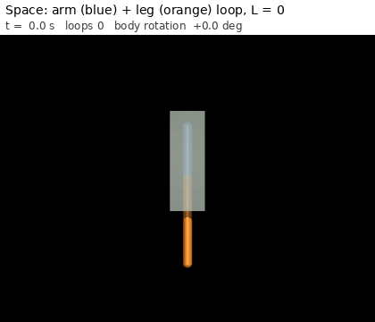
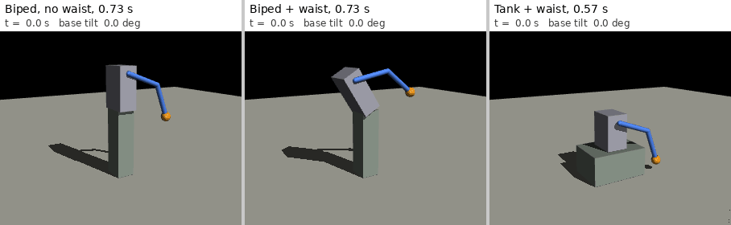
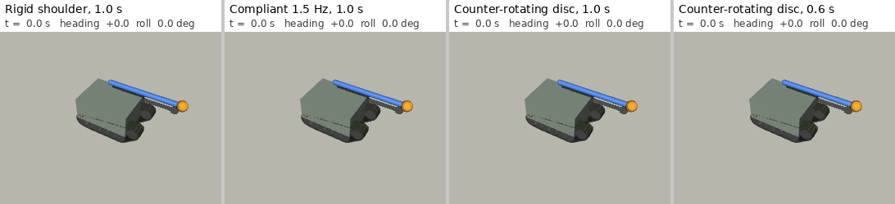

> This is the entry point (overview) of a series. The results are in the [next article](TODO), and the math, error analysis and failure log are in the [book (Japanese, on Zenn)](TODO). All code and numbers are public on [GitHub](https://github.com/okamasaya/simulation_AMBAC).

## Abstract

Developing **physical AI** (AI that has a body and acts in the real world) runs into well-known walls: expensive hardware, the sim-to-real gap, learning that does not know physics and gets stuck, and calibrating the real machine.
In this series I ask how far **cheap simulation that runs on an ordinary PC's CPU** can go against these walls, **without a real robot and without the GPUs that high-fidelity simulators assume**. As the test bed I use **AMBAC** (Active Mass Balance Auto Control) from *Mobile Suit Gundam*: changing the body's attitude by the reaction of swinging the limbs.

Three findings:

1. **AMBAC is physically sound.** Even in space, where angular momentum is conserved, moving the limbs "in a loop" lets the body turn to any angle (a geometric phase). Because of the square–cube law, however, an 18 m machine needs about two minutes to turn 90°.
2. **Learning can discover AMBAC, but it needs structure.** A policy given only a reward fell into a local optimum that swings the limbs to the joint limit and stops. Given the structure of "an oscillator that draws a loop", it reached 98 % of the theoretical upper bound and beat a hand-designed controller.
3. **A "virtual robot with hidden answers" lets you design the calibration procedure before you have hardware.** From the body's wobble alone, the hidden limb masses and inertia were recovered with about 1.2 % scatter per trial. And the "≈2 % error" seen along the way turned out to come **not from the estimator but from the virtual robot's own first-order integrator**. Switching it to RK4 brought the noise-free error below 0.08 %.

Cheap simulation is no substitute for a real machine. But it is **a tool for deciding what to bring to the real machine** (which structure to give the learner, how to split work between learning and control, which calibration values to measure). That is the claim of this series.
Next, I will check whether my simulator matches reality with a real rigid body (a 1 m aluminum bar) and the IMUs of two iPhones (side story).

*Space test field: looping an arm and a leg turns the body little by little, though nothing pushes it from outside (rendered with MuJoCo)*

---

## Introduction

### What is AMBAC?

AMBAC is a concept said to have been introduced as science-fiction background ("SF kōshō", the fan culture of rigorously examining a story's technology) in the 1981 book *Gundam Century*, which supported the world of *Mobile Suit Gundam* (1979).
It was one of the reasons given for why the mobile suits are humanoid: "in space, you can change your orientation by the reaction of swinging your arms and legs, without using propellant".

This is not made up. An object free of external forces conserves angular momentum, so swinging an arm to the right turns the body to the left.
Kane and Scher studied how astronauts can reorient themselves with limb motions in 1970, and the same pair explained how a falling cat twists in mid-air to land on its feet.
In 2025, the Japanese astronaut Takuya Onishi mentioned AMBAC when he controlled his attitude with his legs aboard the International Space Station, and Gundam fans loved it.

But some naive questions come up right away.

- Swinging an arm turns the body the other way. But **when you bring the arm back, doesn't the body come back too?**
- Even if a human can turn, can an **18-meter giant robot** do the same?
- Wouldn't you **fall over** if you tried this on the ground?
- Is the famous line "the legs are just decoration" actually true?

### The starting question

Starting from AMBAC and robot anime and games, this repository asked one more question:

> **Is walking on two legs really well balanced? Why do humans have two legs?**

In anime, humanoid machines stand and fight on two legs as a matter of course. But putting a high center of mass on top of the narrow support of two soles is obviously unstable in a static sense.
Yet humans stand on two legs, carry loads and climb steps. I decided to check the reasons seriously, in the language of rigid-body mechanics, geometric mechanics, control theory and machine learning.

Spoiler: **statically, bipedal balance is poor.** Just holding a 10 kg load at the end of the arm makes the biped fall over, even while standing still.
It can still stand because of **active balance using a heavy, movable upper body** (bending the waist back or forward, the "hip strategy", which is a ground version of AMBAC), and because of **how well legs handle steps at human size**.
When you change the conditions (space, flat ground, steps; human size, giant size), which shape wins keeps changing. The conclusion of stage 1 was that **you need to choose the shape for the purpose**, like "assembling" a machine from parts in the *Armored Core* games.

### Why use AMBAC as a test bed?

The other motivation is more practical.

Developing physical AI, that is, AI with a body that acts in the real world like a robot, faces well-known walls.

| Wall | What it means |
|---|---|
| Expensive hardware | Every trial risks breaking things and costs time |
| Sim-to-real gap | A policy learned in simulation does not work on the real machine |
| Exploration and structure | Learning with only a reward does not know the physical structure and falls into local optima |
| Calibration (system identification) | Which test, and with what accuracy, measures the values that bridge simulation and reality: mass, inertia, friction, motor characteristics |

Large-scale GPU simulation is a strong way to brute-force the sim-to-real gap. But it is out of reach for individuals without computing resources.
I **don't own a single real robot, nor a latest-generation GPU.** Every calculation was done on an ordinary PC (and cloud CPUs).

So I turned the question around:

> **What can cheap, CPU-only simulation answer about the problems of physical AI, and what can it not?**

AMBAC is a very convenient test bed for this question.

- **There is a single basic equation.** For a machine free of external forces, the body's orientation θ and the joint angles q are related by θ̇ = −Γ(q)·q̇, and that's it.
- **The answers can be computed separately.** The optimal loop shape and the theoretical upper bound within the joint limits can be found independently of learning, so learning and calibration results can be "checked against the answer key".
- **It contains a difficulty that is essential for learning.** The net rotation comes only from the "order and combination" of motions (a nonholonomic system), so naive learning does not work.

In other words, AMBAC is both **a romance for Gundam fans** and **a small, honest test bed on which physical-AI methods can be checked against known answers**.
In this series, the technology is the backbone, and AMBAC and Gundam appear when I talk about *why* I want to check things.

### My position, and the attitude of this series

This is a personal investigation, not my day job's research. That's exactly why I care about two things.

- **Evaluate the errors.** Numbers come with statistical error (scatter between trials), computational error (numerical accuracy) and systematic error (bias from assumptions or instrument quirks), separately. That is how particle-physics experiments do it. A latecomer can only stand out by being scientifically right and doing what others haven't.
- **Record the failures.** I keep not only what worked but also what didn't, and why. If I fail in the same way as earlier research did, that is evidence that my hypotheses and logic follow the same path, and it gives me a foothold to catch up.

---

## What I did (summary)

Details are in the [next article](TODO) and the book. Here is only the overall flow.

### Stage 1: shapes and what they mean (Python, Sim01–10)

I wrote simple models made of rigid links in Python and studied what the shape of a machine means for attitude control, stability and mobility, in space and on the ground.

- **The physics of AMBAC**: Swinging one arm back and forth turns the body by −16.04°, then it returns (reversible). Looping two joints, an arm and a leg, turns the body by +2.98° per cycle, matching the area integral of the "curvature" enclosed by the loop (Stokes' theorem). A reaction wheel is a special case of AMBAC; that AMBAC cannot stop a rotation and that a wheel saturates its momentum are the same phenomenon.
- **The wall for giant robots**: The torque needed grows with the 5th power of size, while the torque a geometrically scaled motor can deliver grows with the 3rd power, so AMBAC's speed falls inversely with size.
- **Learning**: Only the policy given the structure of "an oscillator that draws a loop" succeeded.
- **On the ground**: Swinging the arm fast tips the cart over by reaction, and the safe minimum time scales with √(size / gravity) (Froude scaling). A human-sized biped climbs steps more than twice as high as a tank-type machine, but this reverses at 18 m.
- **The 3D shoulder**: "Codman's paradox" of the human shoulder is the same geometric phase as AMBAC. Folding the arms needs a 3-DOF shoulder including twist, plus a shoulder blade.

### Stage 2: testing assembled shapes in a simulation field (MuJoCo, steps 1–17)

I built a "test field" and "stages" inside the PC (like the practice mode of a fighting game) and used the MuJoCo physics engine to assemble machines from a parts list (JSON) and move them.

*Without a waist, the biped cannot carry the load. Even with one, the tank-type with the same waist is about 30 % faster*

- **Validating the simulator itself**: Before moving on, I checked that the stage-1 Python equations and MuJoCo agree: −16.0356° vs −16.0356° for the arm swing, +2.963° vs +2.970° for one loop.
- **What disturbs the body is *stopping* the arm**: On the ground, the friction under the machine absorbs the arm's reaction up to the torque at which the body starts to rotate. What pushed it past that threshold was the sudden braking caused by the lag of the position servo.
- **Ground AMBAC**: Using the asymmetry of friction, just "swing fast, return slowly" with the arm changes the heading of the body.
- **Separate the functions**: Moving with a motor and stopping/holding with an MR-fluid brake improved speed, precision, energy use and holding without power, all at once. That this seems to follow the same order as the in-universe "magnet coating" and "movable frame" is, personally, the part that excited me most (I keep it as a suggestion only).

*Stiff shoulder / compliance / counter-rotating weight: the body turns when the stopping reaction exceeds the friction threshold*

### Calibration: a virtual robot with hidden answers, and error analysis

Since I have no real robot, I built a **"virtual robot" whose masses and inertia are secretly shifted**, and hid the true values from the estimator. Gyro and encoder readings are simulated with noise, and the task is to recover the hidden values from the body's wobble.

At first the result was "≈2 % error". But I noticed that all 5 trials were on the plus side, and when I re-evaluated statistical, computational and systematic errors separately:

- a bias of +1.2 to +1.8 % remained even with all noise removed,
- the bias was proportional to MuJoCo's time step,
- and the cause was that **the first-order integrator (`implicitfast`) of the virtual robot built from the parts list slightly broke L = 0**.

With RK4, the noise-free error dropped below 0.08 %, and over 50 trials the bias was no longer significant (scatter per trial 1.2–1.4 %).
It also turned out that the absolute values follow the total-mass assumption one-to-one (a ±2 % assumption gives a ±2 % systematic error).

I then brought the **kinematic fit** from particle physics (refitting the measurements themselves under physical constraints) to calibration. The per-estimate error σ was estimated correctly (pull with mean 0 and standard deviation 1), and sequential updates adding one loop at a time shrank σ from 1.8 % to 1.0 %.
However, the integrator's systematic error did not show up in χ². **A good fit does not guarantee the absence of systematic error** — that was a lesson too.

---

## Where things stand

- **Stage 1 (shapes and meaning) is complete**, written up as technical reports of 87 and 159 pages (Japanese).
- **Stage 2 (simulation field) has reached step 17**, with a prototype of the calibration error analysis and of calibration by kinematic fit.
- I also wrote a letter paper for AI researchers (Japanese, two columns, about 5 pages) and a mook-style SF commentary.
- **Nothing has been compared with reality yet.** Many numbers rely on assumed part values.

## What's next

- **Side story: test the home-made simulator with a real rigid body and IMUs.** Attach two iPhone SE (3rd gen.) to a 1 m aluminum angle (20 × 20 × 2.0 mm, about 204 g) and record acceleration and gyro with phyphox. Obtain the moment of inertia from the pendulum period, and compare with the simulator's predictions that, when rotated, "the two phones see the same angular velocity, and the centripetal acceleration is proportional to the distance from the axis".
- **Extend calibration to ground machines**: add servo lag and friction calibration values to the kinematic fit, and add external information that pins down the hard-to-estimate directions (weighing the total mass, joint torques) as constraints.
- **Implement the split between learning and optimal control**: a hybrid where optimal control plans and a learned policy corrects at run time.
- **Make the simulator usable by anyone**: someday I'd like to publish this simulator, which assembles machines from a parts list and tests them, as a PyPI package.

---

## How to read this series

| If you want | Go to |
|---|---|
| What I did and what I found (results and figures) | Article "What I did, where things stand, and what's next" (TODO: link) |
| Everything, including math, error analysis and failures | Book (Japanese, Zenn) (TODO: link) |
| Testing with a real rigid body and iPhones | Side story (TODO: link) |
| Code, numbers, technical reports | [GitHub: okamasaya/simulation_AMBAC](https://github.com/okamasaya/simulation_AMBAC) |

Science-fiction settings that fans have seriously examined are a treasure trove of testable hypotheses. Everything is public, so if you find a mistake, please tell me.

## References

- *Mobile Suit Gundam* (TV anime, 1979, Nippon Sunrise)
- *Gundam Century* (Minori Shobō, 1981); said to be where the AMBAC concept was first presented as SF background
- T. R. Kane and M. P. Scher, "Human self-rotation by means of limb movements," *J. Biomechanics*, 3(1), 39–49, 1970.
- T. R. Kane and M. P. Scher, "A dynamical explanation of the falling cat phenomenon," *Int. J. Solids and Structures*, 5(7), 663–670, 1969.
- E. Todorov, T. Erez, Y. Tassa, "MuJoCo: A physics engine for model-based control," *IROS*, 2012.
- Article introducing Takuya Onishi's mention of AMBAC (Japanese): https://www.oricon.co.jp/news/2385521/full/
