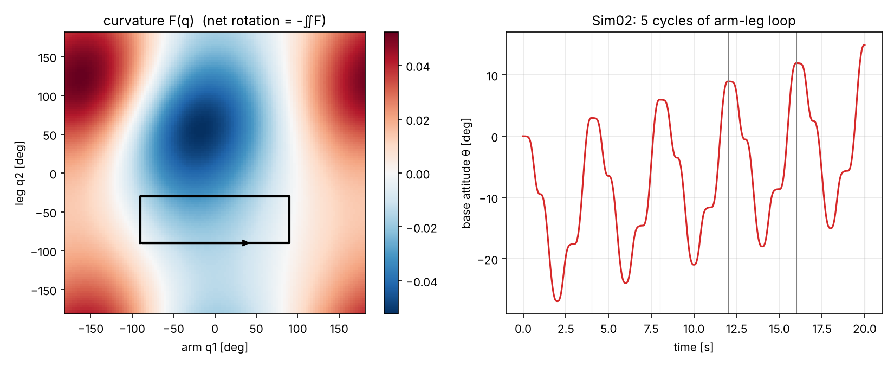
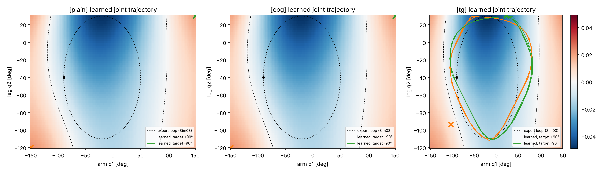
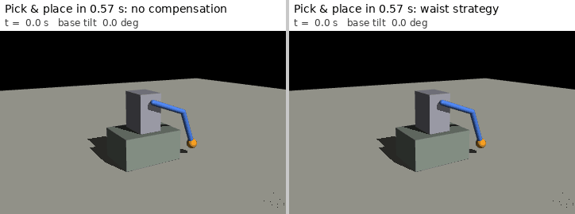
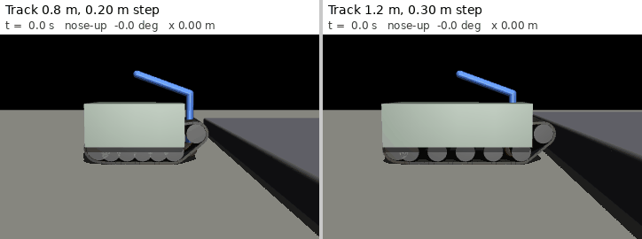
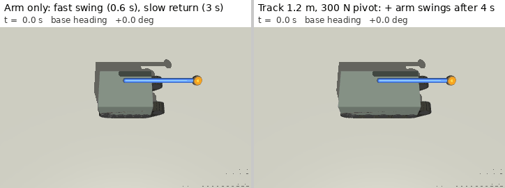
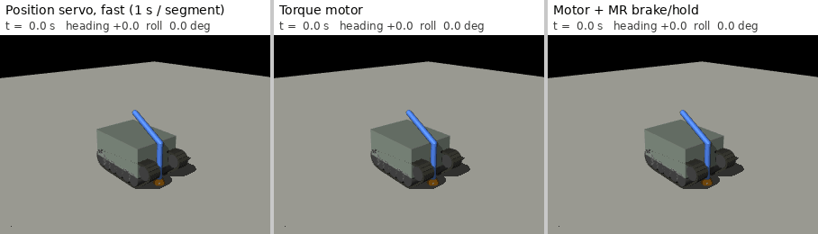
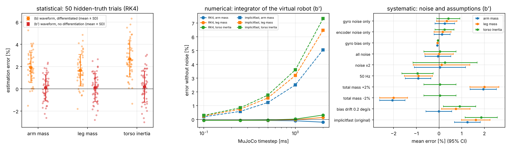
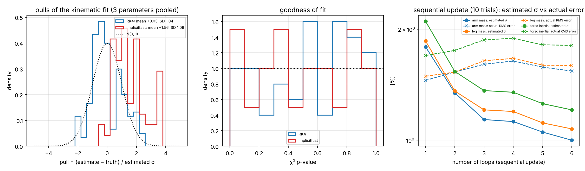

> Second article of the series. Motivation and big picture are in the [entry article](TODO); derivations, detailed error analysis and the failure log are in the [book (Japanese)](TODO). Code and numbers are on [GitHub](https://github.com/okamasaya/simulation_AMBAC).

Using AMBAC (changing attitude by the reaction of the limbs) as a test bed, this article reports, results first, **how far CPU-only cheap simulation could answer three problems of physical AI: (1) exploration and structure, (2) model error, (3) calibration**. At the end I summarize where things stand and the plan.

| Problem of physical AI | Role of cheap simulation | Result on AMBAC |
|---|---|---|
| Exploration does not know the physical structure | Predict the cause of failure from the physical structure and choose the structure to give the policy | No structure: error 50–120°. Oscillator structure: 98 % of the theoretical upper bound |
| Model error and disturbances | Compare learning and optimal control under the same conditions and decide who does what | Learning: error 0.09° (open-loop optimal control: 30.5°). Optimal control wins at planning propellant |
| Calibrating the real machine | Decide the estimation procedure and what to measure on a virtual robot with hidden answers | ~1.2 % scatter per trial, no significant bias. The ~2 % bias came from the virtual robot's integrator |

---

## 1. The test bed: the basic equation of AMBAC

For a planar multibody system with no external force, with body angle θ and joint angles $\bm q$, the total angular momentum can be written

$$
L = A(\bm q)\,\dot\theta + \bm B(\bm q)\cdot\dot{\bm q}.
$$

Starting from rest, $L = 0$, so

$$
\dot\theta = -\bm\Gamma(\bm q)\cdot\dot{\bm q},\qquad \bm\Gamma = \bm B / A
$$

is the basic equation of AMBAC. $\bm\Gamma$ is called the "mechanical connection" in geometric mechanics and has these properties:

- **No time in it**: the rotation depends **only on the path** of the joints, not on speed. Slow or fast, the body turns by the same amount.
- **Reversible with one joint**: bring the arm back, and the attitude comes back. Swinging one arm 180° and back turns the body by up to −16.04°, ending at 0°.
- **Net rotation with a loop of two or more joints**: going once around a closed curve $C$ in joint space gives, by Stokes' theorem,

$$
\Delta\theta = -\oint_C \bm\Gamma\cdot d\bm q = -\iint_S F\,dq_1\,dq_2
$$

($F$ is the curvature of the connection). This is a **geometric phase**; repeat it and you can turn to any angle. For a human-sized arm-and-leg model it is +2.98° per cycle, matching the Stokes value.

Back in Gundam language, the answer to "won't the body come back when the arm comes back?" is: **with one arm, yes; draw a loop with two or more limbs, and no.** Falling cats and astronauts do exactly this.

*Each arm–leg loop turns the body by a fixed angle (Sim02)*

### The giant-robot wall: the square–cube law

The rotation angle does not depend on scale, but **speed** does. For a machine scaled geometrically by s, the torque needed to swing the arm with the same angular acceleration grows as $s^5$, while the torque a geometrically scaled motor delivers grows as $s^3$. You can only swing more slowly by the missing amount, so AMBAC's speed falls as $1/s$. **An 18 m machine needs about 2 minutes to turn 90°**, and to be agile it would need about 170 times the torque of geometric scaling.

### Restated in AI terms

AMBAC is a task in which "the effect of an action (joint velocity) appears only through the **order and combination** of actions". The net rotation comes from the Lie bracket of the input vector fields and cannot be stabilized by smooth time-invariant feedback (Brockett's theorem). This leads directly to the learning failure in the next section.

---

## 2. Problem 1: exploration and inductive bias

**Setup**: On the human-sized arm–leg model ($L = 0$), only the reward "turn the body to the target angle" is given. No physics (connection, curvature, loops) is given. Three kinds of policies were trained with evolution strategies (ES):

- **plain**: observation (attitude error, joint angles) → MLP → joint velocities
- **cpg**: plain plus a periodic signal in the observation
- **tg**: an oscillator generates a loop of target joint angles (center, amplitude, shape), and the shape and the phase speed are learned (same family as PMTG)

For comparison, a model-based controller (expert) runs the optimal circular loop.

| Target | plain | cpg | **tg** | expert |
|---|---|---|---|---|
| +90° | 61.8° | 61.8° | **0.2°** | 8.7° |
| −90° | 49.7° | 49.7° | **0.1°** | 7.9° |
| +150° | 121.8° | 121.8° | **0.4°** | 21.3° |

*Attitude error after 25 s*

*Learned joint trajectories (color: curvature F of the connection). plain and cpg converge to a local optimum (×) that swings the limbs to the joint limit and stops. tg finds a loop that nearly fills the negative-curvature region. Dotted: the hand-designed optimal circle*

**Result**: plain and cpg converged to the local optimum of swinging the limbs to the limit and stopping. tg found a solution within a few dozen iterations, learning a loop of +9.34° per cycle. That beats the hand-designed optimal circle (+6.70°) and reaches **98 %** of the theoretical upper bound within the joint limits (+9.57°). In the end it even learned to "stop at a phase with little wobble", and its final error was more than an order of magnitude smaller than the expert's.

**Why does it fail without structure?** The effect of a single motion (the reversible nod $-\bm\Gamma\cdot\Delta\bm q$) is first order in amplitude, but the net rotation of a loop (curvature × enclosed area) is **second order** ($\propto A_1A_2$). Starting exploration from a near-still policy, the gradient toward enlarging the loop is almost zero, and the first-order effect, "swing to the limit", gets optimized first.

This is not a hyperparameter problem; it comes from the **physical structure of the task**. Adding a periodic signal to the observation (cpg) was not enough; what made the difference was giving the **shape** "draw a loop" as the structure of the policy.

The same thing happened on the ground. Using MuJoCo directly as the objective and optimizing the waist and elbow motion for carrying a load with Nelder–Mead, searching with a short motion time from the start made every coefficient tip over, the objective went flat, and the search stalled. A continuation method that shortens the time gradually cut the carrying time by 65 % and rediscovered the "lean back, then forward" motion humans use for heavy loads (the hip strategy).

*Carrying a load: no correction vs waist correction. The optimizer found "lean back, then forward"*

**Predicting, from the physical structure, the regions where the objective goes flat, and designing to avoid them** can be studied with cheap simulation before touching hardware.

---

## 3. Problem 2: model error, and dividing work between learning and optimal control

**Setup**: An 18 m machine turns 90° in 60 s using both thrusters and AMBAC. The controller knows only an "averaged model" (cycle-averaged), while evaluation uses a "phase model" that includes the in-cycle wobble (that is the model error). In addition, the loop effectiveness (×0.7–1.3), inertia (×0.9–1.1) and a constant disturbance torque were randomized over 100 cases. The learned policy is an MLP mapping observations (mean attitude error, angular momentum, time left, loop phase) to thruster torque and loop frequency, trained under the same randomization (domain randomization).

| Controller | Final error, mean (95 %) | Residual rate [°/s] | Propellant [kg] |
|---|---|---|---|
| Open-loop optimal control | 30.5° (68.8°) | 0.90 | **1.97** |
| MPC | 14.6° (23.3°) | 0.030 | 5.41 |
| MPC + wobble compensation | 0.19° (0.69°) | 0.031 | 5.56 |
| Learned policy | **0.09° (0.10°)** | **0.002** | 4.92 |

*Reference: thrusters-only optimum on the nominal model is 3.62 kg*

**Result**: Open-loop optimal control solved by linear programming used the least propellant, but its final error reached 30°. The averaged model's prediction itself was accurate (mean attitude 89.6° vs predicted 90.0°); the error came from "the wobble at the phase where it stopped". MPC with hand-made wobble compensation improved to 0.19°, but the learned policy acquired the same thing **just from having the phase in its observation**, with 0.09° error and a residual rotation one tenth of MPC's. Run-time computation is only matrix products (0.1 s for 100 cases vs 15–40 s for LP re-planning).

On the other hand, the learned policy used more propellant than the thrusters-only optimum. Once you inject angular momentum with thrusters, the same amount of counter-thrust is always needed to stop, so **AMBAC can save propellant only at the stage of deciding "how much to fire at the start"**. With a reward given only at the end, learning has trouble assigning value to that first decision (credit assignment), and the learned policy erased the room in which AMBAC could have helped.

**Implication**: Plan with optimal control the parts whose optimum is set by explicit structure, such as the budget of a conserved quantity (angular momentum), and let learning correct model error, disturbances and fast wobble (residual learning). Together with section 2:

> **Give the "shape" (the loop) as the structure of the policy; handle the "conserved quantities" in planning.**

---

## 4. The simulation field: a test field and stages inside the PC

From here on is stage 2, which I'm currently working on. Inside the PC I set up a "test field" and "stages", and with MuJoCo (CPU only) I assembled machines from a parts list (JSON) and moved them. Cart, waist, shoulder (1–3 axes), elbow, tracks, springs, discs and so on are the parts (assembly).

### Validating the simulator itself

First, I compared stage 1's Python reference model with MuJoCo using the same joint motions: −16.0356° vs −16.0356° for the single-arm swing, +2.963° vs +2.970° for one arm–leg loop, and angular momentum conserved to about $10^{-6}$.

Game physics engines sometimes do not conserve angular momentum exactly because of damping added for stability, and a geometric phase of a few degrees per cycle can get buried. **Passing tests with known answers is itself a calibration of the simulator.** The plan is to make the future real machine the third layer and cross-check three layers: reference model, simulation field, real machine (the side story is the first step).

### Results with assembled shapes

| Step | Content | Main result |
|---|---|---|
| 6 | Optimizing the hip strategy | Carrying time cut by up to 65 %, at 3× the torque |
| 9 | Biped vs tank-type | The biped cannot carry the load without a waist; even with one it is ~30 % slower than the tank-type |
| 8, 10 | Steps and slopes (linked-plate tracks) | Longer tracks double the step height (0.15 → 0.30 m). Short machines "see-saw" and flip backward |
| 11 | Turning with two tracks | Matches the reference model within 0–11 %. Long tracks need 1.6× the force to turn |
| 12 | Arm swing and heading control | Asymmetric back-and-forth of the arm turns the body (ground AMBAC) |
| 13 | Countermeasures against arm reaction | The body turns when the arm *stops*. Compliance makes it worse; a counter-rotating weight works |
| 14 | Smooth stopping and fluid brakes | With torque control, a 1.2–1.35 s swing without turning the body |
| 15 | Combining separated functions | Move = motor, stop/hold = MR: 1.18 s, 0.2° overshoot, holds without power |
| 16 | Heat and wear under repetition | The motor hits its limit first. Stopping with MR doubles the sustainable rate |
| 17 | Whole arm with 3-axis shoulder + elbow | Motor + MR is fastest among methods that don't disturb the body. The arm does not drop when power is cut |

*Short track at 0.20 m vs long track at 0.30 m. Choosing the shape lets tracks make up for the legs' advantage (steps) — but long tracks are harder to turn*

*Ground AMBAC: "swing fast, return slowly" changes the heading through the asymmetry of friction*

Three take-aways:

1. **On the ground, friction absorbs the arm's reaction up to a threshold.** What disturbs the body is mainly **stopping** the arm: the lag of the position servo (up to 17°) produced sudden braking that crossed the threshold (about 260 N·m for this machine). This was the main reason "moving without thinking looks sloppy".
2. **Just changing how you stop lets you move fast without disturbing the body, with no extra parts.** Keep the torque below the threshold and stop at a constant torque.
3. **Separating functions improves speed, precision, energy and safety at the same time.** Move with a motor; stop and hold with an MR-fluid brake. Same idea as the human body: muscles (move), tendons (flex), ligaments and joint friction (hold).

*Whole arm with 3-axis shoulder + elbow: position servo / torque-controlled motor / motor + MR. When power is finally cut, the arm held by MR does not fall*

### It followed the same order as Gundam's technology history

I write this as a suggestion only. In the story, after making the machine faster, the next problem was joint response, solved by "magnet coating" using magnetism; in the sequel *Mobile Suit Zeta Gundam*, the "movable frame" lets an internal skeleton carry the motion, separating armor from function.

In this simulation too, **making the machine faster made "how to stop" and "the nature of the joints" the next problem**, and the answer was "control the joint's resistance magnetically (MR fluid), and separate the parts that move from the parts that stop". The SF background, built on the fundamentals known at the time of broadcast, may have pointed close to the optimum. **Fictional settings can be a source of hypotheses that cheap simulation can test** — a secondary claim of this series.

---

## 5. Problem 3: designing calibration values before the hardware

### A virtual robot with hidden answers

Instead of a real machine, I made one with arm/leg masses (±15 %) and body inertia (±10 %) randomly shifted, and hid the truth from the estimator. Six loops placed at different spots of the curvature map are each run once; gyro (noise 0.2°/s, bias up to ±0.2°/s) and encoders are recorded at 100 Hz, and estimates are compared with the truth.

| Method | Result |
|---|---|
| (a) Net rotation per loop only | Leg mass cannot be estimated (error +103 ± 145 % over 50 trials) |
| (b) Waveform, regression on differentiated joint angles | Significant bias of +1.7 to +2.7 % (errors-in-variables) |
| (b′) Waveform, compare rotation per interval without differentiating | 1.2–1.4 % scatter per trial; bias not significant |
| Kinematic fit (refit the measurements themselves under constraints) | 1.1–1.3 % scatter per trial (~30 % smaller than (b′)), and σ is estimated correctly |

*All with the virtual robot's integrator set to RK4, 50 trials*

*Error budget: statistical, computational and systematic contributions evaluated separately*

### What the "≈2 %" really was

In the first 5 trials, the (b′) errors were all on the plus side (mean +1.6 to +2.3 %, scatter 0.5 %). So most of the "≈2 % error" was not random scatter but **systematic bias**.

Isolating causes one by one showed that:

- a bias of +1.3 to +1.8 % remains with all noise removed;
- the bias is proportional to MuJoCo's time step (+5 to +7 % at 2 ms, +1.2 to +1.8 % at 0.5 ms, +0.2 to +0.3 % at 0.1 ms);
- the machine assembled from the parts list uses the `implicitfast` integrator (first order), which breaks $L = 0$ slightly (deviation from the basic equation about 0.02 % of the angular velocity);
- the estimator absorbs this deviation along the **hard-to-estimate direction** (the overall scale of masses and inertia; arm, leg and inertia correlated above 0.99), turning it into a parameter bias two orders of magnitude larger.

**With RK4 the noise-free error is below 0.08 % even at 0.5 ms.** The virtual robot — the simulator itself — was the source of the systematic error.

| Error type | (b′) without differentiation |
|---|---|
| Statistical (50 trials, std. dev. per trial) | 1.2 / 1.3 / 1.4 % |
| Bias (mean over 50 trials) | +0.09 / +0.10 / +0.18 % (not significant) |
| Computational (RK4, time step 0.5 → 0.1 ms) | ≤ 0.02 % |
| `implicitfast` integrator (0.5 ms, no noise) | +1.2 / +1.6 / +1.8 % |
| Total-mass assumption ±2 % | ±2.0 / ±2.0 / 0.0 % (transfers 1:1) |
| Gyro bias drift 0.2°/s | 0.0 / +0.7 / +0.9 % |

*Values: arm mass / leg mass / body inertia*

### Hard-to-estimate directions, and what to measure

The basic equation $\dot\theta = -\bm\Gamma\cdot\dot{\bm q}$ contains only **ratios** of masses and inertia, so the attitude waveform alone cannot fix the overall scale. This is the same structure as the "identifiable parameter combinations" known from manipulator identification (Gautier–Khalil base parameters). **Absolute values need a weighing of the total mass, or force information.** That is a guideline that leads directly to what to measure on a real machine.

### Estimating with errors via kinematic fit

Following the kinematic fit of particle physics, with encoder joint angles and gyro rates as measurements, I simultaneously fitted the sequence of true joint angles (about 5200 unknowns), the parameters and the gyro bias, under the constraint $L = 0$:

$$
\chi^2 = \sum \frac{\|\bm Q - \bm q_m\|^2}{\sigma_q^2} + \sum \frac{\left(\omega_m - b + \bm\Gamma(\bm Q;\bm p)\cdot\dot{\bm Q}\right)^2}{\sigma_\omega^2}
$$

*Kinematic fit: pull distributions, and σ shrinking with sequential updates*

- **The per-estimate error σ is estimated correctly** (pull mean +0.01 to +0.05, std. dev. 1.04–1.05). Even without knowing the truth on a real machine, one calibration can tell you how far to trust its value.
- **Sequential updates** (add one loop at a time, using the previous estimate and covariance as prior — the same form as a Kalman filter) shrank σ from 1.8 % to 1.0 %, and the final value agreed with the batch fit within 0.23 %.
- **Limitation**: the integrator's systematic error shifts the pull by +1.5σ, but the χ² p-value stays uniform, so it cannot be detected from goodness of fit — because the deviation is absorbed along the hard-to-estimate direction.

**A good fit does not guarantee the absence of systematic error.** So it must be combined with cross-checks whose answers are known (such as RK4 vs `implicitfast`), and errors must be evaluated continually.

### Which calibration values matter

Tests of assembled machines showed that the following quantities strongly affect performance. They give a priority order for what to measure first on a real machine.

| Calibration value | What it determines |
|---|---|
| Masses and inertia (arms, legs, body) | AMBAC effectiveness, attitude motion |
| Friction threshold under the machine, and its change with load transfer | Whether arm work disturbs the body |
| Contact load distribution | Turning speed (assuming uniform load is off by 30 %) |
| Servo lag (gain) | Trajectory shape degrades into sudden braking |
| Motor copper loss and thermal resistance; MR temperature coefficient and life | Sustainable rate, maintenance interval |
| Friction (separate from gravity) | Froude scaling holds within 1 % on stages differing only in gravity, but fails on ice (predicted 1.35 s vs 2.22 s) |

---

## 6. What didn't work (excerpt)

I keep failures and their causes, not just successes. The full record is in the book's "failure log" chapter.

| Tried | What went wrong | Cause |
|---|---|---|
| Calibrate with net rotation only | Leg mass undetermined | Not enough information (insufficient excitation) |
| Regression on differentiated joint angles | Significant bias, worse at higher sampling | Differentiating a noisy regressor (errors-in-variables) |
| Estimate scatter from 5 trials | Underestimated as 0.5 % (1.2–1.4 % with 50) | Too few trials; the bias hid the scatter |
| Concluded "the bias comes from preprocessing" | **Wrong.** The main cause was the virtual robot's integrator | Stopped at a plausible explanation without isolating causes one at a time |
| Detect systematic error with χ² | Does not show up in χ² | Deviation absorbed along the hard-to-estimate direction |
| Learn with an unstructured policy | Local optimum: swing to the limit and stop | Effect is second order in amplitude; the gradient vanishes |
| Soften the reaction with compliance (spring) | Worse | Lowering the peak did not bring it below the threshold, and the impulse above the threshold remained |

---

## 7. Where things stand

**What cheap simulation could answer**: In all three problems, simulation was used not to "predict real-machine behavior" but to decide

1. the structure to give learning,
2. the split between learning and control,
3. the calibration test motions, what to measure, and with what error.

Each was possible because there was a test bed with known answers. If large-scale GPU simulation with domain randomization goes in the direction of "covering a wide range of errors", the direction here narrows down "where the errors are and what to measure"; the two complement each other.

**What it cannot answer**: On a PC alone, the sim-to-real gap itself cannot be tested. A virtual robot can only tell you whether the calibration procedure works and which parameters are easy to estimate. Phenomena not in the model (contact details, motor nonlinearity, deflection of parts) are not reproduced. Motor and MR-fluid numbers are assumed part values, and the learning method is limited to ES.

## 8. What's next

1. **Side story: start the third-layer cross-check with a real rigid body and iPhone IMUs.** With a 1 m aluminum angle, two iPhone SE (3rd gen.) and phyphox, obtain the moment of inertia from the pendulum period and compare the angular velocity and centripetal acceleration during rotation with the simulator's predictions.
2. **Extend the kinematic fit to ground machines**: add servo lag and friction calibration values, and constraints that pin down hard-to-estimate directions from outside (weighing the total mass, joint torques), and test whether χ² can then detect systematic errors. I'd also like to fit a "chain of motions with different speeds", like throwing a ball, as a chain of per-stage constraints (the same form as fitting a decay chain of particles).
3. **Hybrid of learning and optimal control**: optimal control plans, the learned policy corrects at run time. Also compare with PPO and SAC, and test other nonholonomic systems.
4. **A simulator anyone can use**: wrap up the flow from assembling machines from a parts list to exporting performance tables and calibration data as CSV/JSON, and someday publish it on PyPI.

## References

- J. Tobin et al., "Domain randomization for transferring deep neural networks from simulation to the real world," *IROS*, 2017.
- X. B. Peng, M. Andrychowicz, W. Zaremba, P. Abbeel, "Sim-to-real transfer of robotic control with dynamics randomization," *ICRA*, 2018.
- A. Iscen et al., "Policies modulating trajectory generators," *CoRL*, 2018.
- C. G. Atkeson, C. H. An, J. M. Hollerbach, "Estimation of inertial parameters of manipulator loads and links," *IJRR*, 5(3), 1986.
- M. Gautier, W. Khalil, "Direct calculation of minimum set of inertial parameters of serial robots," *IEEE Trans. Robotics and Automation*, 6(3), 1990.
- J. E. Marsden, *Lectures on Mechanics*, Cambridge University Press, 1992.
- R. W. Brockett, "Asymptotic stability and feedback stabilization," in *Differential Geometric Control Theory*, Birkhäuser, 1983.
- T. Salimans et al., "Evolution strategies as a scalable alternative to reinforcement learning," arXiv:1703.03864, 2017.
- T. Johannink et al., "Residual reinforcement learning for robot control," *ICRA*, 2019.
- E. Todorov, T. Erez, Y. Tassa, "MuJoCo: A physics engine for model-based control," *IROS*, 2012.
- *Mobile Suit Gundam* (1979), *Mobile Suit Zeta Gundam* (1985), *Gundam Century* (1981)
