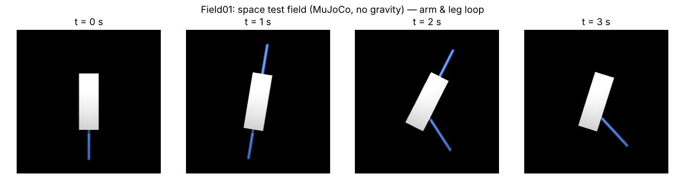
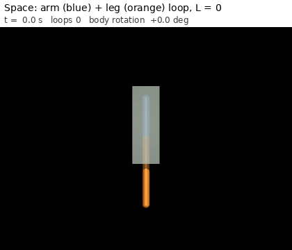
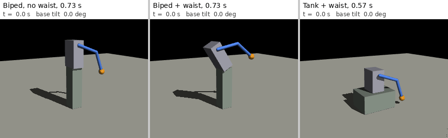
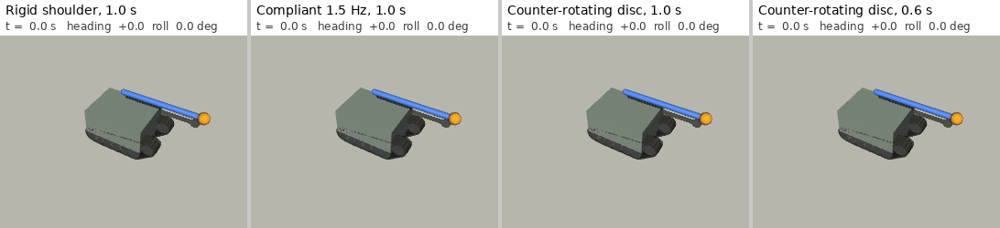
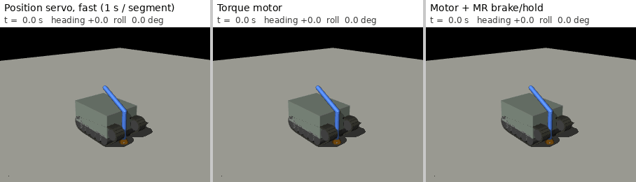

> An unofficial science-fiction commentary by a fan. It has nothing to do with official settings or views of the works. Technical details are in the [entry article](TODO) and the [book (Japanese)](TODO). All calculations are public on [GitHub](https://github.com/okamasaya/simulation_AMBAC).

Change orientation in space by swinging your arms and legs. Stand on the ground with heavy legs. Apply magnet coating to the joints and let an internal skeleton carry the motion.

The science-fiction settings behind *Mobile Suit Gundam* (1979) and its sequels have been seriously examined by many fans for almost half a century. As one fan in that long line, I tried out **AMBAC** (Active Mass Balance Auto Control), the concept at the center of it all, for real — with the equations of physics and a physics engine, on nothing but my own PC.

The conclusion first: **AMBAC is physically sound.** And when you try to make the machine faster, the next problem is **"how to stop"**. That turned out to be remarkably similar to the order in which the technology evolved in the story's world.

## What is AMBAC?

AMBAC is not a line from the show; it is said to have been presented as science-fiction background in the 1981 book *Gundam Century*. In space there's no ground or air to push against. So how can a mobile suit change orientation by swinging its limbs? The answer was AMBAC: "turn the body by the reaction of moving the limbs".

It may sound far-fetched, but it really happens. A cat dropped on its back twists in mid-air and lands on its feet; an astronaut can reorient without holding on to anything. Same principle. Recently, astronaut Takuya Onishi, staying on the International Space Station, compared controlling his attitude with his legs to AMBAC, and fans loved it.

But "physically possible" and "usable like in the show" are different things. As a fan, I can't stop there. This article checks four questions in turn:

1. Can AMBAC really turn you to any orientation?
2. Does it work for an 18-meter giant?
3. Is it true that "the legs are just decoration"?
4. If you make the machine move faster, what becomes the next problem?

## Can you really turn by swinging your limbs?

**Swing an arm, bring it back, and you're back where you started.** In a humanoid model floating in space, swinging one arm forward turns the body the opposite way. But bring the arm back, and the body returns to its original orientation, because without external forces the body's total "tendency to rotate" (angular momentum) stays at zero. That's no better than shaking your head.

**Move two joints "out of step", and you turn a little at a time.** So move two joints, an arm and a leg, slightly out of step: raise the arm, raise the leg, lower the arm, lower the leg — so that the two joint angles draw a "loop". When you return to the original posture, only the body's orientation is left slightly shifted. In a human-sized model, that's about 3° per cycle. Repeat it, and you can face any direction.

**The angle depends on the "shape", not the "speed".** What's interesting is that how much you turn per cycle doesn't depend on how fast you move your limbs — only on the shape and size of the loop. Slow or fast, one cycle turns you by the same angle. Physicists call this a "geometric phase", and it has been studied as the falling-cat problem. The size of the shift is set by the "area" enclosed by the loop (more precisely, the sum of each spot's effectiveness times its area).

**The physics engine gives the same answer.** I also checked this with MuJoCo, a physics engine used in robotics research. One arm swing gives −16.04°, one arm-and-leg loop about +2.97°, matching the hand-written calculation to several decimal places.

*The "space test field" inside the physics engine. A humanoid model with arms and legs on its body changes orientation while drawing loops (0–3 s)*

> **Verdict: AMBAC is physically sound.** Draw loops with your limbs and you can turn to any orientation without propellant.

**Column: a satellite's "flywheel" is a relative of AMBAC.** A satellite spins an internal disc (a reaction wheel) and changes orientation by the reaction. Think of it as AMBAC with "a joint that can keep turning forever", and the same equation explains it. Limbs stop at their range of motion, so they need loops; a disc can spin round and round, so it doesn't. In exchange, the disc's spin has an upper limit, and when it's reached you must "dump the momentum" with propellant. AMBAC sits on the same line as spacecraft technology.

## The 18-meter wall

So can an 18-meter-class machine use AMBAC? I scaled the human-sized model up by 10 (same density, so 1000 times heavier: about 76 tonnes) and computed.

**The angle stays the same, but it gets slow.** The angle per loop is the same at any size. The problem is speed. With 10 times the length, the force (torque) needed to swing the limbs at the same speed becomes 100,000 times larger (5th power of size). Meanwhile, scaling up a motor of the same technology only gives 1000 times the torque (3rd power). The so-called "square–cube law".

| Machine size (height) | 0.9 m | 1.8 m | 18 m | 36 m |
|---|---|---|---|---|
| Time to turn 90° with AMBAC alone | 6.6 s | 13 s | **132 s** | 263 s |

*With motors scaled geometrically, the time grows in proportion to the machine's size*

A 90° turn that takes a dozen seconds at human size takes over 2 minutes at 18 meters. To turn nimbly in a few seconds like in the show, you'd need about 170 times the geometrically scaled motor — **"muscles" more than two orders of magnitude stronger than today's motors**. Conversely, the smaller you are, the faster AMBAC gets. A cat can twist in an instant because it lives on the "small side" of this law.

**Sharing the job with thrusters.** A chemical thruster can turn 90° in 10 seconds with only about 44 kg of propellant. AMBAC uses no propellant but is slow. Leave quick turns to thrusters; use AMBAC for slow adjustments, or when you want to save propellant. That's the physically sensible way to use it. And when you've run out of propellant, or don't want your exhaust to give away your position, AMBAC's "zero propellant" becomes a decisive advantage.

> **Verdict: giant machines can use AMBAC, but slowly.** The agility in the show would need joints two orders of magnitude better.

## Are "the legs just decoration"?

There's a line every fan has quoted at least once. About a machine without legs, a mechanic says "those are just decoration". As it spread, it became known as "legs are just decoration". So, physically, are legs decoration? The answer was: "depends on the situation".

**In space, legs are not decoration.** Legs are heavier and longer than arms, so in AMBAC they are the most effective "heavy limbs". At the same total weight, a machine without legs gained about 40 % less rotation per cycle (9.6° → 5.7°). Conversely, concentrating propellant tanks or armor in the legs makes AMBAC even stronger (12.9°). Ironically, space — where the line was spoken — is exactly where legs are most useful. Still, in a short battle where you can burn all your propellant, thrusters alone suffice, so the "decoration" verdict has its logic too.

**On flat ground, almost decoration.** A machine standing on two legs has a narrow support under its soles and a high center of mass. In the calculation, just holding a 10 kg load at the end of the arm made it fall forward, even standing still. Humans can still carry loads on two legs because they **lean a heavy upper body back to balance**. This movement — moving the upper body to cancel the arm's reaction — is a "ground version of AMBAC". Left to the optimizer, it found on its own the same "lean back, then forward" motion people use for heavy loads. But putting the same upper body on a tank-type cart carried the load faster and more stably.

*Biped (no waist / with waist) and tank-type with waist. The biped without a waist falls when it lifts the load*

**On steps, legs win at human size.** A human-sized biped can climb steps more than twice as high as a tank-type. But the square–cube law strikes here too. Scaled to 18 meters, it reverses: with geometrically scaled motors, the legs could only climb a 5 cm step.

| Situation | Verdict | Reason |
|---|---|---|
| Space | **Not decoration** | Legs are the most effective heavy limbs for AMBAC |
| Space, short battle | Decoration | If you may burn all propellant, thrusters suffice |
| Ground, flat | Almost decoration | Tank-type + movable upper body is faster and more stable |
| Ground, steps (human size) | **Not decoration** | Climbs steps over twice as high as a tank-type |
| Ground, steps (18 m) | Decoration | Square–cube law: only 5 cm |

> **Verdict: whether legs are decoration depends on the use.** That's why choosing the lower body's shape for the purpose makes sense.

## Make it faster, and "how to stop" comes next

From here on is the "stage 2" I'm currently working on. I built a "test field" and "stages" inside the PC and assemble machines from a parts list to move them — like trying out a rebuilt machine in the practice mode of a fighting game.

The test machine is a cart with two tracks, carrying an arm with a 10 kg load. Swinging the arm 180° in 1 second turned the whole cart by about 16°. On the ground, friction under the machine absorbs the arm's reaction. But once the reaction exceeds a "threshold", the excess turns or slides the body.

**The body turned when the arm *stopped*.** Looking closely, the reaction when the arm starts swinging stayed within the threshold. What crossed it was **stopping** the arm. The control that brings the arm to the target position (a position servo) lags, the arm falls behind, and in trying to catch up at the end it brakes suddenly. That jolt made the base slip. Much of why "moving fast without thinking looks sloppy" was in this "how to stop".

Trying countermeasures one by one gave some counter-intuitive results.

| Countermeasure | Swing time | Body rotation |
|---|---|---|
| None (position servo) | 1.0 s | +15.7° |
| Compliance in the joint (spring) | 1.0 s | +24.1° (worse) |
| Counter-rotating weight | 1.0 s | −1.4° |
| Counter-rotating weight | 0.6 s | tips over sideways |
| **Change how it stops** | **1.35 s** | **0.00°** |

*Body rotation when swinging the arm (10 kg load, 180°)*

Adding a spring to give the joint "compliance" made the body turn even more. A weight rotating the opposite way cancelled the reaction and kept the heading, but swinging faster then tipped it over sideways. The cheapest and most effective fix was to **keep the stopping force below the threshold and stop with a constant force**. With no extra parts, it swung — faster, actually — while barely turning the body.

## Rethinking magnet coating and the movable frame

**A part dedicated to "stopping and holding".** Since how you stop turned out to be key, I next handed "stopping" to a specialized part: an MR-fluid (magnetorheological fluid) brake. MR fluid is oil mixed with fine iron particles; apply a magnetic field and it stiffens instantly, weaken the field and it turns back into a liquid. In other words, **magnetism lets you freely change the joint's "resistance"**. It's a real material used in car suspensions, prosthetic knees and more.

I compared a motor doing everything ("move, stop, hold") with "move = motor, stop/hold = MR fluid".

| | Move | Stop / hold |
|---|---|---|
| Motor only | Motor (keeps using power) | ← the same motor |
| Separated functions | Motor | MR fluid (magnetically controlled) |
| Human body | Muscles | Ligaments, joint friction |

| | Motor only | **Motor + MR** |
|---|---|---|
| Time to swing the arm 180° | 1.35 s | **1.18 s** |
| Overshoot past the target | 3.9° | **0.2°** |
| Sustainable rate | 9.5 per minute | **20.4 per minute** |
| When power fails | Arm drops, machine tips over | **Drops only 2 mm** |

*Effect of separating roles (arm with 10 kg load; from steps 15–17)*

Speed, precision, energy and safety all improved **at the same time**. With stopping handed to the MR fluid, the motor no longer had to push backwards, and its heat roughly halved. Just holding the arm up, the motor keeps producing 330 W of heat, but holding with MR fluid needs no power. And when the power failed, the motor-only machine dropped its arm and the momentum toppled the whole body, while the MR fluid kept gripping the arm where the power cut out, letting it drop only 2 mm.

**The order of the technology in the story's world.** At this point, we who were running the calculations couldn't help shouting. Recall the technology in the story. In the first series, the hero's machine couldn't keep up with how fast the pilot operated it, and its joints were given magnet coating — in the setting, a technology that uses magnetism to remove lag and resistance in joint motion. In the sequel *Mobile Suit Zeta Gundam* (1985), the "movable frame" appears: an internal skeleton carries the motion, separating roles from the armor.

The order my simulation followed is strikingly similar.

| | 1 | 2 | 3 | 4 |
|---|---|---|---|---|
| The story's world | AMBAC (1981 background) | Response can't keep up with the pilot | Magnet coating | Movable frame (1985) |
| This simulation | Sim01–05: turning by loops | Step 13: the body turns when stopping | Step 14: stop with MR fluid | Steps 15–17: separate motor and MR |

1. First, I confirmed that you can change attitude by swinging the limbs (AMBAC).
2. Trying to move faster, **lag in the joints' response** caused sudden braking that disturbed the machine.
3. The fix was a part that **controls the joint's resistance magnetically** (MR fluid).
4. Further, **separating the parts that move from the parts that stop and hold** improved every performance measure at once.

Steps 2 and 3 correspond to magnet coating; step 4 to the movable frame's idea of "separating roles".

There are differences, of course. In the setting, magnet coating **reduces** the joint's resistance to make it faster, while MR fluid **adds** resistance to stop and hold. The directions are opposite, but what they share is the idea of **controlling the joint's resistance magnetically, case by case**. Remove resistance when you want to move fast; add it when you want to stop. My results suggest you need both.

If, standing on what was known between 1979 and 1985 — conservation of angular momentum, joint response, material properties — someone reasoned that "once the machine gets faster, the next problems are the nature of the joints and how to stop, and after that you need a structure with separated roles", then they were pointing, in advance, close to the optimum my simulation found. I don't know how far the setting intended this. But it seems fair to say that **science-fiction background thought through from the fundamentals of its day still works as a testable hypothesis.**

> **Discussion:** Magnet coating and the movable frame can be read as physically sensible solutions: "control the joint's resistance magnetically" and "separate the moving parts from the stopping parts".

**Column: can AI discover AMBAC on its own?** I taught an AI only "turn the body to the target orientation" and let it learn how to move its limbs. Without any physics, the AI got stuck in a wrong answer: swing the limbs all the way to their range limit and stop. The loop's effect scales with the square of the swing amplitude, so when learning starts from small motions there's almost no hint that "making the loop bigger helps". But give it just the **shape** "draw a loop", and the AI found a loop more efficient than the human-designed circle, reaching 98 % of the theoretical maximum. Humans give the physical "shape", the AI does the fine-tuning — an important idea in robot development today.

## Behind the scenes: no robot, no GPU

I have to be honest here. This is not work from a research institution; it's a hobby investigation by a fan. **There is not a single real robot** in this investigation. And while photorealistic simulation and large-scale AI training are said to need the latest-generation GPUs, I don't have those either. All computation ran on the CPU of an ordinary PC.

So the numbers have limits:

- Motor and MR-fluid numbers are assumed part values. To apply them to real products, replace them with catalog values.
- Phenomena not in the model — deflection of parts, contact details, temperature unevenness in the fluid — are not reproduced.
- The gap between simulation and reality (the so-called sim-to-real problem) itself can't be checked on a PC alone.

Even so, cheap simulation could do some things. First, **test the simulator itself on problems with known answers**: I cross-checked hand-written equations against the physics engine and moved on only after they agreed to several decimal places. Next, I built **a "virtual robot" with hidden answers**: a machine whose weights and inertia were secretly shifted, and confirmed that the hidden values can be recovered from the limb loops and the body's wobble alone with about 1.2 % scatter per trial. (The "≈2 % bias" seen along the way turned out to come from the virtual robot's own calculation method; that story is in chapter 11 of the [book](TODO).) And by checking things visually in animations, I found many bugs numbers alone would miss: an arm passing through the floor, an arm slowly falling after the power was cut.

Cheap simulation is no substitute for a real machine. But it is **a tool for deciding what to bring to the real machine**. My next goal is to check, with an aluminum bar and iPhone IMUs, whether my home-made simulator matches a real rigid body (side story, TODO).

## Closing

AMBAC is physically sound. But it's slow on giant machines, and whether legs are decoration depends on the use. And when you try to make the machine faster, the problem moves to "how to stop", and the answer was "control the joint's resistance magnetically, and separate the moving parts from the stopping parts".

That a nearly half-century-old SF setting and calculations on a 2026 PC followed the same order may be a coincidence. Even so, the SF settings fans have seriously examined are a treasure trove of testable hypotheses. Everything is public — please try moving that machine with your own hands.

**Afterword.** What started as a chat — "so how well does AMBAC actually work?" — somehow ended up with a test field inside a physics engine and calculations of MR-fluid lifetime. Without the analyses of fans before me, who kept seriously asking "could this really be done?", this question would never have been born. If you find a mistake, please tell me. That, too, is one of the joys of SF commentary.

## References

- *Mobile Suit Gundam* (TV anime, 1979, Nippon Sunrise)
- *Mobile Suit Zeta Gundam* (TV anime, 1985, Nippon Sunrise)
- *Gundam Century* (Minori Shobō, 1981); said to be where AMBAC was first presented as SF background
- T. R. Kane and M. P. Scher, "A dynamical explanation of the falling cat phenomenon," *Int. J. Solids and Structures*, 5(7), 663–670, 1969.
- T. R. Kane and M. P. Scher, "Human self-rotation by means of limb movements," *J. Biomechanics*, 3(1), 39–49, 1970.
- R. Montgomery, "Gauge theory of the falling cat," in *Dynamics and Control of Mechanical Systems*, Fields Inst. Commun. 1, AMS, 1993.
- E. Todorov, T. Erez, Y. Tassa, "MuJoCo: A physics engine for model-based control," *IROS*, 2012.
